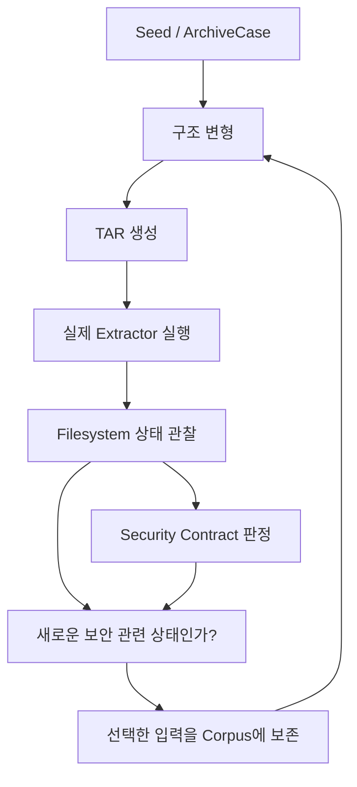

# InodeFence

**TAR 압축 해제 이후의 filesystem 보안 상태를 탐색하는 state-guided fuzzing 연구 프로토타입**

InodeFence는 TAR archive entry를 생성·변형하고, 실제 extractor(압축 해제 프로그램)를 실행한 뒤, filesystem의 보안 관련 상태를 관찰해 archive extraction의 보안 경계 위반을 탐색하려는 프로젝트입니다.
경로뿐 아니라 **파일 객체의 identity와 외부 상태 변화**를 다음 입력을 선택하는 feedback으로 활용할 가치가 있는지 연구합니다.

현재는 **공통 데이터 모델, 최소 단일 실행 pipeline, Generic Mutation v1과 Layer 5 Feedback / Corpus v1**을 구현했습니다. Corpus는 normalized state와 violation novelty를 독립적으로 추적하고 mutation parent를 in-memory로 보존·균등 선택합니다. Python `tarfile`/`data` reference target으로 검증하며, fuzzing loop/campaign runner, adaptive scheduler, persistence와 연구 효과 검증은 후속 작업입니다.

[현재 상태](docs/STATUS.md) · [시작 안내](docs/START_HERE.md) · [아키텍처](docs/research/design/architecture.md) · [Security Contracts](docs/research/design/security-contracts.md) · [개발 가이드](CONTRIBUTING.md)

## 우리가 해결하려는 문제

TAR는 파일 내용과 함께 경로, 링크, 처리 순서를 담습니다. 압축 해제는 이 정보를 읽어 실제 filesystem을 바꾸는 작업입니다.
신뢰할 수 없는 archive를 처리할 때는 지정된 extraction root(압축 해제 목적지) 밖의 파일이 보호되어야 합니다.

기본적인 보안 질문은 다음과 같습니다.

> 압축 파일 안의 경로가 extraction root 밖으로 나갔는가?

InodeFence는 여기에 한 가지 질문을 더합니다.

> 경로가 내부에 있어 보여도, 결과적으로 외부 파일 객체와 연결되거나 외부 상태에 영향을 준 것은 아닌가?

다음은 실제 취약점 재현이 아닌, 확인하려는 객체 관계의 개념 예입니다.

```text
extract/result.txt ─┐
                   ├── 같은 filesystem object
outside/sentinel ──┘
```

두 경로가 같은 파일 객체를 가리키면 내부 파일에 대한 쓰기가 외부 파일의 내용에도 영향을 줄 수 있습니다.
**Object Identity는 경로 이름이 아니라 실제 filesystem object가 같은지 보는 것**입니다. hardlink는 서로 다른 경로가 같은 객체를 가리킬 수 있는 한 예입니다.
symlink도 경로가 실제로 향하는 대상에 영향을 주므로, 경로 문자열만으로 모든 보안 관계를 설명하기는 어렵습니다.

여기서 `outside/sentinel`은 실제 사용자 파일이 아닌 **실험용 보호 파일**입니다. extraction root 밖이지만 disposable sandbox(실행 후 버리는 실험 공간) 안에 둡니다.

## 핵심 아이디어: 입력보다 입력이 만든 상태도 본다

Fuzzing은 입력을 반복해서 바꾸고 실행하며 예상하지 못한 동작을 찾는 탐색 방법입니다.
InodeFence는 TAR를 filesystem을 변화시키는 entry sequence(항목의 순서)로 보고, 그 결과 만들어진 보안 관련 상태를 다음 탐색에 사용하려 합니다.

계획한 흐름은 다음과 같습니다. **아래 루프는 현재 실행 가능한 기능이 아닌 구현 목표**입니다.



`ArchiveCase`는 순서와 중복을 보존하는 immutable TAR 입력 모델입니다.
Mutation(입력 변형)은 entry의 경로, type, link target, 순서, 의존 관계 등을 일반적인 규칙으로 바꾸는 것을 뜻합니다.
Corpus는 다음 변형의 출발점으로 남기는 입력 모음입니다.

특정 CVE의 공격 순서를 생성기에 넣는 대신, 작은 일반 입력에서 출발해 상태에 따라 입력을 선택하는 방식이 목표입니다.
상세 데이터 흐름과 interface 책임은 [architecture.md](docs/research/design/architecture.md)를 따릅니다.

## 무엇을 관찰하는가

초기 Observer(관찰 모듈)는 압축 해제 **전후 snapshot**, 즉 각 시점의 filesystem 상태 기록을 우선합니다.
현재 Observer는 다음 정보를 기록합니다. symlink는 `lstat`과 link text만 관찰하고 referent를 따라 읽지 않습니다.

| 관찰 정보 | 확인하려는 의미 |
| --- | --- |
| path, object type | 어디에 어떤 종류의 객체가 생겼는가? |
| `st_dev`, `st_ino` | 두 경로가 같은 filesystem의 같은 객체를 가리키는가? |
| `st_nlink` | 객체에 연결된 hardlink 수는 얼마인가? |
| mode, size | 권한과 크기가 어떻게 달라졌는가? |
| symlink target | 링크에 기록된 대상은 무엇인가? |
| content hash | 파일 내용이 바뀌었는가? |
| 보호된 sentinel의 전후 상태 | 외부 객체의 존재·내용·metadata에 변화가 있는가? |

**중요한 것은 raw inode 번호 자체보다 객체 사이의 관계와 변화입니다.**
예를 들어 “inode 번호가 123이다”보다 “내부 파일과 외부 sentinel이 같은 객체다”, “외부 sentinel의 내용이 변했다”가 탐색에 의미 있는 정보입니다.

`StateSnapshot = full raw observation/evidence`입니다. Sandbox 전체를 기록하므로 `archive/input.tar`의 SHA-256과 harness metadata도 그대로 보존합니다.
`StateSignature = normalized security-state representation for future feedback/corpus`입니다. `extract/**` 결과와 external 상태·effect, 보호 sentinel 및 내부↔sentinel identity 관계를 사용합니다. `.`과 `archive/**`는 `Region.HARNESS`로 제외하며, 그 외 extraction 밖 경로는 EXTERNAL이므로 root-level `escape.txt`도 유지합니다.

**StateSignature는 ArchiveCase identity나 TAR artifact identity를 직접 포함하지 않습니다.** 서로 다른 case/TAR가 같은 의미의 filesystem/security state를 만들면 같은 signature여야 합니다. 실제 Python reference extraction에서 독립 regular entry의 순서를 바꾸는 E2E regression으로 이 invariant를 확인합니다.
Schema v2는 정렬된 path/type/mode, regular nlink/size/content digest, scope 안의 same-object group, link text와 외부 변경 종류를 담습니다. Directory를 포함한 nonregular nlink는 `None`이며 raw inode·timestamp·ownership 값과 nonregular size를 제외합니다. Raw nlink와 외부 metadata-change labels는 보존하며, 최종 feedback/ablation 정책은 후속 실험에서 정합니다.

**Region.HARNESS는 security trust boundary가 아닙니다.** Signature에서 HARNESS를 제외하는 것은 input/harness novelty 오염을 막기 위한 normalization 정책입니다. C0는 별도로 extraction root 밖의 persistent namespace 생성·삭제·identity/type 교체를 검사하므로 `archive/escaped.txt` 생성이나 기존 `archive/input.tar` 삭제·교체도 evidence입니다. Content/metadata-only 변화는 기존 C0/C2 구분에 따라 C0 조건으로 삼지 않습니다.

**Corpus는 state novelty와 violation novelty를 독립적으로 추적합니다.** 같은 signature라도
새 C0/HARNESS evidence class면 보존할 수 있습니다. Stable violation fingerprint는 contract ID와
path/changed-field 또는 internal/sentinel path 관계만 담으며 raw dev/inode allocation은 제외합니다.
Case/TAR identity와 execution status/duration은 novelty가 아닙니다. 같은 case_id는 한 번만 보존하되
새 outcome의 seen indexes는 갱신하므로 interesting observation이 항상 새 corpus entry는 아닙니다.
상세 API와 정책은 [Feedback / Corpus v1](src/inodefence/feedback/README.md)을 따릅니다.

`run_case()`는 layout·sentinel·input TAR setup 완료 후 BEFORE를 찍고, `target.run()` 종료 직후 bookkeeping/cleanup 이전에 AFTER를 찍습니다. 정상 setup은 baseline에 이미 있으므로 C0가 아닙니다. Snapshot은 생성 주체를 알 수 없으므로 adapter의 harness bookkeeping도 이 관찰 구간 밖에서 처리해야 합니다. 이 lifecycle 없이 HARNESS 변화를 면제하면 실제 boundary escape를 숨길 수 있습니다.

## Security Contracts: 무엇을 위반으로 볼 것인가

Security Contract는 안전한 압축 해제가 지켜야 할 일반화된 보안 규칙입니다.
아래는 이해를 돕는 요약이며, **정확한 정의와 우선순위는 [security-contracts.md](docs/research/design/security-contracts.md)가 기준**입니다.

| ID | Contract | 쉽게 말하면 | 구현 계획 |
| --- | --- | --- | --- |
| C0 | Path Boundary Confinement | 생성하거나 직접 사용하는 경로가 의도한 extraction boundary를 벗어나면 안 됨 | HARNESS 포함 extraction 밖 persistent namespace 변화; direct-use tracing은 이후 |
| C1 | Object Identity Confinement | 내부 객체가 보호된 외부 sentinel과 의도치 않게 같은 객체를 공유하면 안 됨 | post-state lstat identity 공유 판정 |
| C2 | External Effect Noninterference | 압축 해제로 외부 sentinel의 내용·metadata가 의도치 않게 변하면 안 됨 | sentinel 전후 변화 판정 |
| C3 | Extraction Root Integrity | 목적지 자체가 교체·redirect되어 이후 추출이 경계 밖으로 향하면 안 됨 | 최소 pipeline 이후 |
| C4 | Check/Use Coherence | 검증한 경로·객체와 실제 operation에서 사용한 대상의 의미가 일관되어야 함 | instrumentation이 필요한 후속 단계 |

C0는 중요한 기본 검사이며 InodeFence의 신규 기여로 주장하지 않습니다.
Oracle(계약 판정 모듈)은 특정 CVE 식별자나 알려진 PoC byte sequence를 조건으로 삼지 않고, 관찰 사실과 계약을 비교해야 합니다.

## 연구 질문과 검증 기준

핵심 가설은 다음과 같습니다.

> 특정 CVE PoC나 고정된 공격 sequence를 하드코딩하지 않고,
> **generic TAR-entry mutation + filesystem-security-state feedback**을 사용하면
> archive extraction의 보안 경계 위반을 효과적으로 탐색할 수 있는가?

**아직 검증 전인 연구 가설입니다.** 동일한 실행 수·시간 예산에서 더 약한 feedback이나 고정된 공격 전략보다 유용한지 비교해야 합니다.

| 연구 질문 | 확인할 내용 |
| --- | --- |
| 알려진 취약점 재발견 | 해당 CVE PoC를 기본 seed로 주지 않고도 알려진 보안 위반에 도달하는가? |
| Feedback 효과 | random mutation, path-only feedback, fixed attack strategy와 비교해 발견 효율이 달라지는가? |
| Ablation | identity나 external-effect feedback을 제거했을 때 결과가 어떻게 달라지는가? |
| 여러 구현에 대한 적용 | 같은 상태 표현과 generic oracle을 여러 extractor에 적용할 수 있는가? |
| 미지 상태 탐색 | patched/current target에서도 기존에 정의하지 않은 위반 후보를 찾는가? |

Ablation은 구성 요소를 하나씩 빼서 어떤 부분이 효과에 기여하는지 확인하는 비교입니다.
발견 성공률, 첫 위반까지의 시간·실행 수, 서로 다른 보안 상태 등을 측정 후보로 삼되, 정확한 지표와 benchmark version은 평가 전에 고정합니다.
동일 initial corpus, 가능한 동일 mutation operator, 반복 실행과 기록된 random seed로 비교합니다.
Zero-day 발견은 필수 성공 조건이 아닙니다.

정확한 연구 질문과 실험 원칙은 [research-questions.md](docs/research/design/research-questions.md)를 참고하세요.

### 무엇이 새로운 것이라고 주장하지 않는가

다음 각각 자체는 InodeFence의 novelty(신규 연구 기여)가 아닙니다.

- TAR fuzzing, feedback-guided fuzzing
- hardlink 공격, symlink 공격, path traversal
- entry order mutation
- filesystem-state observation, outside-root write detection

Jana & Shmatikov, ZIPDiff, LinkZard, Wormholes 등은 관련 요소를 이미 다루고 있습니다.
InodeFence의 기여 여부는 **선행연구 비교, baseline, ablation, known-vulnerability rediscovery, cross-target experiment**로 평가해야 합니다.
현재 단계에서 “최초”, “기존 fuzzer보다 우수함”, “새로움이 입증됨” 같은 연구 성과를 주장하지 않습니다.
선행연구와의 관계는 [related-work-positioning.md](docs/research/design/related-work-positioning.md)에 정리합니다.

## 범위

| 초기 범위에 포함 | 지금 다루지 않는 것 |
| --- | --- |
| TAR archive extraction | 모든 archive format |
| Linux filesystem semantics | Windows NTFS와 모든 filesystem |
| regular file, directory, hardlink, 필요한 범위의 symlink | 모든 symlink bypass의 재구현 |
| entry path, type, link target, 순서, 의존 관계 변형 | 전체 archive-parser ambiguity 분석 |
| 객체 identity와 external effect, 전후 snapshot | 일반적인 kernel vulnerability, 모든 TOCTOU/race 분석 |
| 상태 기반 corpus 발전과 여러 extractor 적용 평가 | full symbolic execution, 처음부터 eBPF/fanotify full tracing |

Target 구현 우선순위는 **node-tar → oras-go → 일정이 허용하면 GNU tar**입니다.
처음부터 모든 target을 동시에 지원하지 않으며, benchmark용 target version은 별도로 고정합니다.
현재 node-tar/ oras-go adapter는 구현되지 않았습니다.

공격자가 TAR entry를 제어한다고 가정하되, 실행 중 외부 process로 filesystem을 바꾸는 race 모델은 초기 범위에서 제외합니다.
자세한 경계는 [project-scope.md](docs/research/design/project-scope.md)와 [threat-model.md](docs/research/design/threat-model.md)를 따릅니다.

## 전체 시스템 구조와 책임

Runtime Stage는 입력 하나가 처리되는 순서입니다. 개발 진척도를 나타내는 Layer와는 다릅니다.

```text
Seed / ArchiveCase
→ Structure Mutator
→ TAR Builder
→ Target Adapter
→ State Observer
→ Security Oracle
→ Feedback / Corpus
→ next mutation
```

| 모듈 | 책임 |
| --- | --- |
| Seed Generator | 작고 설명 가능한 초기 입력 생성 |
| Structure Mutator | target에 종속되지 않은 entry 구조 변형 |
| TAR Builder | 논리적 입력을 실제 TAR로 표현 |
| Target Adapter | 실제 extractor 실행과 프로세스 결과 기록 |
| State Observer | filesystem에서 관찰한 사실 기록 |
| Security Oracle | Security Contract 위반 여부 판정 |
| Feedback / Corpus | 상태 표현과 판정 결과를 바탕으로 다음 탐색에 남길 입력 선택 |

**Observer = 사실 기록 · Oracle = 계약 판정 · Feedback = 탐색 가치 판단**

> **Interesting ≠ Vulnerable**
>
> 새롭거나 탐색 가치가 있는 상태가 곧 취약점은 아닙니다. 위반 후보는 재현과 원인 분석을 거쳐야 합니다.

관찰 상태는 계약 판정과 비교 가능한 State Signature(상태 요약)로 나뉘어 활용됩니다.
Target-specific 실행 로직은 adapter에 두고, generic mutation·observer·oracle·feedback에 특정 target/CVE 로직을 섞지 않습니다.
상세 구조의 기준은 [architecture.md](docs/research/design/architecture.md)입니다.

## 현재 구현 상태

**Layer 2, Layer 3의 최소 관찰 pipeline, Layer 4 Generic Mutation v1과 Layer 5 Feedback / Corpus v1을 구현했습니다.** 최신 상태와 다음 작업은 [STATUS.md](docs/STATUS.md)에서 관리합니다. Feature branch의 구현 상태 표시는 main merge를 의미하지 않습니다.

| 개발 Layer | 상태 |
| --- | --- |
| Layer 0 — 개발환경 | 완료 |
| Layer 1 — 연구 기반 / 범위 / 아키텍처 | 완료 |
| Layer 2 — 공통 Data Model | 완료: archive, execution, snapshot, signature, evidence/result |
| Layer 3 — Minimal End-to-End Pipeline | 완료: Python reference target, C0 관찰 범위 제한 |
| Layer 4 — Generic Mutation | v1 구현: 8개 독립 operator와 uniform baseline |
| Layer 5 — Feedback / Corpus | v1 구현: 독립 novelty, in-memory retention, uniform caller-RNG 선택 |
| Layer 6 — Baseline / Evaluation / Paper | 미진행 |

현재 코드에 있는 기반은 다음과 같습니다.

- Ubuntu 24.04 / Python 3.12 Dev Container, Linux runtime volume, hardlink/symlink 환경 검사
- Codex CLI rolling latest 정책
- `make check`: Ruff, Pyright, pytest, 환경 검사, 문서 integrity 검사
- GitHub Actions CI, Issue Forms, scoped AGENTS와 PR 협업 규칙
- regular file / directory / hardlink / symlink TAR baseline fixture 4종과 결정적 재생성 script
- extraction 후 metadata와 객체 관계를 출력하는 수동 filesystem probe
- finding disclosure 정책과 검증된 experiment summary 보관 규칙

- 결정적 USTAR builder, disposable sandbox, 실제 reference worker, pre/post Observer
- C0/C1/C2 structured evidence, portable signature, versioned canonical JSON export
- 실제 Linux filesystem과 E2E semantics 테스트
- caller-owned RNG와 canonical ArchiveCase를 사용하는 [Generic Mutation v1](src/inodefence/mutator/README.md); builder와 별도 모듈이며 adaptive scheduler는 이후 구현
- inspectable FeedbackDecision, compact CorpusEntry와 immutable CorpusStats를 제공하는 [Feedback / Corpus v1](src/inodefence/feedback/README.md); full RunResult를 corpus에 저장하지 않음

Python reference는 architecture 검증과 baseline용이며 **node-tar를 대체하는 최종 benchmark target이 아닙니다.** 실행 수로 제한한 [캠페인 API](src/inodefence/campaign.py)는 구현됐습니다. 평가 결과와 확인된 finding은 아직 없습니다.

## 개발 환경과 현재 실행 가능한 명령

macOS 또는 Windows + WSL2에서 저장소를 **VS Code Dev Container**로 엽니다.
기준 환경은 Ubuntu 24.04 + Python 3.12입니다.

```text
macOS / Windows + WSL2
        ↓
VS Code Dev Container
        ↓
Ubuntu 24.04 + Python 3.12
```

소스는 `/workspaces/InodeFence`, filesystem 실험은 `$INODEFENCE_RUNTIME_ROOT`(현재 `/var/lib/inodefence`)에 둡니다.
Host와 공유하는 source bind mount를 실험 공간으로 쓰지 않고 Linux runtime volume을 사용해 filesystem 의미론과 소스 보관 영역을 분리합니다.

컨테이너 안에서 실행합니다.

```bash
# 최초 개발 의존성 설치
make install

# 코드·타입·환경·문서 통합 검증
make check

# 안전한 baseline TAR 4종 재생성
make fixtures

# hardlink baseline 압축 해제 후 상태 출력
make probe CASE=hardlink
```

Probe는 Python `tarfile`의 `data` filter를 사용하는 학습·관찰 도구입니다.
임시 sandbox를 사용하고 실행 후 정리합니다. 기본 CASE는 `regular-file`이며 `directory`, `hardlink`, `symlink`도 지원합니다.
이 명령은 node-tar/ oras-go adapter나 자동 security oracle을 실행하지 않습니다. 실제 fuzzer 실행 명령은 아직 없습니다.

최초 `make install` 후 Dev Container의 Python에서 내부 API를 실행할 수 있습니다.

```python
import random

from inodefence.feedback import Corpus
from inodefence.model import ArchiveCase, ArchiveEntry, EntryType, canonical_json
from inodefence.mutator import mutate
from inodefence.pipeline import run_case
from inodefence.targets import PythonTarfileTarget

case = ArchiveCase(
    (
        ArchiveEntry("a.txt", EntryType.REGULAR, content=b"hello inodefence"),
        ArchiveEntry("b.txt", EntryType.HARDLINK, link_target="a.txt"),
    )
)
result = run_case(case, PythonTarfileTarget())
assert result.execution.succeeded
assert all(not verdict.violated for verdict in result.violations)
record = canonical_json(result)  # sandbox 정리 후에도 case·snapshot·evidence 보존

corpus = Corpus()  # 한 caller-controlled campaign context에 속하는 in-memory search state
decision = corpus.consider(result)
rng = random.Random(1234)
parent = corpus.select_case(rng)
child = mutate(parent, rng)  # 개별 API도 caller 수준에서 조합 가능

from inodefence.campaign import CampaignConfig, run_campaign
from inodefence.generator import minimal_seed_corpus

campaign = run_campaign((case,), PythonTarfileTarget(), CampaignConfig(1234, 25))
assert len(campaign.steps) == 25

# 고정된 4종 정상 seed를 사용할 때도 명시적으로 전달
seeded = run_campaign(minimal_seed_corpus(), PythonTarfileTarget(), CampaignConfig(11, 25))
```

Corpus retention은 다음 mutation parent로 보존한다는 뜻입니다. 새로운 normalized state나
contract-violation evidence class가 자동으로 취약점은 아닙니다. Campaign은 명시적 initial cases를 먼저 순서대로 실행합니다. Seed 실행도 budget에 포함하며
중복 initial case ID, 빈 seed와 부족한 budget은 거부합니다. Parent 선택과 mutation은 하나의
campaign-owned RNG를 사용하고 no-op도 재시도 없이 한 번 실행합니다. 네 target status는 모두
기록하고 harness 오류는 그대로 전달합니다. Steps는 zero-based index, parent ID, full RunResult와
feedback을 보존하므로 메모리는 O(execution_budget)이며 개별 evidence 크기에도 비례합니다.
Config/initial IDs와 admission order는 결과에 남지만 commit/environment provenance와 disk export는
아직 caller 책임입니다. Corpus v1은 persistence나 완전한 campaign key를 제공하지 않습니다.

`violated=False`는 관찰 범위 안에서 증거가 없다는 뜻입니다. Snapshot은 일시적 operation이나 sandbox 밖의 상태를 증명하지 못합니다. C0 namespace 변화와 C2 content/metadata effect를 구분하며, 관찰 오류는 harness 오류로 올립니다. Runtime directory는 cleanup 경계이고 임의 executable을 가두는 OS sandbox가 아닙니다. Unsafe benchmark adapter에는 추가 process/filesystem isolation이 필요합니다. 상세 API와 한계는 [architecture](docs/research/design/architecture.md)와 [계약 구현 범위](docs/research/design/security-contracts.md)를 따릅니다.

Codex CLI는 exact version으로 고정하지 않는 **rolling latest** 정책입니다.
설정·업데이트 방법은 [.devcontainer/README.md](.devcontainer/README.md), baseline 설명은 [TAR baseline 안내](docs/examples/tar-baseline.md)를 참고하세요.

## 팀 개발 방식

InodeFence는 coding agents를 적극 활용하는 **AI-assisted development** 프로젝트입니다.
작업 목표, 현재 Layer, 수정 가능·금지 영역, 완료 조건을 Task Contract로 확정한 뒤 작은 작업 단위로 진행합니다.

```text
Issue → Task Contract → Branch → Human / Coding Agent implementation
→ make check → PR → CI → Human Review → Merge
```

AI가 작성했거나 CI를 통과했다는 이유만으로 자동 merge하지 않습니다.
사람이 architecture 판단, 모듈 책임과 연구 가정을 이해하고 리뷰해야 합니다.
코딩 에이전트는 `START_HERE → STATUS → AGENTS` 순서로 문맥을 확인하고 현재 Layer 범위에서 작업합니다.
협업 규칙은 [CONTRIBUTING.md](CONTRIBUTING.md)와 [AGENTS.md](AGENTS.md)를 따릅니다.

## 실험에서 논문 근거까지

실험 설정과 실행 기록, 확인된 결과, 논문 주장을 구분해 보관합니다.
계획한 evidence 흐름은 다음과 같습니다.

```text
Experiment Config → Raw Execution → Validated Summary
→ Finding / Measurement → Figure / Table → Paper Claim
```

> **Raw result ≠ Paper claim**

실행 로그에 보인 현상을 바로 연구 결론으로 쓰지 않습니다.
위반 후보는 재현·최소화·원인 분석을 거치고, 측정 결과는 설정과 원본 근거를 연결해 검토한 뒤 논문에 사용합니다.

실험 재현성에는 InodeFence commit, target/version, Python/runtime, config, random seed, execution budget, OS/architecture와 결과에 영향을 주는 dependency version을 기록합니다.
Codex CLI 버전은 formal experiment reproducibility 기준에 포함하지 않습니다.

[experiments](experiments/README.md)는 설정·raw 기록과 [검증 요약](experiments/summaries/README.md), [findings](findings/README.md)는 개별 사례의 재현·검토 근거, [paper](paper/README.md)는 논문에 사용할 준비가 된 자료를 담당합니다.
현재는 보관 구조와 규칙이 마련되어 있으며 실험 결과나 finding이 있는 단계는 아닙니다.

## 보안 연구 안전 정책

- 실제 host의 민감 파일, SSH key, 사용자 문서, secret을 실험 대상으로 사용하지 않습니다.
- Disposable sandbox와 실험용 sentinel만 사용하며 파괴적인 filesystem 작업은 runtime sandbox 안으로 제한합니다.
- 확인되지 않은 finding은 공개 Issue에 올리지 않습니다.
- Vendor coordination 전 실제 취약점 exploit/PoC를 public branch에 commit하지 않습니다. 공개 시점과 범위는 별도 팀 검토·공개 결정을 따릅니다.

Git 이력과 CI 로그도 향후 공개될 수 있는 자료로 취급합니다.
재현·검토·vendor coordination·공개 절차의 기준은 [SECURITY.md](SECURITY.md)입니다.

## Repository Map

아래 엔진 경로는 책임 배치이며 전체 pipeline 구현 완료를 의미하지 않습니다.

```text
src/inodefence/      엔진 소스와 모듈 책임 안내
tests/             자동 테스트와 안전한 TAR fixture
scripts/           개발·검증·수동 probe 도구
docs/research/     연구 근거와 상세 설계
experiments/       configs / raw / validated summaries
findings/          private / published finding 보관 흐름
paper/             논문용 자료와 검토된 evidence
```

폴더별 상세 책임은 [엔진 모듈 지도](src/inodefence/README.md)와 [문서 지도](docs/README.md)를 참고하세요.

## 어디부터 읽으면 되는가

| 읽는 목적 | 문서 |
| --- | --- |
| 처음 프로젝트 이해하기 | [START_HERE](docs/START_HERE.md) |
| 현재 단계와 다음 작업 확인 | [STATUS](docs/STATUS.md) |
| 전체 시스템과 모듈 책임 | [architecture](docs/research/design/architecture.md) |
| 보안 판정의 정확한 기준 | [security-contracts](docs/research/design/security-contracts.md) |
| 연구 질문과 선행연구 관계 | [research-questions](docs/research/design/research-questions.md) · [related-work-positioning](docs/research/design/related-work-positioning.md) |
| 개발 참여와 에이전트 작업 규칙 | [CONTRIBUTING](CONTRIBUTING.md) · [AGENTS](AGENTS.md) |
| 개발환경 설정 | [.devcontainer](.devcontainer/README.md) |
| 실험 설정과 결과 보관 | [experiments](experiments/README.md) |
| Finding 검토와 공개 | [SECURITY](SECURITY.md) · [findings](findings/README.md) |
| 논문용 근거와 자료 | [paper](paper/README.md) |

README는 프로젝트의 입구입니다. 세부 정의는 각 canonical 문서를 따르며, 연구 메모나 계획을 검증된 성과로 취급하지 않습니다.
