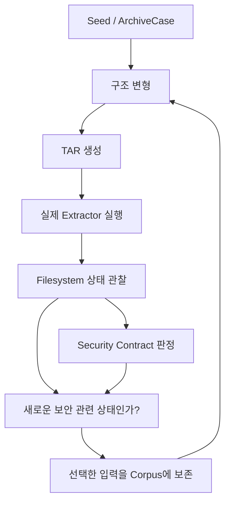

# InodeFence

**TAR 압축 해제 이후의 filesystem 보안 상태를 탐색하는 state-guided fuzzing 연구 프로토타입**

InodeFence는 TAR archive entry를 생성·변형하고, 실제 extractor(압축 해제 프로그램)를 실행한 뒤, filesystem의 보안 관련 상태를 관찰해 archive extraction의 보안 경계 위반을 탐색하려는 프로젝트입니다.
경로뿐 아니라 **파일 객체의 identity와 외부 상태 변화**를 다음 입력을 선택하는 feedback으로 활용할 가치가 있는지 연구합니다.

**지금 돌아가는 것:** `make demo` 한 명령으로 실제 node-tar **7.5.22**를 격리
컨테이너에서 실행하며 "입력 생성 → 실행 → entry별 중간 상태 관찰 → C0/C1/C2 판정 → feedback →
다음 mutation 선택" 루프를 돌립니다. 같은 seed·budget이면 같은 루프가 재현됩니다.
현재 능력은 [STATUS](docs/STATUS.md)의 Capability Ledger가 기준이고, 11/2 중간발표 목표는
배경 문서 [MIDTERM_GOALS](docs/MIDTERM_GOALS.md)에 있습니다.

연구 정의와 claim 범위는 [Research Contract v1](docs/research/design/research-contract-v1.md)이
관리합니다. 2026-10-18 이전 Layer별 이력(capability baseline `8ad07b8`)은 STATUS 하단에 있습니다.

**DESIGNED / IMPLEMENTED / TESTED / EXPERIMENTALLY VALIDATED는 서로 다릅니다.**
Historical vulnerability rediscovery(N01)는 성공 조건으로 실행·주장하지 않습니다. 초기 비교는 arm 간 어휘가 달라 폐기했고, 어휘를 맞춘 R/D/S-u 설계로 다시 실험했다. 역사적 취약점을 재발견한 적이
없고 현재 취약점을 주장하지 않습니다. 첫 intended qualification pair는 **N01 node-tar
7.5.2 / 7.5.3**입니다. 과거 감사·요약은 자체 revision의 기록이며 현재 capability baseline이 아닙니다.

[현재 상태](docs/STATUS.md) · [시작 안내](docs/START_HERE.md) · [아키텍처](docs/research/design/architecture.md) · [Security Contracts](docs/research/design/security-contracts.md) · [개발 가이드](CONTRIBUTING.md)

## 우리가 해결하려는 문제

TAR는 파일 내용과 함께 경로, 링크, 처리 순서를 담습니다. 압축 해제는 이 정보를 읽어 실제 filesystem을 바꾸는 작업입니다.
신뢰할 수 없는 archive를 처리할 때는 지정된 extraction root(압축 해제 목적지) 밖의 파일이 보호되어야 합니다.

기본적인 보안 질문은 다음과 같습니다.

> 압축 파일 안의 경로가 extraction root 밖으로 나갔는가?

InodeFence는 여기에 한 가지 질문을 더합니다.

> 경로가 내부에 있어 보여도, 결과적으로 외부 파일 객체와 연결되거나 외부 상태에 영향을 준 것은 아닌가?

다음은 실제 취약점 재현이 아닌, 확인하려는 객체 관계의 개념 예입니다.

```text
extract/result.txt ─┐
                   ├── 같은 filesystem object
outside/sentinel ──┘
```

두 경로가 같은 파일 객체를 가리키면 내부 파일에 대한 쓰기가 외부 파일의 내용에도 영향을 줄 수 있습니다.
**Object Identity는 경로 이름이 아니라 실제 filesystem object가 같은지 보는 것**입니다. hardlink는 서로 다른 경로가 같은 객체를 가리킬 수 있는 한 예입니다.
symlink도 경로가 실제로 향하는 대상에 영향을 주므로, 경로 문자열만으로 모든 보안 관계를 설명하기는 어렵습니다.

여기서 `outside/sentinel`은 실제 사용자 파일이 아닌 **실험용 보호 파일**입니다. extraction root 밖이지만 disposable sandbox(실행 후 버리는 실험 공간) 안에 둡니다.

## 핵심 아이디어: 입력보다 입력이 만든 상태도 본다

Fuzzing은 입력을 반복해서 바꾸고 실행하며 예상하지 못한 동작을 찾는 탐색 방법입니다.
InodeFence는 TAR를 filesystem을 변화시키는 entry sequence(항목의 순서)로 보고, 그 결과 만들어진 보안 관련 상태를 다음 탐색에 사용하려 합니다.

아래 루프는 bounded Python reference campaign에서 실행 가능합니다. Third-party generated-input campaign은 검증된 OS 격리 전까지 허용하지 않습니다.



`ArchiveCase`는 순서와 중복을 보존하는 immutable TAR 입력 모델입니다.
Mutation(입력 변형)은 entry의 경로, type, link target, 순서, 의존 관계 등을 일반적인 규칙으로 바꾸는 것을 뜻합니다.
Corpus는 다음 변형의 출발점으로 남기는 입력 모음입니다.

특정 CVE의 공격 순서를 생성기에 넣는 대신, 작은 일반 입력에서 출발해 상태에 따라 입력을 선택하는 방식이 목표입니다.
상세 데이터 흐름과 interface 책임은 [architecture.md](docs/research/design/architecture.md)를 따릅니다.

## 무엇을 관찰하는가

초기 Observer(관찰 모듈)는 압축 해제 **전후 snapshot**, 즉 각 시점의 filesystem 상태 기록을 우선합니다.
현재 Observer는 다음 정보를 기록합니다. symlink는 `lstat`과 link text만 관찰하고 referent를 따라 읽지 않습니다.

| 관찰 정보 | 확인하려는 의미 |
| --- | --- |
| path, object type | 어디에 어떤 종류의 객체가 생겼는가? |
| `st_dev`, `st_ino` | 두 경로가 같은 filesystem의 같은 객체를 가리키는가? |
| `st_nlink` | 객체에 연결된 hardlink 수는 얼마인가? |
| mode, size | 권한과 크기가 어떻게 달라졌는가? |
| symlink target | 링크에 기록된 대상은 무엇인가? |
| content hash | 파일 내용이 바뀌었는가? |
| 보호된 sentinel의 전후 상태 | 외부 객체의 존재·내용·metadata에 변화가 있는가? |

**중요한 것은 raw inode 번호 자체보다 객체 사이의 관계와 변화입니다.**
예를 들어 “inode 번호가 123이다”보다 “내부 파일과 외부 sentinel이 같은 객체다”, “외부 sentinel의 내용이 변했다”가 탐색에 의미 있는 정보입니다.

`StateSnapshot = full raw observation/evidence`입니다. Sandbox 전체를 기록하므로 `archive/input.tar`의 SHA-256과 harness metadata도 그대로 보존합니다.
`StateSignature = normalized security-state representation for feedback/corpus`입니다. `extract/**` 결과와 external 상태·effect, 보호 sentinel 및 내부↔sentinel identity 관계를 사용합니다. `.`과 `archive/**`는 `Region.HARNESS`로 제외하며, 그 외 extraction 밖 경로는 EXTERNAL이므로 root-level `escape.txt`도 유지합니다.

**StateSignature는 ArchiveCase identity나 TAR artifact identity를 직접 포함하지 않습니다.** 서로 다른 case/TAR가 같은 의미의 filesystem/security state를 만들면 같은 signature여야 합니다. 실제 Python reference extraction에서 독립 regular entry의 순서를 바꾸는 E2E regression으로 이 invariant를 확인합니다.
Schema v3는 정렬된 path/type/mode, regular nlink/size/content digest, scope 안의 same-object group, link text와 외부 변경 종류를 담습니다. Symlink target은 `run:<raw suffix>` 또는 `literal:<raw target>`으로 tag하며 반복 slash와 `..` spelling을 보존하고 referent를 resolve하지 않습니다. V2 key 호환성이나 migration은 제공하지 않습니다. Directory를 포함한 nonregular nlink는 `None`이며 raw inode·timestamp·ownership 값과 nonregular size를 제외합니다. Raw nlink와 외부 metadata-change labels는 보존합니다.

**Region.HARNESS는 security trust boundary가 아닙니다.** Signature에서 HARNESS를 제외하는 것은 input/harness novelty 오염을 막기 위한 normalization 정책입니다. C0는 별도로 extraction root 밖의 persistent namespace 생성·삭제·identity/type 교체를 검사하므로 `archive/escaped.txt` 생성이나 기존 `archive/input.tar` 삭제·교체도 evidence입니다. Content/metadata-only 변화는 기존 C0/C2 구분에 따라 C0 조건으로 삼지 않습니다.

**Corpus는 state novelty와 violation novelty를 독립적으로 추적합니다.** 같은 signature라도
새 C0/HARNESS evidence class면 보존할 수 있습니다. Stable violation fingerprint는 contract ID와
path/changed-field 또는 internal/sentinel path 관계만 담으며 raw dev/inode allocation은 제외합니다.
Case/TAR identity와 execution status/duration은 novelty가 아닙니다. 같은 case_id는 한 번만 보존하되
새 outcome의 seen indexes는 갱신하므로 interesting observation이 항상 새 corpus entry는 아닙니다.
상세 API와 정책은 [Feedback / Corpus v1](src/inodefence/feedback/README.md)을 따릅니다.

`run_case()`는 layout·sentinel·input TAR setup 완료 후 BEFORE를 찍고, `target.run()` 종료 직후 bookkeeping/cleanup 이전에 AFTER를 찍습니다. 정상 setup은 baseline에 이미 있으므로 C0가 아닙니다. Snapshot은 생성 주체를 알 수 없으므로 adapter의 harness bookkeeping도 이 관찰 구간 밖에서 처리해야 합니다. 이 lifecycle 없이 HARNESS 변화를 면제하면 실제 boundary escape를 숨길 수 있습니다.

## Security Contracts: 무엇을 위반으로 볼 것인가

Security Contract는 안전한 압축 해제가 지켜야 할 일반화된 보안 규칙입니다.
아래는 이해를 돕는 요약이며, **정확한 정의와 우선순위는 [security-contracts.md](docs/research/design/security-contracts.md)가 기준**입니다.

| ID | Contract | 쉽게 말하면 | 현재 구현 / 설계 범위 |
| --- | --- | --- | --- |
| C0 | Path Boundary Confinement | 생성하거나 직접 사용하는 경로가 의도한 extraction boundary를 벗어나면 안 됨 | HARNESS 포함 extraction 밖 persistent namespace 변화; direct-use tracing은 이후 |
| C1 | Object Identity Confinement | 내부 객체가 보호된 외부 sentinel과 의도치 않게 같은 객체를 공유하면 안 됨 | post-state lstat identity 공유 판정 |
| C2 | External Effect Noninterference | 압축 해제로 외부 sentinel의 내용·metadata가 의도치 않게 변하면 안 됨 | sentinel 전후 변화 판정 |
| C3 | Extraction Root Integrity | 목적지 자체가 교체·redirect되어 이후 추출이 경계 밖으로 향하면 안 됨 | DESIGNED, 미구현 |
| C4 | Check/Use Coherence | 검증한 경로·객체와 실제 operation에서 사용한 대상의 의미가 일관되어야 함 | instrumentation이 필요한 후속 단계 |

현재 C0/C1/C2는 **persistent snapshot** detector입니다. 두 capture 사이의 transient effect,
sandbox 밖 접근, direct-use, symlink referent identity와 inode reuse를 완전히 판정하지 못합니다.
`violated=False`는 관찰 범위 내 증거가 없다는 뜻이며 safety proof가 아닙니다.

C0는 중요한 기본 검사이며 InodeFence의 신규 기여로 주장하지 않습니다.
Oracle(계약 판정 모듈)은 특정 CVE 식별자나 알려진 PoC byte sequence를 조건으로 삼지 않고, 관찰 사실과 계약을 비교해야 합니다.

## 연구 질문과 검증 기준

핵심 연구 질문은 다음과 같습니다([research-questions v2](docs/research/design/research-questions.md)).

> 피해 경로 이름을 아는 **동일 어휘·동일 예산** 아래서, filesystem security state(C1 identity·C2 effect)를
> retention·스케줄링 피드백으로 쓰는 탐색이 **무작위 탐색**과 **구조 커버리지 탐색**보다 첫 경계위반까지의
> 실행 수를 줄이고 고유 위반 입력을 더 많이 찾는가?

**아직 검증 전인 연구 가설입니다.** 초기 비교는 arm 간 어휘가 달라 폐기했고, 어휘를 맞춘 R/D/S-u 설계로 다시 실험했다.

| 연구 질문 | 확인할 내용 |
| --- | --- |
| 알려진 취약점 재발견 | 해당 CVE PoC를 기본 seed로 주지 않고도 알려진 보안 위반에 도달하는가? |
| 여러 구현에 대한 적용 | 같은 상태 표현과 generic oracle을 여러 extractor에 적용할 수 있는가? |
| 미지 상태 탐색 | patched/current target에서도 기존에 정의하지 않은 위반 후보를 찾는가? |

발견 성공률, 첫 위반까지의 시간·실행 수, 서로 다른 보안 상태 등을 측정 후보로 삼되, 정확한 지표와 benchmark version은 평가 전에 고정합니다.
동일 initial corpus, 가능한 동일 mutation operator, 반복 실행과 기록된 random seed로 비교합니다.
Zero-day 발견은 필수 성공 조건이 아닙니다.

정확한 연구 질문과 실험 원칙은 [research-questions.md](docs/research/design/research-questions.md)를 참고하세요.

### 무엇이 새로운 것이라고 주장하지 않는가

다음 각각 자체는 InodeFence의 novelty(신규 연구 기여)가 아닙니다.

- TAR fuzzing, feedback-guided fuzzing
- hardlink 공격, symlink 공격, path traversal
- entry order mutation
- filesystem-state observation, outside-root write detection

Jana & Shmatikov, ZIPDiff, LinkZard, Wormholes 등은 관련 요소를 이미 다루고 있습니다.
InodeFence의 기여 여부는 **선행연구 비교, baseline, ablation, known-vulnerability rediscovery, cross-target experiment**로 평가해야 합니다.
현재 단계에서 “최초”, “기존 fuzzer보다 우수함”, “새로움이 입증됨” 같은 연구 성과를 주장하지 않습니다.
선행연구와의 관계는 [related-work-positioning.md](docs/research/design/related-work-positioning.md)에 정리합니다.

## 범위

| 초기 범위에 포함 | 지금 다루지 않는 것 |
| --- | --- |
| TAR archive extraction | 모든 archive format |
| Linux filesystem semantics | Windows NTFS와 모든 filesystem |
| regular file, directory, hardlink, 필요한 범위의 symlink | 모든 symlink bypass의 재구현 |
| entry path, type, link target, 순서, 의존 관계 변형 | 전체 archive-parser ambiguity 분석 |
| 객체 identity와 external effect, 전후 snapshot | 일반적인 kernel vulnerability, 모든 TOCTOU/race 분석 |
| 상태 기반 corpus 발전과 여러 extractor 적용 평가 | full symbolic execution, 처음부터 eBPF/fanotify full tracing |

Target 구현 우선순위는 **node-tar → oras-go → 일정이 허용하면 GNU tar**입니다.
처음부터 모든 target을 동시에 지원하지 않으며, benchmark용 target version은 별도로 고정합니다.
Node-tar는 disposable target container에서 정상 fixture와 tiny benign configured campaign을 실행합니다. Uncontained target은 gate가 거부합니다. GNU-tar adapter와 fuzzing 기반 security evaluation은 다음 단계입니다. oras-go adapter는 구현됐습니다(#176, Ledger M4; adapter 수준 일반성 — affected/fixed 통제 reference 차분과 container-integration 체크, self-discovery native run은 right-censored 음성이라 effectiveness 주장 아님).

공격자가 TAR entry를 제어한다고 가정하되, 실행 중 외부 process로 filesystem을 바꾸는 race 모델은 초기 범위에서 제외합니다.
자세한 경계는 [project-scope.md](docs/research/design/project-scope.md)와 [threat-model.md](docs/research/design/threat-model.md)를 따릅니다.

## 전체 시스템 구조와 책임

Runtime Stage는 입력 하나가 처리되는 순서입니다. 개발 진척도를 나타내는 Layer와는 다릅니다.

```text
Seed / ArchiveCase
→ Structure Mutator
→ TAR Builder
→ Target Adapter
→ State Observer
→ Security Oracle
→ Feedback / Corpus
→ next mutation
```

| 모듈 | 책임 |
| --- | --- |
| Seed Generator | 작고 설명 가능한 초기 입력 생성 |
| Structure Mutator | target에 종속되지 않은 entry 구조 변형 |
| TAR Builder | 논리적 입력을 실제 TAR로 표현 |
| Target Adapter | 실제 extractor 실행과 프로세스 결과 기록 |
| State Observer | filesystem에서 관찰한 사실 기록 |
| Security Oracle | Security Contract 위반 여부 판정 |
| Feedback / Corpus | 상태 표현과 판정 결과를 바탕으로 다음 탐색에 남길 입력 선택 |

**Observer = 사실 기록 · Oracle = 계약 판정 · Feedback = 탐색 가치 판단**

> **Interesting ≠ Vulnerable**
>
> 새롭거나 탐색 가치가 있는 상태가 곧 취약점은 아닙니다. 위반 후보는 재현과 원인 분석을 거쳐야 합니다.

관찰 상태는 계약 판정과 비교 가능한 State Signature(상태 요약)로 나뉘어 활용됩니다.
Target-specific 실행 로직은 adapter에 두고, generic mutation·observer·oracle·feedback에 특정 target/CVE 로직을 섞지 않습니다.
상세 구조의 기준은 [architecture.md](docs/research/design/architecture.md)입니다.

## 현재 구현 상태

실제 node-tar 루프는 `make demo`(호스트, docker 필요)로, node-tar 없는 synthetic 루프는
`make demo-synthetic`(Dev Container)으로 돌립니다. 결과 JSON은 step마다 entry별 중간 상태(`trace`),
C0/C1/C2 판정(`oracle`), 다음 mutation 선택 근거(`selection`)를 담습니다. 정상 입력에서 위반은
0건이며, 취약점 발견이나 재발견을 주장하지 않습니다. M1~M4 상태는 [STATUS](docs/STATUS.md)
Capability Ledger가 기준입니다.

아래 표는 2026-10-18 기준 Layer별 이력입니다.

| 개발 Layer | 기준 main의 capability와 evidence |
| --- | --- |
| Layer 0–2 | Dev Container / 연구 정의 / 공통 model 구현, canonical checks |
| Layer 3 | fresh Linux runtime, actual reference worker, snapshot C0/C1/C2, contained Node benign full path |
| Layer 4 | legacy/M1 eight uniform slots와 A3 no-reorder versions 구현/테스트 |
| Layer 5 | signature v3, independent novelty, B0/B1/B3, A1/A2 keys, deterministic bounded search 구현/테스트 |
| Layer 6 | minimizer, verified export/replay/qualification/dataset/statistics infrastructure 구현/테스트; historical/formal experiments와 paper는 미검증 |

`run_search_campaign` / `SearchCampaignConfig`가 alternative policies를 실행합니다.
Legacy `ExperimentConfig` v1/v2는 B3/legacy mutation만 지원하며 별도 `PolicyEvaluationConfig`는
완료된 policy result의 binding/export/검증을 지원합니다. Automatic policy journal/repetition,
interrupted evidence와 full-pipeline timing의 한계는 [STATUS](docs/STATUS.md)를 따릅니다.
현재 verification/statistics는 관찰된 contract evidence이며 known-class rediscovery나 vulnerability를
자동 판정하지 않습니다. Python reference는 architecture 검증용이고 최종 benchmark target이 아닙니다.
GNU invocation은 benign fixture allowlist에 제한돼 있습니다. oras-go adapter는 구현됐습니다(#176, Ledger M4; adapter 수준 일반성).
Canonical baseline 검증 근거는 [main CI](https://github.com/TheWaitForAGI/InodeFence/actions/runs/37248955432)입니다.

## 개발 환경과 현재 실행 가능한 명령

macOS 또는 Windows + WSL2에서 저장소를 **VS Code Dev Container**로 엽니다.
기준 환경은 Ubuntu 24.04 + Python 3.12입니다.

**필요한 것:** Docker와 Dev Container를 열 수 있는 편집기(VS Code + Dev Containers 확장).
아래 `make` 명령은 Dev Container 안을 전제로 하며, `make demo`처럼 실제 node-tar를 돌리는 명령만
호스트 터미널에서 docker로 실행합니다. 호스트 Python에서 바로 돌리는 경로는 지원하지 않습니다
(`make check`의 환경 검사는 Python 3.12와 Linux runtime 디렉터리 `$INODEFENCE_RUNTIME_ROOT`의
hardlink·symlink 의미론을 요구합니다).

```text
macOS / Windows + WSL2
        ↓
VS Code Dev Container
        ↓
Ubuntu 24.04 + Python 3.12
```

소스는 `/workspaces/InodeFence`, filesystem 실험은 `$INODEFENCE_RUNTIME_ROOT`(현재 `/var/lib/inodefence`)에 둡니다.
Host와 공유하는 source bind mount를 실험 공간으로 쓰지 않고 Linux runtime volume을 사용해 filesystem 의미론과 소스 보관 영역을 분리합니다.

컨테이너 안에서 실행합니다.

```bash
# 최초 개발 의존성 설치
make install
make target-tools  # pinned Node/node-tar lock tooling; target 실행은 별도 image/backend

# 코드·타입·환경·문서 통합 검증
make check

# 안전한 baseline TAR 4종 재생성
make fixtures

# hardlink baseline 압축 해제 후 상태 출력
make probe CASE=hardlink
```

Probe는 Python `tarfile`의 `data` filter를 사용하는 학습·관찰 도구입니다.
임시 sandbox를 사용하고 실행 후 정리합니다. 기본 CASE는 `regular-file`이며 `directory`, `hardlink`, `symlink`도 지원합니다.
이 명령은 node-tar/ oras-go adapter나 자동 security oracle을 실행하지 않습니다. 이 reference campaign CLI는 safe Python reference만 지원합니다. 실제 node-tar effect 캠페인은 `container_host` 컨트롤러 모드(effect-campaign·effect-demo-historical)로 실행합니다(Ledger M1). [개발 pilot](scripts/reference_campaign_pilot.py)과 [설정 기반 CLI](scripts/run_configured_reference.py)가 있습니다.

Exact Python version이 설정과 일치하는 Linux 환경에서 작은 설정 기반 실행을 기록합니다. 예제는 Python 3.12.3이며 다른 patch version에서는 [설정](experiments/configs/README.md)을 명시적으로 갱신해야 합니다.

```bash
python -m scripts.run_configured_reference experiments/configs/reference-smoke-v1.json --output experiments/raw/configured-reference
```

새 output에 `experiment.json`, `manifest.json`, `steps.jsonl`을 보존합니다. Existing output은 거부합니다. Portable Node invocation 검증은 `make check`에 포함되고 실제 fixture 검증은
`container_host ... validate-node-target`와 별도 CI job에서 container로 실행합니다.
이 설정 기반 CLI는 Python reference 전용이며, 실제 node-tar 캠페인은 위의 `container_host` 컨트롤러 모드로 돌립니다.

최초 `make install` 후 Dev Container의 Python에서 내부 API를 실행할 수 있습니다.

```python
import random
from pathlib import Path

from inodefence.campaign import CampaignConfig, run_campaign
from inodefence.campaign_export import export_campaign
from inodefence.feedback import Corpus
from inodefence.generator import minimal_seed_corpus
from inodefence.model import ArchiveCase, ArchiveEntry, EntryType, canonical_json
from inodefence.mutator import mutate
from inodefence.pipeline import run_case
from inodefence.targets import PythonTarfileTarget

case = ArchiveCase(
    (
        ArchiveEntry("a.txt", EntryType.REGULAR, content=b"hello inodefence"),
        ArchiveEntry("b.txt", EntryType.HARDLINK, link_target="a.txt"),
    )
)
result = run_case(case, PythonTarfileTarget())
assert result.execution.succeeded
assert all(not verdict.violated for verdict in result.violations)
record = canonical_json(result)  # sandbox 정리 후에도 case·snapshot·evidence 보존

corpus = Corpus()  # 한 caller-controlled campaign context에 속하는 in-memory search state
decision = corpus.consider(result)
rng = random.Random(1234)
parent = corpus.select_case(rng)
child = mutate(parent, rng)  # 개별 API도 caller 수준에서 조합 가능

campaign = run_campaign((case,), PythonTarfileTarget(), CampaignConfig(1234, 25))
assert len(campaign.steps) == 25

# 고정된 4종 정상 seed를 사용할 때도 명시적으로 전달
seeded = run_campaign(minimal_seed_corpus(), PythonTarfileTarget(), CampaignConfig(11, 25))
manifest, steps = export_campaign(seeded, Path("experiments/raw/example-campaign"))
```

Corpus retention은 다음 mutation parent로 보존한다는 뜻입니다. 새로운 normalized state나
contract-violation evidence class가 자동으로 취약점은 아닙니다. Campaign은 명시적 initial cases를 먼저 순서대로 실행합니다. Seed 실행도 budget에 포함하며
중복 initial case ID, 빈 seed와 부족한 budget은 거부합니다. Parent 선택과 mutation은 하나의
campaign-owned RNG를 사용하고 no-op도 재시도 없이 한 번 실행합니다. 네 target status는 모두
기록하고 harness 오류는 그대로 전달합니다. Steps는 zero-based index, parent ID, full RunResult와
feedback을 보존하므로 메모리는 O(execution_budget)이며 개별 evidence 크기에도 비례합니다.
Config/initial IDs와 admission order는 결과에 남습니다. `export_campaign`은 새 directory에
`manifest.json`과 canonical `steps.jsonl`을 staging 후 공개하고 기존/동시 output을 덮어쓰지 않습니다. Optional immutable config JSON도 stored config ID와 비교해 같은 bundle로 공개합니다. Raw inode/time과
모든 status를 그대로 보존하며 결과를 분석/claim으로 승격하지 않습니다. Manifest의
export_environment는 export한 process의 환경이고 과거 target 실행 환경이 아닙니다.
Campaign은 실행 전 source revision/dirty, process 환경, target/version/timeout/safety와 sentinel digest/mode를 고정해 결과와 manifest에 보존합니다. Supplied source/environment의 정확성은 caller 책임이고 dirty bit는 source patch를 보존하지 않습니다. Formal config ID는 실제 execution provenance와 별개입니다. Corpus v1은 persistence나 완전한 campaign key를 제공하지 않습니다.

`violated=False`는 관찰 범위 안에서 증거가 없다는 뜻입니다. Snapshot은 일시적 operation이나 sandbox 밖의 상태를 증명하지 못합니다. C0 namespace 변화와 C2 content/metadata effect를 구분하며, 관찰 오류는 harness 오류로 올립니다. Runtime directory는 cleanup 경계이고 임의 executable을 가두는 OS sandbox가 아닙니다. Isolation-required target은 validated backend/policy binding이 필요합니다. Snapshot 증거와 OS 실행 경계의 policy/한계는 별도로 기록합니다. 상세 API와 한계는 [architecture](docs/research/design/architecture.md)와 [계약 구현 범위](docs/research/design/security-contracts.md)를 따릅니다.

Codex CLI는 exact version으로 고정하지 않는 **rolling latest** 정책입니다.
설정·업데이트 방법은 [.devcontainer/README.md](.devcontainer/README.md), baseline 설명은 [TAR baseline 안내](docs/examples/tar-baseline.md)를 참고하세요.

## 추출기를 골라 탐색·도중 확인·재실행하기 (`inodefence` 명령)

추출기 하나를 골라 버전을 준비하고, 상태 기반 피드백 탐색을 돌리고, 산출물을 저장소 밖에 쓰는
사용자용 진입점입니다. 실제 target 실행은 docker가 도는 호스트 셸(macOS 터미널, WSL 셸)에서만 되고,
Dev Container 안에서는 `--dry-run`으로 계획만 볼 수 있습니다.

### 설치

Python 3.12와 저장소 클론이 필요합니다. 대상 실행 드라이버(`inodefence.drivers`)는 패키지에 들어 있지만,
이미지 레시피(`tools/`), 컨트롤러 셸 런처(`scripts/local_*.sh`), 어댑터가 쓰는 고정 입력 모듈
(`experiments/repro/`)은 들어 있지 않습니다.

```bash
git clone <저장소 URL> InodeFence && cd InodeFence
python3.12 -m venv .venv && . .venv/bin/activate   # WSL2 Ubuntu 24.04는 python3 = 3.12
pip install -e .            # 개발까지 하려면 make install (= pip install -e '.[dev]')
inodefence --version
inodefence doctor           # 무엇이 준비됐고 무엇이 빠졌는지, 고치는 법
inodefence targets          # 추출기와 각 추출기가 지원하는 것(옵션·탐색) 표
```

설치 후에는 저장소 밖 어느 폴더에서 실행해도 됩니다. 설치 방식에 따라 되는 명령이 다릅니다
(2026-11-16, 깨끗한 venv·저장소 밖 폴더에서 확인):

| 명령 | `pip install -e .`(클론에서) | `pip install .`(wheel)만 | wheel + `INODEFENCE_HOME=<클론>` |
| --- | --- | --- | --- |
| `--version`, `status`, `summary` | 됨 | 됨 | 됨 |
| `doctor` | 됨 | 실행되지만 repository `FAIL`(종료 1) | 됨 |
| `targets`, `verify`, `explore`, `replay` | 됨 | 안 됨: "repository not found", 종료 3 | 됨 |

대상을 돌리는 명령은 이미지 레시피(`tools/`)와 셸 런처(`scripts/`)가 있는 **저장소 클론이 꼭 필요**합니다.
wheel로 설치했다면 `INODEFENCE_HOME`(환경 변수 또는 아래 설정 파일)으로 클론 위치를 알려 줍니다. 이때 `targets`·`verify`·`explore`·`replay`는
그 클론을 작업 폴더로 하고 클론의 `src`를 먼저 읽는 하위 프로세스(`python -m inodefence.drivers.…`)에서 돌므로,
드라이버·엔진·이미지 레시피가 모두 그 클론의 것입니다. 결과의 `engine_commit`·`engine_sha`는 그 클론의 `git rev-parse HEAD`(추적 파일 수정이나 `src`·`scripts`·`tools` 아래 추적 안 된 파일이 있으면 `-dirty`)입니다.
`status`·`summary`·`doctor`는 설치된 패키지 코드로 돌고, 대상 드라이버(`run_target`·어댑터)를 import하지 않습니다.
이 셋이 `drivers` 안에서 쓰는 것은 표준 라이브러리만 쓰는 `drivers/repo.py`(저장소 위치)와 `drivers/runtime/health.py`(Docker·호스트 점검)뿐입니다.
`targets`도 `verify`·`explore`와 같은 clone 코드로 돕니다(0.2.0 RC까지는 CLI 프로세스 안에서 설치본 엔진과 clone 드라이버가 섞였습니다).
고른 clone에 `src/inodefence/__init__.py`와 `src/inodefence/drivers/`가 둘 다 있어야 합니다. 하나라도 없으면(손상된 clone, 또는 `src/inodefence`는 있지만 `drivers/`가 없는 이 버전 이전 레이아웃의 clone) 다른 설치본으로 대신 돌리지 않고 종료 3으로 거부하며, 그 clone을 갱신(`git pull`)하거나 `INODEFENCE_HOME`을 최신 clone으로 바꾸라고 안내합니다.

`doctor`는 각 항목을 `OK`·`FAIL`·`WARN`·`INFO`·`UNKNOWN`으로 출력합니다. 확인하지 못한 것은 `OK`가
아니라 `UNKNOWN`입니다. 로컬 `inodefence-*` 이미지는 있으면 `OK`로 이름을 나열하고, 없으면 `INFO`
(처음 쓸 때 `--auto-prepare`로 빌드)입니다. 다만 어느 이미지가 어느 대상·버전용으로 바로 쓸 수 있는지는
`doctor`가 판단하지 않고, `inodefence verify --target node-tar --version 7.5.2 --dry-run`(읽기 전용)이
셀마다 재사용/준비 계획을 보여 줍니다. 이미지가 없으면 `--auto-prepare`를 줄 때만 Docker로 빌드합니다
(네트워크 필요). `explore`는 실제 실행에 `--auto-prepare`가 필수이고(없으면 아무것도 실행하지 않고 이유를
출력), `--dry-run`에는 필요 없습니다. `$INODEFENCE_RUNTIME_ROOT`(기본 `/var/lib/inodefence`)는 `make check`·
테스트용 개발 전제라 `doctor`에서 없으면 `WARN`이고, `/var/lib/inodefence` 밖이나 symlink로 설정돼 있으면
`FAIL`입니다(그 규칙은 바뀌지 않았습니다).

`doctor`는 끝에 세 줄을 더 출력합니다. 모두 읽기만 하며 아무것도 바꾸거나 지우지 않습니다.

- **남은 컨테이너·볼륨:** InodeFence 소유 라벨(`org.inodefence.smoke-owner`·`org.inodefence.execution-owner`)이
  붙었거나 이름이 런처의 컨트롤러·볼륨 이름(`inodefence-local-controller`, `inodefence-decompress-controller`,
  `inodefence-oras-go-runtime` 등)인 것을 조회합니다. 있으면 `WARN`과 함께 확인 명령
  (`docker container inspect <이름>`)과, 내 것이고 쓰는 실행이 없을 때만 쓸 제거 명령을 보여 줍니다. 도구가
  직접 지우지는 않습니다. Docker가 답하지 않으면 `UNKNOWN`입니다(정리됐다고 보지 않습니다).
- **출력 폴더 디스크 여유:** 2 GiB 미만이면 `WARN`입니다(거부하지 않습니다).
- **Docker 메모리 여유:** 항상 `UNKNOWN`입니다. Windows + WSL2에서 Docker Desktop backend의 메모리는 Windows
  커밋 한도에 걸리는데, WSL 안에서는 그 한도를 볼 수 없습니다(2026-11-16 HOST2 정지 4: WSL 쪽 여유는 충분했지만
  Windows 쪽 가상 메모리 부족과 함께 backend가 사라졌습니다). 이 `UNKNOWN`은 종료 코드에 영향이 없습니다.

### 설정과 출력 위치

| 무엇 | 기본값 | 바꾸는 법 |
| --- | --- | --- |
| 출력 폴더 | `verify`: `~/inodefence-target-run`, `explore`: `~/inodefence-explore` | `--out <폴더>`(상대 경로는 **명령을 실행한 폴더** 기준), 또는 `INODEFENCE_OUTPUT_DIR=<기준 폴더>` → `<기준>/inodefence-target-run`, `<기준>/inodefence-explore` |
| 저장소 위치 | editable 설치면 자동 | `INODEFENCE_HOME=<클론 경로>` |

두 값은 환경 변수로 주거나, [`.env.example`](.env.example)을 `~/.config/inodefence/config.env`로
복사해 적습니다(환경 변수가 파일보다 우선, 다른 파일은 `INODEFENCE_CONFIG`로 지정하며 그 파일이 없으면
오류). 현재 적용된 값과
출처는 `inodefence doctor`가 보여 줍니다.

- **출력은 저장소 밖이어야 합니다.** `--out`이나 기준 폴더가 저장소 안이면 실행 전에 거부합니다
  (위반 입력이 공개 저장소에 섞이지 않도록). 클라우드 동기화 폴더(Google Drive 등)도 피하세요.
  `doctor`와 `verify`·`explore`는 경로에 `Drive`(예: `~/Drive`)·Google Drive·OneDrive·Dropbox 등의 폴더 이름이 보이면
  경고하지만(실행은 막지 않음), 이름이 다른 동기화
  폴더는 알아채지 못합니다.
- **설정 파일로 실험 조건을 바꿀 수 없습니다.** 설정 파일은 위 두 키만 받고, 그 밖의 키(예: seed·budget,
  `INODEFENCE_RUNTIME_ROOT`)는 오류로 거부합니다. seed·arm·budget·실행 SHA·격리 정책은 명령 옵션이나
  동결된 사전등록 파일(`experiments/preregistration/`)에서만 오고, 실험 runtime 폴더
  `INODEFENCE_RUNTIME_ROOT`는 지금처럼 환경 변수로만 정합니다.

### 지원 환경과 확인 수준

- **이 릴리스 후보에서 확인한 호스트:** Windows + WSL2(Ubuntu 24.04, x86_64) + Docker Desktop
  4.99.0 / Engine 29.9.3(HOST4). **macOS는 이 후보에서 확인하지 않았습니다**(아래 #400 기록만 있음).
  그 밖의 Linux 호스트도 확인하지 않았습니다.
- **대상별 검증 수준 (RC 실측: HOST4, demo run, 2026-11-16 08:00~08:04 KST, 엔진 커밋 a5499de, seed 123,
  순차 실행).** "실행 성공"은 하너스가 실행을 끝내고 결과를 남긴 수, "유효 추출"은 추출기가 `success`로 끝난
  수입니다.

  | 대상·버전 | 모드 | 실행 성공 | 유효 추출 | 미판정 | 위반 | replay | 지원 수준 |
  | --- | --- | --- | --- | --- | --- | --- | --- |
  | node-tar 7.5.23 | verify | 5/5 | 0/5 (전부 declined) | 0 | 0 | — | 고정 입력 회귀 (exploratory 버전) |
  | node-tar 7.5.23 | explore 20 | 20/20 | 17/20 (rejected 3) | 0 | 0 | 지원, 실제 위반 E2E 미검증 | 탐색 |
  | python-tarfile 3.12.16 `data` | verify | 5/5 | 0/5 (전부 declined) | 0 | 0 | — | 고정 입력 회귀 |
  | python-tarfile 3.12.16 `data` | explore 20 | 20/20 | 12/20 (failed 5, rejected 3) | 0 | 0 | 미지원 | 탐색 |
  | decompress `@xhmikosr/decompress@11.1.4` | verify | 5/5 | 0/5 (전부 declined) | 0 | 0 | — | 고정 입력 회귀 |
  | decompress `@xhmikosr/decompress@11.1.4` | explore 20 | 20/20 | 11/20 (rejected 9) | 0 | 0 | 미지원 | 탐색 |
  | oras-go 2.6.2 | verify | 6/6 | 0/6 (전부 declined) | 0 | 0 | — | 고정 입력 회귀 |
  | oras-go 2.6.2 | explore 20 | 20/20 | **0/20** (전부 rejected, "추출 성공 0건" 경고) | 0 | 0 | 미지원 | **실험적 — 유의미한 보안 커버리지를 주장하지 않음**(공통 seed가 `d/` 접두 없이 생성돼 대부분 거부) |

  - python-tarfile의 failed 5건은 worker가 보고한 예외(IsADirectoryError 3, FileExistsError 1, KeyError 1)가 종료
    상태와 일치해 판정을 유지했습니다(D1 편차, 아래 판정 규칙).
  - **위반 0은 안전성 증명이 아닙니다.**
  - **고정 입력 회귀의 한계:** `verify`의 고정 입력은 모두 공격 형태이고 정상 입력 대조군이 없습니다. 네 대상 모두
    모든 입력을 거부(declined)했는데, 이것만으로는 모든 입력을 거부하는 고장 난 추출기와 구분할 수 없습니다.
    같은 대상의 탐색에서 나온 유효 추출 수로 보완해 읽으세요.
  - **replay:** 현재 node-tar만 지원하고, 나머지 세 대상은 `replay`가 미지원으로 보고합니다(종료 4). 실제 위반
    케이스에 대한 E2E 재실행은 검증하지 않았고(이 실측에서 위반이 없었음), 합성 사례에 대한 기능 테스트만 있습니다.
  - **macOS:** 이 후보에서는 확인하지 않았습니다.
  - RC 이전 커밋(61afb3f·c55b7ef)에서도 같은 조건의 engineering smoke를 돌렸고 판정은 같았습니다(위반 0).
- **이전 기록:** #400 브랜치의 `make target-run`(같은 드라이버)으로 macOS(arm64)와 WSL2에서 네 대상 고정 입력
  결과를 확인한 기록이 [CHANGELOG](CHANGELOG.md)에 있습니다(2026-11-14, 이 후보에서 재실행 안 함).
- 이 문서의 실행 예는 모두 `demo run` 수준이며 사전등록 실험이나 자격 검증 결과가 아닙니다.

### 탐색 돌리기

```bash
# node-tar의 최신 버전을 준비해 탐색. --out은 반드시 저장소 밖(위반 입력이 섞일 수 있어
# 공개 저장소 안이면 실행 전 거부됩니다). --dry-run이면 계획만 출력하고 아무것도 실행하지 않습니다.
inodefence explore --target node-tar --version latest --budget 400 --seed 7 \
  --out ~/inodefence-explore --auto-prepare

# decompress는 버전 칸에 패키지까지 씁니다: <패키지>@<X.Y.Z> (11.1.4만 주면 --dry-run에서도 종료 3으로 거부)
inodefence explore --target decompress --version @xhmikosr/decompress@11.1.4 --budget 20 \
  --out ~/inodefence-explore --auto-prepare
```

`--version`은 `latest`나 정확한 버전, `--budget`은 실행 수(seed 케이스 수 이상), `--seed`는 난수
seed입니다. 탐색 정책·sentinel 구성은 등록 실험 설정을 기본값으로 쓰며, 끝나면 공통 형식
`result.json`(`inodefence-target-result-v1`, mode=campaign)과 한 장짜리 `summary.md`를 씁니다.

node-tar 탐색(`--version 7.5.23 --seed 123 --budget 20`, engineering smoke 2026-11-16)에서 실제로 생긴 구조:

```text
<--out>/target-explore/
  7.5.23-123-20/live/                 실행 중 갱신: progress.json, fetch.json, violations/run-NNNNNN/
  7.5.23-123-20-result/               끝난 뒤: result.json, summary.md, inputs/
  inodefence-effect-explore-7.5.23-123-20.json (.steps.jsonl, .calls.jsonl)   엔진 원시 기록
```

(`<버전>-<seed>-<budget>` 이름은 node-tar에서 관찰한 것입니다. 다른 대상의 폴더 이름은 아직 실측으로 대조하지 않았습니다.)

### 도중 확인

긴 탐색은 끝나기를 기다리지 않고 실행 중에 봅니다. `--out`에 준 폴더, 그 아래 `target-explore`, 실행 폴더
하나(`…/7.5.23-123-20`), 결과 폴더(`…-result`) 중 아무것이나 줄 수 있습니다.

```bash
inodefence status ~/inodefence-explore   # 진행 스냅샷 + 위반 케이스 목록 (+ 끝났으면 판정 한 줄)
```

끝난 실행에서 `host pull: … failed`가 보일 수 있습니다. 컨트롤러가 뜨기 전이나 지워진 뒤의 복사 실패로,
호스트 쪽 live 사본에 관한 것이고 판정 오류가 아닙니다(`status`가 그 설명을 함께 출력합니다).

탐색은 실행 중에 출력 폴더의 `…/<run>/live/`에 두 가지를 씁니다.

- `progress.json` — 주기적으로(실행 N회마다·일정 시간마다·위반 직후) 갱신되는 한 시점 스냅샷:
  실행 수, 초당 실행, **종료 상태별 수(success·rejected·failed·timed_out)**, 미판정 수와 비율,
  위반 step 수와 고유 fingerprint 수, 쓰기 오류. `status`는 갱신이 오래 멈추면 `STALE`로 경고합니다.
- `violations/run-NNNNNN/` — 위반이 난 케이스를 **발생 즉시** 기록합니다(끝을 기다리지 않음).
  같은 fingerprint의 반복은 개수만 세고 파일은 fingerprint당 처음 몇 개만 남깁니다. 탐색이
  중간에 죽어도 그때까지 쓴 파일은 남습니다.

컨트롤러 컨테이너 안에서 돈 탐색은 호스트가 주기적으로 그 폴더를 가져오므로, 실행 중에도
호스트의 출력 폴더에서 진행과 위반 케이스를 볼 수 있습니다. 가져오기 실패는 탐색을 멈추지 않고
`fetch.json`에 남습니다.

### 위반 케이스 폴더 읽기

각 `violations/run-NNNNNN/`에는 `input.tar`(그 실행에 쓴 정확한 입력)와 `case.json`이 있습니다.
`case.json`에는 케이스·seed·부모·적용된 변이, C0/C1/C2 판정, 종료 상태와 관찰 완결 여부,
fingerprint, 입력의 SHA-256, 그리고 **그 한 건을 같은 이미지에서 다시 돌리는 명령**이 들어 있습니다.

### 종료 상태와 판정은 별개입니다

추출기가 어떻게 끝났는가(종료 상태: success·rejected·failed·timed_out)와 오라클이 무엇을
보았는가(판정: C0/C1/C2)는 서로 다른 축입니다. 오라클은 실행 전후 파일시스템 스냅샷을 비교하므로,
**위반이 보이면 종료 상태와 상관없이 그 실행은 위반으로 판정**되고 FAIL로 잡힙니다(입력도 보존).

위반이 보이지 않은 실행을 "깨끗한 음성"으로 셀지는 탐색(`explore`)에서 다음 규칙(사용자 결정 D1,
2026-11-16)을 따릅니다. 이렇게 세지 않는 실행은 **미판정**입니다.

| 대상 | 위반 없음이 판정(깨끗한 음성)으로 남는 실행 | 미판정이 되는 실행 |
| --- | --- | --- |
| node-tar, decompress | `rejected`; trace가 온전한 `success` | `failed`, `timed_out`; trace가 온전하지 않은 `success` (decompress는 worker 기록이 없는 실행도) |
| python-tarfile | `rejected`; worker 보고가 종료 상태와 일치하는 `failed`(tarfile이 예외로 거부한 것, D1과의 의도된 편차); trace가 온전한 `success`; 빈 아카이브 | `timed_out`; worker 보고가 없거나 종료 상태와 어긋나는 실행; trace가 온전하지 않은 `success` |
| oras-go | `success`, `rejected` | 그 밖의 모든 실행 |

캠페인 판정: 위반이 하나라도 있으면 FAIL. 판정된 실행이 하나도 없거나 미판정 비율이 상한
(`--max-unjudged-ratio`, 기본 0.2)을 넘으면 ERROR. oras-go는 더 엄격해서 미판정이 하나라도 있으면
ERROR입니다(상한 옵션으로 완화되지 않음). 그 밖에는 PASS입니다. 그래서 거절이 많은 것만으로는 ERROR가
되지 않지만, 실패·시간 초과가 많으면 ERROR가 될 수 있습니다. 이 규칙은 탐색 결과 기록에만 적용되며
탐색 루프와 피드백, 등록 실험 경로는 바뀌지 않습니다.

**추출 성공 0건 경고.** 탐색의 모든 실행이 `success` 없이 끝나면(예: 전부 `rejected`) 판정·종료 코드는 그대로 두고
`summary.md`, 탐색 출력 줄(`TARGET-EXPLORE WARNING`), `inodefence status`에 "추출 성공 0건 … 위반 없음의 근거가
제한적" 경고를 붙입니다. 이때의 PASS는 아카이브를 실제로 풀어 본 실행이 없다는 뜻이므로 약한 근거입니다.

**깨끗하게 끝나지 않은 실행에서 난 위반은 "재현 확인 필요"로 구분해 표시합니다.** 성공으로 끝나지
않았거나 관찰이 완결되지 않은 상태에서 난 위반은 그대로 위반이지만, 같은 입력을 다시 돌려 같은
위반이 나는지 먼저 확인하는 것이 맞습니다.

### 위반 후보 재실행(재현 확인)

위반은 **위반 후보**이지 확정된 취약점이 아닙니다. 처리 규칙은 "같은 입력을 같은 조건에서 다시
돌려 재현되는지 본다"입니다.

```bash
# 위반 케이스 폴더 하나를 그 case.json이 가리키는 정확한 이미지에서 3회(기본) 다시 돌립니다.
inodefence replay ~/inodefence-explore/target-explore/<실행>/live/violations/run-NNNNNN --rounds 3   # <실행> 예: 7.5.23-123-20
```

재실행은 탐색과 같은 격리로 돌고, 회차별 판정과 **같은 계약을 다시 위반한 비율**·**fingerprint가
일치한 비율**을 케이스 폴더 **옆** `run-NNNNNN.replay-<UTC>/replay.json`에 씁니다(원본 폴더는
건드리지 않습니다). `case.json`에 기록된 이미지 id가 이 호스트에 없으면 **다시 준비하거나 다른
이미지로 바꾸지 않고 멈춥니다**(다른 이미지로 돌린 것을 재현이라고 적지 않기 위해서). 재실행에는
탐색의 실행 설정이 `case.json`에 있어야 하며, 없는 옛 케이스는 거부합니다.

- **이미지 확인은 세 상태입니다.** 있음, 없음(Docker가 "No such image"라고 답함), 판정 불가(시간 초과, daemon
  없음)입니다. 판정 불가면 "이미지가 없다"고 하지 않고 "Docker가 답하지 않았다"고, `docker info`로 멈춘 daemon인지
  꺼진 daemon인지를 덧붙여 출력하고 종료 3으로 멈춥니다(준비하지 않습니다).
- **증거 보존:** 재실행 컨트롤러가 돌려준 보고서와 회차 기록(`*.steps.jsonl`)을 `run-NNNNNN.replay-<UTC>/evidence/`에
  함께 남깁니다. 끝까지 못 돈 재실행은 `replay.json`의 `replay.diagnosis`에 멈춘 단계(`controller-setup`·`loop`·
  `cleanup`)와 범주(공유 abort 분류기 범주, 모르면 `UNKNOWN`)를 적고, 같은 내용을 `REPLAY DIAGNOSIS:` 한 줄로
  출력합니다. 인프라 정지는 "재현 안 됨"이 아닙니다(비율은 판정된 회차로만 셉니다).
- **실행한 클론:** `replay.repository`에 `checkout_id`(클론 경로의 SHA-256 앞 12자리)와 수정된 추적 파일 수를
  적습니다. 경로 자체는 파일에 쓰지 않습니다. `checkout_id`는 같은 클론인지 구분하는 용도이지 비밀 보호 수단이
  아닙니다(짐작 가능한 경로는 해시를 대조해 알아낼 수 있습니다).
- 같은 케이스를 같은 초에 두 번 재실행하면 두 번째 폴더는 `….replay-<UTC>-2`가 됩니다(덮어쓰지 않음).
  기록을 폴더에 쓰지 못하면 기록 전체를 표준 출력에 내고 종료 1로 끝냅니다(이미 돈 회차를 잃지 않기 위해).

### 결과 요약과 재현 정보 남기기

별도의 "내보내기" 명령은 없습니다. 공유·보고에 쓰는 것은 출력 폴더의 파일과 `summary`입니다.

```bash
# result.json 하나를 한 장짜리 Markdown 요약으로(입력 TAR의 SHA-256을 다시 대조; 생략은 --no-verify-inputs)
inodefence summary ~/inodefence-explore/target-explore/<실행>-result/result.json -o ~/report.md
```

- **재현 정보:** 위반 케이스마다 `case.json`(입력 SHA-256, 이미지 id, 다시 돌리는 명령)과 `input.tar`,
  재실행 결과는 그 옆 `run-NNNNNN.replay-<UTC>/replay.json`에 있습니다.
- 보고서나 케이스 폴더를 밖으로 보낼 때는 위반 입력이 들어 있다는 점을 기억하세요(아래 책임 있는 공개).

### 종료 코드

| 코드 | `verify`·`explore` | `replay` | `targets` | `doctor` | `status`·`summary` |
| --- | --- | --- | --- | --- | --- |
| 0 | PASS | 재실행 완료 | 정상 | FAIL 없음(`UNKNOWN`은 있을 수 있음) | 정상 |
| 1 | FAIL(위반 판정) | 재실행 미완료(끝난 회차는 남음) | — | FAIL 하나 이상 | — |
| 2 | ERROR 판정(만) | 같은 입력·조건으로 재실행 불가 | 사용법 오류 | 사용법 오류 | 읽기·쓰기 실패 / 사용법 오류 |
| 3 | 실행 전 거부 — 판정 없음: 사용법 오류(없는 옵션 값, `--budget 0` 등), 저장소 안 `--out`, `--auto-prepare` 없음, 설정 파일 오류, 이미지·준비 문제, Docker가 이미지 질문에 답하지 않음(준비하지 않음), 같은 `--out`에 이 실행의 결과가 이미 있음(덮어쓰지 않음) 등 | 사용법 오류(`--rounds 0` 등), 이미지가 이 호스트에 없음, Docker가 이미지 질문에 답하지 않음, 저장소 안 폴더, 저장소를 못 찾음, 설정 파일 오류 | 저장소를 못 찾음, 설정 파일 오류 | — | — |
| 4 | — | 이 대상은 재실행 미지원 | — | — | — |

`verify`·`explore`·`replay`는 종료 코드가 결과를 싣기 때문에 사용법 오류를 2로 내지 않고, 아무것도 실행하지
않았다는 뜻의 3으로 냅니다(대상 드라이버와 같은 규칙). 판정을 싣지 않는 명령의 사용법 오류와, 하위
명령 없이 `inodefence`만 잘못 부른 경우는 argparse 관례대로 2입니다. `make`를 거쳐 부르면 `make` 자체는 실패 시
2로 끝나므로, 판정 코드는 `inodefence`를 직접 부를 때의 값을 보세요.

### 한계와 주의

- **oras-go 탐색의 "위반 없음"은 근거가 제한적입니다.** oras-go 탐색은 공통 seed가 oras-go 디렉터리
  아티팩트 제목 접두(`d/`) 없이 만들어져 대부분의 실행이 oras-go에서 거부됩니다(HOST4 seed 123·budget 20에서
  20/20 거부, 2026-11-15 맥북 실행 budget 60에서 성공 6건·9건). 엔트리를 `d/` 아래로 옮기는 변경은 탐색 대상의
  의미를 바꾸므로 사용자 결정 전까지 하지 않습니다.
- **알려진 표시 문제:** `live/`와 결과가 함께 있는 폴더에서 `inodefence status`는 "추출 성공 0건" 경고를 진행 블록과
  결과 줄에 두 번 출력합니다(판정·종료 코드에는 영향 없음).
- **스냅샷 판정은 지속 상태만 봅니다.** 오라클은 실행 전후의 파일시스템 상태를 비교하므로,
  실행 도중에만 존재한 일시적 operation이나 sandbox 밖의 상태는 증명하지 못합니다. 위반은
  재현과 원인 분석이 따로 필요한 후보입니다.
- **이어 하기(resume)는 아직 없습니다.** 멈춘 탐색을 중간부터 이어서 돌릴 수는 없습니다.
  다만 그때까지 캡처된 위반 케이스는 남습니다. 자동 재시도와 멈춘 실행의 강제 종료도 없습니다. `status`는
  오래 진척이 없으면 몇 초째인지와 함께 `STALE` 경고만 출력하고, 실행 중에는 처리량(runs/min)과 남은 예산의
  예상 시간을 보여 줍니다(관찰만).
- **실행 프로필:** 지원하는 것은 STRICT 하나입니다(기본이자 유일한 프로필이며 `--runtime-profile` 옵션은 없습니다).
  FAST는 구현하지 않았습니다(후속 작업). HOST4 engineering smoke(demo run, node-tar 7.5.23, budget 20, 3회)에서
  케이스당 약 1.88 s 가운데 약 93%가 호스트 docker CLI 호출(케이스당 23회)이었고, 그 비용은 보호 영역인
  격리 실행 경로 안에 있어 제품 계층에서 줄일 수 있는 몫은 약 1.6%였습니다(단일 호스트·3회 측정이며 호스트
  부하에 민감합니다). FAST는 그 경로의 변경과 격리 동등성 검증이 먼저입니다. REPLAY는 프로필이 아니라 위
  재실행 절차이며, node-tar만 지원하고 STRICT로 돕니다.
- **인프라 중단의 표시:** `explore`가 깨끗하게 끝나지 않으면(런처 종료 코드가 0이 아니거나 중단됨) 종료 코드와
  판정은 그대로 두고 stderr에 한 줄을 더 냅니다.
  `TARGET-EXPLORE DIAGNOSIS: stage=<controller-setup|loop|cleanup> category=<범주> result=<written|not-written> evidence=<남은 파일>; <설명>`.
  (런처 실행 전의 Docker 무응답·이미지 판정 불가는 이 줄이 아니라 `TARGET-EXPLORE SETUP:` 사유로 나옵니다.)
  범주는 컨트롤러 보고서의 `aborted.category`(공유 abort 분류기 값, 예: `cleanup_inspect`), 없으면 같은 분류기로
  분류한 사유, Docker가 답하지 않으면 `daemon-timeout`·`daemon-unreachable`, 그래도 모르면 `UNKNOWN`입니다. 루프
  보고서는 완주했는데 런처가 실패한 경우는 `stage=cleanup`이며 정리 상태 불명으로 보고 성공으로 치지 않습니다. 실행
  기록(프로필, 실행마다 종료 코드·분류·진단 결과, 경로 없음)은 `<--out>/runtime/<run_id>-<UTC>.json`에 남습니다
  (덮어쓰지 않고, 이름이 겹치면 `.1`, `.2`). 같은 실행의 컨트롤러·볼륨 이름이 이미 있으면 런처가 이미지를 빌드하기
  전에 `TARGET-EXPLORE SETUP: run-resources-exist: …`, 종료 3으로 멈춥니다(런처가 원래 종료 1로 멈추던 조건을
  앞당긴 것이며, 아무것도 지우지 않습니다). 진단은 런처의 종료 코드와 남은 파일만 보고 판단합니다. 런처의 터미널 출력은 캡처하거나
  해석하지 않으므로, 출력에만 나온 원인(예: node-tar 런처의 `INODEFENCE_CLEANUP_UNKNOWN`)은 범주 `UNKNOWN`으로
  남습니다. python-tarfile 탐색은 루프 도중 인프라 abort도 `TARGET-EXPLORE SETUP`, 종료 3으로 보고합니다
  (node-tar·oras-go는 `ERROR`, 종료 2). 종료 코드를 맞출지는 정해지지 않았으며 지금은 바꾸지 않았습니다.
- **decompress·oras-go·python-tarfile 런처의 정리:** 이 세 셸 런처는 컨트롤러·볼륨 제거 실패를 종료 코드에
  반영하지 않고, 소유 라벨도 붙이지 않으며, docker 호출에 시간 제한이 없습니다. 그래서 정리 상태가 불명확해도
  실행이 성공으로 끝날 수 있습니다. 제품 계층은 실행이 끝날 때마다 그 실행의 컨트롤러·볼륨 이름이 아직 있는지
  조회해 `RUNTIME DIAGNOSTIC WARN leftover-resources`로 알리고(`inodefence doctor`도 같은 이름으로 조회),
  거기까지만 합니다. 지우지 않으며, 런처 수정은 격리 인접 변경이라 이번에 하지 않았습니다.
- **미공개로 보이는 문제를 찾으면 공개 저장소에 올리기 전에 해당 추출기의 유지보수자에게 먼저
  알립니다**(책임 있는 공개). 위반 입력과 결과는 저장소 밖 출력 폴더에만 두고, 위반 입력 자체를
  커밋하지 않습니다.

> 위 예시의 버전은 모두 `latest`입니다. 공개 권고문의 영향 범위 안에 있는 특정 버전에서 나온
> 탐색 수치(위반 수·종료 상태 분포 등)는 이 문서에 적지 않습니다.

## 팀 개발 방식

InodeFence는 coding agents를 적극 활용하는 **AI-assisted development** 프로젝트입니다.
작업 목표, 현재 Layer, 수정 가능·금지 영역, 완료 조건을 Task Contract로 확정한 뒤 작은 작업 단위로 진행합니다.

```text
Issue → Task Contract → Branch → Human / Coding Agent implementation
→ make check → PR → CI → Review (verifier agent or human) → Squash Merge
```

CI 통과만으로 merge하지 않습니다. architecture 경계·모듈 책임·연구 규칙 검토(autoloop verifier 또는 사람)를
통과한 PR은 작성자가 직접 squash merge합니다. 머지는 사람 게이트가 아닙니다(D035).
oracle 판정을 바꾸는 BREAKING 변경, 가드·격리 설정, FROZEN 변경, 외부 공개만 사람이 결정합니다.
코딩 에이전트는 `START_HERE → STATUS → AGENTS` 순서로 문맥을 확인하고 현재 Layer 범위에서 작업합니다.
협업 규칙은 [CONTRIBUTING.md](CONTRIBUTING.md)와 [AGENTS.md](AGENTS.md)를 따릅니다.

## 실험에서 논문 근거까지

실험 설정과 실행 기록, 확인된 결과, 논문 주장을 구분해 보관합니다.
설계한 evidence 흐름은 다음과 같습니다. 검증·요약 APIs는 구현됐지만 formal dataset과 figure/paper reproduction은 아직 검증되지 않았습니다.

```text
Experiment Config → Raw Execution → Validated Summary
→ Finding / Measurement → Figure / Table → Paper Claim
```

> **Raw result ≠ Paper claim**

실행 로그에 보인 현상을 바로 연구 결론으로 쓰지 않습니다.
위반 후보는 재현·최소화·원인 분석을 거치고, 측정 결과는 설정과 원본 근거를 연결해 검토한 뒤 논문에 사용합니다.

실험 재현성에는 InodeFence commit, target/version, Python/runtime, config, random seed, execution budget, OS/architecture와 결과에 영향을 주는 dependency version을 기록합니다.
Codex CLI 버전은 formal experiment reproducibility 기준에 포함하지 않습니다.

[experiments](experiments/README.md)는 설정·raw 기록과 [검증 요약](experiments/summaries/README.md), [findings](findings/README.md)는 개별 사례의 재현·검토 근거, [paper](paper/README.md)는 논문에 사용할 준비가 된 자료를 담당합니다.
Safe Python reference의 [개발 pilot 요약](experiments/summaries/reference-campaign-pilot-v1.md)이 있습니다. Formal effectiveness 결과나 확인된 finding은 아직 없습니다.

## 보안 연구 안전 정책

- 실제 host의 민감 파일, SSH key, 사용자 문서, secret을 실험 대상으로 사용하지 않습니다.
- Disposable sandbox와 실험용 sentinel만 사용하며 파괴적인 filesystem 작업은 runtime sandbox 안으로 제한합니다.
- 확인되지 않은 finding은 공개 Issue에 올리지 않습니다.
- Vendor coordination 전 실제 취약점 exploit/PoC를 public branch에 commit하지 않습니다. 공개 시점과 범위는 별도 팀 검토·공개 결정을 따릅니다.

Git 이력과 CI 로그도 향후 공개될 수 있는 자료로 취급합니다.
재현·검토·vendor coordination·공개 절차의 기준은 [SECURITY.md](SECURITY.md)입니다.

## Repository Map

아래 엔진 경로는 책임 배치이며 전체 pipeline 구현 완료를 의미하지 않습니다.

```text
src/inodefence/      엔진 소스와 모듈 책임 안내
src/inodefence/drivers/  제품 실행 계층: inodefence verify/explore/replay/targets가 거치는 대상별 드라이버
                         (runtime/: 읽기 전용 Docker·호스트 점검과 중단 진단)
tests/             자동 테스트와 안전한 TAR fixture
scripts/           컨트롤러·셸 런처, 등록 실험 러너, 분석(analysis/)·개발(dev/)·운영(ops/) 도구, 드라이버 옛 경로 별칭
docs/research/     연구 근거와 상세 설계
experiments/       configs / raw / validated summaries
findings/          private / published finding 보관 흐름
paper/             논문용 자료와 검토된 evidence
```

폴더별 상세 책임은 [엔진 모듈 지도](src/inodefence/README.md)와 [문서 지도](docs/README.md)를 참고하세요.

## 어디부터 읽으면 되는가

| 읽는 목적 | 문서 |
| --- | --- |
| 처음 프로젝트 이해하기 | [START_HERE](docs/START_HERE.md) |
| 현재 단계와 다음 작업 확인 | [STATUS](docs/STATUS.md) · [BACKLOG](docs/BACKLOG.md) |
| 11/2 중간발표 목표(배경 문서) | [MIDTERM_GOALS](docs/MIDTERM_GOALS.md) |
| 실제 실행 기록 (무엇을 언제 돌려 어떤 결과였나) | [LOG](docs/LOG.md) |
| G0 연구 계약과 evidence 수준 | [Research Contract v1](docs/research/design/research-contract-v1.md) |
| 전체 시스템과 모듈 책임 | [architecture](docs/research/design/architecture.md) |
| 보안 판정의 정확한 기준 | [security-contracts](docs/research/design/security-contracts.md) |
| 연구 질문과 선행연구 관계 | [research-questions](docs/research/design/research-questions.md) · [related-work-positioning](docs/research/design/related-work-positioning.md) |
| 개발 참여와 에이전트 작업 규칙 | [CONTRIBUTING](CONTRIBUTING.md) · [AGENTS](AGENTS.md) |
| 개발환경 설정 | [.devcontainer](.devcontainer/README.md) |
| 실험 설정과 결과 보관 | [experiments](experiments/README.md) |
| Finding 검토와 공개 | [SECURITY](SECURITY.md) · [findings](findings/README.md) |
| 논문용 근거와 자료 | [paper](paper/README.md) |

README는 프로젝트의 입구입니다. 세부 정의는 각 canonical 문서를 따르며, 연구 메모나 계획을 검증된 성과로 취급하지 않습니다.

## 라이선스

[MIT License](LICENSE). 실험 대상 extractor(node-tar 등)와 의존성은 각자의 라이선스를 따릅니다.
