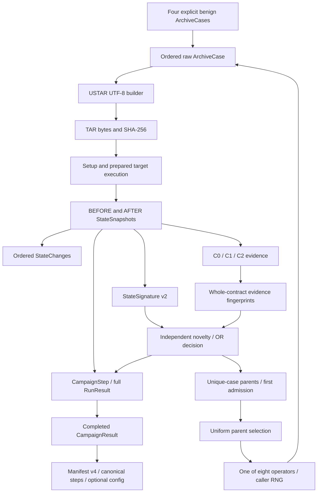

# Engine contracts and research semantics audit v1

## 1. Audit identity, scope and verdict

Audited main: **fae2954906fa1a95235cde5cddd4dcb73f334169** (2026-10-04).
Audit branch: `audit/engine-contract-v1`, created directly from that commit.
`git fetch origin` completed; `origin/main` matched the required commit and
`git status --short --branch` showed a clean main worktree before branching.
The maintainer's directly supplied Audit Phase 1 specification is the Task Contract.

[PR #35](https://github.com/TheWaitForAGI/InodeFence/pull/35) input:
**5b3745e40e5d43c3b79fa9fe7ca1872f1d2e1106**, open Draft,
`research/benchmark-evaluation-prep-v1`; its last reviewed implementation was
`efe1dbb5ec3787dee42eadb643646be2b326b489` (#39). It was fetched into
`refs/audit-input/pr35` and its research/catalog files read in a temporary copy.
It was neither checked out as this audit's base nor edited. Current main source,
[security contracts](../research/design/security-contracts.md), and the
[current architecture boundary](../research/design/architecture.md) control
implementation facts. Historical PR descriptions and summaries are evidence of
their stated revisions, not substitutes for current code.
The pinned [research input tree](https://github.com/TheWaitForAGI/InodeFence/tree/5b3745e40e5d43c3b79fa9fe7ca1872f1d2e1106/docs/research/benchmarks)
and [catalog input tree](https://github.com/TheWaitForAGI/InodeFence/tree/5b3745e40e5d43c3b79fa9fe7ca1872f1d2e1106/experiments/benchmarks)
identify the exact document/metadata versions compared in §9.

**No Blocker established. Two Majors, six Minors and five Notes, including two
cross-boundary items.** The engine-only EN series has one Major, five Minors and
five Notes; CR-001/CR-002 add one Major and one Minor. These are not vulnerability
counts. C0/C1/C2 predicates match their documented snapshot scope. A builder
transformation violates the raw-input contract, and the inherited EC-01 artifact
attestation defect still affects research provenance. Both need disposition
before benchmark implementation/evaluation. No effectiveness claim is validated.

**EC-03: RESOLVED ON AUDITED MAIN by #42; its OPEN label in PR #35 is STALE.**
The separate current navigation drift in EN-005 is not a reopening of EC-03.

Ownership covered: archive/core/result models, builder, seeds, all eight mutation
operators, observer/comparison, C0/C1/C2, signatures, fingerprints, feedback,
Corpus/selection, campaign research semantics, config/provenance/export where
they affect research evidence, related engine tests and design/module docs, and
all 17 changed PR #35 files. Container execution/lifecycle was not re-audited;
only the artifact provenance seam and inherited command test gap are handed off.

Safety: no affected package installation/build/execution, CVE execution, exploit
archive generation or benchmark security evaluation. Encoding reproductions
use inert entries in memory without extraction. Real filesystem checks use
disposable runtime sentinels. Existing safe Python-reference regressions were
run; real Node container results are inherited engineering evidence, not rerun
or promoted to benchmark qualification. **NO PRODUCTION FIXES INCLUDED.**

## 2. Engine architecture and boundary map

Every boundary below records input/output, invariants, normalization, loss and
trust. “Lost” means absent downstream at that boundary, not necessarily absent
from the separately retained raw evidence.

| Boundary / code | Input → output | Invariants | Normalization | Information lost | Trusted assumptions |
| --- | --- | --- | --- | --- | --- |
| Archive construction, `model/archive.py` | raw text/type/content/mode → ArchiveEntry/ordered ArchiveCase | Four enum types; regular bytes only; nonempty link target; mode 0..07777; tuple order/duplicates | None; case ID hashes versioned canonical JSON | No uid/gid/time/header extensions, setup, target or lineage fields | Caller supplies model objects; SHA-256 collision resistance |
| Builder, `builder.py::build_tar` | ArchiveCase → uncompressed TAR bytes | Ordered members; fixed metadata; no dependency resolution; explicit USTAR failure | uid/gid/mtime zero, owner names empty; USTAR name/prefix split | Source metadata and unsupported encodings intentionally unavailable; **some long leading slashes are lost (EN-001)** | Python 3.12 tarfile behavior; builder must enforce its own raw-text contract |
| Seed generator, `generator/minimal.py` | explicit call → four cases | Fixed order/content/modes; benign preceding internal link sources; no IO/RNG | No input normalization | No external aliases, complex chains or type transitions in seeds | Caller chooses these seeds; four separate cases are not one combined input |
| Mutator, `mutator/operators.py` | parent + Random → child | One uniform operator draw; immutable parent; no target/oracle knowledge | Only explicit affix edits/new finite names | Operator ID/parameters/RNG state not returned; no applicability retry | Same parent/RNG implementation/state; builder acceptance is separate |
| Target result, `pipeline.py::run_case` | TAR + target/sentinels → ExecutionResult | Process outcome is not verdict; preparation before BEFORE, stopped execution before AFTER, cleanup after | Adapter status mapping and decoded streams | No filesystem event sequence; duration excludes most pipeline costs | Trusted adapter/backend/controller; complete stop and lifecycle contract |
| Observer, `observer/snapshot.py::capture_state` | runtime root/phase/protected names → raw StateSnapshot | fd traversal; no symlink following; hash regular files; complete or exception | Canonical relative observed names, sorted unique objects, permission bits via S_IMODE | File bytes become SHA-256; atime/referent/events/actor absent; special kinds coarsen to OTHER | Stable stopped tree, same controller view; readable files; runtime/kernel trusted |
| Comparison, `observer/compare.py::compare_states` | matching BEFORE/AFTER → ordered StateChanges | Same root/protection/phase; missing side means existence, not IO failure | Sorted paths and ChangeField schema order | Intermediate states, cause and direction as a separate label absent | Valid complete snapshots; identity pair is a time-local proxy |
| Oracle, `oracle/contracts.py::evaluate_contracts` | raw pair → three typed ViolationResults | Initial protected paths exist; C0 ignores Region exemptions; C1 uses dev+ino; C2 includes metadata | No CVE/path-recipe/status gates | Only relevant changes/relations enter each verdict; no root-cause adjudication | Empty extract and no permitted aliases; no harness effects during observation |
| Signature, `feedback/signature.py` | raw pair → StateSignature v2 | EXTRACTION/EXTERNAL scope; same scope for identity groups | Drop volatile values; regular-only size/nlink; textual run prefix to `$RUN` | HARNESS, before values, raw identities/ownership/times, singleton identities | Caller treats equality as this representation only; token ambiguity in EN-004 |
| Fingerprints, `feedback/fingerprint.py` | violated verdicts → sorted unique fingerprints | Contract ID + whole evidence set; nonviolations absent | Dedup/order normalization; values removed | Values, direction, status, explanation/limits and operation history | Oracle/raw results remain authority; fingerprint is an evidence class |
| Feedback, `feedback/corpus.py::consider` | RunResult + seen indexes → FeedbackDecision | New state OR new violation; advance both indexes for every result | Existing signature/fingerprint equality only | Full evidence not retained in decision | Coherent immutable RunResult; one campaign context |
| Corpus admission | interesting decision → first-admission CorpusEntry | Each case ID once; admission metadata never overwritten | Unique case identity, insertion order | Later outcome/admission history/raw logs absent from entry | Campaign separately retains every complete result |
| Parent selection | retained entries + Random → ArchiveCase | Uniform per retained unique case, insertion order; empty raises without RNG draw | None | Parent selection probability/draw not exported | Same pool/order/RNG; not uniform over states, entries or operators' applicable cases |
| Next mutation | selected case + same campaign RNG → next child | Selection precedes mutation; no-op executes once | Affix/new-name grammar as above | Applied operator cannot always be recovered from input diff | Semantic feedback stability controls future parent pools |
| Campaign, `campaign.py::run_campaign` | explicit ordered seeds/config/target → completed CampaignResult | Seed-inclusive exact budget; zero-based index; lineage/full result; provenance frozen before cases | Initial collection tuple; sentinel provenance sorted | No partial result on abort, full-step clock or operator history | Correct target/config binding; same semantic outcomes for repeat lineage |
| Config/export | ExperimentConfig + completed result → ID/bundle | Strict keys/policy IDs; seed/target/policy equality; stored provenance; no overwrite | Config timeout numeric spelling and sentinel order; ASCII canonical JSON/LF | No reader/replay/general failure ledger; optional config may be absent | Clean/preserved source/artifacts, supported Linux publication, caller-owned destination |

There is no CVE/version-dependent decision in generic model, mutation, observer,
oracle, signature, fingerprints or Corpus. Campaign composes those APIs; it does
not implement oracle truth or Node invocation. Source/isolation/config identities
are provenance, not novelty.

## 3. Model contract assessment

| Model | Expresses / checks | Assessment and remaining trust |
| --- | --- | --- |
| ArchiveEntry | REGULAR/DIRECTORY/HARDLINK/SYMLINK, arbitrary immutable bytes, raw nonempty UTF-8 text, modes including special bits | Strong runtime validation; NUL/surrogates/malformed content/link combinations rejected. Forward/unresolved links valid; path normalization intentionally absent. USTAR bounds belong to builder. |
| ArchiveCase | Ordered tuple, exact duplicates, empty archive; SHA-256 of canonical logical representation | Equality/hash preserve entry order and duplicate multiplicity. Same spelling at different positions is distinct input. No setup/session/header grammar or target fields; representability does not imply generation. |
| ExecutionResult | Four statuses, completed exit-code consistency, actual finite nonnegative duration, optional timeout, decoded stdout/stderr | No security meaning attached. Numeric duration currently accepts bool through math.isfinite; timeout runtime type checking is less strict than TargetProvenance. Empty command is allowed for synthetic evidence. Trusted producers supply correct numeric types. |
| ObjectSnapshot | Existing lstat object; dev+ino identity; mode/type separate; regular digest mandatory; symlink text mandatory | Hardlinks are relations among regular objects, not ObjectType. nlink=0 is valid for an open/unlinked observation model. Lists can pass digest/link validation (EN-002); type annotations alone do not make frozen objects deeply immutable. |
| StateSnapshot | Absolute-root string, explicit phase, sorted unique canonical objects/protected paths; missing objects allowed | Root string is only prefix-checked; protected paths need not exist until Oracle checks BEFORE. Tuple order is canonical here, unlike archive order. Identity groups contain all types, including hardlinked symlink objects. No timestamp of capture or completeness flag: producer must either complete or raise. |
| StateChange | One or two raw observations, path match, ordered nonempty labels, absent-side consistency | Current constructor does not check labels against actual differences (EN-003). Pure comparison does compute them correctly. No event direction field; before/after carry direction. |
| SignatureObject/ExternalEffect/StateSignature | Normalized post-state and external effect labels | Frozen fields have no runtime tuple/member/schema validation. Public malformed instances can be mutable/unhashable (EN-002). Function-produced values are tuples. |
| IdentityEvidence/ViolationResult | Typed contract-specific evidence; C1 internal/external path roles; nonempty evidence iff violated | They do not independently prove that evidence came from supplied snapshots, that sentinel is configured, or that C0 evidence meets its predicate. Oracle is the trusted producer. |
| RunResult | Case, original TAR hash/format, execution, raw pair, changes, signature, verdicts | No constructor reconciliation of phases, hashes, signature, evidence or verdict count. Pipeline assembles them coherently; a future reader must validate rather than trust a dataclass (EN-002/003). |
| FeedbackDecision/CorpusEntry/CorpusStats/CampaignStep/CampaignResult | Frozen compact metadata/steps and counters | Correct function-produced tuple snapshots; no arbitrary-caller validation. Decision properties are fixed OR semantics, not a policy-neutral interface. Mutation lineage is in steps, not case ID. |
| Provenance/config | Typed source/environment/target/sentinel/isolation values, strict config JSON, exact supported profile IDs | Source unavailable is explicit None; dirty is not patch preservation. Config environment label is not attestation. Supplied source/environment is caller-owned. Artifact declarations still masquerade as actual facts on public composition (CR-001). |

Canonical serialization: default model envelope v1, ExecutionProvenance and
CampaignResult envelope v2, signature internal v2, IsolationPolicy/Provenance
internal v1, ExperimentConfig v1/v2, manifest writer v4. Arrays preserve tuple
order; enum values are strings; content bytes use lossless base64; ASCII escaping
preserves undecodable diagnostic text; NaN/Infinity cannot serialize. Python hash
seed is not a case ID. Raw inode/time/duration bytes are intentionally run-specific.
There is no generic deserializer, migration promise or automatic reconstruction
of missing fields; a schema-changing fix requires explicit version decisions.

Model exclusions are consistent with the current four-type TAR scope: no device,
FIFO, sparse, PAX/GNU extension, header ambiguity, raw non-UTF-8 archive names,
uid/gid/time mutation, pre-existing extraction tree or multi-archive session.
Observer can record incidental OTHER objects, but cannot identify their precise
special type/rdev through this model. No claim of complete TAR expressiveness is
warranted.

## 4. Builder, generation and reachability assessment

### Builder facts

`build_tar` uses Python tarfile USTAR_FORMAT, strict UTF-8, no compression/PAX/GNU
promotion, fixed owner/time metadata, and explicit entry modes. It preserves
member order, duplicates and unresolved link targets; it does not resolve links,
sort members, repair dependencies or inspect source files. Directory trailing
spelling is restored by `_RawPathTarInfo.get_info`; tarfile's *reader* strips
directory trailing slashes, so raw header checks are necessary.

Name and prefix fields are 100 and 155 **encoded bytes**, separated by `/`.
A nonempty valid split can represent 256 bytes total; an unsplittable 101-byte
basename fails. Linkname is at most 100 bytes with no prefix field. Numeric mode
is bounded by the model, owner/time are zero, regular size uses the 12-byte octal
field (maximum 8 GiB minus 1); allocating such content was not attempted. TAR
headers include checksums and fixed record padding. Unsupported values raise
entry-indexed ValueError; nothing is executed when building fails. Deterministic
bytes are supported on the pinned implementation/environment, not an unlimited
cross-Python-version compatibility promise.

**Exception to raw preservation:** Python's `_posix_split_name` chooses an empty
prefix for some 101-byte absolute member names; empty prefix has no serialized
separator, losing one leading slash. EN-001 proves this for every entry type,
multiple leading slashes, a nested name and multibyte UTF-8. Link targets over
100 bytes reject correctly. Short absolute names and nonempty long prefixes
preserve spelling. PR #35's blanket preservation/buildability assertions need
this exception; deterministic reconstruction alone would reproduce the wrong
transformation without detecting it.

### Exact seed and operator semantics

Seeds are regular `a.txt`; directory `dir/` plus `dir/a.txt`; `a.txt` then internal
hardlink `b.txt`; `a.txt` then internal symlink `b.txt`. Regular content is
`b"hello inodefence"`, mode 0644; directory 0755; symlink 0777. Seeds are independent
parents, with no combined directory+both-link seed and no external relationship.

| Operator / uniform slot | Exact action | Applicability, bias and structure effects |
| --- | --- | --- |
| add_entry | Append REGULAR, mode 0644, 0..16 random bytes, one of 16 prefix/stem combinations | Always applicable; random bytes frequently create digest novelty; cannot introduce a directory or edit existing content |
| remove_entry | Uniformly remove one index, preserve others' order | Empty no-op; no dependency protection; may erase the sole directory/link prerequisite |
| duplicate_entry | Choose entry uniformly by index; insert exact value in any of n+1 positions | Empty no-op; identical-entry multiplicity biases chosen values; no differing-type conversion |
| reorder_entries | Choose first index uniformly, then an index of unequal value; swap | Fewer than two distinct values no-op; all-equal multi-entry case consumes the first draw. Swap guaranteed otherwise, but neither permutations nor unequal value pairs are sampled uniformly |
| mutate_path | Choose any entry; prepend `../`, `./`, `/` or append `/..`, `x` | Empty no-op; preserves existing characters; no component deletion/substitution; redundant dot/slash variants often collapse after extraction |
| add_hardlink | Append hardlink to an existing raw member path; new finite name | Empty no-op; source can be directory/link/nonexistent after removal, not necessarily a usable regular source |
| add_symlink | Append symlink to existing raw path with probability 1/2 in nonempty cases, otherwise generated raw text | Always applicable; source spelling copied without dependency/relative-base reasoning; empty case skips the branch draw |
| mutate_link_target | Choose only link indices; affix target as for paths | No-link no-op; no arbitrary recombination, shortening or sentinel-aware addressing |

Operator selection is 1/8 each **including** inapplicable slots, with no retry.
No-op rates depend on parent shape; semantic no-ops additionally depend on target
policy and previous output. One global campaign Random drives uniform parents
and operators, so outcome-dependent retention changes subsequent RNG choices.
There is no hidden global RNG or seed-generation randomness.

New stems are `a`, `b`, `file`, `dir/item`; prefixes are empty/`./`/`../`/`/`.
Induction over seeds and operators shows all path/link characters remain in the
seed/stem/affix alphabet; neither `outside` nor `sentinel.txt` can be spelled.
Random file bytes cannot flow into path text. This excludes the selected arms'
addressing of the default protected file, **not every conceivable target-caused
external effect**. Ordinary unprotected controlled-run namespace effects may be
reachable and C0-classifiable. A generic-name sentinel does not solve Node's
missing outside-directory component; O01 can instead use an external controlled
CWD, but its adapter/CWD binding is absent. See EN-007.

Length is not bounded by mutation. Valid model inputs can produce unbuildable
linknames or unsplittable names; Campaign propagates those exceptions without a
completed result. This is documented current behavior, not a counted proposal
retry. Future M1's bounded grammar/countable no-op rule is a new requirement.

### Static benchmark compatibility

Y = present in the named scope; P = partial; N = absent; U = unresolved. Oracle
and feedback columns describe a **specified surviving controlled effect**, not
an executed historical target result. “Reconstruct” refers to logical case/TAR
from full completed steps with the pinned builder, not root cause/event history.

| Selected family / input | Representable? | Buildable? | Seed available? | Mutation reachable? | Observable? | Classifiable? | Feedback useful? | Reconstructable? |
| --- | --- | --- | --- | --- | --- | --- | --- | --- |
| N01 link sanitation, persistent protected hardlink | Y | Y within bounds; EN-001 exception for long absolute members | P internal link seed only | N default sentinel; simple structural link Y | Y final dev+ino / nlink | C1 + C2 metadata; C0 not required | Relation/nlink/fingerprint retained; usefulness unmeasured | Y logical input/raw alias; no use trace or automatic replay |
| N03 composed links, persistent alias | Y | Y bounded four-type sequence | P separate link seeds | N default address; chain composition P | Y surviving alias, link text | C1/C2; no C4 inference | Relations/text/effects retained; probability unknown | Y input/final state; intermediate chain traversal absent |
| N04 directory cache/type collision, protected write | Y | Y bounded directory/link/file sequence | P directory seed | N default address; collision/composition P | Y persistent overwrite/namespace | C2 protected content/size; C0 external namespace; cause requires source review | Digests/effects/fingerprints; no causal cache state | Y input/raw before/after; cache events absent |
| O01 validation base/CWD mismatch | Y archive types; setup is outside model | Y core TAR; ORAS title-prefix/gzip transport absent | P internal hardlink seed | P generic-name source; no ORAS/external-CWD binding | Y persistent same-device alias given setup | C1/C2; not C4 | Same generic keys potentially usable | Core TAR Y; transformed transport/CWD/wrapper evidence absent |
| N02/N05 secondary lexical/base cases | Y | Y bounded; EN-001 affects repeated absolute roots | P benign regular/link types | N default address; nested composition P | Y controlled persistent effects | C0/C1/C2 according to effect | Potential only | Input/effect Y; candidate invocation/qualification absent |
| N06 POSIX backslash cache variant | Y raw backslash text | Y bounded UTF-8 | P directory type only | N backslash alphabet/address | Y persistent controlled write | C0/C2; no equivalence event proof | Potential only | Y input/final effect; missing grammar |
| N07/N08 equivalence/race | P input names/order, no runtime race control | P encoding only | N equivalent-name setup | N alphabet/platform/race | P final effect on required platform | P persistent C0/C2; no race attribution | Not qualified | No equivalent-name/event evidence |
| N09 parser/PAX/GNU ambiguity | N required metadata model | N | N | N | N parser discrepancy | N discrepancy oracle | N | N unsupported encoding/member disagreement |
| O02 composed write secondary | Y types | Y core TAR, transport absent | P link/file types | N address, P structure; no adapter | Y persistent write given setup | C0/C2; exact fix U | Potential only | Core input/effect Y; wrapper/fix mapping U |
| O03 OCI title/pre-existing symlink | N sink/setup as ArchiveCase | N/A non-TAR sink | N | N | P effect with other setup | P C0/C2, no sink proof | Outside v1 plan | N title/setup evidence |
| G01 nested configured-root mismatch | P types, invocation U | Y archive, boundary mapping absent | P hardlink | U exact pair/root | P persistent alias/effect | Fixed `extract/**` cannot classify a narrower nested boundary | U | Input Y; intended boundary/pair U |
| G02 selected-member traversal | Y regular member | Y bounded | P regular | N default address; invocation U | Y scoped persistent effect | C0/C2 given fixed invocation | Potential only | Input/effect Y; selected-member invocation U |
| G03 reused extraction tree | P entries, no session/setup | Y individual archive | N session | N fresh runtime each input | P supplied reused setup | P effect only; policy dispute not resolved by oracle | Outside v1 plan | N multi-run tree/session provenance |

The four primary source accounts and selected fixes remain external facts, not
InodeFence results: [N01 advisory](https://github.com/isaacs/node-tar/security/advisories/GHSA-8qq5-rm4j-mr97),
[N03 advisory](https://github.com/isaacs/node-tar/security/advisories/GHSA-83g3-92jg-28cx),
[N04 advisory](https://github.com/isaacs/node-tar/security/advisories/GHSA-r628-mhmh-qjhw),
[O01 advisory](https://github.com/oras-project/oras-go/security/advisories/GHSA-fxhp-mv3v-67qp).
N03's published validation platform is macOS; that does not qualify Linux.
N01 relative-arm correspondence, N04 strict-mode compatibility and O01 public
transport behavior remain predictions/qualification requirements. No logical
attack sequence was generated to prove practical reachability in this phase.

## 5. Observer and C0/C1/C2 assessment

`capture_state` walks fd-relative sorted names and uses non-following stat.
Regular opens use O_NOFOLLOW/O_NONBLOCK; fstat must match the prior dev+ino and
kind, then size/mtime/ctime must still match after hashing. Directories open with
O_DIRECTORY/O_NOFOLLOW; no symlink traversal. Hardlink identity is recorded for
each observed path. OTHER objects are not opened. Snapshot tuples are sorted
again before construction. Missing protected paths remain in protected_paths.
OSError/permission/traversal/open/read failure raises ObservationError; detected
digest inconsistency also raises. Model errors propagate as exceptions rather
than producing a complete snapshot. Incomplete observation cannot become a
normal RunResult through the current pipeline.

| Visibility class | Exact support | Blind spot / interpretation constraint |
| --- | --- | --- |
| Persistent state | Reachable lstat tree under the supplied run root at two stopped moments; all regions | Unreachable descendants behind symlinks, elsewhere on host/container, /tmp/proc/dev, transient/reverted states absent |
| Transient event | None | Create/delete within interval invisible if no retained metadata evidence; inode reuse can hide replacement |
| Path-use event | None | Reads, in-place external use, validation/use base and traversal sequence not reconstructed |
| Referent access | Readlink text only; regular objects reached by directory walk are hashed | No symlink referent identity/content, access or exfiltration evidence; dangling links are ordinary link state |
| Actor attribution | None in snapshots | Relies on stopped target, completed setup and no observation-window harness effects; phase labels are not provenance |
| Completeness failure | Fail closed with exception | Unreadable target output, removed/renamed root or excessive depth can abort observation and lose ordinary result availability; these are infrastructure-invalid attempts, not nonviolations |

Directory replacement concurrent with observation is excluded by the threat
model. The observer is not a general concurrent-tree consistency mechanism;
directory metadata and newly opened child identity are not cross-checked like
regular digest opens. Directory timestamps/size/nlink are retained raw even
though normalization later drops selected values. There are no limits on total
objects/digest bytes/recursion in this module; capacity must be qualified for
future budgets by the execution/evidence lane, not treated as security coverage.

| Contract | Intended property | Exact implemented predicate / evidence | Emitted evidence | False-negative classes | False-positive classes and assumptions |
| --- | --- | --- | --- | --- | --- |
| C0 | Generated/directly used paths stay within extraction boundary | compare_states changes where `not is_extraction_path(path)` AND fields intersect EXISTENCE/IDENTITY/OBJECT_TYPE | Whole StateChange including both sides and **all** changed fields, not only the trigger fields | Direct use without namespace transition; content/metadata-only effects; outside snapshot; transient namespace operations; inode reuse; root-redirection cause under C3 | Adapter/controller namespace writes during observation, initial setup bracketed incorrectly; fixed `extract/**` layout is the intended root; HARNESS is included |
| C1 | Internal object must not share protected outside identity | For each AFTER EXTRACTION object, compare its `(st_dev, st_ino)` to each existing protected AFTER sentinel | IdentityEvidence internal/sentinel path + actual dev+ino | Removed aliases; symlink referent-only links; unprotected external aliases; unseen/reused identities | Pre-existing/permitted aliases if caller breaks fresh-empty policy; arbitrary constructed snapshots; sharing all lstat types is prohibited by current policy |
| C2 | Protected external object does not change | Every compare_states change whose path is in BEFORE protected_paths | StateChange creation/deletion or type/identity/nlink/mode/size/uid/gid/mtime/ctime/link text/digest changes | Unprotected object content changes; atime; transient/reverted effects not reflected in retained metadata; same-identity reuse with identical measured facts | Unrelated actor or harness mutation; metadata baseline churn. nlink/ctime changes are **real contract effects**, not content-write proof |

Oracle requires nonempty protected set and initially existing protected objects;
comparison requires matching root/protection and BEFORE/AFTER phases. Protection
may disappear or change type after execution. Creation/deletion use absent sides;
replacement uses type/dev+ino changes, with inode reuse limitation explicit.
No predicate consumes exit code, process status, TAR spelling, case ID or CVE.

Actual benign audit hardlink creation demonstrates C0=false, C1=true, C2=true,
unchanged content digest and increased nlink. Ctime may corroborate but its
resolution must not be used to infer a byte write. Existing tests also retain
old inodes during replacement, preventing vacuous reuse assertions. A symlink
pointing outside is not C1 solely because of its text. No C3/C4 conclusion is
derived from these surviving effects. There is no reproduced predicate mismatch
with the canonical **current snapshot scope**; the full normative contracts are
broader and explicitly not proven by a nonviolated result.

## 6. State normalization and violation fingerprints

### Every signature field

| Field / source fact | Retained, normalized or dropped | Security consequence |
| --- | --- | --- |
| Signature schema | Retain internal version 2 | Must version semantic fixes, not compare silently to other representations |
| Scope / paths | Retain exact canonical observed EXTRACTION/EXTERNAL names including extract root; drop HARNESS objects | Identical observed spelling despite different archive paths shares state; HARNESS C0 requires independent fingerprints |
| Object type / mode | Retain ObjectType and permission/special bits | OTHER coarsens special kinds; directory/link modes can create novelty |
| Regular size / digest | Retain exact size and SHA-256 | Random benign content can dominate novelty (EN-008); no actual output bytes retained |
| Nonregular size | None | Directory allocation size/link text byte length not separate novelty |
| Regular nlink | Retain integer even if other aliases are outside signature scope | Preserves alias count signal; not complete alias location or referent evidence |
| Nonregular nlink | None | Directory filesystem count noise reduced; raw C2/external labels unchanged |
| dev / ino | Drop numbers | Preserve only scoped non-singleton identity groups; singleton replacement inside extraction can collapse |
| Identity groups | AFTER raw groups projected to scope; sorted; groups with <2 members dropped | Internal↔sentinel relations retained; harness-only/mixed dangling members removed |
| uid / gid | Drop values | Persistent extraction ownership differences can collapse; protected/external changed-field labels still retained |
| mtime / ctime | Drop values | Timestamp relabeling noise removed; external changed-field presence retained, not values |
| atime | Absent already in raw observation | No access/read evidence |
| Symlink target | Retain raw text except literal absolute run-root prefix → `$RUN` | No referent inference; absolute/relative token ambiguity EN-004; other absolute strings retained |
| protected_paths | Retain sorted configured paths even after deletion | Scope/protection stays explicit; not protection of every external object |
| External effects | Retain all EXTERNAL StateChange paths and ordered field labels | Metadata/identity/type/existence signals survive without before values; includes unprotected external paths and parent-directory metadata |
| Before object values / change direction | Drop from signature | States with same AFTER and same field labels can share key despite distinct effects; raw pair remains necessary |
| Case/TAR/run root/phase/process/config/provenance | Drop from key, except textual run-prefix normalization above | Prevents direct input/allocation/process novelty; no campaign identity or safety proof |

Security distinctions intentionally collapsed: exact ownership/timestamp values,
internal singleton replacement history, create/delete direction when final
scoped state does not distinguish it, and special-object subtypes. These are
documented representation limits; new identity/effect information must be judged
against a declared schema. The untagged `$RUN` collision is accidental (EN-004).

Noise tendencies: random payload hashes, growing paths/symlink text, regular
nlink, mode changes and external directory metadata labels can create new keys
without progress toward a protected effect. Complete keys preserve useful raw
state distinctions but do not prove that state growth is useful feedback. No
evaluation evidence establishes the relative weight of these axes.

### Fingerprint field inventory

| Contract | Retained key | Normalized / excluded | Equality means |
| --- | --- | --- | --- |
| C0 | Contract ID; each StateChange path and complete ordered field tuple | Sorted unique evidence; no before/after, values/direction, actor, process/prose/limits | Same whole-contract path/field evidence class; not same namespace operation or bug |
| C1 | Contract ID; each internal/sentinel path pair | Sorted unique relations; drop dev+ino | Same relation set, not same raw objects, acquisition mechanism or root cause |
| C2 | Contract ID; each changed protected path and fields | Sorted unique evidence; drop values/direction | Same selected field-change pattern, not same bytes/ownership/replacement behavior |

Adding another evidence path/relation creates a new **aggregate** fingerprint,
not a new atomic behavior. Duplicate evidence and verdict order do not. Creation
and deletion with path + EXISTENCE coincide; different replacements or values
can coincide; timestamp field presence remains even though values do not.
Process SUCCESS/REJECTED/FAILED/TIMED_OUT and duration are excluded. No fingerprint
is a unique security behavior/finding. Current module/design docs and PR #35's
metric definition already say this precisely (EN-009 accepted limitation).

## 7. Feedback, Corpus and search invariants

| Observation | state_novel | New violation keys | interesting | New parent if not already retained? |
| --- | --- | --- | --- | --- |
| New state only | true | empty | true | yes |
| New violation only, including HARNESS C0 with same signature | false | nonempty | true | yes |
| Both | true | nonempty | true | yes |
| Neither | false | empty | false | no |
| Already retained case, new state and/or violation | either | either | OR result | no; indexes/counter still advance |
| Different case, duplicate state and fingerprints | false | empty | false | no |

`consider` computes the decision, updates both seen sets and observations, then
interesting counter and unique-case admission. First safe result bootstraps an
empty Corpus via a new signature. First admission stores *all* current
fingerprints, not just new ones. Later outcomes never replace compact metadata.
Entries/stats returned to callers are tuple/frozen snapshots. Full outcomes
remain in CampaignStep, so final Corpus stats can be replayed from every
completed step; tests check both decision replay and retained order. No observed
engine-generated divergence between Corpus and CampaignResult was found.

Uniform selection is over retained **case entries** in admission order, with
caller Random.choice. It is not weighted by signature diversity, effect severity,
operator applicability, age or size. Duplicate case IDs are not extra parents.
Repeated nondeterministic outcomes can increase seen indexes without increasing
parents; Campaign's full steps preserve those observations. Corpus itself has no
target/setup/source key: mixing contexts is caller error, explicitly documented.

The RNG is shared between selection and mutation and seeds do not consume it.
Uniform operator probability and uniform parent probability do not imply uniform
semantic reachability; validity, no-ops, retained shape and alphabet all matter.
No hidden nondeterminism was found beyond filesystem/target semantic outcome,
runtime/version and caller RNG assumptions. Frozen records supplied with invalid
mutable fields can break set/hash assumptions (EN-002); current producers do not.

FeedbackDecision is fixed B3 OR logic. B0/B1/A1/A2/A3 in PR #35 are proposals,
not accepted policy strings. A future decision model must distinguish full
diagnostic novelty from policy admission; hiding fingerprints to simulate B1
would corrupt evidence. That missing seam is a future implementation requirement,
not a defect in the current explicitly fixed policy.

## 8. Campaign research semantics and metric availability

Seeds execute in supplied order, all must fit the positive integer budget,
initial IDs must be unique, and selection begins only after all seeds have been
considered. For a complete result, mutation count = budget minus seed count;
this counts executions, including no-op child, rejected, failed and timed-out
results. Index is zero-based; first-hit reporting needs index + 1. A selected
parent must have an earlier admission; repeated case IDs/self-loop mutations do
not violate per-execution lineage. Parent ID identifies the logical case, not a
particular later re-observation of that parent.

One `Random(random_seed)` is created after seeds. Same initial cases/config/RNG
implementation **and semantic feedback outcomes** are necessary for identical
lineage. Equal RNG seeds across baseline/version cells do not ensure equal
mutated inputs, because parent pools and call counts differ. All full complete
RunResults and decisions survive runtime cleanup in steps, independent of
retention. Memory is O(budget) records but each result grows with archive/output
size; retained-parent growth can grow that per-step cost.

Infrastructure/build/observation/cleanup/config exceptions abort without a partial
CampaignResult. A computed result before failed cleanup is not a completed step.
Completed export is optional and separate; #41 fixes publication of *completed*
bundles, not evidence on an aborted campaign. #40's unexpected-evidence retention
is a narrow benign-validation helper, not a general exception ledger. EN-010
tracks this accepted current limit and future measurement requirements.

| Proposed PR #35 metric/evidence | Derivable now from complete full steps? | Exact qualification / missing information |
| --- | --- | --- |
| Executions, seed/mutation counts, process status rates, no-op case repeats | Yes | Includes every returned status; logical equality does not identify the selected no-op operator |
| Full v2 unique states/fingerprints, I/E, retained count/order, post-seed growth | Yes | Count representation keys, not bugs; replay all steps, not admission metadata only |
| First generic contract evidence index | Yes | Earliest index + 1, independent of interesting/retained flag; not confirmed rediscovery |
| First confirmed known-class evidence index and success/censor proportion | Partial | Nomination indices exist; requires fresh paired replay, lifecycle/root-cause adjudication and complete scheduled/invalid ledger |
| Full-step/time-to-first-evidence/campaign throughput | No | ExecutionResult duration excludes builder/setup/prepare/observation/oracle/feedback/normal teardown/mutation; no full orchestration clock/UTC schedule |
| Repeatability / 3-of-3 affected versus 0-of-3 fixed | No automatic derivation | Requires new replay records/reader; raw allocation equality is not expected |
| Input/TAR reconstruction | Manual capability for completed core cases | Case content/order/raw text and TAR hash present; pinned builder can regenerate; no reader/tamper validation tool, no original TAR file, EN-001 remains a semantic error |
| ORAS transformed input mapping | No | Title-prefix TAR/gzip/wrapper/CWD identity and hashes absent |
| Per-operator applicability/success/transition/no-op rate or exact parameters | No unambiguous derivation | Operator choice/parameters/RNG state not stored; different edits/inapplicable slots can produce same child |
| Security relation diversity | Possible only with explicit metric definition | AFTER scoped identity groups/raw C1/effects available; not event or referent diversity |
| Invalid attempt counts/exclusion reasons, last completed steps across abort | No general mechanism | Exceptions escape; earlier steps held locally, no durable partial result/failure ledger |
| Formal CPU/filesystem/mount/umask/compiler/build/schedule/protocol evidence | Partial | Current platform strings/config/policy/locks are narrower; supplemental frozen research ledger needed |
| Alternative-policy counts and causal ablation | No | Only B3 profile accepted; decision/admission seam must be versioned; retain full unprojected diagnostics |

Current config supports precisely `minimal-generic-v1`, `uniform-generic-v1`,
`state-v2-or-violation-v1-uniform-parent-v1`. `run_configured_campaign` checks actual
ordered cases against both configured IDs and all four minimal seeds, then
target and isolation equality before campaign. Low-level run_campaign can accept
other cases but does not create a new supported configured profile. Nullable
experiment_config_id is a reference, not self-contained config or verified
research environment. Stored metadata consistency cannot validate false initial
artifact declarations (CR-001).

## 9. PR #35 claims, drift and EC-03 adjudication

Classification vocabulary: CURRENT (matches audited implementation), STALE
(superseded as a current claim), PARTIALLY STALE (mixed bounded fact and newer
implementation), PREDICTION (proposed effect/design), SOURCE-BACKED EXTERNAL FACT
(upstream metadata/source, not engine measurement), NOT YET VALIDATED (requires
runtime/replay/experimental evidence). The table inventories important claim
families in **every changed input file**. Historical claims explicitly scoped to
#39 remain valid history; they must not be advertised as this main's current state.

| PR #35 file / claim family | Classification at fae2954 | Evidence / refresh requirement |
| --- | --- | --- |
| engine-contract-audit.md: four types/seeds/eight operators, raw snapshots, C0/C1/C2, v2 signature, OR/unique-case Corpus, seed-inclusive campaign | CURRENT, except builder blanket preservation PARTIALLY STALE/incorrect | These core production modules did not change in #40–#42; EN-001 is a previously missed boundary defect, not newly introduced drift |
| engine-contract-audit.md: #36–#39 composition/config/admission/policy; EC-01 open | CURRENT with artifact limitation | Exact IsolatedTarget admission remains; metadata-only CR-001 reproductions accept changed worker/lock/image before freeze |
| engine-contract-audit.md: configured benign Node smoke NOT_RUN, ENGINEERING FOUNDATION, no audit-ready signal | STALE | #40 full-path benign smoke and #42 explicit freeze/status; inherited engineering, not candidate qualification |
| engine-contract-audit.md: completed manifest v3, no bundled config, partial final-directory publication | STALE | #41 v4, optional hash-bound config and staged atomic no-overwrite publication; general aborted-campaign evidence still absent |
| engine-contract-audit.md: EC-02 command/default test gap | CURRENT cross-review gap | Generated argv currently explicit; actual Config defaults remain unchecked, CR-002 |
| engine-contract-audit.md: EC-03 OPEN contradictory STATUS next-work paragraph | STALE / RESOLVED in main | #42 replaced the older paragraph, as verified by the #39→fae2954 STATUS diff |
| candidate-matrix.md: 15 candidates, four primaries, Linux/exclusion/root-cause distinctions, NOT_RUN and no candidate binding | CURRENT planning scope; historical causes/ranges SOURCE-BACKED EXTERNAL FACT | Benign tar7.5.22 does not qualify historical candidate versions; source URLs not execution evidence |
| candidate-matrix.md: pending benign smoke / last-reviewed #39 | STALE | Refresh implementation reference without advancing execution/qualification fields |
| artifact-qualification-v1.md: six npm identities/engine declarations, ORAS module sums and selected source pairs | SOURCE-BACKED EXTERNAL FACT | Six official registry identity tuples and two Go checksum tuples rechecked; no package bytes/build/runtime or signed-tree verification |
| artifact-qualification-v1.md: upstream tag/patch ancestry/lock hashes, ORAS public Push route, compiler and GNU candidate repair | SOURCE-BACKED EXTERNAL FACT scoped to PR's ledger; not independently re-audited in full here | Retain citations/uncertainties; GNU pair remains null. Do not infer installed compatibility from source metadata |
| artifact-qualification-v1.md: common Node compatibility, relative arm/Linux/strict/CWD effects | PREDICTION / NOT YET VALIDATED | Engine ranges alone do not establish runtime behavior; wrapper/qualification remain absent |
| taxonomy-and-reachability.md: S01–S14/R1–R8/E1–E4, finite alphabet exclusion and current observer limits | CURRENT static capability analysis with EN-001 build exception | Representation/structure generation/actual addressing/observability remain distinct; no measured discovery rate |
| taxonomy-and-reachability.md: candidate expected contracts, M1 sufficiency/M2 utility | PREDICTION / NOT YET VALIDATED | Persistent alias/write coverage conditional on setup; M1 needs constructive non-executing checks and a later pilot |
| benchmark-set-v1.md: selected N01/N03/N04/O01, exact pairs, gates, all IMPLEMENTATION_BLOCKED/NOT_RUN | CURRENT planning state; pair basis SOURCE-BACKED EXTERNAL FACT; effects PREDICTION | #40–#42 do not pass historical runtime or known-class gates; no candidate READY |
| evaluation-protocol-v1.md: repeats/budgets/schedule, 3/3 vs 0/3, censor/invalid/ambiguous definitions | PREDICTION / predeclared design; NOT YET VALIDATED operationally | Scientifically separates interesting/violation/rediscovery; formal cost, timing/failure/replay toolchain absent |
| evaluation-protocol-v1.md: process duration insufficient; no generic partial campaign ledger/reader/operator history | CURRENT | EN-010; completed bundles alone cannot account for incomplete attempts or wall-clock first hit |
| evaluation-protocol-v1.md: current manifest v3/no full config artifact/partial final export | PARTIALLY STALE | v4 optional config now available; caller can still omit it; completed export failure no longer leaves a partial final directory before publication; emergency failure evidence remains separate |
| baseline-and-ablation-v1.md: B3 only; B0/B1/B2/A1/A2/A3 and M1 unimplemented; fixed OR decision seam | CURRENT capability / PREDICTION designs | Config rejects proposed IDs; B1 is full-state, not path-only; projections retain redundant nlink/verdict signals |
| post-audit-backlog.md: P00 smoke/freeze pending, no audit-ready signal, EC-03 OPEN | STALE | Remove completed smoke/freeze work from pending list in a future research refresh; keep full-audit/fix/candidate prerequisites |
| post-audit-backlog.md: P01–P11 address grammar/policy/timing/replay/ORAS/qualification | CURRENT missing-capability map / PREDICTION tasks | P04 completed-export portion PARTIALLY STALE after #41; general abort ledger remains needed; P05 bundled-config absence PARTIALLY STALE |
| experiments/benchmarks/catalog-v1.json: engine_revision=#39 | STALE implementation reference | Refresh only after coherent review; source dates/ranges and all execution NOT_RUN remain independent |
| catalog-v1.json: schema/status/selected pairs/qualification, reachability/expected effects | CURRENT planning fields; SOURCE-BACKED EXTERNAL FACT or PREDICTION per field | No engine import/execution; enum YES never proves actual candidate success; EN-001 qualifies buildability |
| catalog.schema.json and validate_catalog.py: closed planning shape, IDs/capabilities/docs/primary/artifact checks, reject executed states | CURRENT | PASS 15 records and 14 negative variants; validator is a declared subset, not source/advisory/effect verification or future result ingestion |
| experiments/benchmarks/result-templates.md: empty qualification/results/replay/invalid tables | CURRENT templates / NOT YET VALIDATED results | Empty cells are not zeros; no result values were filled |
| experiments/benchmarks/README.md and research/benchmarks/README.md: planning separation, no qualification, scoped last-reviewed revision | CURRENT overall; last-current engine/export/readiness references PARTIALLY STALE | Preserve authorization boundary and evidence labels while refreshing facts |
| docs/research/README.md and docs/research/cve-analysis/README.md: navigation to planning, no CVE execution | CURRENT | Correctly distinguish source reading from experimental finding |
| experiments/README.md: provenance v1/manifest v2/ENGINEERING FOUNDATION/no benign smoke plus appended v2/v3 paragraph | STALE internally mixed current descriptions | PR copy predates #40–#42's rewritten current main; future refresh should use v2/v4 and actual benign scope |
| PR #35 body: #39 reviewed SHA/585 tests are historical | CURRENT history | Do not rewrite as validation of fae2954; new audit validation below is separate |
| PR #35 body: pending smoke/freeze, manifest v3, EC-03 OPEN | STALE as current handoff | #40/#41/#42 respectively; PR kept untouched in this lane |

Specific deltas: **#40** adds benign configured Node full-path validation,
stop/raw preservation helpers and integration CI evidence. **#41** adds staged
completed publication, manifest v4 and optional bound config bundle; it does not
add checkpoint/resume or generic failure export. **#42** changes readiness and
navigation to full-audit-next, reconciles STATUS and scopes attestation/dependency
claims. None modifies generic mutation/observer/oracle/signature/Corpus or makes
any historical benchmark qualified. Catalog validation success does not certify
all source facts or coherent future execution gates.

EC-03 comparison: at #39 the next-work paragraph said only trusted references
could campaign / no campaign binding / zero Node campaign executions, while its
newer readiness summary said contained binding existed. At fae2954 that paragraph
is replaced by full-audit-next; readiness and completed summary consistently say
tiny contained benign smoke occurred. #42's source diff resolves the invariant.
No STATUS fix is needed in this audit. PR #35's old verdict must be refreshed
by its owner, separately from the remaining module navigation issue.

## 10. Engine test and invariant matrix

P/N are positive/negative cases. “Could wrong implementation pass?” describes
remaining blind spots, not a claim that a covered invariant is broken. Existing
tests were unchanged. The audit's explicit reproduction module documents current
observations, not post-fix acceptance assertions; it is outside canonical tests'
collection and must be run explicitly.

| Invariant | Test exists / type / P and N | Direct tests or test family | Could implementation be wrong while these still pass? |
| --- | --- | --- | --- |
| Entry type/content/target/mode, NUL/surrogate rejection | Yes, pure constructor, P+N | test_core_model: link/regular/directory/runtime types/raw paths | Derived/result types and mutable observed strings not covered (EN-002) |
| Archive order/duplicates/case ID/frozen inputs | Yes, pure + hash-seed E2E, P+N | case_order_duplicates; pipeline canonical hash seeds | Dataclass subclasses/arbitrary derived record coherence not proven; canonical producer path covered |
| USTAR types/order/duplicates/metadata/determinism | Yes, byte-header + tarfile read, P+N | test_builder; generator_integration fixture byte identity | Long empty-prefix absolute split passes unnoticed (EN-001); tarfile reader can hide directory slash changes |
| UTF-8 byte-bound name/prefix/link limits | Partial, pure builder, P+N | utf8_ustar_prefix; unrepresentable input; mutator_builder length rejection | Exact 100/155 edges, multibyte linkname and long leading slash combinations missing; audit adds adjacent cases |
| Seed determinism/order/dependencies/no IO/RNG | Yes, pure + actual reference, P+N | test_generator; generator_integration | Does not prove useful benchmark reachability, intentionally |
| Eight operators immutable/order/raw text | Yes, many seeds + mixed/empty/duplicate fixtures, P+N | test_mutator | Mixed fixtures contain outside/Unicode names absent from initial seed language; no reachability claim can be inferred |
| Operator selection/applicability/no-op RNG | Partial, pure/campaign, P+N | only_caller_rng, deterministic_rng, empty/inapplicable, campaign_noop | No explicit eight-slot draw/applicability distribution test; deterministic duplicate-only reorder consumes a draw; statistical uniformity not independently tested |
| No target/oracle/import coupling in mutation | Source inspection and patched forbidden APIs | only_caller_rng; architecture source inspection | Monkeypatches do not forbid every indirect import; inspected modules contain no such coupling |
| Observer regular/directory/hash/nlink/identity | Yes, real Linux runtime, P+N | real_files_directories_hardlinks; metadata_lstat | Digest wrong-open identity or mid-read change branches lack targeted negative tests; ordinary fixtures cannot expose them |
| Symlink no referent traversal/read; special file no open | Yes, real links/dangling/neighbor/FIFO, P+N | symlink_lstat_no_referent; special_files | OTHER subtype loss is not tested as diversity; no general device/socket equivalence claim |
| Missing sentinel distinct from failed observation | Yes, real deletion + controlled IO failure, P+N | missing_sentinel; io_failure; pipeline AFTER exception | Permission case mocks `_digest`, not actual uid/capability unreadability; listdir/stat/readlink failures and digest inconsistency paths need negatives |
| Sorted unique observed paths/protected roles/phases | Yes, constructor/synthetic, P+N | model_rejects_unsorted; state_semantics region/protection; compare context | Mutable digest/link fields and false label tuples still pass (EN-002/003) |
| Compare existence/type/identity/content/metadata | Yes, real + selected-field synthetic, P+N | before_after_creation_deletion; c2_each_selected_effect | StateChange direct constructor can lie; positive compare doesn't establish constructor consistency |
| C0 includes HARNESS/root-level namespace | Yes, real controlled transitions, P+N | pipeline_c0_harness (create/delete/replace/type/content/mode); root_level_external | Transient/direct-use/sandbox-external effects deliberately not supported; tests correctly retain old inode for replacement |
| C1 needs dev+ino, protected AFTER identity; symlink alone no C1 | Yes, synthetic + real alias, P+N | c1_requires_device_and_inode; controlled_external_identity; audit hardlink-only | Existing actual alias tests also write bytes; audit adds metadata-only alias; no actor/referent proof |
| C2 each protected field, deletion/replacement/type | Partial, synthetic each field + real change/deletion, P+N | c2_each_selected_effect; c0_namespace_c2_existence; observer controlled effects | Dedicated real protected regular→symlink/directory and stable-size content-only cases narrower/missing; ownership change mocked; audit adds nlink-only Linux arm |
| Contracts independent of status/duration | Yes, controlled adapter matrix, P+N | pipeline_verdict_signature_status_duration | Controlled adapter returns evidence independent of process semantics; real rejection/partial/timeout tests complement it |
| Signature raw allocation/time/uid normalization | Yes, synthetic relabel + live double allocation + hash seed, P+N | signature_stable_relabeling; pipeline different inodes | Does not prove cross-filesystem equivalence or arbitrary ownership/effect meaning |
| Signature scoped groups/HARNESS/regular-only nlink | Yes, synthetic + real pipeline, P+N | projects_groups/drops_singletons; directory_nlink; same-case/TAR semantic state | No literal `$RUN` collision test until audit; accidental absolute-vs-relative collapse EN-004 |
| Signature effects/path/content distinctions | Yes, synthetic P+N | distinguishes_relations_effects; absolute_run_link_text | No tests validating research utility of high digest/path novelty (requires experiments, not unit assertions) |
| Fingerprint contract/field/relation/value/order/dedup behavior | Yes, pure P+N | test_feedback_corpus fingerprint families | No explicit original test for existence direction collapse, despite docs; current class equality not root-cause identity |
| Feedback four novelty combinations / already-retained | Yes, exhaustive boolean matrix + synthetic/real integration, P+N | decision_properties; retained_case_new_outcomes; same_state_new_violation | Synthetic fixtures sometimes replace verdicts independent of raw snapshots: test channel logic, not oracle truth; real HARNESS path covers actual composition |
| Corpus first admission, all fingerprints, seen indexes, unique IDs/stats | Yes, pure replay/multiple outcomes, P+N | first_safe_state; new_subset; both indexes; frozen_snapshots | Long randomized traces not tested; malformed mutable result cannot be a valid input; current complete replay invariant strong |
| Uniform caller-RNG parents/insertion order/empty failure | Yes, deterministic choice comparison + no-global RNG, P+N | selection_uniform; empty_selection | Comparing same Random.choice proves declared algorithm, not finite empirical fairness or security-state distribution |
| Campaign budget/order/RNG/no-op/all statuses/lineage | Yes, mocks + Linux reference, P+N | test_campaign; semantic_repeat campaign_integration | Many mocks have empty protected sets/no oracle and synthetic TAR hash=case ID, so cannot validate real run coherence; actual integration fills that gap |
| Corpus/CampaignResult final consistency | Yes, full decision/entry replay, P | final_stats_admission_order; reference_campaign_replay | Complete runs only; cannot prove recovery after abort |
| Config strict keys/IDs/order/binding/provenance freeze/drift | Yes, pure and benign reference, P+N | test_experiment_config; provenance; isolation_provenance | Pre-freeze descriptor artifact replacement wasn't challenged; metadata-only audit variants expose CR-001 |
| Completed export retains full steps/checksums/config/fail-closed publication | Yes, synthetic + benign reference, P+N | test_campaign_export; export_integration | Not a reader, general failure ledger or hard-crash durability proof; current tests correctly separate parent-fsync final state |
| Docs reflect implemented stage | Link/path checks only, no semantic assertion | scripts/check_docs.py; test_check_docs | EN-005/006 drift passes path checks; anchors/semantic currentness not validated |

Tests are generally stronger than happy paths: negative constructors, fixed
identity/device checks, real filesystem observation, raw header assertions,
duplicate-only reorder, partial rejection, HARNESS/noise isolation, independent
novelty and abort cleanup all exist. Adjacent encoding and model-validation cases
still escaped the suite. Repeated status/duration matrices at pipeline/Corpus
boundaries are useful isolation checks, not independent evidence of benchmark
effectiveness. No test count is used as a security proof.

## 11. Findings summary

| ID | Severity | Status | Subsystem / invariant |
| --- | --- | --- | --- |
| EN-001 | MAJOR | OPEN, reproduced | Builder silently loses leading slash at USTAR split |
| EN-002 | MINOR | OPEN, reproduced | Runtime model validation does not enforce deep immutable typed evidence |
| EN-003 | MINOR | OPEN, reproduced | StateChange accepts labels inconsistent with raw observations |
| EN-004 | MINOR | OPEN, reproduced | Signature placeholder conflates absolute run target and literal relative text |
| EN-005 | MINOR | OPEN, source-confirmed | Current navigation/module docs retain pre-implementation status |
| EN-006 | MINOR | OPEN, source-confirmed PR input drift | PR #35 current handoff lags #40–#42; EC-03 resolved on main |
| EN-007 | NOTE | ACCEPTED CURRENT LIMIT; future requirement | Default protected sentinel addressing excluded by mutation grammar |
| EN-008 | NOTE | RESEARCH RISK; unmeasured | Content/path growth creates novelty without demonstrated semantic progress |
| EN-009 | NOTE | ACCEPTED CURRENT SEMANTICS | Whole-contract fingerprints are not unique security behaviors |
| EN-010 | NOTE | ACCEPTED CURRENT LIMIT; future requirement | Complete steps lack full timing/operator/general abort evidence |
| EN-011 | NOTE | ACCEPTED SCOPE; regression gaps | Persistent-only observer and completeness guard tests |
| CR-001 | MAJOR | OPEN, reproduced; execution-lane disposition | EC-01 public artifact declarations freeze as actual facts |
| CR-002 | MINOR | OPEN STATIC TEST GAP; cross-review | EC-02 actual command/default inspection coverage |

There are no production patches in this branch. Notes are not inflated to Major
because they are explicitly scoped missing capabilities/accepted policies rather
than broken current research results. No existing formal result is invalidated
here: evaluation is NOT_RUN. Majors constrain future implementation/evaluation;
Minors have no demonstrated current pipeline false passing verdict.

## 12. Detailed findings

### EN-001 — Long absolute member spelling silently changes at serialization

- Severity/status/subsystem: **MAJOR / OPEN / builder**.
- Exact location: [builder.py](../../src/inodefence/builder.py),
  `_RawPathTarInfo.get_info` and `build_tar`; delegated
  `tarfile.TarInfo.create_ustar_header/_posix_split_name`.
- Invariant: accepted logical raw path must serialize unchanged, or fail
  explicitly when USTAR cannot preserve it; no silent normalization.
- Observed: `"/" + "a"*100` is 101 UTF-8 bytes. Split prefix is empty and
  name is 100 `a`s. Encoded path loses `/`; bytes equal the distinct relative
  input's TAR while logical case IDs differ. Nested/double-slash/multibyte
  variants likewise lose one slash, for all four entry types.
- Expected: exact header-reconstructed spelling or explicit indexed failure;
  support does not require silently choosing another spelling/extension.
- Evidence/reproduction: `test_en001_long_absolute_member_loses_one_leading_slash`
  in [audit reproductions](engine_contract_reproductions_v1.py), 16 variants;
  adjacent short absolute and nonempty 100/155-byte splits preserve names;
  both over-limit link types reject. TARs remain inert in memory, never extracted.
- Impact/affected claims: archive-model→target semantics differ, weakening
  negative reachability/replay interpretations and PR #35 raw-preservation,
  S09/USTAR buildability and optional absolute/repeated-root arms. Existing
  four short fixtures are unaffected; this is not a demonstrated target exploit.
- Suggested fix: validate reconstructed header spelling/split before emission;
  reject an empty-prefix lossy split or use a lossless representable split.
  Preserve raw directory spelling; avoid broad path normalization.
- Regression required: actual intended contract assertion for all entry types,
  absolute slash counts, nested roots, UTF-8 byte boundaries, name/prefix limits,
  directory raw headers and unchanged short fixture bytes.
- Dependencies: builder owner; research buildability correction; decide whether
  rejection-only guard preserves format ID or encoding changes require versioning.

### EN-002 — Frozen annotations do not enforce immutable typed evidence

- Severity/status/subsystem: **MINOR / OPEN / core/result/feedback models**.
- Exact location: [filesystem.py](../../src/inodefence/model/filesystem.py),
  `ObjectSnapshot.__post_init__`, `SignatureObject`, `ExternalEffect`,
  `StateSignature`; [results.py](../../src/inodefence/model/results.py),
  `RunResult`/numeric checks; `FeedbackDecision`/result record constructors.
- Invariant: public evidence described as immutable typed values must either
  validate collection/text types or explicitly identify a trusted-constructor boundary.
- Observed: a list of 64 lowercase hex characters passes regular digest
  validation and mutates after construction. A list can pass symlink text checks.
  StateSignature accepts a list of objects, can change while frozen, and cannot
  be hashed; derived result records accept arbitrary collections/schema/coherence.
  ExecutionResult also accepts boolean duration via math.isfinite.
- Expected: actual string/tuple/member/numeric invariants at relevant public
  boundaries; explicitly documented trust where derived coherence is producer-owned.
- Evidence/reproduction: `test_en002_mutable_digest_and_derived_signature_are_accepted`;
  constructor source, plus existing tests check frozen assignment only on valid inputs.
- Impact/affected claims: public immutable evidence/key assumptions can fail or
  serialization can encode arrays instead of digest text. Current observer and
  signature functions supply valid strings/tuples; no production-generated
  corruption or nonviolation is established. Future raw readers/policy interfaces
  (PR #35 P03/P05) must not rely solely on dataclass/type annotations.
- Suggested fix: focused validation of text/collection members and supported
  scalar types; document trusted derived assembly; avoid changing model semantics
  solely to accommodate mocks.
- Regression required: list/tuple/non-string digest/link values, mutable derived
  collections, malformed schemas/types and numeric booleans; valid canonical bytes
  and equality/hash remain stable unless intentionally versioned.
- Dependencies: model/interface owner, serialization compatibility and reader task.

### EN-003 — Change labels can contradict their before/after evidence

- Severity/status/subsystem: **MINOR / OPEN / StateChange evidence model**.
- Exact location: `model/filesystem.py::StateChange.__post_init__`.
- Invariant: changed-field labels describe the supplied raw difference.
- Observed: before/after differing only in content_digest can be constructed
  with fields=(MODE,), although mode is unchanged. Fields may omit actual
  differences or assert false ones while passing ordering/existence validation.
- Expected: exact coherent labels or explicit producer-only construction;
  malformed imported evidence must not silently become a trusted field class.
- Evidence/reproduction: `test_en003_changed_field_labels_need_not_match_the_raw_values`.
  `compare_states` itself computes exact labels; existing contradictory-proof
  tests reject identical snapshots/absent sides, not incorrect field membership.
- Impact/affected claims: misleading C2 evidence/fingerprint/effect labels for
  directly constructed/imported records; future P05 ingest/adjudication affected.
  Current Oracle uses pure compare output, so no current predicate error shown.
- Suggested fix: reconcile labels with observations at an appropriate evidence
  boundary without making model import observer/oracle; retain schema order.
- Regression required: false extra field, omitted true field, swapped existence,
  exact multi-field changes; pipeline comparison/verdict canonicalization stable.
- Dependencies: EN-002's reader/trust decision; model/compare ownership.

### EN-004 — Untagged run-prefix token collapses distinct symlink targets

- Severity/status/subsystem: **MINOR / OPEN / StateSignature**.
- Exact location: `feedback/signature.py::state_signature`, target prefix replacement.
- Invariant: root-allocation normalization should preserve absolute-vs-relative
  raw target meaning while collapsing only run-root variability.
- Observed: a symlink target `<run>/outside/sentinel.txt` normalizes to
  `$RUN/outside/sentinel.txt`, equal to the unchanged literal **relative** target
  `$RUN/outside/sentinel.txt`. Raw snapshots differ, keys coincide; OTHER token
  spellings remain distinct.
- Expected: escaped/tagged normalization distinguishing literal relative text
  from an absolute run-root anchor, without resolving referents.
- Evidence/reproduction: `test_en004_literal_relative_placeholder_collides_with_absolute_run_target`.
  Adjacent `$RUN-other` differs; existing root-relabel normalization must stay equal.
- Impact/affected claims: a security-relevant path-text distinction disappears
  from state novelty/diversity. Oracle never infers referents, so this does not
  create a false C1/C2 verdict. Current minimal grammar cannot emit `$RUN` literal;
  public cases/future generic dictionary and absolute mapping can. P02/P03/P05 affected.
- Suggested fix: explicit anchor kind plus suffix, or reversible literal escaping;
  keep snapshot target raw and never infer referent access.
- Regression required: literal token, absolute run-root and run-root sibling,
  exact root, suffix/`..` spelling, cross-run equality; version signature semantics.
- Dependencies: representation/schema owner; no C0/C1/C2 definition change.

### EN-005 — Current navigation still describes implemented capabilities as future

- Severity/status/subsystem: **MINOR / OPEN / documentation consistency**.
- Exact location: [design README](../research/design/README.md), current-state
  paragraph; [feedback README](../../src/inodefence/feedback/README.md),
  Campaign context/current limits paragraph.
- Invariant: present-tense navigation agrees with canonical current implementation.
- Observed: design README says model fields/pipeline are not implemented; feedback
  README groups third-party campaign isolation among future work. Main already
  has the bounded model/pipeline and enforced contained benign campaign composition.
- Expected: accurate current scope with remaining research/portability limits;
  historical decisions/summaries retain their recorded revisions.
- Evidence: source paragraphs compared with STATUS, pipeline/campaign and #40–#42.
  Link integrity checks pass because they do not check semantic currentness.
- Impact/affected claims: reader may plan duplicate infrastructure or misread audit
  readiness. This is independent of EC-03, whose STATUS contradiction was removed.
- Suggested fix: update only these current-state sentences in a later docs fix;
  retain evaluation-not-run and snapshot limitations.
- Regression required: focused semantic review across entry/status/module maps;
  docs checker alone is insufficient. No new production test required.
- Dependencies: documentation owner; no implementation change.

### EN-006 — PR #35 handoff/export assumptions lag merged main

- Severity/status/subsystem: **MINOR / OPEN INPUT DRIFT / research package**.
- Exact location: PR #35 `engine-contract-audit.md`, `candidate-matrix.md`,
  `evaluation-protocol-v1.md`, `post-audit-backlog.md`, catalog engine_revision,
  READMEs and PR body; immutable head recorded in §1.
- Invariant: a research handoff used as current implementation guidance is
  refreshed for affected capabilities while predictions stay unvalidated.
- Observed: pending benign smoke/freeze, manifest v3, absent bundled config,
  partial final export and EC-03 OPEN describe #39, not audited main.
- Expected: #40 benign full path, #41 v4/optional config/staged completion,
  #42 full-audit-ready/EC-03 resolved; keep all candidate execution NOT_RUN.
- Evidence: §9 full file/claim inventory, PR metadata and local #39→fae2954 diff.
  Generic engine modules are unchanged, so core scope/RNG/oracle claims mostly remain.
- Impact/affected claims: obsolete prerequisites/export handling could misdirect
  P00/P04/P05; stale reference is not proof of bad historical evidence. EC-01/02
  and all benchmark qualifications still need work; do not blanket-resolve them.
- Suggested fix: owner refresh in PR #35 under its own contract, not this audit;
  reconcile current references, preserve historical validation and separate actual
  benign results from historical candidate qualification.
- Regression required: catalog/docs validation plus field-by-field source review;
  no execution fields promoted based on engineering smoke.
- Dependencies: PR #35 owner, CR-001 disposition, full-audit handoff. No PR #35 edits here.

### EN-007 — Default protected-file benchmark addressing is outside the grammar

- Severity/status/subsystem: **NOTE / ACCEPTED CURRENT LIMIT / seeds/mutation/search**.
- Exact location: `generator/minimal.py::minimal_seed_corpus`,
  `mutator/operators.py::_PATH_STEMS/_PATH_PREFIXES/_TEXT_AFFIXES`,
  `runtime.py::SentinelSpec/disposable_sandbox`.
- Invariant: distinguish representable inputs, generated structures, actual
  protected-file addressing and finite search probability.
- Observed: operators cannot introduce required letters/components of
  `outside/sentinel.txt`; hardlink copying/affixes cannot repair that exclusion.
  Directory introduction/type conversion/arbitrary component replacement absent.
- Expected: current limitation explicitly retained; future selected-arm evaluation
  needs a shared generic address vocabulary/setup mapping, not an attack seed.
- Evidence: induction over all eight operators and explicit seed/stem/affix values;
  no target execution or PoC construction needed. PR #35 already records this gap.
- Impact/affected claims: N01/N03/N04 default sentinel arms not mutation-reachable;
  O01 requires generic-name external CWD and adapter; no rediscovery inference
  from four benign seeds or existing hardlink tests. No current result violated.
- Suggested direction: future versioned finite M1 component dictionary/recombination,
  controlled setup names/depth/byte bounds shared across every baseline/target.
- Regression required: constructive logical non-executing reachability, deterministic
  RNG/raw spelling/duplicates and out-of-bounds counted behavior after its contract.
- Dependencies: post-audit P01/P02; builder EN-001; ORAS invocation/CWD separately owned.

### EN-008 — Exact benign content and path growth can dominate state novelty

- Severity/status/subsystem: **NOTE / UNMEASURED RESEARCH RISK / signature/Corpus**.
- Exact location: `mutator/operators.py::add_entry/mutate_path/mutate_link_target`,
  `feedback/signature.py::state_signature`, `Corpus.consider/select_case`.
- Invariant: raw representation counts must not be interpreted as useful search
  progress or vulnerability diversity without controlled evaluation.
- Observed: appended random bytes change retained regular digest; growing path/link
  strings change keys; unique such cases join uniform parent pool even without a
  new relation/effect. Removal has no dependency preservation and uniform parents
  can diffuse rare useful structure. This is by design, not measured inefficiency.
- Expected: counts called representation diversity; evaluate relevance via the
  declared policies/ablations, not by declaring every new key security progress.
- Evidence: exact retained signature fields and add_entry payload RNG; existing
  safe-state admission tests prove violation is not required;
  `test_en008_content_digest_changes_key_without_changing_relations` demonstrates
  distinct keys for the same relation structure and no contract violation.
  No hit-rate estimate made.
- Impact/affected claims: RQ2/RQ3 interpretation; random-content/path novelty can
  mask group/effect ablation differences. PR #35 explicitly acknowledges redundancy.
- Suggested direction: preserve B3 baseline; predeclare diagnostics/projections
  and identical grammar across arms in future research work, not tune from hits.
- Regression required: benign equal-relation/different-content examples and
  policy diagnostics; usefulness requires a separately authorized comparative dataset.
- Dependencies: P03/P08–P10, full timing/invalid evidence P04; no production fix now.

### EN-009 — Unique fingerprints are aggregate evidence classes, not behaviors

- Severity/status/subsystem: **NOTE / ACCEPTED CURRENT SEMANTICS / fingerprints**.
- Exact location: `feedback/fingerprint.py::violation_fingerprints/_evidence_fingerprint`.
- Invariant: equality/counts have a precise evidence-class interpretation.
- Observed: create/delete at one path share EXISTENCE class; changed values and
  raw identities are omitted; adding another relation/path changes an aggregate
  class even if all atomic behaviors were seen separately.
- Expected: retain documented class semantics; no unique-bug/unique-root-cause claim.
- Evidence: field projection/source and dedup/whole-evidence tests;
  `test_en009_creation_and_deletion_share_a_whole_contract_fingerprint` demonstrates
  the collision with distinct raw changes. Module/design docs and PR #35 metric
  explicitly say direction/values are omitted.
- Impact/affected claims: unique fingerprint counts/nomination dedup; original
  raw steps and case IDs, not fingerprints, determine replay and earliest hit.
  HARNESS create/delete can share signature and fingerprint, intentionally losing
  a new search parent while raw campaign observations still preserve both effects.
- Suggested direction: no automatic production change; define future behavior
  taxonomy separately if needed, with versioning and unchanged raw evidence.
- Regression required: explicit create/delete and same-label/different-value class
  cases alongside permutation/dedup/aggregate additions; raw evidence retained.
- Dependencies: analysis metric/replay owner; schema review if representation changes.

### EN-010 — Complete results cannot supply all proposed campaign metrics

- Severity/status/subsystem: **NOTE / ACCEPTED CURRENT LIMIT / campaign/evidence**.
- Exact location: `campaign.py::CampaignStep/run_campaign`, `pipeline.py::run_case`,
  `model/results.py::ExecutionResult`, `campaign_export.py::export_campaign`.
- Invariant: executed index, process time, full completed step, abort and validated
  known-class rediscovery must not be conflated.
- Observed: no full-step/campaign clock, chosen operator/parameters, durable
  partial result/exception ledger, reader/replay/adjudication record. Exceptions
  abort correctly; earlier complete steps do not return. Completed v4 bundle
  can include config but does not supply abort/replay data.
- Expected: existing engineering scope stated accurately; future time/invalid/
  policy/operator/replay metrics get explicit evidence fields and denominators.
- Evidence: §8 metric inventory; budget/no-op/status/error tests; #41 completion
  implementation; PR #35 P03–P05 acknowledge the gaps.
- Impact/affected claims: full-step throughput/time-to-first-hit impossible from
  duration sums; invalid campaigns cannot be ordinary censored no-hit; per-operator
  rate ambiguous; affected/fixed evidence requires later independent records.
- Suggested direction: future orchestration/failure ledger, complete monotonic
  offsets, separate replay schema and optional operator trace where metrics need it.
- Regression required: benign controlled clock/phase/cleanup/export exceptions,
  last-complete-step retention, tamper round-trip and mocked paired adjudication.
- Dependencies: P03–P05 and execution-lane lifecycle disposition; no production feature added.

### EN-011 — Persistent observation is bounded; guard regressions are narrower

- Severity/status/subsystem: **NOTE / ACCEPTED SCOPE + TEST GAPS / observer/oracle**.
- Exact location: `observer/snapshot.py::_digest/capture_state`,
  `tests/test_observer.py::test_io_failure_is_not_missing_state` and §10 matrix.
- Invariant: incomplete captures are infrastructure failure; surviving snapshots
  cannot imply events, referent reads, actor identity or safe unobserved paths.
- Observed: snapshot-only limits match docs. Regular open mismatch and mid-hash
  inconsistency guards exist but lack dedicated negative tests; permission test
  mocks hashing, not actual uid behavior; listdir/stat/readlink errors not individually
  challenged. Recursive/total-size capacity is not bounded in observer.
- Expected: retain narrow claims; targeted benign guard regressions before relying
  on these branches for broader target/large-budget evidence.
- Evidence: source and current observer/pipeline tests; no incomplete normal result
  reproduced. Audit adds actual metadata-only C1/C2 hardlink observation.
- Impact/affected claims: G6 evidence completeness and invalid-attempt handling,
  not a proof of transient/C3/C4/exfiltration visibility. Unreadability abort must
  stay invalid even when caused by target output.
- Suggested direction: add controlled fd/stat/read failure negatives and qualify
  resource/evidence capacity separately; do not swallow errors into PASS or invent tracing.
- Regression required: open-identity mismatch, digest final-stat mismatch, missing
  traversal member vs failed read, actual controlled unreadability where portable,
  no verdict on failure and cleanup preserved.
- Dependencies: observer tests and P04 failure/capacity work; execution lane controls
  stopped-state assumption/resource bounds.

### CR-001 — EC-01 remains: declared artifacts freeze as actual image facts

- Severity/status/subsystem: **MAJOR / OPEN CROSS-REVIEW / provenance composition**.
- Exact location: `targets/node_tar.py::NodeTarTarget.bind/public constructor`,
  `targets/isolated.py::IsolatedTarget.capture_isolation`, `campaign.py::run_campaign`.
- Invariant: artifact facts labeled actual must match identified image contents;
  immutable consistency of a declaration is not independent verification.
- Observed: normal bind identifies image metadata. Caller can replace worker/lock
  digest or move descriptor to another accepted same-version image.
  capture_isolation then replaces backend artifacts with descriptor declarations;
  freeze records them and later consistency only compares against those values.
  Worker command checks versions, not those artifact hashes.
- Expected: verified binding/reidentification before freeze or explicit separation
  of declared metadata from actual artifact facts, including public composition.
- Evidence/reproduction: `test_cr001_pre_freeze_descriptor_replacement_is_not_reidentified`
  challenges worker, lock and image with a metadata-only backend whose prepare
  raises if execution attempted. All three changed declarations freeze without
  second identify. PR #35's earlier fake-campaign reproduction is inherited;
  current relevant source is unchanged since #39.
- Impact/affected claims: future artifact/replay provenance can claim a worker/lock
  different from actual image; affects G2/G5/P01/P05 and #42 compact-attestation
  wording. No isolation escape or flaw in ordinary bind established; no archive
  target ran. This is not fixed by #40 smoke or #41 checksum publication.
- Suggested fix direction: execution owner validates actual descriptor/image facts
  before campaign source freeze/first case; do not weaken exact-wrapper safety gate.
- Regression required: changed worker and lock, pre-freeze same-version image
  replacement/stale facts, normal bind success, later drift and export stored facts.
- Dependencies: other engineer's target/provenance lane; deduplicate against EC-01;
  research package refresh must preserve unresolved disposition until fixed.

### CR-002 — EC-02 command/default inspection remains a test gap

- Severity/status/subsystem: **MINOR / OPEN STATIC GAP / execution cross-review**.
- Exact location: `execution/container.py::ContainerExecutionBackend.create_command/prepare`,
  `tests/test_container_backend.py::FakeDocker/test_policy_has_no_host_exposure_or_inherited_environment`.
- Invariant: command/CWD/environment used agree with invocation, and tests expose
  missing overrides rather than validate only unrelated isolation settings.
- Observed: generated argv correctly supplies explicit entrypoint, args, extract
  workdir and cleared/explicit environment. Prepare inspects image/user/host policy
  but not actual Config.Entrypoint/Cmd/WorkingDir/Env. Fake responses omit these;
  portable assertions are narrower than a command/default contract.
- Expected: execution lane decides appropriate actual-field validation and focused
  negative/command assertions, especially before ORAS external CWD is introduced.
- Evidence: bounded source comparison with PR #35 EC-02; these source/test paths
  are unchanged by #40–#42. No real mismatched execution was tested or established.
- Impact/affected claims: future P07/CWD qualification could rely on incomplete
  portable checks; current generated command is correct, so not Major.
- Suggested direction: explicit argv and adverse actual-Config coverage; retain
  documented runtime trust and backend lifecycle controls.
- Regression required: wrong entrypoint/Cmd/workdir/env variants, ordinary Node
  invocation and any later controlled CWD setting; real benign qualification belongs
  to execution lane, not this phase.
- Dependencies: other engineer's backend/target review; deduplicate EC-02; no container
  execution review or production change contributed here.

## 13. Ordered fix requirements and future contracts

1. Disposition/fix **EN-001** and **CR-001** before benchmark implementation or
   artifact/replay claims. Preserve raw input semantics, safety gates and existing
   short fixture bytes; challenge adjacent variants, not only the first example.
2. Resolve EN-002/003 evidence-boundary validation and EN-004 tagged normalization
   with explicit schema/compatibility decisions before a public reader/new policy
   consumes those values. These Minors do not demonstrate current oracle false PASS.
3. Execution lane dispositions CR-002 and any findings from its own audit;
   establish actual invocation/CWD evidence needed for ORAS without duplicating
   the backend or reclassifying source metadata as runtime facts.
4. Correct current navigation EN-005; PR #35 owner separately refreshes EN-006,
   closes EC-03 as resolved on #42 and retains all historical candidate NOT_RUN
   gates and EC-01/02 until their actual disposition. Do not update historical
   validation numbers into fictitious new results.
5. Add focused benign regressions from §10/EN-011, then canonical checks. Audit
   reproduction assertions documenting defects are not sufficient future acceptance
   tests; later fixes must assert preserved/rejected input and coherent typed evidence.
6. Only under new post-audit implementation contracts: P01 environment/artifact
   freeze; P02 generic M1 vocabulary/constructive reachability; P03 policy/decision
   seam; P04 full timing/general failure evidence; P05 hash-verified reader/replay
   records. #41 already supplies completed atomic export and optional config.
7. Only after those reviewed capabilities and separate authorization: benign
   historical-runtime compatibility, controlled qualification, Node/ORAS matched
   setup and fresh paired replay; pilot feasibility before formal budgets. No CVE,
   affected target, exploit input or benchmark evaluation is enabled by this report.

## 14. Cross-review handoff

To the other audit engineer, by ID (no messages posted to unrelated issues/people):

- **CR-001 / EC-01:** adjudicate pre-freeze public Node artifact/image composition;
  ordinary bind plus immutable image ID does not validate later declarations.
  Confirm whether advertised actual worker/lock facts need reidentification or a
  distinct declared-fact schema. Audit metadata-only variants supplied.
- **CR-002 / EC-02:** command/default inspection gap and exact future controlled
  ORAS CWD. This lane source-checked the seam without repeating execution review.
- **EN-010:** map real cleanup/stop/output-overflow/AFTER failure phases to a future
  invalid-attempt ledger; completed atomic publication does not retain aborted
  Campaign steps. Evidence computed before failed cleanup remains provisional.
- **EN-011:** stopped tree, same-device/controller view, unreadability and total
  object/digest/recursion capacity are assumptions of engine evidence, not things
  snapshots prove. Validate resource/teardown claims in the execution lane.
- **EN-001:** target receives builder output whose leading slash can differ from
  logical case; use pinned TAR hashes and raw path assertions in any later replay.
- **EC-03:** resolved in STATUS at #42. Avoid duplicate open finding/fix; EN-005 is
  independent module navigation drift. PR #35 stays Draft and untouched here.

No communication or finding disclosure to third parties was performed. Suggested
handoff points above do not grant benchmark execution or merge authorization.

## 15. Validation and evidence ledger

Local validation environment: Linux Dev Container on
`6.18.33.2-microsoft-standard-WSL2`, x86_64, Python 3.12.3
(`/opt/venv/bin/python`), runtime `/var/lib/inodefence`; pytest 9.1.1.
Exact commands/results below are this
audit's work, separately from inherited #40–#42 real-container records.

| Command / action | Result |
| --- | --- |
| `git fetch origin`; `git rev-parse origin/main`; `git status --short --branch` before branching | PASS, exact required fae2954 and clean worktree |
| `git fetch origin pull/35/head:refs/audit-input/pr35` | PASS, input head 5b3745e40e5d43c3b79fa9fe7ca1872f1d2e1106; no research edits |
| `python -m pytest tests/test_core_model.py tests/test_builder.py tests/test_generator.py tests/test_generator_integration.py tests/test_mutator.py tests/test_mutator_builder.py tests/test_observer.py tests/test_state_semantics.py tests/test_feedback_corpus.py tests/test_feedback_corpus_integration.py tests/test_campaign.py tests/test_campaign_integration.py tests/test_campaign_export.py tests/test_campaign_export_integration.py tests/test_experiment_config.py tests/test_provenance.py tests/test_execution_duration.py tests/test_pipeline.py tests/test_tar_fixtures.py` | **PASS, 439 tests in 8.64s**; includes Linux semantics/reference campaign/baselines, no affected target |
| `python -m pytest docs/audits/engine_contract_reproductions_v1.py` | **PASS, 30 audit observations in 0.12s**; 16 lossy path variants, 5 adjacent builder cases, 3 model/signature observations, 2 novelty/fingerprint examples, metadata-only real hardlink, 3 provenance variants |
| `python /tmp/inodefence-engine-audit-pr35/experiments/benchmarks/validate_catalog.py` | **PASS, 15 planning records**, unmodified pinned PR copy |
| Standard-library `validate_catalog` calls on independent deep copies | **PASS, 14/14 negatives rejected**: duplicate benchmark/candidate ID, unknown root/contract, executed/READY/isolation claim, selection mismatch, ambiguous pin, missing inspected patch, bad URL, unknown capability, artifact-version mismatch, wrong ecosystem |
| Official registry/checksum metadata reads, without tarball/source execution | **PASS, eight identity comparisons**: six npm version/gitHead/SRI/shasum/tarball/engines tuples, two Go module/go.mod sums. Package bytes, signed-tree proof and runtime compatibility not verified |
| Primary advisory source reads | Four upstream advisories re-read; ranges/effect scope kept source-backed, not runtime validated |
| `make check` | **PASS**: Ruff check and format, Pyright 0 errors/warnings, **614 pytest tests**, runtime hardlink/symlink/shared-object environment checks, **63 Markdown** files/canonical docs; no affected target |
| `make docs-check`; `git diff --check`; audit-artifact LF/scope checks | **PASS**; 63 Markdown files; only two `docs/audits/` artifacts changed, no production/config/fixture/PR #35 modifications |
| Current `scripts/check_docs.py` path/canonical checks applied to a temporary archive of pinned PR #35 Git-visible files | **PASS, 71 Markdown documents**; same checker logic, no edits or execution of its target code |

The catalog/schema/validator/results templates were audited as planning metadata,
not executable configuration. The 14 negative cases check shape/state invariants,
not truth of every advisory/root cause. External ancestry, upstream lock hashes,
ORAS public-route source and GNU unresolved pair retain their PR #35 evidence
scope; they were not transformed into a new independently validated experiment.
No formal benchmark cells, affected/fixed replay results or performance numbers
were produced. This artifact is a source/benign-reproduction audit, not a validated
target vulnerability finding or paper-ready effectiveness dataset.
