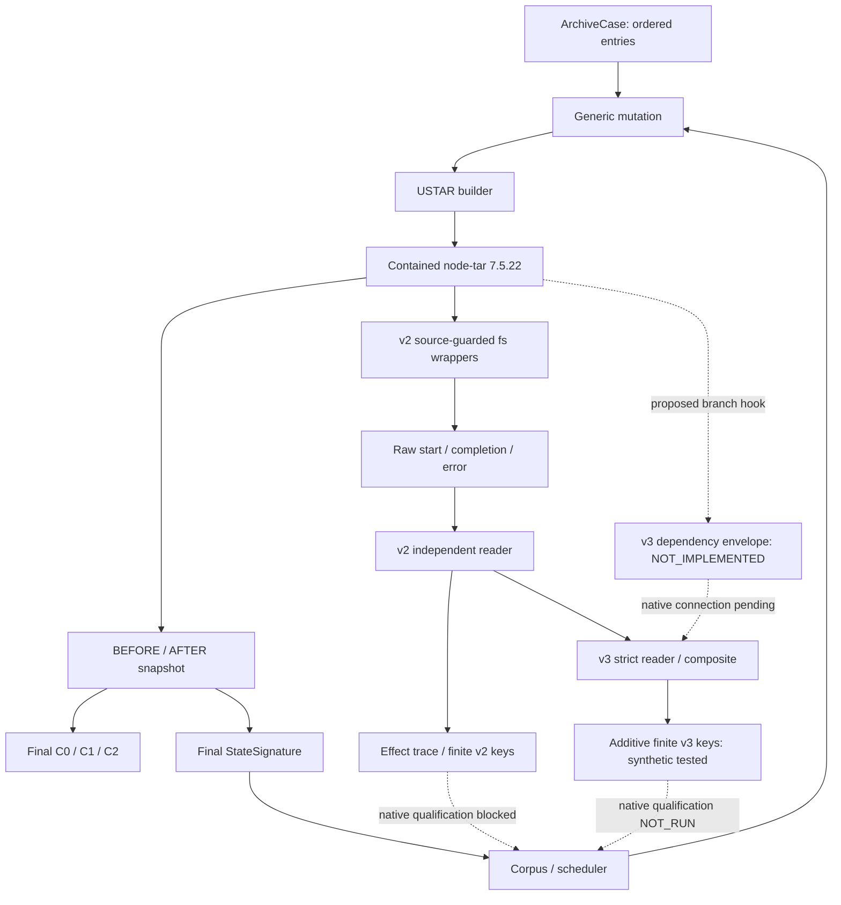
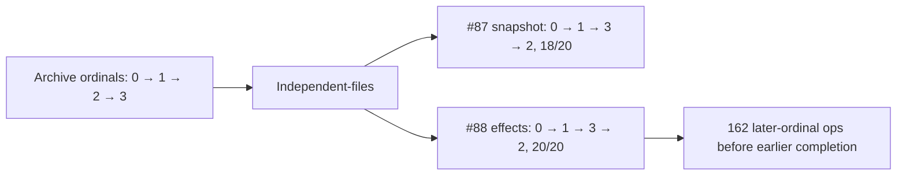
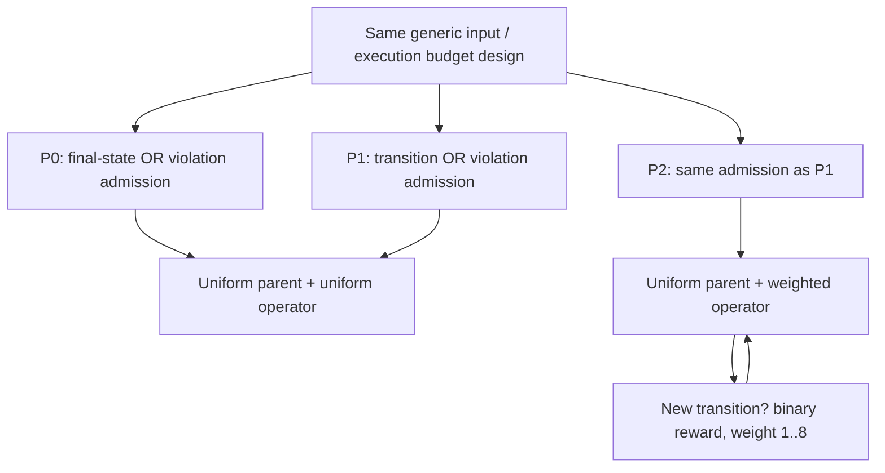
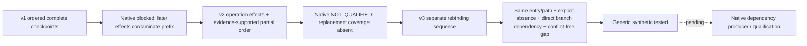
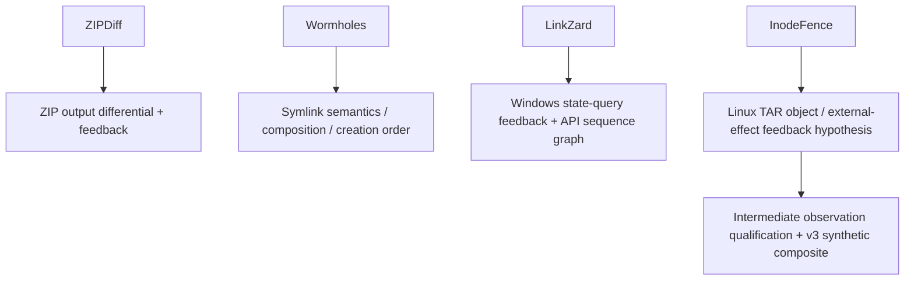
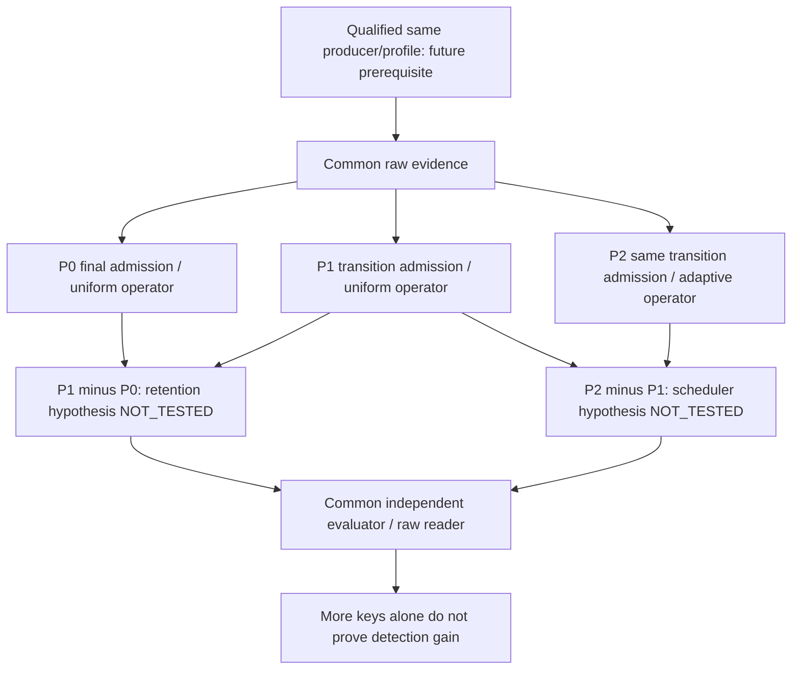
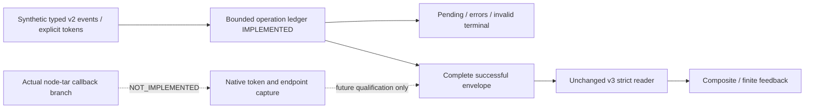
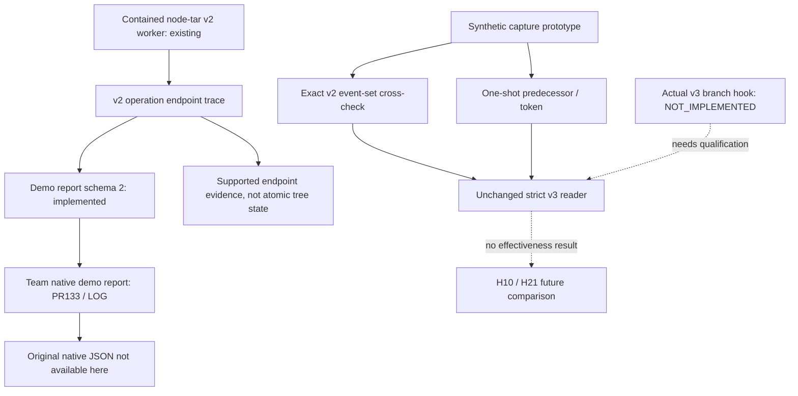

# 중간 상태 관찰 구조도

> 10/24 현재: 기존 그림의 qualification blocked 표기는 연구 qualification에 해당한다.
> bounded **v2 demo 연결은 현재 코드에 존재**하고 팀 실행 보고가 있다. v3 native 연결은 없다.
> MIDTERM 우선순위 P0와 비교 정책 P0/P1/P2는 다른 용어다.

기준 revision과 근거는 [보고서](intermediate-observation-report.md), [색인](evidence-index.md)에 있다.
실선은 현재 구현 관계, 점선은 제안 연결이다. 그림은 새 실행 로그가 아니다.

## 전체 구조: 확인된 구현과 미완성 연결



## 가상 타임라인: 입력 소비와 작업 완료 분리

다음은 이해를 위한 **가상 예시**다. 지연을 넣어 실행한 실험이 아니다. B는 A와 독립 경로다.

```mermaid
sequenceDiagram
  participant P as TAR Parser
  participant U as Unpack / reservations
  participant FS as Filesystem APIs
  participant O as Observer
  P->>U: entry 0 A (large regular)
  U->>FS: A open/write started
  P->>U: entry 0 body end; entry 1 B
  U->>FS: B mkdir started
  FS-->>U: B mkdir callback complete
  U->>O: entry 1 settled
  FS-->>U: A write / metadata / close complete
  U->>O: entry 0 settled
  Note over FS,O: A callback 시점 snapshot에 B가 이미 존재할 수 있음
```

## 과거 관측 기록의 순서

출처: #87 private snapshot summary, #88 causal-effect summary. 이번 raw 재관측이 아니다.



이 숫자는 callback/operation 관측 관계다. timestamp만으로 모든 물리 effect의 총순서를 복원하지 않는다.

## P0·P1·P2의 변경 변수



## v1 → v2 → v3 모델 변화



v3는 v2 판정을 소급 변경하지 않는다. v1 private qualification의 실험 번호 v3와도 다르다.

## 기존 연구와의 비교 축



이 그림은 분류이며 성능 순위가 아니다. 원문·한계·확인되지 않은 항목은 보고서 비교표를 따른다.

## 10월 23일: 관찰과 정책 효과의 비교 논리



## 10월 23일: 합성 구현과 native 제안의 경계



prototype이 제공하는 token은 합성 입력이다. arrow 순서나 시간으로 native dependency를 만들어내지 않는다.
실제 전체 filesystem snapshot은 이 그림에 없으며 event endpoint 관찰을 전체 tree로 합성하지 않는다.

## 10/24 현재 연결과 증거 경계



schema2 event 배열은 entry/start 순이며 completion sequence는 별도 값이다. event0·not_observed·null·
explicit absent를 구분한다. cap64 잘림은 total/truncated 표시와 함께 보여야 한다.
