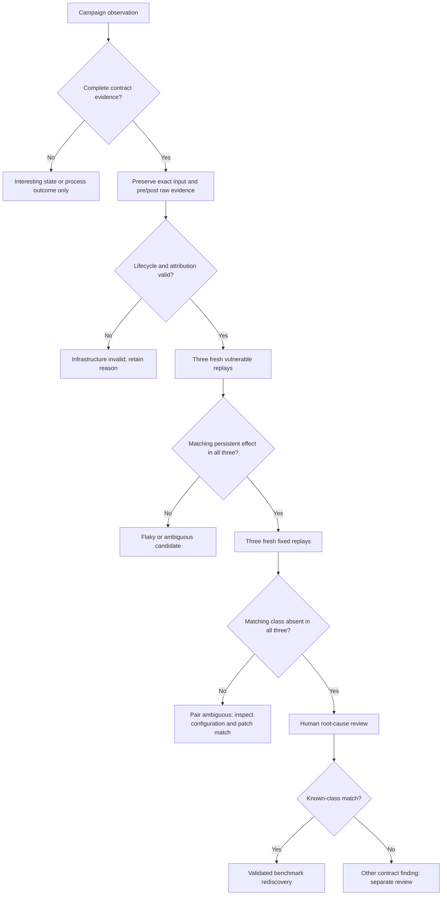

# Controlled rediscovery and evaluation protocol v1

**PREDECLARED PLAN — NO EXPERIMENTAL RESULTS.** Implementation and execution
require accepted global Phase-4 closeout → remaining P01–P05 implementation →
a new benchmark Task Contract. Pre-audit freeze, Phase-1/2 audits and Phase-3 fixes
are completed; this Draft does not assert global/evaluation readiness. [Set v1](benchmark-set-v1.md) fixes the cases; [baselines/ablations](baseline-and-ablation-v1.md)
fix independent variables. Apply repository experiment-validation skill before
promoting raw runs. This protocol does not authorize PoC execution in this lane.

## Experimental unit and independent variables

| Research question | Measurement connection | Interpretation limit |
| --- | --- | --- |
| RQ1 Rediscovery | Confirmed success, censored first-hit index and identical-input affected/fixed replay | Only admitted classes/releases and declared grammar |
| RQ2 Feedback effectiveness | Paired B3 versus B0/B1 success and first-hit summaries | B0 changes overall search policy; B1 isolates violation admission; no path-only/fixed-recipe comparison |
| RQ3 Ablation | A1/A2/A3 versus B3 on declared subsets, common full-state counts | Redundant nlink/fingerprint signals remain; projections preserve security evidence |
| RQ4 Generality | Qualified Node and ORAS evidence under the same oracle | Unevaluated with fewer than two families; not universal coverage |
| RQ5 Unknown-state discovery | Preserve unrelated contract candidates separately | Exploratory; no new vulnerability or zero-day requirement |

State/fingerprint/corpus counts explain search behavior; **more state signatures
!= more vulnerabilities**. Throughput is an infrastructure feasibility metric
including setup/observation, not just target process time.

One campaign = benchmark × exact target version × search policy × RNG seed ×
frozen environment/setup profile. Fresh runtime for each input, new search corpus
for each campaign. The same logical seeds, grammar, dictionary, oracle, setup,
limits and engine commit are used on both versions and all feedback comparisons.
Only target package version changes in a vulnerable/fixed pair. Only declared
search policy changes in a baseline comparison. No corpus is shared across
conditions. Random seed equality does not imply identical evolved inputs:
feedback changes parent pools. Record lineage and actual generated cases.

## Budget, repetition and scheduling

Numeric values below are **proposed planning parameters, not frozen runnable
configuration or measured results**. Freeze only after isolated full-path
qualification, safe throughput/storage/memory evidence and policy implementation.
Lock the protocol revision and complete schedule before formal runs. No value
asserts that ExperimentConfig supports these policies now.

- Qualification pilot: 5 independent seeds 9001–9005, 200 executions per
  admitted condition. Pilot data is separate, never added to formal estimates.
  Establish environment, runtime compatibility, export feasibility and throughput;
  no PoC-derived seeds or guaranteed-hit recipes. A no-hit pilot is inconclusive.
- Formal v1: 20 independent campaign seeds 1001–1020, **1,000 executions per
  campaign, inclusive of all four initial seeds**. The 996 mutation executions
  include deterministic no-ops, repeated cases, safe rejections, target failures
  and timeouts. No replacement mutation, free retries or invalid-input discounts.
- Per-target execution timeout: **5 seconds** for every primary condition,
  with identical CPU/memory/process/filesystem limits and container startup
  accounting within each comparison. Container resource values are taken from
  the audited infrastructure profile, frozen before pilot, and recorded exactly.
  Do not invent an isolation setting that current backend does not implement.
- No search warm-up and no discarded initial steps. Image builds/package fetches
  and one benign operational readiness check per version occur before measurement;
  measure full per-input isolation/setup/observation costs during campaigns.
- Run to the full execution budget even after a candidate hit. Replay and
  adjudication happen afterward with a separate recorded validation budget.
  A host watchdog of 2 hours per campaign detects stalled infrastructure; an
  abort below 1,000 results is incomplete data, never ordinary no-hit censoring.
- Execute one campaign at a time on the chosen host. In each benchmark/RNG block,
  use an explicitly saved schedule shuffled with independent scheduling seed 4242
  to distribute version/policy order; it must not consume campaign RNG.

Use B3 vulnerable/fixed for RQ1/discrimination: 4×2×20 = 160 campaigns.
Add B0/B1 vulnerable only for feedback effectiveness: 4×2×20 = 160 campaigns.
Reuse vulnerable B3 results; do not rerun them for a favorable comparison.
This is 320,000 formal search executions before targeted ablations. Fixed
B0/B1 campaigns are optional extra cells, not required for the primary feedback
question; same-input cross-version replay supplies the stronger discrimination
check. Exact ablation subsets add 100,000 executions (see plan), total 420,000.

At 1 second full-step latency this is about 117 hours serially; a 5-second
all-timeout workload exceeds 24 days before overhead. Pilot median/p95 full-step
latency, rejection/timeout rate, raw bytes and peak memory decide feasibility.
If infeasible, amend the plan **before any formal run** using throughput/resource
facts, e.g. uniformly reduce budget to 500 and defer mutation ablation. Record
old/new version, reason and all scheduled cells. Do not adapt budgets per
benchmark based on pilot hit rate or keep successful formal runs while changing
others. A later 10,000-execution extension, if justified, is a separate protocol
and reports all original no-hit cells, not only promising seeds.

## What counts as rediscovery

A known-class rediscovery requires all of the following:

1. A mutated input generated from the declared benign seeds (seed-phase hit is
   a qualification/setup anomaly, not credited as discovery).
2. Complete generic C0/C1/C2 raw evidence for the candidate's selected effect.
3. The exact input reproduces the matching relation/effect on the vulnerable
   version in **3 of 3 fresh independent replays**, with the same setup.
4. The exact input produces **no matching known-class evidence in 3 of 3
   fresh replays on the selected fixed version**, with equivalent configuration.
5. Human root-cause review links archive semantics, patch behavior and surviving
   effect to the benchmark class; generic oracle never tests CVE/version IDs.

For identity cases N01/N03/O01, persistent C1 is sufficient; C2 metadata is
corroboration, bytes need not change. C2-only nlink/ctime is not automatically
class evidence when the alias no longer exists. For N04 accept protected-file
C2 content/size effect or C0 external namespace effect with matching cache
transition semantics. A harmless internal link, dangling external symlink,
interesting state, nonzero exit, crash or timeout is insufficient. An input
that hits another known class is reported as other-class evidence, not credited
to its scheduled benchmark. No post-extraction application writes are inserted
to manufacture C2.

No rediscovery = complete valid campaign exhausts budget with no subsequently
confirmed matching input. This does not assert absence of the vulnerability.
Ambiguous = flakiness, insufficient root-cause match, incomplete observation or
matching evidence on both selected versions. Preserve all generic violations
and classify separately; a fixed release can still have unrelated known issues.
Infrastructure failure = invalid/missing target pin, configuration drift,
boundary failure, missing observation, export loss, engine exception, host
watchdog or failed cleanup. It is not an extractor security verdict or no-hit.

## False-positive and interpretation flow

Review actor attribution and observation completeness first: HARNESS writes by
adapters, unmapped container paths, unrelated baseline changes and unfinished
children invalidate interpretation. Inspect actual dev+inode pairs, not inode
alone; distinguish lstat symlink objects from referents; inspect C2 field labels
and values. Ctime-only changes may be real contract evidence but do not prove
bytes changed. Never edit raw results to suppress inconvenient fields.
Interesting observation ≠ violation ≠ rediscovery ≠ new vulnerability. Follow
[SECURITY.md](../../../SECURITY.md) for any unclassified finding; no exploitability
escalation or automatic public disclosure is part of adjudication.

## Exact metrics

Let N=1,000 configured executions, E=number of complete valid RunResults, K=20
scheduled campaigns per cell, V=number of complete infrastructure-valid campaigns,
H=number with a validated matching rediscovery, I=interesting observations under
a variant's declared key, R=retained unique mutation parents. Seeds contribute
to E, I and representation counts; rediscovery hits must be mutation-origin.
Report scheduled/complete/invalid counts beside every aggregate. Let A be
complete campaigns with unresolved/ambiguous candidate classification. Show
confirmed yield H/V as a lower bound and (H+A)/V as a possible upper bound when
A>0; do not report unresolved candidates as confirmed ordinary no-hit. Their
time-to-hit values remain pending, rather than receiving ordinary no-hit censor
labels. Cumulative confirmed-hit fractions include them conservatively as not
confirmed, with unresolved counts shown. Final ordinary censor quantiles require
adjudication completion or an explicit pending-data limitation.

| Metric | Numerator / denominator; unit | No hit / target failure / timeout / infrastructure handling |
| --- | --- | --- |
| Rediscovery success proportion | H/V complete campaigns; also H/K scheduled campaigns as conservative yield; percent and counts | Complete no-hit = 0; returned timeout/failure remains eligible if complete matching evidence; invalid runs excluded from H/V but shown in H/K and reason counts |
| Executions to first confirmed class evidence | 1-based original campaign index of earliest subsequently validated matching case; denominator one campaign; executions | Complete no-hit right-censored at N, reported `>N`; never give it a fictitious hit at N. Invalid truncated campaign separate |
| Time to first confirmed class evidence | Monotonic seconds from first seed pipeline setup through completed return/cleanup of earliest confirmed original step; one campaign | No-hit right-censored at completed campaign elapsed; target timeout costs included. Post-campaign replay/adjudication time excluded and reported separately. Current ExecutionResult.duration_seconds alone is insufficient |
| Unique StateSignatures | Count of distinct full v3 signature values over E; states/campaign; auxiliary count/E states per execution | All returned statuses included; no novelty from missing snapshot. Raw count is not number of bugs and digest/path novelty can inflate it |
| Unique violation fingerprints | Distinct canonical generic fingerprints over E; classes/campaign; auxiliary count/E | No-hit can still have unrelated violations. Values omit effect direction; count is not vulnerability count |
| Corpus growth | R_end − R_after_seed; parents/campaign; auxiliary growth/(E−4) | Report R_after_seed and R_end; fixed-seed policy has zero growing corpus; never compare raw size as effectiveness |
| Interesting-observation rate | I/E; percent | Variant-specific denominator includes seed/no-op/reject/failed/timed-out complete steps; only descriptive across different keys |
| Repeatability | Successful fresh vulnerable replays / 3 per candidate; full semantic campaign repeats on pilot / scheduled pilot repeats | 3/3 required for confirmation; record each failure; do not demand equal raw inodes/timestamps |
| Paired vulnerable/fixed discrimination | Count of identical candidate inputs with matching vulnerable 3/3 and fixed 0/3 / all deduplicated matching inputs nominated for review; percent | Replay failure or incomplete evidence = unresolved, reported in denominator and category count. Also report per-seed campaign hit/no-hit pairs, with invalid pairs separate |
| Process and infrastructure outcomes | Each returned status count/E; infrastructure-invalid campaign count/K; percentages/counts | Failures/timeouts are not successes by themselves. Keep all statuses and exception reasons; no discounts |

All nomination cases receive deterministic adjudication in ascending original
step order; deduplicate by case_id within benchmark/environment and record all
original occurrences. Earliest confirmed occurrence determines hit index.
If validation resources run out, mark unresolved cases and the campaign
classification pending; never relabel them as no-hit or drop them from tables.

Keep analysis representation counts based on full unablated v3/fingerprints for
all variants, independently of feedback eligibility. Distinguish these common
analysis counts from each policy's own seen-key counts and I/E. Report diagnostic
throughput E/full campaign seconds, useful bytes retained and malformed/rejected
rate, without ranking effectiveness by archive rejection or raw novelty alone.

## Censoring and summaries

A right-censored no-hit means only “later than the observed budget,” not a
missing observation. Publish every seed's hit/censor flag and index; plot
cumulative confirmed-hit fraction at 100, 250, 500 and 1,000 executions using
all V complete campaigns. Use empirical event-time quantiles over all campaigns:
if the hit fraction never reaches 0.25/0.50/0.75, report that quartile as
`>1,000` / not reached. Do not average or take a median only over successful
campaigns. Conditional successful-run latency may be supplemental and must say
its denominator. For time-to-hit use a descriptive Kaplan–Meier curve with
no-hits censored at actual elapsed time; state independent-censoring limitations
and do not claim significance from differing campaign durations.

Success proportions show counts and 95% Wilson intervals for V complete
independent RNG trials. Seeds are independent pseudo-random trials, not proof
of representativeness beyond this set. Show paired B3−B0/B1 success differences
and discordant seed counts; no significance claim or large multiple-testing
matrix is predeclared. Median/IQR suit complete per-campaign descriptive counts
and throughput. Report benchmarks separately; an optional macro mean gives
each benchmark equal weight and never pools executions across targets.

Record initial incomplete attempts as invalid in a separate ledger. After a
verified infrastructure fix rerun the **whole benchmark/seed comparison block**
under a new dataset revision; archive prior attempts. Published denominators
cannot silently grow until success. Unknown observer/harness exceptions are
triaged before the next run. Cross-host datasets stay stratified unless their
configuration and effects are independently shown comparable.

## Provenance and evidence retention

Before the first run freeze clean InodeFence Git SHA; target source/tag/package
hash, Node or Go compiler version, complete dependency locks; worker command,
options, actual CWD; container image digest/backend version/validated boundary
profile; OS/kernel/architecture; CPU model/count and resource allocation; memory;
filesystem type/mount flags/device relation; uid/gid/umask/protected_hardlinks;
sentinel names/content digest/mode; actual target-visible root mapping; grammar,
dictionary, seed IDs, RNG implementation/seed, policy IDs, budget/timeout;
schedule and protocol/catalog revision hashes; start/end UTC plus monotonic
durations. Environment labels and config IDs alone are not this evidence.

Retain immutable experiment configuration, manifest, all full canonical steps,
inputs/regeneration information and TAR checksums, stdout/stderr, before/after
snapshots, violations, feedback decisions, lineage and failure ledger. Logical
case bytes are available in RunResult; future replay reader must rebuild the
same TAR and verify its recorded hash. Current export retains completed campaigns
only: incremental/exception-safe evidence is a documented gap, not an existing
API. Pilot determines whether O(budget) memory and export volume fit the limits.
Record immutable shared raw storage URI, SHA-256 manifest for every artifact and
analysis script/source revision. Retain raw data through review and paper
submission; no deletions before maintainer agrees an archival location.

Derived summaries live in experiments/summaries only after validation; empty
[table templates](../../../experiments/benchmarks/result-templates.md) stay
planning. Do not fill paper/ with unvalidated or fabricated numbers.

## Claims this design could support

With successful controlled evidence: representative Linux TAR extraction
filesystem-state violations can be rediscovered from benign seeds; under these
fixed policies, budgets and versions, feedback may improve rediscovery yield or
latency over the specified unretained/state-only baselines; common contracts can
express effects in qualified Node and Go targets. Declare any M1 extension when
stating these results; do not attribute them to untouched Generic Mutation v1.

It cannot establish universal archive coverage, superiority over all fuzzers,
a zero-day, guaranteed extractor safety, first-ever state fuzzing, actual secret
exfiltration, general race detection, or causal proof of check/use coherence.
No-hit fixed runs support only absence of observed matching evidence in this
budget. B1 is full StateSignature novelty, **not path-only feedback**. Existing
RQ2 fixed-recipe/path-only comparisons remain unevaluated unless a separately
specified comparison is added; no misleading substitution is permitted.

## Post-audit timing and failure ticket precision

At reviewed #39, PreparedContainer.execute starts monotonic timing immediately
before attached start and ends after stop/wait/inspect (or startup-race removal).
It includes CLI start/attach/draining and verified termination, not TAR building,
sentinel setup, container creation/inspection before BEFORE, snapshots, oracle/
feedback, normal container removal, sandbox removal, corpus selection/mutation,
admission/provenance capture, Node bind/identify or export. Snapshot phases are
not timestamps. No complete campaign elapsed/first-evidence clock exists.

Future P04 needs an orchestration monotonic origin, per-step start/evidence-ready/
fully-completed offsets and campaign completion/failure offset, with start/end UTC
for scheduling only. Full-step cost includes build/setup, container preparation,
BEFORE, start/termination, AFTER/analysis and backend/runtime cleanup. Only a
successful run_case return after both cleanup contexts is a completed step.
Evidence computed before cleanup is provisional if cleanup subsequently fails.
The time-to-first-confirmed-evidence metric uses that completed original step's
offset; later replay/adjudication costs are separate. Report full campaign elapsed
from admission through completion, search elapsed from first seed setup, and
bind/identify/preflight/export costs separately; do not silently discard them in
throughput or extrapolate container cost from target durations.

Infrastructure-invalid attempts include unavailable image/runtime, bad container
policy/start, attached disconnect, uncertain stop/removal, output overflow,
builder failure, incomplete BEFORE/AFTER, identity/config drift and export IO/
encoding failure. Current exceptions abort without a partial CampaignResult;
completed earlier steps stay only in memory, while partial export may lack a
manifest. OutputLimitError preserves a bounded prefix in the exception but has
no durable ledger. None is a target nonviolation or ordinary no-hit censor.

The post-audit ledger must preserve frozen config/source/artifacts, attempt/index,
phase, exception, bounded output/available snapshot evidence, last fully complete
step, cleanup outcome and incomplete-artifact checksums, even when no final result
returns. Export failure is distinct from execution failure. Completed records
need append/durability semantics and tamper checks; torn records/uncertain cleanup
must remain invalid. Controlled clocks/exceptions/IO failures can test this with
benign doubles; no vulnerable target is required to validate the infrastructure.

## Post-audit replay/adjudication ticket precision

Current manifest v4 supplies stored policy/image/runtime/target/sentinel facts,
verified worker/lock origin (IsolationProvenance v2), config ID, seed IDs, executed
contexts and steps SHA-256. Each canonical step contains logical ArchiveCase/content,
case ID, TAR SHA-256/builder format, command/status/duration, full BEFORE/AFTER,
tagged v3 signature, violations, lineage and feedback. Optional experiment.json
and its checksum are published in the same complete bundle when supplied; an
unconfigured export can omit it. A future qualified campaign must retain the exact
config artifact. There is no reader, retained TAR byte file, replay runner/record,
original nomination timestamp or incremental failure history. EC-01 was resolved
by #45; runtime UUID/inode/time need not match across replays. Strengthened EX-004
export sync regression coverage does not implement P04's infrastructure-failure ledger.

P05 must verify manifest/steps checksums, schema/complete-record counts, original
case ID and raw spelling/order/content, then rebuild with the pinned builder and
reject a TAR hash mismatch before executing anything. Record any ORAS namespace/
gzip transport hash separately and reproduce the same wrapper mapping. Select
candidates deterministically from all completed raw steps, independently of
whether search admitted them. Link each nomination to its original step/index.

Replay the identical logical input/TAR in three fresh affected runs and three
fresh fixed runs with complete raw evidence and verified teardown. Each member
matches its own frozen version/config/image identity; affected and fixed configs
necessarily differ in declared target artifacts. Compare a documented invariant
setup/options/runtime/policy subset, not equality of their full config hashes.
Record all six results, failed attempts and root-cause adjudication separately.
Matching 3/3 affected versus 0/3 fixed satisfies the planned classification only
with lifecycle-valid generic C0/C1/C2 evidence and source correspondence. Flaky,
infrastructure-invalid or unadjudicated inputs remain separate/pending; no CVE
number or version condition enters Oracle. Benign round-trip/tamper tests and
mocked six-run adjudication must precede any separately authorized affected replay.
