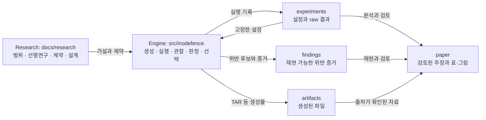
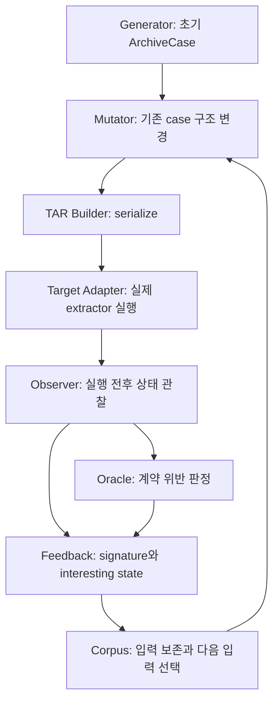
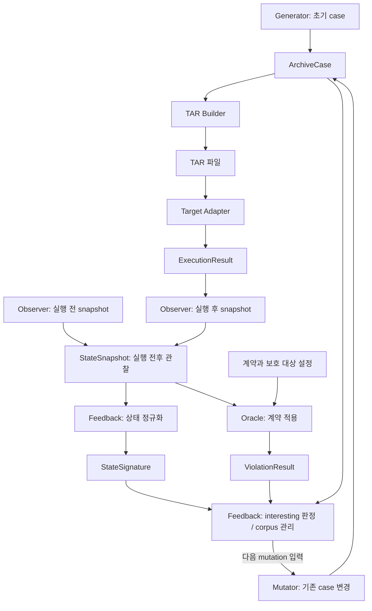

# 시스템 아키텍처

이 문서는 상세 아키텍처의 canonical source다. 하위 README는 자기 폴더의 책임과 탐색 경로만 설명한다. 계약 정의는 [security-contracts.md](security-contracts.md), 설계 결정은 [../../DECISIONS.md](../../DECISIONS.md)를 따른다.

## 현재 상태와 계획

현재는 **Layer 1 완료, Layer 2 공통 Data Model 시작 직전**이다. 개발환경과 smoke test가 있으며 기존 엔진 하위 패키지는 빈 `__init__.py`만 갖는다. `model/`에는 안내 문서만 있다. 아래 pipeline과 모델 이름은 설계이며 실행 가능한 API를 뜻하지 않는다. 최신 진행 상태는 [../../STATUS.md](../../STATUS.md)를 본다.

먼저 최소 end-to-end 관찰 경로를 만들고 mutation과 feedback으로 확장한다. **Stage는 pipeline 책임**, **Layer는 개발 진행 단계**다. 아래 Generator를 개발 Layer 1로 해석하지 않는다.

## Research → Engine → Evidence

“파일 이름뿐 아니라 같은 object를 가리키는 관계도 feedback에 유용한가?”는 연구 질문이다. 엔진이 기록한 내부 파일과 외부 sentinel의 identity 관계는 관찰 자료다. 비교 실험과 재현 검토를 거쳐야 논문 주장의 근거가 된다. raw 결과나 finding 후보 자체를 성능·novelty의 증명으로 취급하지 않는다.

Filesystem 실행 공간은 저장소의 `artifacts/`나 source bind mount가 아니라 Linux volume의 `$INODEFENCE_RUNTIME_ROOT`(기본 `/var/lib/inodefence`)다. 외부 sentinel도 host 파일이 아니라 disposable run sandbox의 `outside/`에 둔다. 저장소에는 의도적으로 보존할 증거만 옮긴다.

## Pipeline과 소스 디렉터리

이는 책임 흐름이다. Observer의 사전 snapshot은 extractor 실행 **전**에 필요하다. 최초 최소 관찰 경로에는 mutation과 feedback loop가 없어도 된다.

| Stage / 공통 역할 | 소스 경로 | 책임 | 경계 |
| --- | --- | --- | --- |
| 공통 Data Model | [model/](../../../src/inodefence/model/README.md) | 모듈 간 입력·결과 표현 | 실행·mutation·판정 없음 |
| Seed Generator | [generator/](../../../src/inodefence/generator/README.md) | 작고 정상적인 초기 case 생성 | 기존 case 변형은 Mutator |
| Structure Mutator | [mutator/](../../../src/inodefence/mutator/README.md) | entry type/path/link target/order/추가·삭제·복제/dependency 변경 | CVE recipe 하드코딩 없음 |
| TAR Builder | 배치 미확정; [generator 안내](../../../src/inodefence/generator/README.md) | 내부 case를 실제 TAR로 serialize | mutation 정책과 실행에서 분리 |
| Target Adapter | [targets/](../../../src/inodefence/targets/README.md) | target별 실행 방식과 결과 기록 | target-specific logic은 이 경계에 둠 |
| State Observer | [observer/](../../../src/inodefence/observer/README.md) | filesystem의 실행 전후 사실 기록 | 취약 여부 판정 없음 |
| Security Oracle | [oracle/](../../../src/inodefence/oracle/README.md) | snapshot에 일반화된 계약 적용 | filesystem 실행·mutation 없음 |
| Feedback / Corpus | [feedback/](../../../src/inodefence/feedback/README.md) | signature, interesting 판정, corpus 보존·선택 | 계약 정의 없음 |

TAR Builder 전용 패키지나 pipeline 조율 코드의 위치는 아직 정하지 않았다. 이번 문서 정비로 새 구현 위치나 interface를 확정하지 않는다. Snapshot 준비 → target 실행 → snapshot 수집의 조율을 개별 모듈의 판정 로직과 혼합하지 않는다.

## 계획 중인 Data Flow

`ExecutionResult` 자체가 filesystem 상태를 포함한다는 의미는 아니다. 실행 기록과 sandbox 관찰 대상을 연결해 Observer가 상태를 수집한다. `StateSignature`와 `ViolationResult`는 snapshot에서 갈라지는 서로 다른 결과다. Oracle이 signature만 받아 판정하는 직렬 구조가 아니다.

| 모델 후보 | 의미와 쉬운 예 | 주 소비자 |
| --- | --- | --- |
| `ArchiveEntry` / `ArchiveCase` | `notes.txt` 파일과 `notes/` 디렉터리 같은 entry의 내용·관계·순서 | Mutator, TAR Builder |
| `ExecutionResult` | 어떤 extractor 실행이 종료·실패·timeout했는지 기록 | 관찰 경로, 증거 기록 |
| `ObjectSnapshot` / `StateSnapshot` | path, type, identity, sentinel 전후 상태 | Oracle, Feedback |
| `StateSignature` | run 간 비교할 수 있게 표현한 보안 관련 상태 | corpus 선택 |
| `ViolationResult` | 어떤 계약의 위반 후보인지와 판정 근거 | Feedback, finding 기록 |

필드와 Python API는 다음 구현 Layer에서 정한다. Run마다 달라지는 inode 숫자 자체보다 identity **관계**를 비교할 필요가 있다는 설계 의도가 있다. 정확한 signature 정규화와 interesting 기준은 미구현·미확정이다.

## 관찰, 판정, 선택의 차이

설명용 예: disposable sandbox에서 `extract/result.txt`와 `outside/sentinel`의 `(st_dev, st_ino)`가 같다고 하자.

1. **Observer**는 “두 경로가 같은 identity를 갖는다”는 사실과 sentinel 전후 상태를 기록한다. 취약 여부를 판단하지 않는다.
2. **Oracle**은 보호 대상 설정과 C1(Object Identity Confinement)에 따라 의도하지 않은 공유인지 판정한다. sentinel을 직접 수정해서 시험하지 않는다.
3. **Feedback**은 그 관계가 기존 corpus에 없던 보안 관련 상태인지 평가해 입력 보존 여부를 결정한다. 새로운 상태가 항상 계약 위반인 것은 아니다.

종료 코드만으로 취약 여부를 판정하지 않는다. 추출 실패 후 남은 상태도 관찰 대상일 수 있다. Target의 실행 옵션·버전·instrumentation은 generic mutation, observer, oracle, feedback에 섞지 않는다.

## 초기 설계와 확장 순서

초기 seed는 사람이 이해할 수 있는 작은 정상 case로 제한한다. Known CVE PoC는 rediscovery의 기본 seed로 쓰지 않는다. Mutation operator는 entry 구조에 대한 generic 변경이며 특정 CVE나 Wormholes bypass를 encoding하지 않는다.

초기 target 우선순위는 node-tar → oras-go → 일정이 허용하면 GNU tar다. Benchmark에서는 버전을 따로 고정하며 현재 adapter 구현은 없다.

초기 Observer는 full operation trace 대신 pre/post snapshot을 사용한다. 관찰 후보는 relative path, object type, `st_dev`, `st_ino`, `st_nlink`, mode, size, symlink target, 선택 object의 content hash, 보호 sentinel 상태다. 중간 operation 순서나 모든 check/use 불일치를 pre/post snapshot만으로 증명한다고 가정하지 않는다.

Oracle 우선순위는 C0(Path Boundary Confinement) → C1(Object Identity Confinement) → C2(External Effect Noninterference)다. C3(Extraction Root Integrity)는 이후 확장하고 C4(Check/Use Coherence)는 필요한 instrumentation 이후에 다룬다. 정의는 [security-contracts.md](security-contracts.md)에만 둔다.

Feedback은 상태를 안정적인 signature로 변환하고 새로운 security-relevant state를 만든 입력을 보존·스케줄링한다. 이 메커니즘의 연구 가치는 아직 검증할 가설이다.

| Milestone | 계획된 결과 |
| --- | --- |
| 1 — 최소 관찰 경로 | 작은 Known TAR → 하나의 target → sandbox → pre/post snapshot → path/identity/effect oracle |
| 2 — Generic TAR 생성 | 내부 data model로 동일한 TAR case 생성 |
| 3 — Mutation | generic structural mutation 추가 |
| 4 — Feedback Loop | interesting state 입력 보존과 다음 mutation 선택 |
| 5 — Evaluation | baseline, ablation, known-vulnerability rediscovery, current-version campaign |

Milestone은 목표 pipeline을 설명하며 개발 Layer를 대체하지 않는다. 바로 다음 구현 작업은 [STATUS](../../STATUS.md)의 `ArchiveEntry`와 `ArchiveCase` 정의다.
