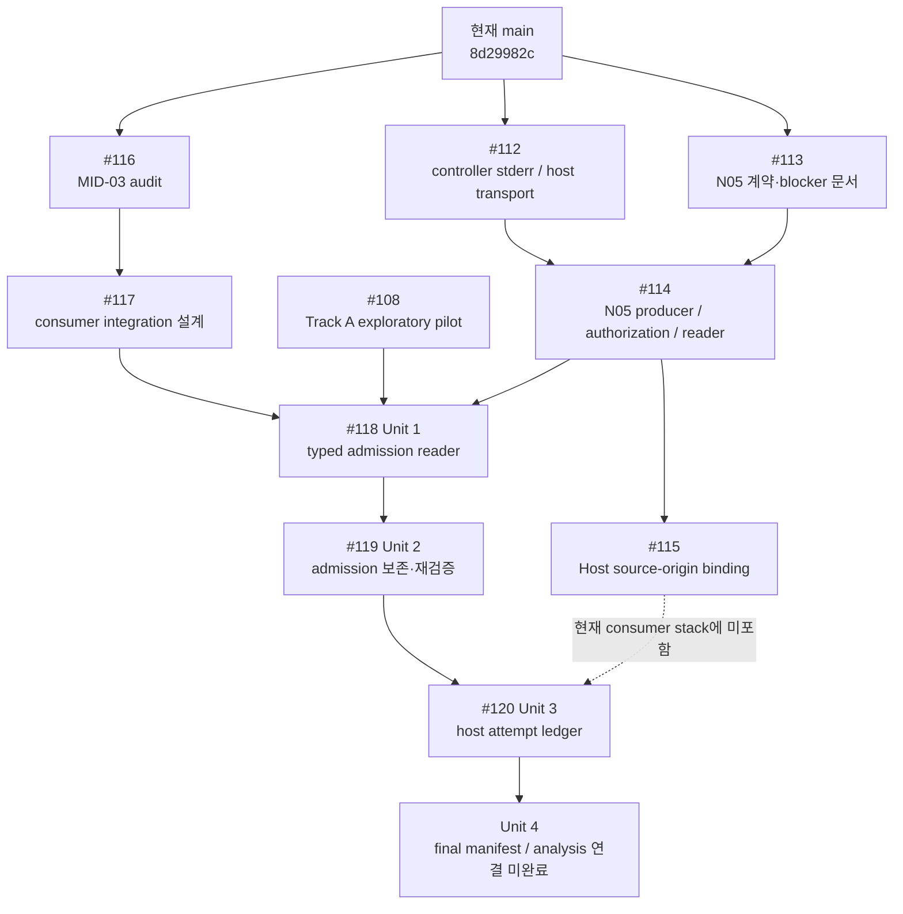
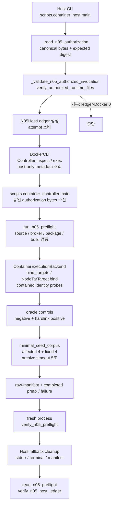

# N05 / Track A 통합 준비상태 감사 보고서 (2026-10-23)

> **출처·범위:** 연구 책임자가 제공한 2026-10-23 로컬 Daybreak Blue 기반 **AI-assisted read-only audit** 원문을 보존한 문서입니다. 아래의 로컬 테스트·GitHub CI·환경 관찰은 *원 감사의 보고 내용*이며, 이 문서 등록 과정에서 독립 재실행하거나 사람 검토로 승인한 결과가 아닙니다.
>
> **기준점:** `main@8d29982c26cebfcce7a413b3ba9177fcd28078de`, `#115@e83349ed1592d536e3ec0fce3c7cb204cb5c6ec9`, `#120@02072c95537d76d1b213b9c858d96c97fff653cc`. GitHub의 이후 변경 사항은 이 snapshot에 반영되지 않습니다.
>
> **판정:** 코드 통합 **CONDITIONAL_READY / HUMAN_REVIEW_REQUIRED**. N05와 Track A는 **BLOCKED / NOT_AUTHORIZED / NOT_RUN**. 이 문서는 실행 승인, PR 승인 또는 N01의 인간 검증을 대체하지 않습니다.
>
> **공개 범위:** 개인 Mac 절대경로는 `<MAC_PROJECTS_REDACTED>`로 치환했습니다. 감사 원문에 링크된 임시 inventory는 공개·보존되지 않았습니다. Git SHA·코드 경로·검증 주장과 해당 한계는 원문대로 유지했습니다.

---

**1. Executive Summary**

이번 감사의 결론은 **#114/#115 코드 통합은 조건부 가능하지만, N05와 Track A 실행은 아직 BLOCKED**라는 것입니다. 2026-10-23에 다시 조회한 원격 `main`은 **`8d29982c26cebfcce7a413b3ba9177fcd28078de`**입니다. #114는 #112·#113의 정확한 커밋을 포함하며, #115는 #114 Head에 대한 단일 후속 수정입니다. #115는 승인된 checkout을 검사하면서 다른 checkout이나 설치본의 Host 코드를 실행할 수 있었던 문제를 해결하고, source-origin 거부가 attempt를 소비하지 않도록 검사 순서를 바꿉니다. 직접 실행한 안전한 Host 테스트는 **28 passed**였고, 기존 GitHub CI 로그에서도 #114의 **1,628 passed**, #115의 **1,634 passed**를 확인했습니다. 그러나 최종 실행 소스·실행 승인·패키지 tarball·fresh Controller/volume은 아직 준비되지 않았습니다. 또한 #118~#120에는 #115가 없으며, Controller가 Host/Linux 증거를 같은 절대 경로로 읽어야 한다는 consumer 요구와 N05의 엄격한 mount 구성을 함께 해결해야 합니다. **Consumer와 배치 구성을 완성한 뒤 최종 SHA를 동결하고, 그 SHA에 대해 N05를 한 번 승인하는 순서**를 권고합니다.

코드·기존 브랜치·PR·실험 원본은 변경하지 않았습니다. 로컬 `main@919d723b7eb3bf13b060d3ae34b083499590b4fc`와 기존 `.devcontainer/devcontainer.json` 수정도 보존했습니다. 별도 임시 clone에서만 정적 분석과 안전한 테스트를 수행했으며, 실제 N05·역사적 타깃·퍼징 캠페인은 실행하지 않았습니다.

---

**2. PR 의존성 관계도**



**원격 상태**

다음 10개 PR은 모두 **Open / 미병합**입니다. 모두 `check`와 `container-integration`이 성공 상태였으며, 제출된 GitHub review와 inline review comment는 각각 **0개**였습니다. #108·#116의 일반 댓글은 검토·인계 요청이며 실행 승인이나 PR approval이 아닙니다.

| PR / 현재 제목 | 작성자 | Draft | 변경 파일 |
|---|---|---:|---:|
| [#108 — feat: prepare bounded Track A B0/B1/B3 exploratory pilot](https://github.com/TheWaitForAGI/InodeFence/pull/108) | jiwoongchoi-norun | Yes | [10개](https://github.com/TheWaitForAGI/InodeFence/pull/108/files) |
| [#112 — fix: retain bounded preflight controller stderr](https://github.com/TheWaitForAGI/InodeFence/pull/112) | jiwoongchoi-norun | Yes | [4개](https://github.com/TheWaitForAGI/InodeFence/pull/112/files) |
| [#113 — docs(research): freeze N05 qualification blockers](https://github.com/TheWaitForAGI/InodeFence/pull/113) | jiwoongchoi-norun | Yes | [6개](https://github.com/TheWaitForAGI/InodeFence/pull/113/files) |
| [#114 — feat: add authorized N05 five-second preflight](https://github.com/TheWaitForAGI/InodeFence/pull/114) | jiwoongchoi-norun | Yes | [15개](https://github.com/TheWaitForAGI/InodeFence/pull/114/files) |
| [#115 — fix: bind N05 host runtime to authorized source](https://github.com/TheWaitForAGI/InodeFence/pull/115) | dudooomchit | No | [7개](https://github.com/TheWaitForAGI/InodeFence/pull/115/files) |
| [#116 — docs: record MID-03 feedback evaluation audit](https://github.com/TheWaitForAGI/InodeFence/pull/116) | JooREC0 | No | [2개](https://github.com/TheWaitForAGI/InodeFence/pull/116/files) |
| [#117 — docs: design MID-03 N05 consumer integration](https://github.com/TheWaitForAGI/InodeFence/pull/117) | JooREC0 | No | [1개](https://github.com/TheWaitForAGI/InodeFence/pull/117/files) |
| [#118 — feat: add target-free Track A admission reader](https://github.com/TheWaitForAGI/InodeFence/pull/118) | JooREC0 | Yes | [26개](https://github.com/TheWaitForAGI/InodeFence/pull/118/files) |
| [#119 — feat: preserve and reverify Track A admission evidence](https://github.com/TheWaitForAGI/InodeFence/pull/119) | JooREC0 | Yes | [7개](https://github.com/TheWaitForAGI/InodeFence/pull/119/files) |
| [#120 — feat: add Track A host attempt ledger](https://github.com/TheWaitForAGI/InodeFence/pull/120) | JooREC0 | Yes | [9개](https://github.com/TheWaitForAGI/InodeFence/pull/120/files) |

정확한 commit 목록·전체 변경 파일·CI URL·review/comment 원본은 감사 당시 로컬 임시 inventory에 수집했습니다. **해당 임시 inventory는 저장소에 포함되지 않았습니다.** 본문에 고정된 SHA와 GitHub 링크로 필요한 내용을 재확인해야 합니다.

**정확한 Base/Head**

| PR | Base 브랜치 / full SHA | Head 브랜치 / full SHA |
|---|---|---|
| #108 | `main`<br/>`21e317281a2d2a7faf6198f66302f3912b429011` | `experiment/track-a-exploratory-pilot`<br/>`64a7a1645c03512d50ff5e0246108d297d1e6aa8` |
| #112 | `main`<br/>`8d29982c26cebfcce7a413b3ba9177fcd28078de` | `fix/n05-preflight-host-evidence`<br/>`0eca90f44a249d3ab1e66966b7ab3cfe80f79055` |
| #113 | `main`<br/>`8d29982c26cebfcce7a413b3ba9177fcd28078de` | `docs/n05-native-qualification-critical-path`<br/>`00356e43f5e6bc1623cc7b36cba0479b755b1118` |
| #114 | `main`<br/>`8d29982c26cebfcce7a413b3ba9177fcd28078de` | `feat/n05-preflight-readiness-v2`<br/>`f7aaa33050e247e0718d4ceb1ba01485802e269d` |
| #115 | `feat/n05-preflight-readiness-v2`<br/>`f7aaa33050e247e0718d4ceb1ba01485802e269d` | `codex/n05-host-source-binding`<br/>`e83349ed1592d536e3ec0fce3c7cb204cb5c6ec9` |
| #116 | `main`<br/>`8d29982c26cebfcce7a413b3ba9177fcd28078de` | `docs/mid03-feedback-evaluation-audit`<br/>`7d42799e895eba0f490fbdeaad110fe1407fd664` |
| #117 | `docs/mid03-feedback-evaluation-audit`<br/>`7d42799e895eba0f490fbdeaad110fe1407fd664` | `docs/mid03-n05-consumer-integration-plan`<br/>`1d3ba474428ecd29e38f26945e7079a2328c06fd` |
| #118 | `docs/mid03-n05-consumer-integration-plan`<br/>`1d3ba474428ecd29e38f26945e7079a2328c06fd` | `feat/track-a-admission-reader`<br/>`7f8696f9ea701c8438585843d5f78d0248de8933` |
| #119 | `feat/track-a-admission-reader`<br/>`7f8696f9ea701c8438585843d5f78d0248de8933` | `feat/preserve-track-a-admission-evidence`<br/>`348e809fc37b1c03fcbfad55393c2425e84c969c` |
| #120 | `feat/preserve-track-a-admission-evidence`<br/>`348e809fc37b1c03fcbfad55393c2425e84c969c` | `feat/track-a-host-attempt-ledger`<br/>`02072c95537d76d1b213b9c858d96c97fff653cc` |

#108의 Base SHA는 원격 PR이 보고한 값이며 현재 `main` SHA와 구분했습니다.

**포함 커밋과 중복 계산**

- #108·#112·#113·#115·#116·#117·#119는 각각 위 Head의 단일 커밋입니다.
- #114의 4개 커밋은 **#112 Head + #113 Head + merge `0932ba77703457dbe172d7eb08e2cd229a17886b` + #114 Head**입니다. #112·#113을 재구현한 것이 아닙니다.
- #118의 9개 커밋에는 #108과 #114의 5개 dependency 커밋, dependency merge `3ebb0f989e38025154b0f9ac41d3b45464fa0e32`·`f19f3875b66f9ef41c94b2492651d7d6b4f0898e`, Unit 1 구현 `e7c9f9a62144b3443d85eb1691e8c31c9fbc75f5`, #118 Head가 포함됩니다.
- #120은 `7683edc9def088a307cb6cdb858430cb17643cd7`과 현재 Head의 2개 커밋입니다.
- `git merge-base --is-ancestor`로 확인한 결과, 대상 PR Head는 **모두 현재 main에 미포함**이며 **#115는 #120에도 미포함**입니다.

---

**3. #114와 #115 코드 차이**

**비교 범위**

| 비교 | 실제 차이 |
|---|---|
| 현재 `main` → #114 | 15 files, **+4,379 / −77**. #112·#113 dependency 포함 |
| #114 정확한 Head → #115 | 7 files, **+277 / −23** |
| 현재 `main` → #115 전체 결과 | 15 files, **+4,633 / −77** |

#115의 7개 변경 파일은 `docs/STATUS.md`, N05 preflight Task Contract, `scripts/README.md`, `scripts/container_host.py`, evaluation README, `n05_preflight.py`, `test_n05_preflight.py`입니다. Controller·Reader·Docker backend 구현을 다시 작성하지 않습니다. [정확한 #115 diff](https://github.com/TheWaitForAGI/InodeFence/compare/f7aaa33050e247e0718d4ceb1ba01485802e269d...e83349ed1592d536e3ec0fce3c7cb204cb5c6ec9)

#114의 변경 파일은 다음 15개입니다.

```text
docs/STATUS.md
docs/research/benchmarks/README.md
docs/research/benchmarks/n05-five-second-preflight-task-contract-draft.md
docs/research/benchmarks/n05-native-rebinding-v3-qualification-task-contract-draft.md
docs/research/design/README.md
docs/research/diagnostics/n05-native-qualification-critical-path.md
scripts/README.md
scripts/container_controller.py
scripts/container_host.py
src/inodefence/evaluation/README.md
src/inodefence/evaluation/n05_preflight.py
src/inodefence/evaluation/n05_preflight_reader.py
tests/evaluation/test_n04_host_ledger.py
tests/evaluation/test_n05_preflight.py
tests/test_container_backend.py
```

책임은 Layer 6의 실행 admission·증거·reader에 머뭅니다. Generic mutation, C0/C1/C2 oracle, feedback 정책을 변경하는 diff는 확인하지 못했습니다.

**실제 호출 경로**



주요 근거는 [`container_host.py`](https://github.com/TheWaitForAGI/InodeFence/blob/e83349ed1592d536e3ec0fce3c7cb204cb5c6ec9/scripts/container_host.py#L979), [`container_controller.py`](https://github.com/TheWaitForAGI/InodeFence/blob/e83349ed1592d536e3ec0fce3c7cb204cb5c6ec9/scripts/container_controller.py#L95), [`run_n05_preflight`](https://github.com/TheWaitForAGI/InodeFence/blob/e83349ed1592d536e3ec0fce3c7cb204cb5c6ec9/src/inodefence/evaluation/n05_preflight.py#L1023)입니다.

1. **요청 시작:** Host의 `main()`에서 mode `preflight-node-n05-5s-v2`를 선택합니다.
2. **승인 검사:** `_read_n05_authorization()`이 고정된 nonsymlink 경로의 실제 bytes를 읽고 외부 expected SHA-256을 비교합니다. `authorization_from_bytes()`가 필드·고정값·canonical JSON을 검사합니다. 동일 bytes를 Host ledger와 Linux evidence에 보존합니다.
3. **소스 결속:** `verify_authorized_source()`는 승인 full SHA, clean 상태, 승인 파일 8개의 digest를 검사합니다. #115는 여기에 실제 Host origin 검사를 추가합니다.
4. **실행 identity:** Host가 full Controller ID를 inspect하고, Linux backend는 non-root Linux·hostname·Controller ID·runtime volume mount를 확인합니다. Broker attestation은 image·daemon·freshness·mount·isolation을 승인 내용과 대조합니다.
5. **Docker 허용 시점:** #115에서는 authorization·invocation·runtime-source 검사가 모두 끝난 뒤 ledger를 만들고 Docker CLI를 찾습니다. Docker는 Host 경로에서만 사용하며 Controller에는 stdio lifecycle API를 제공합니다.
6. **Attempt 소비:** `N05HostLedger.__init__()`의 고정 root 생성부터 소비됩니다. 이후 Docker 부재·identity 실패도 재시도 사유가 되지 않습니다.
7. **Archive 실행 전 중단:** 잘못된 source/broker/package/build/image/timeout/isolation, 잘못된 oracle control 등이 있으면 readiness archive로 진행하지 않습니다.
8. **실패 보존:** 완료 prefix, extraction started/completed 수, failure record, bounded stderr, deadline, invocation-owned target names, cleanup 결과를 기록합니다.
9. **판정:** 완료된 target timeout·예상 밖 benign 결과는 `PREFLIGHT_FAIL`; infrastructure·identity·관찰·cleanup 불확실성은 `PREFLIGHT_INCONCLUSIVE`로 처리합니다.
10. **Reader:** Linux Reader가 raw checksum·source 파일·승인·타깃·controls·schedule·RunResult·oracle derivation을 재검산하고, Host verifier가 Linux terminal·stderr·Host cleanup을 결합합니다.

`NodeTarTarget.bind()`와 artifact 재확인은 별도의 contained `--identify` 프로세스를 사용합니다. 이 공통 metadata probe의 timeout은 **10초**이고, N05가 검증하려는 **8개 archive extraction timeout이 5초**입니다. “모든 타깃 프로세스가 5초”라고 확대해 설명하면 안 됩니다. [identity probe 구현](https://github.com/TheWaitForAGI/InodeFence/blob/e83349ed1592d536e3ec0fce3c7cb204cb5c6ec9/src/inodefence/targets/isolated.py#L51)

**#115가 해결한 문제**

#114에서는 ledger를 만든 다음 승인된 worktree bytes를 검사했습니다. 그러나 그 검사가 **실행 중인 Host entry와 이미 import된 project module이 그 worktree에서 왔음**을 보장하지 않았습니다. 승인된 clean clone을 검사하면서 다른 checkout·설치본이 실행될 여지가 있었고, source rejection도 attempt를 소비했습니다.

#115는 `_n05_loaded_authorized_files()`에서 origin을 구하고 `verify_authorized_runtime_files()`로 검사합니다. 대상은 Host entry, N05 module, container backend, Docker client의 **4개 파일**입니다. 절대 경로·nonsymlink·canonical resolve·승인 worktree 내부의 정확한 위치·digest를 요구합니다. [Host origin 수집](https://github.com/TheWaitForAGI/InodeFence/blob/e83349ed1592d536e3ec0fce3c7cb204cb5c6ec9/scripts/container_host.py#L250), [runtime binding 검증](https://github.com/TheWaitForAGI/InodeFence/blob/e83349ed1592d536e3ec0fce3c7cb204cb5c6ec9/src/inodefence/evaluation/n05_preflight.py#L337)

| 항목 | #114 기존 동작 | #115 수정 동작 | 테스트 근거 | 잔여 위험·검증 한계 |
|---|---|---|---|---|
| 다른 checkout의 Host entry | 승인 worktree 검사와 실행 entry가 분리됨 | `__file__` origin이 승인 경로와 다르면 거부 | `host-entry` | 다른 경로의 동일 bytes도 거부하는 의도적 정책 |
| 설치된 다른 project module | 로딩 origin 검사 없음 | 대표 runtime 객체들의 source origin 비교 | `other-checkout-module` | 실제 다른 wheel 설치 대신 대체 origin 함수를 사용한 회귀 |
| Symlink origin | 명시적 runtime canonical 검사 없음 | symlink·부모 경로 alias를 resolve 비교로 거부 | `symlink-origin` | source root·모든 parent-link 경우를 각각 실증한 테스트는 아님 |
| 실제 source와 승인 SHA 불일치 | source checker가 거부하지만 ledger 생성 후 | 같은 검사를 ledger 생성 전 수행 | 코드의 `SourceProvenance` equality | 새 6개 회귀는 Git capture를 mock하므로 실제 dirty/SHA mismatch 실증과 구분 |
| 승인 digest 불일치 | 거부가 attempt를 소비할 수 있음 | ledger 이전 거부 | `digest` | 이 테스트는 authorization digest 목록 불일치를 주입함 |
| origin 확인 실패 | 검사하지 않음 | `None`·source-less 객체·origin 불일치 거부 | `unknown-origin` | 모든 Python loader 종류를 검증한 것은 아님 |
| 올바른 Host/module binding | 경로 결속을 확인하지 않음 | 정확한 origin 4개를 수용 | positive helper test | Python interpreter·third-party library attestation은 아님 |
| 거부 시 ledger | 이미 생성될 수 있음 | 생성 0회, root 부재 | 5개 negative case 공통 assertion | admission 이후 실패는 소비됨 |
| 거부 시 Docker | origin mismatch를 알지 못하고 진행 가능 | Docker lookup 이전 중단 | `shutil.which` 금지 double 호출 0회 | 실제 daemon 호출 실험은 아님 |

새 회귀는 positive 1개와 parameterized negative 5개입니다. negative case는 실제 `container_host.main()`을 호출하고 ledger constructor와 Docker lookup이 실행되면 실패하도록 합니다. 따라서 **검사 순서와 fail-closed 동작의 근거는 유효**합니다. 다만 실제 설치본·실제 Controller·실제 N05 성공을 증명하지 않습니다. [회귀 테스트 원문](https://github.com/TheWaitForAGI/InodeFence/blob/e83349ed1592d536e3ec0fce3c7cb204cb5c6ec9/tests/evaluation/test_n05_preflight.py#L854)

**판정:** #115는 명시된 Host source-origin 문제를 해결합니다. 승인된 디스크 파일의 provenance 검사이며, 메모리에 로딩된 bytecode·모든 import·interpreter·시간차 source 변경 전체를 인증하는 장치는 아닙니다.

**Reader의 한계**

- 독립 프로세스는 독립적인 **재계산**입니다. 독립적인 인간 검증이 아닙니다.
- `authorized_by`와 digest는 사람의 신원을 인증하지 않습니다.
- Linux Reader 단독 PASS에는 `host_cleanup_pending=True`가 남습니다. 전체 PASS에는 Host 검증이 필요합니다.
- 기록된 cleanup과 snapshot을 검증하며, transient effect·sandbox 밖 전체 접근·C3/C4를 증명하지 않습니다.
- Hard kill이나 evidence filesystem 실패는 start-only 또는 부분 evidence를 남길 수 있습니다. 이는 소비된 불완전 attempt이며 재시도 승인이 아닙니다.
- `verify_n05_host_ledger()` 단독에는 Host/Linux authorization bytes equality 등 consumer가 추가로 확인하는 교차 조건이 전부 들어 있지 않습니다. #118의 admission은 이를 명시적으로 추가 검증하므로 그 검사를 생략하면 안 됩니다. [Host verifier](https://github.com/TheWaitForAGI/InodeFence/blob/e83349ed1592d536e3ec0fce3c7cb204cb5c6ec9/scripts/container_host.py#L684), [consumer 교차 검증](https://github.com/TheWaitForAGI/InodeFence/blob/02072c95537d76d1b213b9c858d96c97fff653cc/src/inodefence/evaluation/track_a_admission.py#L720)

**이번 감사에서 실행한 안전한 검증**

소스는 clean **`e83349ed1592d536e3ec0fce3c7cb204cb5c6ec9`**, 환경은 **Darwin 27.0.0 arm64 / Python 3.12.14 / pytest 9.1.1**입니다.

실행 명령은 다음과 같습니다. 아래 `PY`는 감사 당시 사용한 interpreter의 개인 경로를 **공개용으로 치환**한 것입니다. 재실행할 경우 자신의 환경 경로로 바꿔야 합니다.

```bash
PY=<MAC_PROJECTS_REDACTED>/InodeFence/.venv/bin/python

"$PY" -B -m pytest -p no:cacheprovider \
  --basetemp=../pytest-host-safe \
  tests/evaluation/test_n05_preflight.py::test_authorized_runtime_files_bind_loaded_host_code_to_source \
  tests/evaluation/test_n05_preflight.py::test_host_runtime_source_mismatch_stops_before_attempt_and_docker \
  tests/evaluation/test_n05_preflight.py::test_host_authorization_rejects_digest_only_claim \
  tests/evaluation/test_n05_preflight.py::test_host_invocation_rejects_unapproved_identity \
  tests/evaluation/test_n05_preflight.py::test_consumed_runner_rejects_before_evidence_creation \
  tests/evaluation/test_n05_preflight.py::test_authorization_record_is_content_validated_before_evidence_creation \
  tests/evaluation/test_n05_preflight.py::test_host_ledger_downgrades_interruption_and_cleanup_uncertainty \
  tests/evaluation/test_n04_host_ledger.py \
  tests/test_container_backend.py::test_host_inspection_allowlist_is_separate_and_exact \
  tests/test_container_backend.py::test_host_inspection_executes_only_on_the_host_client \
  tests/test_container_backend.py::test_cli_drains_large_output_and_reports_truncation \
  tests/test_container_backend.py::test_cli_deadline_still_applies_after_pipes_close \
  -q
```

실제 출력:

```text
............................                                             [100%]
28 passed in 1.27s
```

테스트는 temporary synthetic records, controlled stderr subprocess, fake Docker executable을 사용합니다. 실제 Docker 타깃이나 N05 runner의 역사적 실행 경로는 호출하지 않았습니다.

추가 확인 결과:

| 검증 | 결과 | 의미 |
|---|---|---|
| `git diff --check mainSHA e83349e…` | PASS | whitespace 검사 |
| `capture_source(Path.cwd())` | `e83349e…`, `dirty=False` | 감사 snapshot의 Git identity |
| 기존 N04 ledger read-only 재검증 | `PREFLIGHT_INCONCLUSIVE`, Linux digest 모두 null | consumed N04 결과 재구성 |
| retained affected/fixed `validate_node_build()` | PASS | 기존 build context의 정적 무결성 |
| #114 기존 CI 로그 | 1,628 passed; env/docs PASS | 해당 PR CI의 engineering evidence |
| #115 기존 CI 로그 | 1,634 passed; Ruff/format/Pyright/env/docs PASS | 해당 PR CI의 engineering evidence |

CI는 PR 본문만 인용하지 않고 실제 로그를 조회했습니다. [#114 CI](https://github.com/TheWaitForAGI/InodeFence/actions/runs/39179299461), [#115 CI](https://github.com/TheWaitForAGI/InodeFence/actions/runs/39286894752)

이번 로컬 감사에서는 Linux 전용 publication/runtime을 요구하는 전체 `make check`를 재실행하지 않았습니다. 기존 CI의 benign container integration 성공도 실제 N05 7.5.2/7.5.3 실행 성공으로 간주하지 않습니다.

---

**4. N05 Readiness Matrix**

| Gate | 현재 상태 | 확인 근거 | 남은 작업 | 담당 제안 |
|---|---|---|---|---|
| A. #114/#115 정확한 candidate identity | **PASS** | 원격 Head와 clean 감사 snapshot 확인 | 사람 코드 리뷰 | Maintainer·Security reviewer |
| A. 최종 통합 execution SHA | **BLOCKED** | consumer stack·Unit 4·배치 구성 미완료 | 최종 변경 후 clean commit 동결 | Integration owner |
| A. Host source binding 구현 | **PASS — 테스트 범위** | #115 코드와 6개 origin 회귀 | 최종 SHA에서 Linux regression 재검증 | Runtime owner |
| A. 실제 Controller/Reader 로딩 origin | **NOT_VERIFIED** | fresh 실행 Controller 없음 | source mount·`PYTHONPATH`·module origin 확인 | Runtime owner |
| B. 타깃 image identity 존재 | **PASS — inspect 범위** | 두 immutable ID 모두 현재 daemon에 Linux arm64로 존재 | 실행 admission 재확인 | Runtime owner |
| B. retained lock/build identity | **PASS — 정적 검증** | SHA 재해시와 `validate_node_build()` | 원본을 그대로 보존 | Evidence owner |
| B. npm tarball bytes | **BLOCKED** | 고정 N05 package 경로 두 개 모두 없음 | 정확한 bytes 확보·재해시·보존 | Runtime owner |
| B. 실제 Node/package runtime identity | **NOT_VERIFIED — 이번 감사** | 타깃 프로세스 미실행 | 승인된 N05의 contained identity probe | 승인된 operator |
| C. macOS/OrbStack 기본 접근 | **PASS — 조회 범위** | Darwin arm64, context `orbstack`, daemon Linux arm64 | 승인 record에 exact daemon identity 동결 | Runtime owner |
| C. fresh Controller/volume | **BLOCKED** | 전용 volume 없음; fresh Controller 미동결 | 격리·UID·mount·freshness·consumer 검사 | Runtime owner |
| C. Host↔Linux authoritative 경로 | **BLOCKED** | consumer 재개방 요구와 N05 mount 제약 미해결 | deployment mapping 설계·target-free 검증 | Runtime·MID-03 owner |
| D. 별도 N05 human authorization | **BLOCKED** | 고정 authorization 파일 없음 | 최종 source/instance에 대한 명시적 1회 승인 | 정당한 승인권자 |
| D. 승인 부재 시 fail-closed | **PASS — 구현·안전 테스트** | missing/digest-only/origin mismatch 거부 | 최종 integration에서도 유지 | Security reviewer |
| E. no-overwrite ledger/raw 구현 | **PASS — engineering 범위** | exclusive Host publication·Linux atomic publication·reader | 최종 integration regression | Evidence owner |
| E. 실제 N05 evidence·cleanup·전체 PASS | **NOT_VERIFIED / NOT_RUN** | N05 evidence 미생성 | 승인 후 1회 실행과 재검증 | Operator·독립 reviewer |
| E. 기존 N04 보존 | **PASS** | 원본 3개 digest 유지, 동일 inconclusive 재구성 | 재실행 금지 유지 | Evidence owner |
| Track A Unit 4 | **BLOCKED** | finalizer가 20개 Host terminal을 아직 결합하지 않음 | final manifest·analysis 연결 | MID-03 owner |
| N01 human correspondence | **NOT_VERIFIED / 문서상 pending** | 현재 main도 human disposition 대기 | 정당한 사람 판정 | Research owner |

마지막 행은 N05 benign readiness 자체와 별개의 연구 qualification gate입니다.

**현재 타깃 identity**

| Binding | affected | fixed |
|---|---|---|
| Node / node-tar 선언 | `22.22.0 / 7.5.2` | `22.22.0 / 7.5.3` |
| Image ID — 현재 존재 확인 | `sha256:8b44887734511dbe9462f9b82f1c3128a8b445ebab2fa9b8db3fadcbc659c520` | `sha256:ed428826dd4b561f5b23035539137f0e7fe86c03c92eb5c7cae54a684fc7880f` |
| arm64 platform manifest — retained build binding | `b5ae7f5d2f85f12fa417ecece3e9089001266cc6bf4a997724c225a40ce8b542` | `3a1bcf4dffcd21ddc4fa6645980bebd96dceda4ceee0ddfe033abd0d50dd6ee0` |
| npm tarball SHA-256 — 요구값, bytes 없음 | `22d8b674a68754ea909d03aa13958a7d2fd5e78af8a8f0cde6455babef7aaf1a` | `9d95d0cf786786360f97c1e414caea8a14452dc337fda17ba256ae7762c2ec66` |
| Lock SHA-256 — 재해시 일치 | `31792107e9442ab18b04661d10ca0a0053db1fb7c58ca3aa702f1abb9908e243` | `a63d02f09d9a9fb2def77da84d5145984ff260fcedd19839ba96ec858fdfae24` |
| Build record SHA-256 — 재해시 일치 | `960b28e0699af5c6ac35709d2d14d7a8818ea8cfed0039f86b3b0217c68997ef` | `e6adeae1456771dce3e0d20acb3e231ceefd5e726a4c8bf554fc402f62ac8960` |

공통 worker SHA-256도 retained context에서 다음과 일치했습니다.

```text
feb13d7be5f5718769bebd4b0e375ea3f535abffd45223494dd518263593498b
```

이는 N01에서 사용한 retained N02 build context와 N05 상수가 같은 타깃을 지정함을 확인한 것입니다. 현재 image inspect의 `RepoDigests`는 두 타깃 모두 빈 배열이므로 registry provenance를 추가로 입증한 것으로 해석하지 않습니다. [N05 frozen identity 정의](https://github.com/TheWaitForAGI/InodeFence/blob/e83349ed1592d536e3ec0fce3c7cb204cb5c6ec9/src/inodefence/evaluation/n05_preflight.py#L153)

현재 도구용 Controller image `sha256:8ea6aad0328af475f0060809bf9bf642399edecee818cb9b771eb19ac635ac09`도 존재합니다. 그러나 image 존재만으로 최종 source mount·설치 경로·실행 UID·fresh Controller instance가 승인된 것은 아닙니다.

**환경과 증거 경로**

현재 구현의 고정 경로는 다음과 같습니다.

```text
Host source:
  <MAC_PROJECTS_REDACTED>/InodeFence-n05-preflight-execution-source-v2-attempt-001

Host authorization:
  <MAC_PROJECTS_REDACTED>/InodeFence-n05-five-second-preflight-v2-attempt-001-authorization.json

Host ledger:
  <MAC_PROJECTS_REDACTED>/InodeFence-n05-five-second-preflight-v2-attempt-001-host-ledger

Linux evidence:
  /var/lib/inodefence/evidence/n05-five-second-preflight-v2-attempt-001

Runtime volume:
  inodefence-n05-preflight-runtime-v2-attempt-001
```

Host source·authorization·ledger·optional Host evidence copy는 모두 부재였고, Docker 조회에서도 전용 volume은 `no such volume`이었습니다.

요구되는 Controller는 network none, read-only rootfs, non-root 실행, cap-drop ALL, no-new-privileges, private namespaces, 1 GiB memory/swap, 256 PIDs, 256 MiB tmpfs이며, source read-only mount와 전용 runtime volume만 허용됩니다. Target은 별도 `docker-volume-subpath-v1` 경계와 resource limit을 사용합니다. 이 조건은 **코드·계약상 요구사항**이며, fresh N05 instance에서 실제 충족했는지는 아직 미확인입니다. [Task Contract](https://github.com/TheWaitForAGI/InodeFence/blob/e83349ed1592d536e3ec0fce3c7cb204cb5c6ec9/docs/research/benchmarks/n05-five-second-preflight-task-contract-draft.md)

---

**5. 통합 방안 비교**

| 방법 | 장점 | 위험·추가 작업 | 판단 |
|---|---|---|---|
| #114의 dependency 전체를 리뷰하고 ancestry를 보존해 통합 → #115 통합 | 현재 stack과 정확히 대응, 중복 커밋 처리 최소화 | Draft·사람 review·#115 Base 정리 필요 | **권고** |
| #112·#113을 각각 ancestry 보존 방식으로 먼저 통합 → #114 → #115 | dependency를 개별 승인하기 쉬움 | PR 수 증가; 같은 변경을 별도 중복 구현할 필요는 없음 | 가능 |
| 각 PR을 squash 후 기존 stack을 그대로 병합 | 저장소의 squash 선호와 부합 | ancestry가 사라져 dependency 재노출·재적용 위험; child diff 재구성 필요 | 무검토 연속 병합은 비권고 |
| 새 통합 PR에서 N05와 consumer stack을 함께 정리 | 최종 SHA와 전체 검증을 한곳에 모을 수 있음 | 리뷰 범위가 커지고 변경 출처 추적 필요 | 최종 execution freeze 용도로 가능 |
| #114/#115만으로 먼저 N05 실행 후 consumer 추가 | N05 실행을 앞당김 | source SHA가 바뀌어 기존 PASS 적용 불가; 1회 attempt를 조기에 소비 | 현재 계약에서는 비권고 |

**직접적인 통합 질문에 대한 답**

- **#114 → #115 순차 통합:** 현재 Git ancestry상 가능합니다. GitHub도 두 PR을 mergeable로 보고합니다. 다만 #114 Draft와 미완료 사람 review를 해소한 뒤 maintainer가 판단해야 합니다.
- **#112·#113:** #114에 정확한 커밋으로 포함돼 있습니다. 별도 재구현·cherry-pick은 필요하지 않습니다.
- **현재 main 기준 rebase:** 현재 main은 #114의 기반과 같으므로 즉시 강제할 이유가 없습니다. Squash·새 main 변경·Base 재지정이 발생하면 diff와 CI를 다시 확인해야 합니다.
- **최종 SHA:** 실제 통합과 필요한 수정이 끝난 clean **commit SHA**를 동결해야 합니다. 현재 candidate Head나 가상 merge tree hash를 실행 SHA로 대신하면 안 됩니다.
- **Task Contract source binding:** #115는 이미 draft의 검사 순서·origin 설명을 갱신했습니다. 아직 실행 SHA가 없으므로, 최종 계약 검토 후 외부 authorization에 새 full SHA와 파일 digest를 고정해야 합니다.
- **#108/#118~#120 연결:** 소스 SHA는 추가로 변경됩니다. #118은 #114를 포함하지만 #115는 포함하지 않습니다.
- **과거 evidence 재사용:** 현재 exact-SHA 계약에는 compatible descendant 예외가 없습니다. 이전 SHA의 N05 evidence를 새 SHA의 readiness로 조용히 재사용할 수 없습니다. 기존 N01/N04도 N05 PASS를 대신하지 못합니다.

임시 audit clone에서 `git merge-tree --write-tree #115Head #120Head`를 계산했을 때 **텍스트 충돌은 없었습니다**. 결과 tree는 `e0be20c2b03aea57d52731590c2d9ce581a581e8`입니다. 브랜치·commit·worktree를 병합한 것이 아니며, **결합 결과의 동작·CI 호환성은 NOT_VERIFIED**입니다.

**가장 중요한 남은 통합 문제는 namespace/path입니다.**

#120 Controller는 Host ledger, 원본 pilot authorization, N05 Host/Linux roots, protocol을 기록된 절대 경로로 다시 엽니다. 그러나 N05 attestation은 mount destination을 `/workspaces/InodeFence`와 `/var/lib/inodefence` 두 곳으로 제한합니다. 이 구성만으로 Host의 개인 절대경로에 있는 ledger를 Linux Controller에 노출하지 못합니다. Track A entrypoint는 `/workspaces/InodeFence` 자체에서의 실행도 거부합니다. 추가 mount·별도 Controller·경로 alias를 즉석에서 넣으면 기존 identity/containment binding과 충돌할 수 있습니다. **배치 설계를 먼저 확정하고 그 변경까지 최종 source·contract에 포함해야 합니다.** [N05 mount 제약](https://github.com/TheWaitForAGI/InodeFence/blob/e83349ed1592d536e3ec0fce3c7cb204cb5c6ec9/src/inodefence/evaluation/n05_preflight.py#L615), [Track A Controller 경로 요구](https://github.com/TheWaitForAGI/InodeFence/blob/02072c95537d76d1b213b9c858d96c97fff653cc/scripts/track_a_container_controller.py#L26)

---

**6. 정확한 작업 순서**

다음은 **후속 작업 제안**입니다. 이번 감사에서 실행하거나 승인한 작업은 아닙니다.

1. **#112·#113·#114·#115의 사람 리뷰를 완료한다.**  
   선행 조건은 현재 exact Head 고정입니다. 변경 대상은 review disposition이며, source-origin 범위·attempt 소비·failure 보존을 확인합니다. 완료 조건은 maintainer가 통합 방식을 명시적으로 선택하는 것입니다.

2. **#114 dependency와 #115를 ancestry를 보존하는 순서로 통합한다.**  
   기존 PR 브랜치를 임의로 재작성하지 않고 maintainer가 수행합니다. 실제 main 대비 diff와 중복 dependency를 확인하고, N04 consumed gate를 유지해야 합니다. 완료 조건은 #115를 포함한 검토 가능한 통합 소스입니다.

3. **Consumer stack에 #115를 반영하고 Unit 4를 완성한다.**  
   대상은 Track A admission·Host ledger·finalizer·analysis입니다. 누락·중복·손상된 Host terminal과 20-cell accounting을 target-free 테스트로 검증합니다. 완료 조건은 Host 실패와 campaign PENDING/STARTED/no-hit을 구분하는 최종 reader입니다.

4. **Host↔Controller authoritative 경로와 source 실행 위치를 확정한다.**  
   Runtime owner와 MID-03 owner가 mount·원본/사본 권한·Controller identity 재사용 여부를 설계합니다. N05 mount 조건, Host의 Linux evidence 접근, Controller의 Host ledger 접근을 함께 검증해야 합니다. 완료 조건은 digest-only fallback 없이 양쪽이 원본 증거를 읽을 수 있는 승인 가능한 배치입니다.

5. **최종 통합 소스에서 canonical Linux 검증을 수행한다.**  
   선행 조건은 위 코드·계약 변경 완료입니다. `make check`, focused N04/N05/Track A regressions, CI와 source-origin 검증을 수행합니다. 이 단계의 테스트는 N05 실행 승인이 아닙니다. 완료 조건은 최종 후보 SHA에 대응하는 검증 기록입니다.

6. **실행 계약과 clean commit을 최종 동결한다.**  
   계약의 경로·mount·probe/추출 예산·timeout·실패 소비 규칙까지 확정한 뒤 full commit SHA를 고정합니다. authorization은 checkout 밖에 두고, 그 SHA와 승인 대상 파일 8개의 digest를 결속합니다. 이후 source 변경이 생기면 freeze를 다시 해야 합니다.

7. **정확한 package bytes와 실행 자원을 준비한다.**  
   기존 N02 build context는 보존하며 요구 tarball을 새 고정 경로에 확보·재해시합니다. 도구용 image의 사용 가능성을 검토하고 fresh Controller/volume의 ID·격리·mount를 기록합니다. Controller/volume의 **15분 freshness** 때문에 사람 승인 절차와 생성 시점을 맞춰야 합니다.

8. **정당한 사람이 별도의 1회 N05 authorization을 발급한다.**  
   필수 binding은 authorization ID·결정문·승인자/시각·human statement·attempt/mode·full source SHA·파일 digest·Controller ID/image·두 타깃 identity·Docker context/daemon ID/version/API·source/evidence/ledger/volume 경로·5초 timeout·8개 extraction·30분 ceiling·isolation·`no_retry=True`·`pilot_authorized=False`입니다. 완료 조건은 고정 경로의 canonical record와 신뢰 가능한 외부 checksum 전달입니다.

9. **별도 실행 요청 아래 승인된 operator가 N05를 정확히 한 번 실행한다.**  
   Host ledger 생성 이후 실패도 소비됩니다. 자동 retry·10초 fallback·N04 재사용은 금지합니다. 완료 조건은 PASS·FAIL·INCONCLUSIVE 중 실제 결과와 모든 가능한 prefix/cleanup evidence 보존입니다.

10. **독립 프로세스와 reviewer가 전체 증거를 검증한다.**  
    Linux raw/final/independent record와 Host authorization/stderr/terminal/manifest를 함께 검증합니다. Linux Reader PASS만으로 종료하지 않습니다. 완료 조건은 authoritative roots·digest·Host cleanup·전체 판정의 인계입니다.

11. **전체 N05 PASS 이후 Track A를 별도로 승인한다.**  
    최종 SHA와 N05 SHA의 정확한 equality, Unit 4 완료, 배치 경로 검증, 별도 pilot authorization을 확인합니다. 승인 예산은 기존 제안 기준 **20 cells × 200 seed-inclusive extractions = 총 4,000회**입니다. N05 승인이나 N01 automated PASS를 pilot 승인으로 전용하지 않습니다.

---

**7. Human Decision Required**

이번 감사가 대신 결정하거나 승인할 수 없는 사항입니다.

- **Maintainer:** #114 Draft 해제·병합 여부와 ancestry 보존 또는 squash 후 stack 재구성 방식.
- **Research/Runtime owner:** 최종 execution source에 consumer Unit 4와 배치 수정을 어디까지 포함할지.
- **Runtime owner:** N05와 Track A의 Controller identity·mount·절대 경로 요구를 함께 충족하는 배치 방식.
- **Evidence owner:** N05 Host/Linux 및 Track A Host ledger의 authoritative 원본, 사본의 권한과 장기 보존 위치.
- **정당한 승인권자:** 최종 SHA·fresh instance에 대한 정확히 한 번의 N05 승인과 실패 후 재승인 규칙.
- **Research owner:** N01 human correspondence disposition과 exploratory evidence의 사용 범위.
- **Pilot 승인권자:** N05 PASS 이후 별도의 4,000회 pilot 승인.

현재 source compatibility 예외는 없습니다. 예외를 새로 허용하려면 적용 범위·검증 기준·새 승인 규칙을 별도 계약으로 먼저 확정해야 합니다.

---

**8. 최종 판정**

| 판정 항목 | 결과 | 근거 |
|---|---|---|
| `PR_INTEGRATION_READINESS` | **CONDITIONAL_READY — HUMAN_REVIEW_REQUIRED** | #114→#115 ancestry가 명확하고 #115의 수정 목적·검사 순서·회귀 근거가 일치함. Draft·사람 리뷰·실제 통합 결과 재검증은 남음 |
| `N05_EXECUTION_READINESS` | **BLOCKED / NOT_AUTHORIZED / NOT_RUN** | 최종 clean SHA, 실제 Controller/Reader source binding, package bytes, fresh instance와 별도 승인 부재 |
| `TRACK_A_PILOT_READINESS` | **BLOCKED / NOT_AUTHORIZED / NOT_RUN** | #115 미포함, Unit 4 미완료, namespace/path 구성 미해결, 실제 N05 PASS와 별도 pilot 승인 부재 |

**권고 순서는 코드 통합 → consumer·배치 완성 → 최종 SHA 동결 → 사람의 1회 N05 승인 → 실행·전체 증거 검증 → 별도 Track A 승인입니다.**

이번 읽기 전용 감사는 여기서 종료합니다.