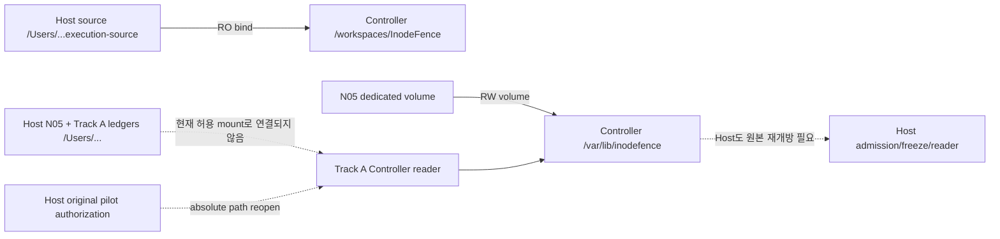

# N05 / Track A overnight integration handoff — 2026-10-23

Task Contract: 지웅이 직접 제공한 **Overnight N05 / Track A Integration Advancement**.
범위는 Layer 6 통합·안전한 공학 검증·경로 설계·MID-03 Unit 4 명세다.
이 문서는 승인 기록, N05 PASS, 실험 결과 또는 병합 결정이 아니다.

## A. Executive Summary

1. 원격 main과 #108, #112–#120 Head는 이전 감사 inventory와 모두 동일하다.
2. #120을 첫 부모로, #115를 둘째 부모로 하는 충돌 없는 실제 merge 후보를 보존했다.
3. 코드 후보 SHA는 `7861a7c5e0f9ca288eb36fae40b926ed60a4ca20`이며, #115의 source-origin 검사와 #120의 consumer/attempt 구현을 원본 bytes대로 유지한다.
4. 이 clean SHA에서 명시적으로 선정한 target-free 호스트 검사 117개가 통과했다.
5. 최초 실행의 113 PASS / 2 FAIL 중 두 실패는 기존 Linux guard의 macOS 거부이며, 원본 로그를 보존하고 guard는 변경하지 않았다.
6. Ruff·format·Pyright·문서 검사는 통과했지만 Dev Container `make check`와 Linux synthetic consumer 전체 검증은 수행하지 못했다.
7. 허용 mount와 절대 경로 Reader 요구 사이의 불일치는 코드와 target-free mount 모델로 확인했으며 실제 Docker namespace 실패로 재현한 것은 아니다.
8. 현 admission은 N05와 Track A에 같은 Controller ID와 volume을 요구하므로 별도 Controller는 계약 변경 없는 우회책이 아니다.
9. Unit 4는 Host authority, 20-cell host/campaign 결합, incomplete 증거 및 실행 수 의미를 확정한 뒤 구현해야 한다.
10. N05와 Track A pilot은 각각 **NOT_AUTHORIZED / NOT_RUN**이며, 이번 결과로 실행 준비 완료를 주장하지 않는다.

## B. Exact Source Inventory

2026-10-23 UTC에 GitHub connector metadata와 `git ls-remote`를 대조했다.
모든 아래 PR은 OPEN / 미병합이다. Base SHA는 조회된 PR metadata 값이다.

| 항목 | Full Head SHA | 상태 / Base |
| --- | --- | --- |
| 원본 local main | `919d723b7eb3bf13b060d3ae34b083499590b4fc` | 사용자 checkout, 보존 |
| 원격 main | `8d29982c26cebfcce7a413b3ba9177fcd28078de` | 변경 없음 |
| #108 | `64a7a1645c03512d50ff5e0246108d297d1e6aa8` | DRAFT; main base `21e317281a2d2a7faf6198f66302f3912b429011` |
| #112 | `0eca90f44a249d3ab1e66966b7ab3cfe80f79055` | DRAFT; main base `8d29982c26cebfcce7a413b3ba9177fcd28078de` |
| #113 | `00356e43f5e6bc1623cc7b36cba0479b755b1118` | DRAFT; main base `8d29982c26cebfcce7a413b3ba9177fcd28078de` |
| #114 | `f7aaa33050e247e0718d4ceb1ba01485802e269d` | DRAFT; main base `8d29982c26cebfcce7a413b3ba9177fcd28078de` |
| #115 | `e83349ed1592d536e3ec0fce3c7cb204cb5c6ec9` | non-draft; #114 base `f7aaa33050e247e0718d4ceb1ba01485802e269d` |
| #116 | `7d42799e895eba0f490fbdeaad110fe1407fd664` | non-draft; main base `8d29982c26cebfcce7a413b3ba9177fcd28078de` |
| #117 | `1d3ba474428ecd29e38f26945e7079a2328c06fd` | non-draft; #116 base `7d42799e895eba0f490fbdeaad110fe1407fd664` |
| #118 | `7f8696f9ea701c8438585843d5f78d0248de8933` | DRAFT; #117 base `1d3ba474428ecd29e38f26945e7079a2328c06fd` |
| #119 | `348e809fc37b1c03fcbfad55393c2425e84c969c` | DRAFT; #118 base `7f8696f9ea701c8438585843d5f78d0248de8933` |
| #120 | `02072c95537d76d1b213b9c858d96c97fff653cc` | DRAFT; #119 base `348e809fc37b1c03fcbfad55393c2425e84c969c` |
| integration code | `7861a7c5e0f9ca288eb36fae40b926ed60a4ca20` | 로컬 merge; 실행 source로 승인되지 않음 |

로컬 브랜치는 **`integration/n05-track-a-20261023-overnight`** 하나만 만들었다.
코드 merge 이후 이 보고서와 검증 로그를 같은 브랜치의 별도 handoff commit으로 보존한다.
그 문서 commit은 위 코드 검증 SHA와 다르며, 정확한 보고서 commit SHA는 종료 응답과 세션의
`revision-index.json`에 기록한다. 문서 commit도 새로운 source SHA다. 향후 실행 승인은 반드시
Unit 4·경로 해결까지 끝낸 최종 clean SHA에 다시 결속해야 한다.

증거 inventory는 [pr-inventory.json](../../../artifacts/overnight-n05-track-a-20261023/pr-inventory.json),
원격 refs는 [remote-refs.txt](../../../artifacts/overnight-n05-track-a-20261023/remote-refs.txt)에 있다.
이전 inventory 원본은
`/var/folders/66/qxq5htsj06jdfksnsbks9c7m0000gn/T/inodefence-n05-readonly-audit-i1ddk14g/audit-inventory.json`이다.
SHA-256은 `8d626d60108660246084bffba0eba181a1c5e8edb741eafcce03d05a97dfa891`이며 원본을 수정하지 않았다.
[동일 bytes 사본](../../../artifacts/overnight-n05-track-a-20261023/prior-audit-inventory.json)을 보존했다.
앞선 #115 28 PASS는 사용자 제공 감사 기준이다. Inventory에는 그 콘솔 원본이 없어 이번 실행 결과와 합산하지 않는다.
#115 CI `39286894752`와 #120 CI `39844885615`의 success metadata를 재조회했다.
PR body의 1,634 / 1,751 tests 등은 해당 작성자의 과거 보고이며 이번 merge의 Linux 검증으로 전용하지 않는다.

## C. Integration Result

### Git 결합과 변경 범위

`merge-base --is-ancestor` 결과는 #112⊆#114, #113⊆#114, #114⊆#120, #115⊄#120이다.
#115와 #120의 공통 조상은 `f7aaa33050e247e0718d4ceb1ba01485802e269d`다.
`merge-tree --write-tree`와 실제 `merge --no-ff --no-commit` 모두 충돌 없이 결합됐다.
코드 검증 후 merge commit을 생성했으며 tree는 `e0be20c2b03aea57d52731590c2d9ce581a581e8`이다.
첫 부모는 #120 full Head, 둘째 부모는 #115 full Head다. Cherry-pick이나 기존 커밋 재작성은 없다.

#120 대비 정확한 7개 변경 파일은 다음과 같다(277 insertions / 23 deletions).

- `docs/STATUS.md`
- `docs/research/benchmarks/n05-five-second-preflight-task-contract-draft.md`
- `scripts/README.md`
- `scripts/container_host.py`
- `src/inodefence/evaluation/README.md`
- `src/inodefence/evaluation/n05_preflight.py`
- `tests/evaluation/test_n05_preflight.py`

공통으로 수정된 세 README/STATUS 문서는 자동 결합됐다. 실행 코드 충돌은 없다.
원격 main 대비 코드 후보의 전체 29개 변경 파일은
[integration-files-vs-main.txt](../../../artifacts/overnight-n05-track-a-20261023/integration-files-vs-main.txt)에 있다.
이번 작업은 결합 이외의 production 코드 수정이나 Unit 4 구현을 추가하지 않았다.

| 검토 항목 | 코드 근거 / 판정 | 이번 검증의 한계 |
| --- | --- | --- |
| #115 source origin | `container_host.main` 1120–1156: invocation/runtime-file 검사 → ledger → Docker; 다른 checkout·unknown·symlink·digest mismatch 거부 | Python interpreter·외부 library attestation 아님 |
| source mismatch 소비 | mismatch 5종에서 ledger/Docker call 0 검증 | 성공한 N05 launch는 미실행 |
| authorization | canonical JSON 및 실제 bytes 확인, digest-only 거부 | 합성 fixture이며 사람 승인 증거 아님 |
| N04 consumed | production `ATTEMPT_CONSUMED=True`; early rejection 회귀 PASS | consumed attempt 재실행 없음 |
| N05 Reader/Host verifier | Reader는 #120과 byte-identical; Host verifier는 #115 원본 전체와 byte-identical | complete Linux synthetic PASS graph는 이번 환경에서 미실행 |
| Track A admission | Units 1/2 재개방·live capability·source/image/timeout/cleanup 검증 보존 | 전체 34/38개 Linux fixture suite는 과거 보고만 존재 |
| attempt ID | Unit 3 원본 보존: Host durable start → Controller typed read → 같은 ID의 policy claim | 실제/전체 합성 propagation roundtrip 이번 미실행 |
| failure accounting | unknown observation은 null 사실 유지; terminal·cleanup success 조건 보존 | launch/watchdog/cleanup 전체 51개 suite는 Linux 재검증 필요 |
| 중복 검증 | Host 신뢰 anchor 재검증과 Controller retained integrity 재검증은 다른 trust boundary; 기존 Reader에 위임 | transport/path 해석 통합은 후속 설계 |

보존 근거: [semantic-preservation.json](../../../artifacts/overnight-n05-track-a-20261023/semantic-preservation.json).
#115의 Host/N05/test 3파일과 #120의 consumer/N04/Reader 7파일, 총 10파일을 원본과 byte 비교했다.

### 실제 공학 검증

먼저 Makefile·pytest config·conftest·선정 테스트와 호출 경로를 읽었다.
`make check`는 lint/format/Pyright/pytest/environment/docs이며 install이나 Docker를 직접 실행하지 않는다.
그러나 전체 pytest는 Linux filesystem/reference/benign adapter 경로를 포함한다.
이번에는 macOS 호스트만 사용했으므로 Linux guard를 바꾸지 않고 명시적 allowlist만 실행했다.
Dev Container canonical `make check`는 **NOT_RUN**이다.

환경: macOS 27.0.1 arm64, CPython 3.12.14, pytest 9.1.1, pluggy 1.7.0,
packaging 26.3, iniconfig 2.3.1, Pygments 2.21.0, Ruff 0.17.1, Pyright 1.1.414.
기본 `python3`는 3.14.6이라 사용하지 않았다. 기존 uv cache의 의존성을 PYTHONPATH로 직접 읽었고
네트워크 의존성 설치는 0회다. Pytest 외부 plugin autoload와 bytecode 쓰기를 비활성화했다.
실제 Docker CLI 호출은 0회다. DockerCLI 테스트의 실행 파일은 tmp 아래 Python double이다.

| Source 상태 | 실제 명령 / 상세 기록 | Scope | Result |
| --- | --- | --- | --- |
| #120 HEAD + staged merge, dirty | Python 3.12 `-m pytest`의 명시적 nodeID allowlist; [원본 argv/env](../../../artifacts/overnight-n05-track-a-20261023/host-safe-selection.json) | mocked / host-native 파일 I/O / fake CLI | 113 passed, 2 failed |
| 같은 staged tree | 추가 `test_path_accounting_contracts.py` 4개 | declared-mount model / synthetic typed model | 4 passed |
| merge SHA `7861a7c5e0f9ca288eb36fae40b926ed60a4ca20`, clean | [실제 full argv/env](../../../artifacts/overnight-n05-track-a-20261023/clean-safe-command.json) | 위 allowlist에서 Linux 전용 2개 제외 + 추가 4개 | **117 passed, 0 failed**, 1.83s |
| staged tree = merge tree | cached Ruff `check .`, `format --check .` | static | PASS, 375 formatted files |
| 같은 tree | cached Pyright `node .../pyright/dist/index.js --pythonpath /opt/homebrew/bin/python3.12` | static, network 없음 | 0 errors / warnings |
| 같은 tree | `/opt/homebrew/bin/python3.12 scripts/check_docs.py` | links / canonical docs | PASS, 135 Markdown |
| 같은 tree | `git diff --cached --check` | whitespace | PASS |
| Dev Container full suite | `make check` | Linux canonical | **NOT_RUN** |
| real namespace / N05 / historical / pilot | 실행하지 않음 | native / experiment | **NOT_RUN** |

117은 clean 재검증 건수이며 최초 113과 중복 합산하지 않는다. `host-safe.xml`, `clean-safe.xml`에
각 testcase가 기록돼 있다. Source-origin 6개, N04 consumed rejection, N05 host interruption ledger,
authorization/containment, Track A legacy entry rejection, stderr bound/error, malformed terminal,
20-cell schedule/protocol/plan, backend command/transport checks 등이 포함된다.
Reference extractor·historical target·실제 Controller 프로세스를 실행하지 않았다.

최초 실패의 읽기용 로그는 [host-safe.log](../../../artifacts/overnight-n05-track-a-20261023/host-safe.log)에 있다.
Pytest traceback의 trailing whitespace만 제거한 파생본이며 원본 bytes는 `host-safe.log.gz`,
`host-safe.xml.gz`와 세션 원본에 그대로 있다. `log-transforms.json`에 원본·파생 hash와 변환을 기록했다.
최종 staged whitespace 검사에서 raw traceback의 공백이 검출되어 원본을 보존한 이 방식으로 처리했다.

- `test_missing_backend_fails_before_runtime`: `container.py:86`의 non-root Linux guard가 macOS에서 `ValueError`.
- `test_missing_evidence_stays_explicitly_unavailable`: `storage.py:32`의 Linux publication guard가 `NotImplementedError`.

두 건은 코드 결함으로 판정하지 않았고 수정을 시도하지 않았다. 선정 시 Linux 의존성을 놓친
환경 실패로 보존했다. 재검증 명령에서 제외한 이유도 JSON에 명시했다. Guard를 monkeypatch하거나
Linux라고 가장하지 않았다. 전체 N05/Units 1–3 synthetic fixture는 Linux runtime/publication을
필요로 하므로 이번 PASS 범위에 포함하지 않는다. CI success도 이 한계를 대신하지 않는다.

추가 4개 검사는 새 `/Users/evidence` mount가 production attestation에서 거부됨, 선언된 mount로
Host ledger 절대 경로를 볼 수 없음, failed observation의 실행 수를 0으로 바꾸면 거부됨,
unknown observation을 COMPLETE로 승격하면 거부됨을 확인한다.
두 번째 검사는 mount 모델이며 실제 Linux namespace probe가 아니다.

PHASE 2 결과는 **INTEGRATION_CANDIDATE_READY**(코드 결합 성공)다.
공학 전체 readiness는 Linux 검증이 남아 **CONDITIONALLY_READY**다.
현재 허용 범위에서 입증된 새로운 production 결함은 없다. 아래 경로 위험과 Unit 4 미연결은
실행/최종 분석의 blocker이며, 통합 성공으로 해소되지 않는다.

## D. Host↔Controller Path Contract

### 원본·소비자·namespace

다음 경로는 코드에 기록된 요구값이다. 이번에 만들거나 mount한 경로가 아니다.

| 원본 데이터 | 생성 주체 | 검증·소비 주체 | 필요한 경로 | 허용 mount / 차이 |
| --- | --- | --- | --- | --- |
| Host source root | 향후 규민/지웅이 동결할 clean execution clone | Host runtime-file guard, Controller Git/file guard | `/Users/choijiwng/Projects/InodeFence-n05-preflight-execution-source-v2-attempt-001` | Host canonical 원본; Controller에는 RO `/workspaces/InodeFence`로만 bind |
| N05 Host ledger | `N05HostLedger` | `verify_n05_host_ledger`, Track A admission | `/Users/choijiwng/Projects/InodeFence-n05-five-second-preflight-v2-attempt-001-host-ledger` | Controller 허용 mount 밖; `root == HOST_LEDGER_ROOT`까지 검사 |
| N05 authorization 원본 | 별도 사람 승인 경로 | Host `_read_n05_authorization` | `/Users/choijiwng/Projects/InodeFence-n05-five-second-preflight-v2-attempt-001-authorization.json` | Host가 bytes를 broker channel로 전달; Host ledger `authorization.json`과 Linux `authorization/preflight.json` 사본 보존 |
| N05 Linux raw/source/control/admission/final | N05 Controller/independent reader | Host verifier와 Track A host/controller readers | `/var/lib/inodefence/evidence/n05-five-second-preflight-v2-attempt-001` | Controller RW runtime volume; macOS Host에서 같은 절대 경로를 읽을 경로는 미검증 |
| Track A execution/admission/repetitions | live admission freeze / Controller | Host + Controller + final reader | `/var/lib/inodefence/evidence/track-a-final-state-exploratory-feasibility-v1` | Controller RW runtime volume; Host가 freeze/read하려면 역방향 view도 필요 |
| Track A Host ledger | `TrackAHostLedger` | Controller started reader / 향후 Unit 4 | `TrackAPilotAuthorization.track_a_host_ledger_root` | 아직 실제 승인값 없음; output과 달라야 함. CLI는 Host absolute path를 그대로 전달 |
| pilot authorization 원본 | 별도 사람 승인 경로 | Host launch admission, Controller `_read_host_admission` | `TrackAHostAdmissionRecord.pilot_authorization_path` | N05 승인과 별개; Unit 2 copied pilot만으로 원본 재개방을 대체하지 않음 |
| protocol JSON | source/config 작성자 | Host admission / Controller execution reader | `<source>/experiments/configs/track-a-final-state-exploratory-feasibility-v1.json` | Host 전달 경로와 Controller의 `<controller-worktree>/...` bytes가 같아야 함 |
| Controller working source | 동결한 source mount | N05 `Path.cwd()`, Track A current source check | N05 `/workspaces/InodeFence`; Track A `--controller-worktree` | Track A는 `/workspaces/InodeFence`에서 실행을 명시적으로 거부; N05의 유일 source mount와 추가 충돌 위험 |

근거 위치(코드 SHA 기준): `n05_preflight.py:61–106, 309–390, 616–638`,
`container_host.py:684–926, 1120–1186`, `track_a_admission.py:720–895`,
`track_a_host_ledger.py:492–529, 804–867`, `track_a_container_controller.py:35–116`,
`track_a_container_host.py:156–224`, `track_a_exploratory.py:592–695, 700–747`.
[code-index.json](../../../artifacts/overnight-n05-track-a-20261023/code-index.json)에 함수 시작 위치가 있다.

### 질문별 확정 답변

1. **Controller는 `/Users/...`를 실제로 열어야 하는가?** 현재 코드는 그렇다.
   Host가 `--host-ledger`로 전달한 절대 경로를 Controller가 `Path`로 읽고,
   `_read_host_admission`은 기록된 output 및 original pilot path를 다시 연다.
   admission은 binding의 N05 Host/Linux roots를 직접 연다. 문자열 형식 검사에서 끝나지 않는다.
2. **경로 고정은 어디인가?** `verify_n05_host_ledger`는 `root != HOST_LEDGER_ROOT`를 거부한다.
   Host admission은 `record.host_ledger_root == str(root)`를 검사하고,
   execution reader는 `manifest.output_root == str(root)` 및 canonical nonsymlink root를 요구한다.
   단순 복사·prefix 치환·symlink alias는 기존 검증과 같지 않다.
3. **N05 허용 mount는?** source bind RO `/workspaces/InodeFence`와 dedicated volume RW
   `/var/lib/inodefence` 두 destination만 허용한다. `/tmp`는 별도 제한된 tmpfs다.
   `/Users` bind, Docker socket, writable source, 다른 volume/consumer는 허용되지 않는다.
4. **같은 Controller인가?** 현재 admission의 명시적 equality는 pilot controller ID/image,
   runtime volume, daemon identity를 N05 authorization 및 broker와 모두 비교한다.
   따라서 현재 구현은 같은 container instance와 volume을 요구한다.
   `fresh_controller_per_campaign`은 현재 Host가 같은 container 안에서 새 `docker exec` Python
   프로세스를 만드는 의미로 읽어야 한다. 새 container instance와 혼동하지 말아야 한다.
5. **독립 Controller로 분리하면?** ID/volume equality를 바꾸는 versioned applicability 및
   pilot controller attestation 설계가 필요하다. 현재 검사 하나를 제거해서 해결할 수 없다.
6. **원본 보존 + 명시적 경로 대응이 가능한가?** 설계상 가능하다. Logical origin과 physical
   view를 분리하고 source SHA·authorization 원문·원본 manifest digest를 그대로 보존해야 한다.
   현재 Reader에는 그 interface가 없으므로 아직 구현·승인된 해결책이 아니다.
7. **SHA/ledger 영향은?** Reader/transport 변경만으로도 source SHA가 바뀐다. 원본 승인 path를
   새 path로 재작성하면 승인 digest도 바뀐다. 원문은 재작성하지 말고 별도 versioned mapping
   manifest를 trusted anchor에 결속해야 한다. Started/terminal의 attempt ID와 기존 digest는 유지한다.
8. **guard를 지킬 수 있는가?** evidence view에만 제한된 대응을 도입하고 host executable origin은
   계속 authorized canonical source로 검증해야 한다. symlink alias, arbitrary path RPC,
   source/runtime 혼용, Docker stdio allowlist 확장은 해결책으로 승인하지 않는다.

UID/GID 계약은 Controller 및 target 1000:1000이다. Host CLI는 `docker exec --user vscode`를
사용하고 target policy는 Controller의 non-root UID/GID를 반영한다. N05 attestation에는 실제
Controller `Config.User`의 숫자 확인이 별도 field로 존재하지 않아, 계약/계정값의 일치는 배치
단계에서 확인해야 한다. 이번에 실제 UID/GID를 관찰한 것은 아니다.
네트워크 none, RO rootfs, ALL capabilities drop, no-new-privileges, private IPC/cgroup 조건과
target의 one-run volume-subpath 경계는 유지해야 한다. Host ledgers의 기록 authority는 Host다.

### 해결안 비교와 권고

| 항목 | A. 동일 절대 경로 evidence mount | B. 명시적 evidence view + 제한된 bytes transport (권고) | C. N05 / pilot Controller 분리 |
| --- | --- | --- | --- |
| 변경 대상 | N05 mount allowlist/계약/승인; source workdir 제한도 해결 필요 | readers의 logical/physical root interface, bounded evidence transport, view manifest | admission schema의 N05/pilot identity 분리, 새 pilot attestation + B 또는 별도 view |
| trust boundary | 새 Host filesystem 노출; 정확한 파일/디렉터리만 RO여도 현 계약 밖 | trusted Host가 고정 allowlist 원본을 읽어 digest-bound view를 발행; target엔 노출 안 함 | 두 환경 사이 qualification applicability를 새로 정의 |
| 복잡도 | 중간; rootfs RO·UID·source cwd·양방향 path까지 포함하면 단순 mount 1개가 아님 | 중간 이상; logical refs와 실제 읽기 경로를 구분해야 함 | 높음; identity/volume/자원/증거 이동을 모두 새로 검증 |
| 재검증 | 원본을 같은 absolute path로 읽어 기존 digest graph 검증; 실제 mount 재검사 필요 | 원본 authorization/path는 보존, view bytes를 원본 digest로 전부 재검증; digest-only fallback 없음 | N05 원본 재검증 + 독립 pilot environment 전체 재attestation |
| 실패 동작 | path/mount drift는 launch 이전 거부 | missing/extra/traversal/symlink/stale/wrong mapping/oversize는 start/claim 전 거부 | identity/applicability/view mismatch는 pilot 거부 |
| source SHA | 바뀜; 새 최종 SHA용 N05/승인 필요 | 바뀜; view schema/protocol/transport를 최종 SHA에 결속 | 바뀜; 별도 사람 applicability 결정 필요 |
| Security Contract | C0/C1/C2 의미는 유지하나 containment envelope 변경이 큼 | C0/C1/C2·기존 두 mount·source guard를 유지하는 방향 | C0/C1/C2 유지 가능하나 격리/실행 identity 계약 변경이 큼 |
| 추가 테스트 | extra mount/RO drift/UID/source cwd/namespace read-negative/target exposure | complete raw graph, bytes tamper, logical origin mismatch, stale started, unknown view, size bound, no symlink, both directions | B의 테스트 + split-ID substitution, wrong image/daemon/volume/resource rejection |
| 사람 결정 | 새 mount 계약을 허용할지; 현재는 **허용 안 됨** | authority/transport schema·retention·size bound·signed-off mapping | 별도 Controller의 N05 적용성을 인정할지 |

**권고는 B를 별도 작은 설계/구현 작업으로 동결하는 것**이다. 이유는 Host ledger authority와
원문 경로를 보존하면서 광범위한 Host mount 및 현재 same-ID 규칙의 변경을 피할 수 있기 때문이다.
Host→Controller의 pilot/ledger/start bytes뿐 아니라 Controller→Host의 Linux/Track A 증거 view도
필요하다. 기존 runtime volume의 Linux evidence는 원본으로 남기고, Host view는 bytes 전체와
원본 manifest root에 결속한다. Host가 volume을 직접 읽을 수 있다고 가정해서는 안 된다.

구체적인 interface 초안은 `EvidenceView(logical_namespace, logical_root, physical_root,
inventory_reference, expected_origin_manifest_sha256)`다. Mapping은 사람 승인/실행 manifest에
결속하며 caller가 임의 prefix를 추가하지 못해야 한다. 기존 reader의 logical-root equality와
physical nonsymlink/file/hash 확인을 둘 다 수행한다. N05 Host verifier와 Track A reader가 서로
다른 path 해석을 구현하지 않도록 같은 resolver를 사용하되 oracle·mutator에는 넣지 않는다.
동적 Host `started.json`은 발행 직후 exact digest로 전달하고 stale start 재사용을 거부한다.
Transport 받은 complete bytes를 기존 parser/reader로 검증하며 검증 객체나 seal을 직렬화하지 않는다.
새 Docker inspection/lifecycle 권한을 Controller에 주지 않는다.

현재 고정 Controller image·source working directory와 Track A primary-worktree 거부도 B와 함께
명시적으로 해결해야 한다. 승인된 source clone 안에서 허용할 workdir 정책을 새로 정하고,
source guard를 비활성화하지 않는다. 임시 통합 worktree의 `.git`는 Host common gitdir을 가리키므로
그대로 RO bind해 실행 source라고 간주할 수도 없다. 별도 clean execution clone이 필요하다.

이는 **PROPOSED DESIGN**이다. mount, image, protocol, authorization, path resolver를 이번에
변경하거나 운영에 적용하지 않았다. 현재 경로 위험은 코드 기반 blocker이며 native 재현은 NOT_VERIFIED다.

## E. MID-03 Unit 4 Handoff — 주언

### 현재 구현과 정확한 미연결 지점

| 현재 구성 | 구현된 책임 | Unit 4에서 남은 것 |
| --- | --- | --- |
| `TrackAExecutionManifest` v2 / `read_track_a_execution` | local admission, copied pilot, N05 originals, protocol, plan, clean source 재검증 | 외부 Track A host ledger를 final graph에 결합 |
| `TrackAHostLedger` / attempt v2 | durable start, Host ID, stderr/cleanup/terminal/manifest; no retry | 20-slot 전체 publication authority 및 final references |
| `read_track_a_host_ledger` | terminalled attempt의 ordered consumed prefix 및 중복 ID 검사 | start-only/부분 terminal은 strict reader가 거부하므로 incomplete 보고용 별도 inspection 필요 |
| Controller started reader | start-only 디렉터리·digest·schedule·execution·attempt ID 검증 후 backend | 최종 reader가 동일 binding을 다시 확인 |
| `PolicyRepetitionController` / policy journal | claim, completed/failed/invalid/started/pending, contiguous completed-record prefix | Host preclaim failure와 campaign PENDING의 차이를 최종 output에 노출 |
| `TrackAFinalManifest` v1 | local `_inventory(root)`, policy slot counts, sum completed_steps | 외부 host ledger·20 host record refs 없음 |
| `verify_track_a_final` | local final inventory·execution/admission/N05·repetition 재검증 | Host terminal/cleanup/stderr evidence 누락·변조를 현재 검증하지 않음 |
| `analyze_track_a` | 모든 20 campaign을 포함한 arm별 계획/관찰 통계 | Host 상태·unknown·incomplete를 독립 축으로 결합 |

기존 finalizer는 **campaign 20개 COMPLETED만으로 COMPLETE를 정한다**.
Host failure/cleanup 실패/host ledger 누락을 연결하지 않았으므로 현재 final status를 pilot 전체 성공으로
표현해서는 안 된다. 이는 Unit 4의 알려진 미구현 범위다. 실제 잘못된 pilot 결과를 관찰한 것은 아니다.
`_inventory(root)`는 Track A root만 순회하고 외부 host ledger는 자동 포함되지 않는다.

### 최소 구현 단위와 의존성

| 단위 | 최소 변경 / 재사용 | 예상 파일 | 인수 조건 |
| --- | --- | --- | --- |
| U4.1 authority 및 typed reference | external Host ledger를 원본 authority로 선택하는 안; `ArtifactReference`, `read_track_a_host_attempt`, `read_track_a_host_ledger` 재사용 | `track_a_host_ledger.py`, consumer design doc | root/source/authorization/execution/plan에 결속한 외부 reference; self-derived digest만으로 사람 인증하지 않음 |
| U4.2 incomplete prefix inspection | strict 성공 reader는 유지; 별도 read-only inspection이 start-only/부분 terminal/complete/absent를 구분 | `track_a_host_ledger.py`, 새 `test_track_a_final_host_binding.py` | 원본 수정·terminal 합성·retry 없음; 잘못된 bytes는 invalid로 보존 |
| U4.3 final manifest v2 | host admission anchor와 20개의 scheduled slot reference/state 추가; `_inventory`, `write_record` 재사용 | `track_a_exploratory.py` | complete는 20 valid Host COMPLETE + 20 campaign COMPLETED + 200 verified records/cell; no-overwrite |
| U4.4 independent reader | `read_track_a_execution` → authority reopen → 각 host manifest/start/terminal/stderr → policy claim/journal 대조 | 같은 모듈, 필요 시 작은 `track_a_final.py` 추출만 별도 합의 | 삭제·변조·중복·누락·cross-run swap·cleanup fail·changed N05가 COMPLETE로 검증되지 않음 |
| U4.5 analysis / docs | 기존 summary·arm aggregation 재사용, Host/campaign/target 상태와 예산 의미 분리 | `track_a_exploratory.py`, protocol Markdown/필요한 schema JSON, evaluation README | failed/incomplete도 20-cell 분모에 남고 unknown을 0 또는 no-hit으로 바꾸지 않음 |

최소 새 data model은 `TrackAHostLedgerReference`(logical root/authority/admission digest)와
`TrackAHostSlotEvidence`(run index/id, attempt ID 또는 null, publication state, 존재하는 원본
artifact refs, diagnostic, verified count 또는 null)다. Enum은 예를 들어
`NOT_STARTED / STARTED_ONLY / PARTIAL_TERMINAL / TERMINAL_VERIFIED / INVALID_EVIDENCE`로 둔다.
이는 **최종 진단 상태**이며 Unit 3 terminal schema를 재정의하거나 새 승인을 발행하지 않는다.
COMPLETE용 strict validator와 incomplete inspection을 `allow_missing=True` 하나로 합치지 않는다.
원본 authority가 unavailable이면 historical COMPLETE verification/통계 산출은 fail-closed하며,
진단 output만 unavailable을 명시할 수 있다.

선행 조건은 #120 + #115 통합, Units 1–3의 Linux synthetic 재검증, authority 사람 결정이다.
경로 resolver가 미완성이어도 동일 namespace synthetic fixture로 U4.1–U4.5를 구현할 수 있다.
실제 배치는 D의 양방향 evidence view가 필요하다. 관련 schema/reader 변경은 최종 source SHA를
다시 바꾸므로 모든 구현 이후에 execution freeze와 N05 승인을 배치해야 한다.

### 20-cell 식별·완전성·예산 규칙

1. 단순 파일 개수가 아니라 `TRACK_A_SCHEDULE`과 frozen `plan.runs`를 strict zip해 index 0–19,
   run ID, arm, RNG seed, config ID를 대조한다. Host directory는 `attempts/<index:02d>-<run_id>`다.
2. Start/terminal/manifest의 attempt ID·execution SHA·plan SHA·Host admission reference와
   policy claim의 ID가 같아야 한다. Host admission SHA를 externally selected final anchor에 결속한다.
3. COMPLETE에는 20개 모두 있어야 하며 중복 ID·index/run mismatch·unexpected directory·gap·
   symlink·복수 attempt는 invalid다. STOPPED는 검증된 ordered consumed prefix와 나머지
   NOT_STARTED를 허용한다. 원본 유실과 원래 미시작을 구별할 수 없으면 unknown/invalid다.
4. Host launch 전 실패 + freshly verified campaign PENDING/0은 `HOST_FAILED_PRECLAIM`이다.
   terminal 재관찰 실패는 campaign state/count null이며 stale PENDING/0을 쓰지 않는다.
5. Host COMPLETE/FAILED, publication completeness, campaign state, target `SUCCESS/REJECTED/
   TIMED_OUT/...`는 별도 축이다. Target timeout/rejection은 완료된 record라면 관찰 분모에 포함한다.
6. 모든 최종 verification은 N05 Host/Linux original, cleanup, independent PASS, pilot bytes,
   protocol/plan/source/image/controller/volume/resource binding을 기존 admission reader로 다시 연다.
   기록된 승인 reference는 외부 trusted approval route를 대체하지 않는다.
7. Campaign STARTED + 완성 journal이나 missing terminal은 interrupted다. 완료로 추정하지 않는다.
   start-only/partial Host evidence는 consumed 상태이며 retry/resume의 근거가 아니다.
8. Campaign completion denominator는 scheduled 20개, arm별 5개다. 실패·미시작·unknown을 제거하지
   않는다. Target-status rate denominator는 검증된 completed records 수이며 0일 때 null이다.
9. **4,000은 20×200의 planned seed-inclusive budget**이다. 4개 seed+196 mutation이 각 cell의
   계획이다. 완료 cell은 200 records, seed 4, mutation 196, target-status sum 200을 검증한다.
10. 현재 `terminal.target_executions == slot.completed_steps == len(journal.records)`는
    **완전히 기록된 관찰 수**다. target를 시작한 뒤 observation/publication 전 실패한 마지막 실행은
    포함하지 못할 수 있다. 따라서 interrupted run의 실제 target launch 수를 정확한 0 또는 record 수로
    주장하면 안 된다. Minimal Unit 4는 `planned_executions`, `verified_completed_executions`,
    `actual_target_starts`(알 수 없으면 null), `count_completeness`, 진단을 구분한다.
    정확한 launch count가 꼭 필요하면 별도 begin/end durability contract가 필요하며 이번 Unit 4에서
    임의로 instrumentation 범위를 넓히지 않는다. 이미 저장된 terminal 숫자를 재작성하지 않는다.

### Target-free fixture와 구체적인 테스트 제안

기존 `_synthetic_admission`, `_frozen`, `_ledger`, `_SyntheticSuccessfulBackend`,
`_SyntheticFailingBackend`, `_install_launch_boundaries`, `_tree_bytes`를 재사용한다.
이들은 Linux publication/runtime을 쓰므로 supported Dev Container에서 실행한다. Historical
extractor나 실제 Docker는 필요 없다. N05 reader/verifier는 mock하지 않는다.

새 공용 fixture 제안:

- `frozen_track_a_with_external_host_authority`: synthetic N05 graph + 별도 Host/output roots;
  original authority bytes snapshot을 보존한다.
- `twenty_cell_synthetic_evidence`: 기존 200 budget을 바꾸지 않고 production canonical writer와
  synthetic backend/controlled completed-record producer로 20×200 metadata를 만든다.
  4,000 synthetic records를 native extractions라고 부르지 않는다.
- `host_prefix_fault`: start 직후, stderr 발행 후, terminal 후 manifest 전의 publication fault.
  성공 fixture를 hash만 바꿔 fake COMPLETE로 만드는 방식은 사용하지 않는다.

| 제안 test 함수 | 실패 주입 / 인수 조건 |
| --- | --- |
| `test_final_complete_binds_all_20_host_attempts` | happy 20×200 metadata, source/plan/attempt refs 모두 같은 경우만 COMPLETE |
| `test_final_rejects_missing_host_terminal_or_manifest` | terminal/manifest 제거; strict COMPLETE 거부, incomplete 진단은 원본 상태 보존 |
| `test_final_rejects_duplicate_attempt_id_and_schedule_gap` | duplicate ID, 00 다음 02, extra 20/다른 run ID; invalid |
| `test_final_rejects_host_campaign_attempt_id_swap` | 다른 cell claim/start swap; backend/target 없이 Reader 거부 |
| `test_host_preclaim_failure_is_not_pending_no_hit` | spawn 실패 terminal + PENDING campaign; Host failed, actual 0은 fresh observation 근거가 있을 때만 |
| `test_start_only_and_partial_terminal_remain_consumed` | 위 publication fault 3종; finalize STOPPED, no overwrite/retry |
| `test_observation_failure_preserves_unknown_count` | reread exception; count/state null, lower-bound observations와 구분 |
| `test_cleanup_or_stderr_failure_blocks_final_complete` | campaign COMPLETED라도 Host cleanup/capture 실패면 COMPLETE 거부 |
| `test_final_reader_reopens_n05_pilot_and_host_originals` | seal 뒤 각 원본 missing/tamper/non-PASS; final reader와 analysis 실패 |
| `test_per_cell_budget_and_seed_counts_are_verified` | 199/201 records, wrong seed count/config; 거부, 계획 200으로 바꾸지 않음 |
| `test_failed_and_unstarted_cells_stay_in_schedule_denominator` | prefix failure + remaining NOT_STARTED; campaign 분모 20/5 유지 |
| `test_target_timeout_counts_as_verified_observation` | timed-out synthetic result record; target-status 분모에 유지, Host failure와 분리 |
| `test_interrupted_target_start_count_is_not_inferred_from_prefix` | synthetic backend 진입 후 완료 record 전 예외; starts unknown, prefix count를 actual로 승격 안 함 |
| `test_final_analysis_does_not_modify_any_authoritative_tree` | Host/N05/Track A/pilot/protocol bytes 전후 동일 |
| `test_finalization_is_no_overwrite_and_authority_mismatch_fails` | duplicate seal, alternate root/self-recalculated admission; 거부 |
| `test_evidence_view_rejects_traversal_symlink_and_stale_start` | D의 resolver 구현 후 별도 dependency regression |

Unit 4 인수는 이 테스트들과 supported Linux canonical `make check`, independent code/research review가
완료되고 protocol/schema/README가 결과를 정확히 설명할 때다. 현재 v1 final manifest는 host verification이
없는 legacy evidence임을 version으로 구분한다. v1을 새 v2 COMPLETE라고 자동 승격하지 않는다.
주언의 구현을 대신하는 대규모 Unit 4 변경은 이번에 시작하지 않았다.

## F. Readiness Matrix

| 항목 | 판정 | 남은 조건 |
| --- | --- | --- |
| Current baseline / 이전 감사 연결 | READY | frozen inventory와 현재 refs 보존 |
| #115+#120 실제 결합 | READY | `INTEGRATION_CANDIDATE_READY`, conflict 없음 |
| `INTEGRATION_CANDIDATE_READINESS` | **CONDITIONALLY_READY** | Linux synthetic full suite + canonical make check + 사람 review |
| Host safe regression | READY | clean merge SHA에서 117 PASS; 범위 한정 |
| full N05/Units 1–3 synthetic / attempt propagation | NOT_VERIFIED | 기존 CI/PR 보고와 이번 실행 분리 |
| actual Host↔Controller namespace | NOT_VERIFIED | code risk + target-free mount model만 확인 |
| path transport/deployment contract | BLOCKED | D의 결정·구현·양방향 검증 필요 |
| MID-03 Unit 4 설계/테스트 명세 | READY | E 제공; 구현 소유자는 주언 |
| MID-03 Unit 4 구현 | BLOCKED | authority 결정과 U4.1–U4.5 구현·검증 |
| exact execution source/controller freeze | BLOCKED | 최종 구현과 review 후 clean SHA/image 고정 |
| N05 package bytes at frozen paths | BLOCKED | 두 지정 `.tgz` 경로 없음; 다운로드/복사 미수행 |
| N05 fresh controller/volume | NOT_VERIFIED | 실시간 Docker inspect 없음; 준비됐다고 간주하지 않음 |
| N05 authorization/Host source/ledger at frozen paths | BLOCKED | read-only exists 검사에서 모두 없음; 생성하지 않음 |
| `N05_EXECUTION_READINESS` | **BLOCKED** | final source/image/path + packages/fresh env + 별도 사람 승인 |
| N05 execution | NOT_RUN | NOT_AUTHORIZED |
| `TRACK_A_PILOT_READINESS` | **BLOCKED** | same final source의 검증된 N05 PASS + 별도 pilot approval + Unit 4/path 해결 |
| Track A execution | NOT_RUN | NOT_AUTHORIZED |
| research effectiveness / rediscovery | NOT_RUN | 이번 공학 검증에서 판단 불가 |
| remote push / PR creation | NOT_APPLICABLE | 이번 Task Contract에서 금지 |

Host 경로 존재 검사는 [host-path-availability.json](../../../artifacts/overnight-n05-track-a-20261023/host-path-availability.json)에 있다.
fresh controller/volume은 준비되지 않았다는 과거 blocker를 현재 live fact로 단정하지 않고 미검증으로 남겼다.
N04 consumed rejection은 READY인 안전 guard이며 N04 재실행은 NOT_APPLICABLE이다.

## G. 담당별 후속 작업

| 담당 | 작업 | 정확한 선행 조건 | 완료 기준 |
| --- | --- | --- | --- |
| 지웅 | 코드 후보/authority/path 설계·승인 순서 결정 | 이 보고서와 full SHA 검토; Linux 검증 결과; 주언/규민의 계약 합의 | merge 여부를 사람이 결정; 최종 source/image/path 동결 후 N05와 pilot 승인을 별도 기록 |
| 규민 | N05 source/package/controller/volume 준비 + path transport 검증 | D의 구현/배치 계약 확정; 최종 clean source SHA; 네트워크 설치가 필요하면 별도 승인 | 지정 package digest/UID/mount/freshness/source 증거 확보; 승인 후에만 N05, Host cleanup까지 independent 재검증 |
| 주언 | U4.1–U4.5 및 consumer evidence-view 통합 | #115+#120 후보; authority 결정; supported Linux synthetic 환경 | 20-cell Host/campaign/final graph와 incomplete/denominator 회귀 + make check; 실제 pilot은 별도 gate |
| 민찬 | 기존 transition/novelty 연구 판정과 발표 문구 확정 | 기존 qualification evidence와 research contract | FACT/HYPOTHESIS/미구현/실험 NOT_RUN 구분; 기존 실패 판정과 novelty 가설을 과장하지 않음 |

권장 순서는 **authority/path 결정 → Unit 4/transport 구현 → Linux 안전 검증·독립 review → 최종
source/image freeze → 별도 N05 승인/실행/재검증 → 별도 pilot 승인**이다.
중간발표 전 완주 여부와 무관하게 공학 evidence와 실험 미실행 상태를 분리해서 보고한다.

## H. 발표에서 사용할 수 있는 사실

| 분류 | 사용할 수 있는 표현 | 이번 근거의 경계 |
| --- | --- | --- |
| FACT | #120에 빠져 있던 #115를 원본 커밋을 보존해 충돌 없이 로컬 결합했다 | merge SHA와 ancestry; 원격 병합 아님 |
| FACT | authoritative evidence를 다시 여는 consumer 경로와 namespace 배치 요구를 코드에서 추적했다 | actual Docker failure 재현 아님 |
| ENGINEERING TEST | clean integration code SHA에서 target-free 호스트 검사 117개 통과, static checks PASS | Linux 전체 make check·native target·실험 PASS 아님 |
| ENGINEERING TEST | 잘못된 source origin은 ledger와 Docker 접근 전에 거부하며 unknown count의 0 승격을 거부한다 | 해당 synthetic/model 범위 |
| EXPERIMENT | N05 NOT_AUTHORIZED / NOT_RUN; Track A pilot NOT_AUTHORIZED / NOT_RUN | N05 PASS·4,000 actual executions·취약점·정책 우위 주장 없음 |
| FUTURE WORK | 양방향 evidence view, Unit 4 Host/final binding, 최종 source freeze 및 별도 승인 | 설계/계획이며 구현·결과로 승격하지 않음 |

이번 증거는 **engineering evidence**다. Research validation의 RAW ONLY/REPRODUCIBLE/
VALIDATED FINDING/PAPER-READY 등급에 올릴 실험 run 자체가 없다. Mutation/feedback/oracle의
연구 의미나 C0/C1/C2 Security Contract는 변경하지 않았다.

## 보존·종료 기록

- 원본 checkout `/Users/choijiwng/Projects/InodeFence`는 local HEAD와 status가 처음과 같고,
  `.devcontainer/devcontainer.json` SHA-256은
  `af1b308868338c81cc727094c1bfab5dce679b546ef4eb79c97915c8cdf233c9`로 동일하다.
- 새 worktree는 정확히 하나:
  `/private/tmp/inodefence-overnight-20261023-goy0npqw/candidate`.
  새 브랜치는 위 B의 로컬 integration branch 하나다. 기존 worktree를 삭제·prune·이동하지 않았다.
- 세션 root는 `/private/tmp/inodefence-overnight-20261023-goy0npqw`이며 생성 경로는
  `candidate/`, `evidence/`, `test-tmp-host/`, `test-tmp-probes/`, `test-tmp-clean/`이다.
  Pytest tmp 아래의 승인 모양 JSON/Host ledger는 명시적 synthetic fixture이며 실제 승인·attempt가 아니다.
- 저장소에 새로 보존한 파일은 이 보고서, 해당 artifact 안내의 최소 갱신과
  `artifacts/overnight-n05-track-a-20261023/` 아래 inventory/log/XML/검증 probe다.
  정확한 파일·SHA-256 목록은 해당 디렉터리 `artifact-index.json`에 기록한다.
  원본 사용자 diff는 세션 `evidence/original-worktree.diff`에만 보존했고 문서 commit에 복사하지 않았다.
- 원본 source/docs/experiment 증거는 primary checkout에서 변경하지 않았다. candidate에는 #115의
  명시적 7파일 결합 및 별도 handoff 자료만 추가했다. 기존 raw evidence 삭제/덮어쓰기는 없다.
- Git object fetch, local merge commit과 별도 handoff commit만 수행했다. 원격 push·PR 작성·PR
  수정·자동 병합·승인 기록 생성·실제 Docker/target/N05/pilot 실행은 없다.
- 최종 보고서 commit은 코드 검증 SHA와 구분한다. 종료 응답의 full SHA와 세션
  `revision-index.json`으로 재연결한다. 임시 경로가 사라져도 로컬 branch의 보고서/증거를 복구할 수 있다.

PHASE별 판정은 [phase-results.json](../../../artifacts/overnight-n05-track-a-20261023/phase-results.json)에 보존했다.
