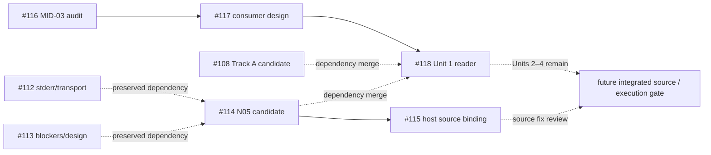

# GitHub 최신 차이 감사 — 2026-10-22 기술 부록

GitHub connector의 read-only PR metadata/body/diff 및 selected file 조회로 확인했다.
Remote `main`은 commit API에서 **`8d29982c26cebfcce7a413b3ba9177fcd28078de`**로 확인됐다.
조회 시각: **2026-10-22 09:03 UTC / 18:03 KST**. [고정 main](https://github.com/TheWaitForAGI/InodeFence/commit/8d29982c26cebfcce7a413b3ba9177fcd28078de).
Oct 21 MID01 기준 main과 동일하다. 로컬 main ref나 PR `base_sha`를 최신 main으로 대체하지 않았다.

## PR 상태와 정확한 revision

아래 8개 PR은 모두 **open / merged=false**다. `merge_commit_sha`가 반환돼도 open PR의
test-merge ref일 수 있으므로 병합 증거로 사용하지 않는다. 테스트 수는 각 PR 본문의 보고이며
이번 감사에서 테스트나 CI 로그를 재실행·전수 검증하지 않았다.

| PR | draft | base branch / base SHA | exact head SHA | 역할 / 증거 수준 |
| --- | --- | --- | --- | --- |
| [#108](https://github.com/TheWaitForAGI/InodeFence/pull/108) | true | main / `21e317281a2d2a7faf6198f66302f3912b429011` | `64a7a1645c03512d50ff5e0246108d297d1e6aa8` | Track A 20×200 후보 runner/protocol; 보고된 engineering TESTED. 별도 승인·preflight·pilot NOT_RUN |
| [#112](https://github.com/TheWaitForAGI/InodeFence/pull/112) | true | main / `8d29982c26cebfcce7a413b3ba9177fcd28078de` | `0eca90f44a249d3ab1e66966b7ab3cfe80f79055` | bounded stderr/host transport 증거 보강; 보고된 engineering TESTED, 새 attempt 아님 |
| [#113](https://github.com/TheWaitForAGI/InodeFence/pull/113) | true | main / `8d29982c26cebfcce7a413b3ba9177fcd28078de` | `00356e43f5e6bc1623cc7b36cba0479b755b1118` | N05 blockers 및 native-v3 proposed contracts; 문서 설계/정적 검증 |
| [#114](https://github.com/TheWaitForAGI/InodeFence/pull/114) | true | main / `8d29982c26cebfcce7a413b3ba9177fcd28078de` | `f7aaa33050e247e0718d4ceb1ba01485802e269d` | N05 attempt/authorization/reader 후보; synthetic TESTED 보고, NOT_AUTHORIZED / NOT_RUN |
| [#115](https://github.com/TheWaitForAGI/InodeFence/pull/115) | false | feat/n05-preflight-readiness-v2 / `f7aaa33050e247e0718d4ceb1ba01485802e269d` | `e83349ed1592d536e3ec0fce3c7cb204cb5c6ec9` | 실행 중인 host entry/module origins를 승인 source에 결합하는 fix; TESTED 보고, 실제 N05 아님 |
| [#116](https://github.com/TheWaitForAGI/InodeFence/pull/116) | false | main / `8d29982c26cebfcce7a413b3ba9177fcd28078de` | `7d42799e895eba0f490fbdeaad110fe1407fd664` | MID-03 evaluation audit; 구현/기존 PR에 대한 engineering checks 보고, pilot NOT_RUN |
| [#117](https://github.com/TheWaitForAGI/InodeFence/pull/117) | false | docs/mid03-feedback-evaluation-audit / `7d42799e895eba0f490fbdeaad110fe1407fd664` | `1d3ba474428ecd29e38f26945e7079a2328c06fd` | N05 consumer integration 설계/회귀 명세; Units 1–4 제안, 실행 승인 아님 |
| [#118](https://github.com/TheWaitForAGI/InodeFence/pull/118) | true | docs/mid03-n05-consumer-integration-plan / `1d3ba474428ecd29e38f26945e7079a2328c06fd` | `7f8696f9ea701c8438585843d5f78d0248de8933` | Unit 1 typed target-free admission reader; synthetic TESTED 보고, launch 통합 미완료 |

Oct 21 문서는 #108/#112/#113/#114만 다뤘다. Run #2의 추가 감사 대상은 #115–#118이다.
Main에 새로 병합됐다는 차이는 없고 open branch에 source binding fix, 감사, consumer 설계,
typed reader가 추가된 상태다. Claim: R2-C06/R2-C07/R2-C11.

## Dependency 관계

실선은 PR metadata의 stacked base, 점선은 본문에 명시된 sibling/dependency 또는 설계상 소비 관계다.
모든 종속 PR의 전체 diff가 독립적인 신규 구현이라는 뜻은 아니다.

#114 본문은 #112/#113 exact heads를 preserved dependencies로 명시한다.
#118 본문은 #108 `64a7a164…`와 #114 `f7aaa330…`를 각각 merge commit `3ebb0f9`, `f19f387`로
보존했다고 기록한다. #118 base는 #117이다. #115는 #114 위 별도 fix이며 #118이 명시한 N05
dependency는 #115 head가 아닌 #114 head다. 따라서 #115의 통합까지 완료됐다고 읽지 않는다.
이 도식은 metadata/본문 기반 dependency map이며 이번에 새 통합 branch를 만들거나 merge하지 않았다.

## #118이 실제로 해결한 것과 남은 것

Selected source를 exact head에서 읽었다:
[track_a_admission.py](https://github.com/TheWaitForAGI/InodeFence/blob/7f8696f9ea701c8438585843d5f78d0248de8933/src/inodefence/evaluation/track_a_admission.py).
Module docstring은 read-only 및 trusted human-controlled approval channel의 책임을 명시한다.
`TrackAPilotAuthorization`, `N05EvidenceBinding`, `VerifiedTrackAAdmission`과
`validate_track_a_admission`이 존재한다. Validator는 authorization 원본, trusted digest/reference,
host ledger verifier와 N05 reader, source/target/environment/resource/plan binding을 검사한다.
이는 전체 PR의 독립 code-review 승인이나 실제 evidence admission 실행을 뜻하지 않는다.

| 범위 | 확인된 상태 | 다음 단계 / 금지 해석 |
| --- | --- | --- |
| Unit 1 | typed admission reader 후보 IMPLEMENTED; focused 34 tests와 canonical 1,670 tests PASS를 PR이 보고 | Synthetic N05 PASS-shaped fixture는 actual `PREFLIGHT_PASS`가 아님 |
| Exact tmpfs binding | #118 follow-up이 MiB + 1 byte 불일치 거부를 보고 | Covered regression의 engineering 근거; 실제 controller 검증 아님 |
| Unit 2 | `freeze_track_a_execution` / `read_track_a_execution`의 typed result 소비 및 원본 보존·재검증 연결은 후속 과제 | 기존 digest-only 실행 경로가 해결됐다고 주장 금지 |
| Units 3–4 | host-attempt ledger, attempt-ID propagation, final reader/accounting 연결 설계가 남음 | pre-claim host 실패가 모두 기록된다고 주장 금지 |
| 실제 launch | #118은 output root 생성·claim·controller/target launch를 하지 않는 경계를 보고 | ‘N05→pilot end-to-end 연결 완료’ 아님 |
| 신뢰/승인 | expected digest 및 approval reference는 별도 trusted route의 책임 | 문자열·human name·checksum 자체는 사람 인증 아님 |

Unit 구분의 근거는 [#117 exact design](https://github.com/TheWaitForAGI/InodeFence/blob/1d3ba474428ecd29e38f26945e7079a2328c06fd/docs/research/design/mid03-n05-consumer-integration-plan.md)과
[#118 본문](https://github.com/TheWaitForAGI/InodeFence/pull/118)이다. #117의 문서 머리말이
NOT_IMPLEMENTED여도 이후 #118 Unit 1 후보 진척을 함께 반영해야 한다. 반대로 Unit 1만으로
설계 전체가 구현됐다고 업데이트하지 않는다.

## 상태별로 주장 가능한 범위

| 상태 | 이번 감사에서 확인한 예 | EXPERIMENTALLY VALIDATED와의 관계 |
| --- | --- | --- |
| main에 병합된 코드 | M의 final-state C0/C1/C2, B0/B1/B3/A1/A2/A3, generic v3 synthetic stack | 구현 존재와 engineering TESTED; policy 효과 결과 아님 |
| open/draft 구현 | #108/#112/#114/#115/#118 | main 기능으로 표기 금지; reported tests와 실제 연구 실행 구분 |
| 설계·감사 | #113/#116/#117 | 실행 가능한 전체 통합과 승인으로 승격 불가 |
| actual historical execution | N01 8 readiness + 10 pair, earlier independent readers | machine replay 완료, final human qualification pending; rediscovery 아님 |
| actual native qualification | v2 480 runs 및 retained NOT_QUALIFIED | 실행한 negative observation qualification; 효과 비교 결과 아님 |
| NOT_AUTHORIZED / NOT_RUN | N05 5초 preflight, 4,000회 pilot, native effectiveness campaign | zero-hit 결과도 아니며 성공/효과 추정 불가 |
| EXPERIMENTALLY VALIDATED | 이번 기록에서 RQ1 rediscovery/RQ2/RQ6 effectiveness에 해당 근거 없음 | engineering TESTED나 PR merge로 이 칸을 채우지 않음 |

역사적 실행 근거는 [N02](../../../diagnostics/n02-autonomous-integration-and-qualification.md),
[N04 N01 audit](../../../diagnostics/n04-n01-independent-evidence-audit.md),
[v2 summary](../../../../../experiments/summaries/node-native-effect-observation-qualification-v2.md)다.
N04 5초 attempt는 target 전 transport에서 INCONCLUSIVE로 종료됐고 consumed다.
[N04 preflight result](../../../diagnostics/n04-five-second-preflight-result.md).
N05 mode/reader 후보나 #115 source fix는 새 attempt 실행·승인을 만들지 않는다.

## 실행 게이트에 남은 조건

최종 통합 clean SHA에 대한 검토·source/controller freeze, 그 exact source에 유효한 N05 별도 승인과
actual independent host/Linux PASS, Unit 2–4 연결 및 검증, 별도 pilot authorization과
failure/retention 규칙이 필요하다. 현행 exact-source equality에서 consumer 변경 후 다른 SHA의
PASS를 자동 재사용할 수 없다. 이 목록은 실행 지시나 묵시적 승인이 아니다.

감사 한계: selected source 및 PR 기록을 확인했으며 raw root 접근, 전체 patch의 독립 검증,
CI job 로그 감사, historical reader나 project tests 실행은 하지 않았다. 최신 상태는 위 시점의
스냅샷이다. 발표 동결 때 다시 확인할 필요가 있으나 이번 작업의 자동 후속 행동으로 예약하지 않는다.
