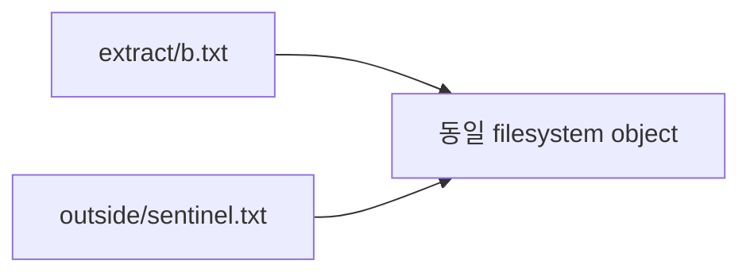

# 중간발표 12장 — 수정안 v2

대상: 교수·연구 평가자. 기본 경로: **Path B**. 아래는 슬라이드 내용 설계이며 실행 결과나 발표 파일이 아니다.
Claim ID는 [Run #2 register](00-independent-review-response.md)의 R2-Cxx다.
Source revision/PR/ledger details는 [기술 부록](02-github-pr-delta-20261022.md)과 Q&A에 둔다.

## 경로 선택

**Path A**는 별도로 승인된 pilot의 actual raw/config/source/전체 실행 회계, 독립 reader,
human presentation acceptance가 확보된 경우에만 쓴다. N05 actual PASS와 source applicability,
실제 consumer 연결 및 별도 pilot 승인도 확인해야 한다. Qualified historical 해석에는 N01 human
gate가 필요하다. 별도 exploratory route의 데이터는 그 승인 범위의 feasibility 관측으로만 사용하고
qualification·rediscovery·formal effectiveness로 올리지 않는다. 새로운 자료는 별도 검토 addendum으로 연결한다.

**Path B**는 pilot 미실행·차단 또는 증거 부족일 때 사용한다. 현재 선택이다.
정확히 12장이고 10장만 Path A/B 내용을 교체한다. 다른 장의 N01 관측이나 native negative
결과를 pilot 데이터로 재분류하지 않는다. 없는 값은 빈 그래프 대신 상태 표와 대체 문장으로 표현한다.

## 1. InodeFence: TAR 보안 상태를 관찰하고 탐색에 사용할 수 있는가?

| 필드 | 내용 |
| --- | --- |
| 핵심 메시지 | 관찰·판정 가능성과 같은 예산의 탐색 정책 효과를 나눠 검증한다. |
| 필요한 그림/표 | ‘관찰할 수 있는가? → 탐색을 바꾸는가?’ 두 질문과 TAR→extractor→filesystem 도식 |
| 근거 파일·Claim ID | [00 RQ 대응](00-independent-review-response.md), [Research Contract](../../../design/research-contract-v1.md); R2-C01/R2-C13 |
| 발표자 핵심 논리 | 새 공격의 존재보다 측정 방법과 탐색 효용을 묻는다. Canonical rediscovery보다 관찰 검증이 선행한다. |
| 발표 가능한 문장 | “알려진 TAR 문제에서 객체 동일성과 외부 영향을 관찰할 수 있는지, 그 상태를 활용한 정책이 같은 예산에서 탐색을 어떻게 바꾸는지 연구합니다.” |
| 데이터 부족 시 대체 문장 | “탐색 효과는 아직 검증하지 않았고 오늘은 관찰 근거와 비교 방법, 남은 검증을 제시합니다.” |

## 2. TAR 압축 해제: 경로 안에 있어도 같은 외부 객체일 수 있다

| 필드 | 내용 |
| --- | --- |
| 핵심 메시지 | 내부 경로의 존재와 보호 객체의 격리는 서로 다른 질문이다. |
| 필요한 그림/표 | 아래 개념도; ‘실제 민감 파일이 아닌 disposable sentinel, 개념도’ 표시 |
| 근거 파일·Claim ID | [Security Contracts](../../../design/security-contracts.md), [01 관측 경계](01-cve-and-evidence-boundaries.md); R2-C05 |
| 발표자 핵심 논리 | hardlink는 다른 pathname이 같은 filesystem object를 가리킬 수 있다. Path-only 관찰로 놓칠 관계를 설명하되 실제 overwrite를 추가하지 않는다. |
| 발표 가능한 문장 | “추출 경로 안의 파일이 외부 sentinel과 동일한 객체를 공유하면 path 경계와 object 경계를 따로 확인해야 합니다.” |
| 데이터 부족 시 대체 문장 | “이 도식은 측정 대상을 설명하는 개념도이며 새로운 실행 결과가 아닙니다.” |

## 3. 실제 node-tar 취약 사례와 두 수정 경계

| 필드 | 내용 |
| --- | --- |
| 핵심 메시지 | 7.5.3은 첫 CVE의 수정 경계이며 이후 hardlink 문제 전체의 종결점이 아니다. |
| 필요한 그림/표 | 23745: ≤7.5.2→7.5.3 / 24842: ≤7.5.6→7.5.7의 두 행; N01 pair는 첫 행에 표시 |
| 근거 파일·Claim ID | [01 공식 권고문 표](01-cve-and-evidence-boundaries.md); R2-C02/R2-C03/R2-C17 |
| 발표자 핵심 논리 | 첫 권고는 linkpath 정제 부족, 두 번째는 검사/생성 기준점 불일치다. 버전 일치와 exact N01 root cause는 분리한다. |
| 발표 가능한 문장 | “N01의 7.5.2/7.5.3 경계는 CVE-2026-23745와 일치합니다. CVE-2026-24842의 수정 경계는 7.5.7이며, N01의 정확한 원인 대응은 사람 검토 대기입니다.” |
| 데이터 부족 시 대체 문장 | “공식 권고의 버전·원인 설명과 우리 고정 입력의 관측을 구분해 제시합니다.” |

## 4. ZIPDiff·Wormholes·LinkZard가 이미 보여준 것

| 필드 | 내용 |
| --- | --- |
| 핵심 메시지 | archive feedback, link/order 공격, file-state 탐색은 선행연구에 존재한다. |
| 필요한 그림/표 | 세 연구의 ‘입력 단위 / 관찰 신호 / InodeFence에 남은 질문’ 비교표; 순위 없음 |
| 근거 파일·Claim ID | [00 1차 문헌 표](00-independent-review-response.md): ZIPDiff §4, Wormholes §5.5, LinkZard §4.2.2/Appendix C; R2-C13/R2-C19 |
| 발표자 핵심 논리 | Wormholes의 자동화를 인정하고 LinkZard의 hardlink state를 누락하지 않는다. 구성 차이를 최초성으로 치환하지 않는다. |
| 발표 가능한 문장 | “기존 기법을 바탕으로 generic TAR mutation과 identity/effect 기반 보존을 구성하고, 이 구성의 측정 가능한 가치를 검증하려 합니다.” |
| 데이터 부족 시 대체 문장 | “문헌상 독립 기여와 외부 도구 대비 우월성은 아직 주장하지 않습니다.” |

## 5. 중심 RQ1/RQ2, 검증 가설, 보조 RQ6

| 필드 | 내용 |
| --- | --- |
| 핵심 메시지 | 관찰 성립과 탐색 효과는 각각 증거가 필요한 단계다. |
| 필요한 그림/표 | RQ1 관찰·판정: limited evidence / RQ2 정책 효과: NOT_RUN / RQ6 native 확장: blocked의 세 행 |
| 근거 파일·Claim ID | [00 질문·가설 표](00-independent-review-response.md), [canonical RQs](../../../design/research-questions.md); R2-C01/R2-C04/R2-C11/R2-C12 |
| 발표자 핵심 논리 | 발표 RQ1은 canonical rediscovery의 선행 질문이다. H1 정책 효용과 H3/H4 transition/scheduler 이득은 모두 가설이다. |
| 발표 가능한 문장 | “RQ1의 관찰 선행 근거는 있지만 재발견과 RQ2의 정책 효과는 미검증입니다. RQ6는 native 관찰의 신뢰성부터 확인하는 보조 연구입니다.” |
| 데이터 부족 시 대체 문장 | “미실행 질문에는 효과 방향이나 예상 결과를 넣지 않았습니다.” |

## 6. InodeFence 아키텍처: 입력 진화와 판정을 분리

| 필드 | 내용 |
| --- | --- |
| 핵심 메시지 | generic mutation, target 실행, 관찰·oracle, feedback을 분리해 측정한다. |
| 필요한 그림/표 | 아래 pipeline; runtime 실행 결과와 보존 자료의 흐름을 구분 |
| 근거 파일·Claim ID | [architecture](../../../design/architecture.md), [STATUS](../../../../STATUS.md); R2-C05/R2-C08 |
| 발표자 핵심 논리 | CVE recipe나 version 판단을 generic oracle에 넣지 않는다. Seed는 benign이며 실제 search-origin lineage는 별도 필요하다. |
| 발표 가능한 문장 | “TAR 구조를 일반 변형하고 실제 추출 뒤 상태를 관찰해 C0/C1/C2를 판정하며, 정책은 그 상태의 보존 여부를 결정합니다.” |
| 데이터 부족 시 대체 문장 | “파이프라인의 구현·공학 검증을 탐색 효과 입증과 구분합니다.” |

## 7. C0/C1/C2: 무엇을 위반 증거로 판정하는가?

| 필드 | 내용 |
| --- | --- |
| 핵심 메시지 | C0 namespace, C1 identity, C2 sentinel effect는 서로 다른 persistent 계약이다. |
| 필요한 그림/표 | 세 행 표: C0 observed sandbox의 외부 namespace / C1 AFTER lstat dev+ino / C2 전후 content·metadata; snapshot 한계 각주 |
| 근거 파일·Claim ID | [Security Contracts](../../../design/security-contracts.md), [01](01-cve-and-evidence-boundaries.md); R2-C05/R2-C17 |
| 발표자 핵심 논리 | C0 false여도 C1/C2 true일 수 있다. C2는 nlink/ctime도 포함한다. False는 전체 안전성 증명이 아니다. |
| 발표 가능한 문장 | “경로 밖의 namespace 변화, 외부 sentinel과의 객체 동일성, sentinel의 내용·metadata 변화를 독립적으로 판정합니다.” |
| 데이터 부족 시 대체 문장 | “현재 snapshot은 transient 접근과 unchanged direct-use, symlink referent, check/use coherence를 판정하지 못합니다.” |

## 8. N01 실제 실행: identity 공유와 metadata effect 관측

| 필드 | 내용 |
| --- | --- |
| 핵심 메시지 | 동일한 고정 TAR에서 관측 차이를 확인했으며 이는 fuzzer rediscovery가 아니다. |
| 필요한 그림/표 | 아래 보고서 기반 2행 표; ‘10초 / 같은 입력 5회씩 / C2 metadata-only / human pending’ 상시 표시 |
| 근거 파일·Claim ID | [01 N01 표](01-cve-and-evidence-boundaries.md), [N02](../../../diagnostics/n02-autonomous-integration-and-qualification.md), [N04](../../../diagnostics/n04-n01-independent-evidence-audit.md); R2-C03/R2-C04/R2-C15 |
| 발표자 핵심 논리 | nlink 1→2, ctime 변화와 dev+ino 동일성이 근거다. Content digest 불변, original package-byte 보존 한계, 이번 raw 재검증 부재를 설명한다. |
| 발표 가능한 문장 | “보존 보고서는 7.5.2의 C1과 metadata-only C2를 5/5, 7.5.3의 동일 위반을 0/5와 rejection 5/5로 기록합니다. Machine reader는 이를 재구성했고 최종 human 판정은 대기 중입니다.” |
| 데이터 부족 시 대체 문장 | “새 raw 검증이나 새로운 사람 판정은 추가하지 않았으며 기존 보고서의 exact-input 관측만 인용합니다.” |

| Target | C1 | C2 | 실행 결과 |
| --- | --- | --- | --- |
| node-tar 7.5.2 | 5/5 | 5/5, metadata-only | SUCCESS 5/5 |
| node-tar 7.5.3 | 0/5 | 0/5 | REJECTED 5/5 |

## 9. B0/B1/B3 비교 프로토콜과 인과 해석

| 필드 | 내용 |
| --- | --- |
| 핵심 메시지 | 정책 비교가 답하는 질문과 identity 신호 하나의 기여는 다르다. |
| 필요한 그림/표 | B0 walk / B1 full key / B3 key OR fingerprint 표; ‘B3−B0=전체 정책, B3−B1=violation admission 추가’ 표시 |
| 근거 파일·Claim ID | [03 contrast 표](03-contrast-identifiability.md), [baseline](../../../benchmarks/baseline-and-ablation-v1.md), [protocol](../../../benchmarks/evaluation-protocol-v1.md); R2-C08/R2-C09/R2-C10/R2-C16 |
| 발표자 핵심 논리 | 공통 target/corpus/grammar/budget, paired seeds와 full-state 분석, 실패·censoring을 설명한다. A1/A2/A3의 잔존 신호는 Q&A에서 보강한다. |
| 발표 가능한 문장 | “B1도 identity/effect를 포함한 full state key를 사용합니다. B3−B0는 retention과 parent 분포를 포함한 정책 전체, B3−B1은 violation novelty admission의 추가 효과를 묻습니다.” |
| 데이터 부족 시 대체 문장 | “비교는 구현됐지만 실제 효과 데이터가 없어 어느 정책이 우수한지 말할 수 없습니다.” |

## 10. Pilot 결과 또는 실행 차단 상태 — 현재 Path B

| 필드 | 내용 |
| --- | --- |
| 핵심 메시지 | 현재 pilot 결과는 없으며 미실행을 zero-hit 결과로 제시하지 않는다. |
| 필요한 그림/표 | Path B: 5초 readiness 근거 → verified consumer → 별도 pilot 승인 → actual data의 미충족 상태 표. Path A: 검토된 실제 per-seed 공통 지표와 planned/actual/complete/invalid 분모 표 |
| 근거 파일·Claim ID | [02 현재 gate](02-github-pr-delta-20261022.md), [N04 result](../../../diagnostics/n04-five-second-preflight-result.md); Path A packet 현재 없음; R2-C07/R2-C11/R2-C14/R2-C18/R2-C20 |
| 발표자 핵심 논리 | B에서는 target 전 infrastructure failure와 readiness 미평가를 구분한다. Reader synthetic 진척은 부록에서만 설명한다. A에서도 exploratory 관측과 confirmed rediscovery를 구분한다. |
| 발표 가능한 문장 | **Path B:** “5초 readiness는 앞선 attempt에서 target 전 차단돼 평가되지 않았습니다. 후속 N05와 pilot은 승인·실행되지 않았으며, 4,000회는 계획 총량입니다.” **Path A 전용:** “검토된 승인 범위에서 수집한 실제 per-seed 관측과 실행 회계는 이 표와 같습니다.” |
| 데이터 부족 시 대체 문장 | “Accepted pilot packet이 없으므로 성능 그래프를 제시하지 않고 남은 검증 조건을 보고합니다.” |

Path A로 전환해도 슬라이드의 모든 값은 actual packet을 통해서만 채운다. 20 cells × 200
seed-inclusive executions = 4,000은 계획이다. Fixed B3는 별도 discrimination 문맥이며 affected
B0/B1/B3와 무분별하게 pooling하지 않는다. Candidate가 없거나 invalid면 그 상태를 그대로 표기한다.

## 11. Native v1/v2/v3와 연구 한계

| 필드 | 내용 |
| --- | --- |
| 핵심 메시지 | native 관찰 qualification 실패와 synthetic 표현 가능성은 탐색 효과와 별개다. |
| 필요한 그림/표 | v1 BLOCKED / v2 480-run NOT_QUALIFIED / v3 generic synthetic TESTED·native producer NOT_IMPLEMENTED 표; P1−P0와 P2−P1은 후속 질문 |
| 근거 파일·Claim ID | [STATUS](../../../../STATUS.md), [v2 summary](../../../../../experiments/summaries/node-native-effect-observation-qualification-v2.md), [v3 report](../../../diagnostics/n04-namespace-rebinding-sequence-v3-synthetic-verification.md); R2-C10/R2-C12/R2-C18 |
| 발표자 핵심 논리 | v2 mandatory replacement coverage 실패를 보존했다. v3는 별도 multi-operation composite의 synthetic engineering 결과이며 native 성공으로 재분류하지 않았다. |
| 발표 가능한 문장 | “v2는 480회를 완료했지만 필수 replacement coverage를 충족하지 못했습니다. v3는 generic 표현과 reader를 합성 검증했으며 native producer와 효과 검증은 남아 있습니다.” |
| 데이터 부족 시 대체 문장 | “RQ6는 별도 qualification 이후의 확장으로 두고, RQ1/RQ2의 final-state 검증과 분리합니다.” |

## 12. 중간 결론과 11월 후속 검증

| 필드 | 내용 |
| --- | --- |
| 핵심 메시지 | 현재 성과는 제한된 관찰 근거와 검증 가능한 구현이며 핵심 탐색 효과는 앞으로 검증한다. |
| 필요한 그림/표 | ‘확인: 구현·N01 관측·negative qualification / 미확인: rediscovery·정책 효과·generality’ 표와 11월 순서도 |
| 근거 파일·Claim ID | [README 결정 5개](README.md), [06 팀 제출](06-team-evidence-template.md), [Research Contract](../../../design/research-contract-v1.md); R2-C01/R2-C04/R2-C11/R2-C12/R2-C13 |
| 발표자 핵심 논리 | 10월 30일 검토된 claim을 동결하고 11월 2일 그 범위만 발표한다. 이후 승인된 readiness/consumer/pilot → 별도 11월 9일 experiment freeze → 반복 비교·triage·재현 → 11월 30일 artifact 검토를 제안한다. 일정은 승인·성공 보장이 아니다. |
| 발표 가능한 문장 | “객체 동일성과 외부 metadata effect를 관찰하는 선행 근거는 확보했습니다. 남은 핵심은 qualified 조건에서 정책 비교와 benign-seed 재발견을 실제 증거로 검증하는 일입니다.” |
| 데이터 부족 시 대체 문장 | “실험이 미실행이면 그 상태와 후속 검증 조건을 결론으로 제시하고 효과를 예상하지 않겠습니다.” |

## 기술 부록과 Q&A로 이동할 자료

[01](01-cve-and-evidence-boundaries.md)의 exact TAR/raw manifest identity와 package-byte 한계,
[02](02-github-pr-delta-20261022.md)의 PR/SHA/dependency·N05 ledger/source gate,
[03](03-contrast-identifiability.md)의 전체 ablation/metrics/censoring 표,
[05](05-reviewer-qa-addendum.md)의 원인 대응·인과성 답변을 둔다.
메인 12장에는 문제·방법·관측·미검증 질문을 남긴다. Retained evidence playback을 사용한다면
‘고정 입력 기록 설명’이라고 표시하고 검토된 자료에만 의존한다. 이번 개요는 live 실행을 요청하지 않는다.
