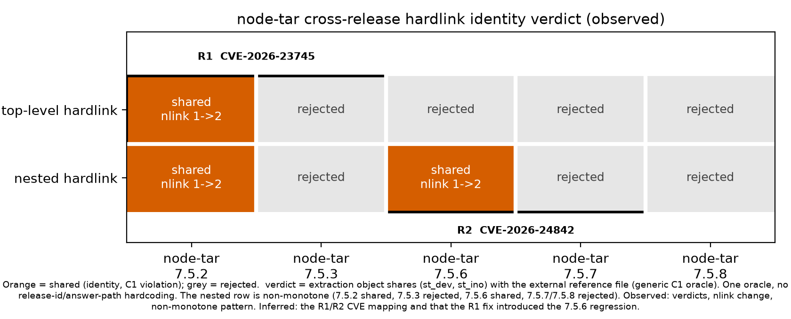

# InodeFence 결과보고서 (교내 학술대회 제출용 초안)

> **초안 안내 — 제출 전에 이 상자를 지운다.**
>
> - **서식과 제출 요건.** 서식 9와 제출 요건은 학교 붙임 원문에서 확인했다(HWP+PDF, 사진 포함 5장 내외, 영상 5분 이내,
>   생성형 AI 사용 내역 기입). 서식 칸별 본문은 [서식 본문](capstone-report-form-body.md)이고, 이 문서는 그 원재료인 긴 판이다.
> - **일정.** 팀은 결과보고서·영상 제출 준비 완료를 2026-11-26으로 운영한다. 공식 결과물 기한은 2026-11-30이다.
> - **주장 규칙.** 주장 문장은 단일 주장 목록 [claims-evidence-status-v1](../sections/claims-evidence-status-v1.md)의
>   "쓸 수 있는 말" 범위 안에서만 쓰고, 문장이나 문단 끝에 주장 ID(`[C-M2]` 등)를 붙인다. 근거 경로·증거 수준·용도 제한은
>   그 표의 같은 ID 행에 있다. ID가 없는 문장은 배경·정의·절차·행정 내용이다.
> - **본실험 결과 자리.** EXP-3 train과 EXP-2 holdout의 결과가 들어갈 곳은 `본실험 결과 자리(봉인 해제 뒤 기입)`로 둔다.
> - **표·그림 요구 사항**은 [표·그림 요구 목록](results-artifact-requirements.md)에 있다.

| 항목 | 내용 |
| --- | --- |
| 과제명 | InodeFence: 파일시스템 보안 상태를 피드백으로 쓰는 TAR 추출 경계위반 탐색 프로토타입 |
| 팀명·학과·학번·지도교수 | `[사람]` (제출 서식에서 기입) |
| 역할 | 지웅: Core·Integration / 주언: Feedback·Evaluation / 규민: Runtime·Target / 민찬: Observation·Oracle·Demo |
| 저장소 공개 범위 | `[사람]` (외부 공개는 사람 승인 사항) |

## 1. 요약

InodeFence는 TAR 아카이브 추출 과정의 보안 경계위반을 탐색하는 연구 프로토타입이다. 판정과 피드백에 CVE 식별자·PoC·고정
공격 패턴·대상 경로·sentinel 이름을 넣지 않고, 추출 결과의 파일시스템 보안 상태(외부 객체와의 identity 공유, 보호 대상
sentinel의 변화)를 관찰해 쓴다. 피해 경로 이름은 위협 모델 전제로 어휘에 포함하므로 blind 발견은 주장하지 않는다.

지금까지 확인한 것은 다음과 같다.

1. 실제 node-tar에서 입력 생성부터 다음 변이 선택까지의 루프가 `make demo` 한 명령으로 반복 실행된다. [C-M1]
2. 판정기 하나가 node-tar 5개 릴리스와 고정 입력 2개의 통제 차분에서 서로 다른 두 결함을 구분한다. 통제 재현이며 퍼저의
   탐색 결과가 아니다. [C-M2]
3. 같은 판정기를 코드 변경 없이 다른 추출기 3개에 어댑터로 적용했다. 퍼저 탐색의 일반성이나 효과에 대한 주장이 아니다. [C-M4a]
4. 세 방식이 같은 어휘·같은 예산을 쓰는 비교를 결과를 보기 전에 동결했고(2026-11-13), train과 holdout을 나눴다. [C-DESIGN]

**이 보고서는 핵심 연구 질문에 아직 답하지 않는다.** H-A는 등록 실험으로 판정하며 지금은 미검증이다. [C-HA]
본실험 결과는 §7.10의 `본실험 결과 자리(봉인 해제 뒤 기입)`에 둔다.

## 2. 연구 배경과 필요성

TAR 추출은 공격자가 제어하는 입력이 신뢰 경계를 넘어 파일시스템에 객체를 만들고 연결하는 통로다. 하드링크와
심볼릭 링크, entry 순서, 링크 타깃이 결합되면 추출된 객체가 추출 디렉터리 밖 객체와 같은 `(st_dev, st_ino)`를
공유하거나 보호 대상 외부 객체를 바꿀 수 있다. 서로 다른 경로가 같은 객체를 가리킬 수 있으므로, 경로 문자열만
검사하면 이런 identity 관계를 놓칠 수 있다. 추출 라이브러리의 경계 처리는 릴리스마다 고쳐지거나 다시 바뀔 수 있으므로,
특정 취약점 번호가 아닌 일반 규칙으로 릴리스마다 다시 검사할 도구가 필요하다.

## 3. 연구 목표와 연구 질문

**핵심 연구 질문(H-A).** 피해 경로 이름을 아는 동일 어휘·동일 예산 아래서, 파일시스템 보안 상태(C1 identity·C2 effect)를
retention·스케줄링 피드백으로 쓰는 탐색(S-u)이 무작위 탐색(R)과 구조 커버리지 탐색(D)보다 첫 경계위반까지의 실행 수를
줄이는가? 이 질문은 등록 실험으로 판정하며 지금은 미검증이다. [C-HA]

**위협 모델 전제.** 공격자는 피해 경로 이름을 안다고 가정하고 그 이름을 세 방식의 어휘에 똑같이 넣는다. 따라서 이
연구는 blind 발견을 주장하지 않는다. 참신성은 확정된 사실이 아니라 검증 대상 가설로 둔다.

## 4. 위협 모델과 판정 기준

대상은 고정 버전의 TAR extractor이고 공격면은 공격자가 제어하는 아카이브 바이트다. 실제 host의 민감 파일은 대상으로
쓰지 않으며, disposable sandbox 안의 sentinel만 쓴다.

| 계약 | 이름 | 위반 후보 조건 |
| --- | --- | --- |
| C0 | Path Boundary Confinement | 추출 루트 밖 경로에서 생성·삭제·identity/type 교체가 생김 (기준선, 이 연구의 기여로 주장하지 않음) |
| C1 | Object Identity Confinement | 추출 내부 객체가 보호된 외부 sentinel과 같은 `(st_dev, st_ino)`를 공유함 |
| C2 | External Effect Noninterference | 보호된 sentinel의 존재·종류·inode·내용·크기·mode·nlink·uid/gid·mtime/ctime이 바뀜 |

판정기의 위반 판정은 후보다. 확정 취약점으로 보려면 재현과 root-cause 검토가 따로 필요하다. 판정 조건에는 CVE
식별자, 릴리스 번호, 정답 경로를 넣지 않는다. 정의는 [security-contracts](../../docs/research/design/security-contracts.md)와
[threat-model](../../docs/research/design/threat-model.md)을 따른다.

## 5. 시스템 설계와 구현

한 testcase는 다음 순서로 흐른다.

```text
Seed Generator -> Structure Mutator -> TAR Builder -> Target Adapter
  -> State Observer -> Security Oracle -> Feedback / Corpus -> 다음 mutation
```

- **generic 부분**(mutator, observer, oracle, feedback)은 대상 extractor를 모르도록 나눴다. Observer는 관찰 사실을 기록하고,
  Oracle은 그 기록에 계약을 적용하도록 설계했다.
- **target 부분**(adapter, worker, recipe)에 extractor별 실행 방법을 두었다. node-tar는 격리된 컨테이너에서 실행한다.
- **피드백**은 관찰된 상태의 정규화 키를 받아 새 상태나 새 위반이면 입력을 corpus에 남기고 다음 변이의 바탕으로 쓴다.
  새 상태 키의 수는 탐색 거동이며 효과의 척도가 아니다.

상세 설계는 [§4 Method](../sections/05-method.md)에 있다.

## 6. 실험 설계

세 방식(R 무작위, D 구조 커버리지, S-u 상태 피드백)이 같은 어휘와 같은 예산을 쓰도록 설계했다. S-u의 경계 키는 특정 패턴이나 경로를 담지 않지만 결함 계열 수준의 사전 지식이고, D는 구조 커버리지 유도 퍼징의 대리이며 코드 커버리지 기준선이 아니다. 가설·방식·표본 수·분석·
판정표는 결과를 보기 전에 Git에 동결했다(2026-11-13, 동결 커밋 `72de299`). train(7.5.2, 탐색)과 holdout(7.4.4, 확증)을
나눴고, 결과는 해제 기록 전까지 가린다. 표본 수는 동결 전 위험도 파일럿(§7.7)을 보고 정했고, holdout seed는 9026–9185(N=160)이다. [C-DESIGN]

동결 전에 등록을 고친 내용(예측 문장, 판정표의 비기각 행, N 결정 규칙, 범위 문구, 동결일 정의)은 등록 실행을 시작하기 전의 개정이며 사전등록 변경 이력(exp2-v1 §8)에 공개돼 있다. 그 가운데 2026-11-13 개정은 팀 책임자의 결정으로 동결일 정의를 "선행 조건 완료 + 검증 24 h"에서 "선행 조건 완료 + 독립 검증 완료"로, N 규칙의 날짜 조건 "동결이 2026-11-14이고"를 "동결이 2026-11-14 이전(당일 포함)이고"로 바꿨다. 옛 문구대로 그날 동결했다면 N=120이었고, 이 개정으로 N=160이 유지됐다. 근거는 등록된 일정 조건이며 결과 정보는 쓰지 않았다. [C-DESIGN]
등록 파일은 [exp3-v1](../../experiments/preregistration/exp3-v1.md)(train)과
[exp2-v1](../../experiments/preregistration/exp2-v1.md)(holdout)이다.

| 실험 | 목적 | 상태 |
| --- | --- | --- |
| EXP-0 | 인프라 측정. 가설 판정 아님 | 등록 실행 완료 [C-EXP0] |
| 위험도 파일럿 | 표본 수 산정 입력(비등록, 탐색) | 실행 완료 [C-PILOT] |
| holdout 릴리스 선정 점검 | 후보 5개의 고정 입력 상태 확인 | 실행 완료, 7.4.4 선정 [C-HOSEL] |
| 측정 사슬 양성·음성 대조 | 판정기·측정 경로 확인(비등록) | 실행 완료 [C-PC] |
| 호스트 적격성·교차 호스트 비교 | 참여 호스트 기준 충족 확인 | 두 호스트 통과 [C-INFRA] |
| EXP-3 train | 7.5.2, 탐색. GO 판정 입력 | 실행 완료, GO [C-GO] |
| EXP-2 holdout | 7.4.4, H-A 확증 | 실행 중, 결과 봉인 [C-HA] |

## 7. 결과

증거 수준 어휘(TESTED 등)는 [Capability Ledger](../../docs/STATUS.md)를 따른다. observed는 실행 출력으로 확인한 것,
inferred는 관찰에서 끌어낸 해석이다.

### 7.1 루프 동작 (M1, TESTED)

실제 node-tar에서 입력 생성 → 실행 → entry별 중간 상태 관찰 → C0/C1/C2 판정 → 피드백 → 다음 변이 선택의 루프가 한
명령(`make demo`)으로 반복 실행된다. 루프가 돈다는 것까지이며 탐색 효과의 근거가 아니다. [C-M1]

### 7.2 릴리스 간 통제 재현 (M2, TESTED)

릴리스 번호나 정답 경로를 판정 조건에 넣지 않은 identity 판정기 하나가, node-tar 5개 릴리스(7.5.2·7.5.3·7.5.6·7.5.7·7.5.8)와
고정 입력 2개의 통제 차분에서 서로 다른 두 결함(CVE-2026-23745, CVE-2026-24842)을 구분한다. 판정 결과는 observed이고
릴리스별 원인 서술은 inferred다. 사람이 만든 고정 입력의 통제 재현이며 퍼저의 탐색 결과가 아니다. [C-M2]



*그림 7-1. 릴리스별 판정(통제 재현). [C-M2]*

### 7.3 회귀 검사 명령 (TESTED)

`make regression TAR_VERSION=<x>` 한 명령으로, 알려진 경계 고정 입력이 그 릴리스에서 아직 C1/C2를 내는지 확인할 수 있다.
고정 입력 회귀 확인이며 탐색 성능의 근거가 아니다. [C-REG]

### 7.4 다른 추출기 적용 (M4, 판정기·어댑터 수준)

같은 판정기를 코드 변경 없이 다른 추출기 3개(python-tarfile, oras-go, decompress)에 어댑터로 적용했고, 각 통제 차분에서
영향 쪽은 위반, 대조 쪽은 비위반으로 판정했다. python-tarfile은 같은 라이브러리의 추출 필터 설정(`fully_trusted` 대 `data`)
토글 비교이고, oras-go(v2.6.1 대 v2.6.2)와 decompress(4.2.1 대 유지보수 포크 11.1.4)는 릴리스 비교다. 이 둘은 실제 추출기의 동작을 프로브로 관찰한 기록이 있고, 저장소 테스트의 판정은 그 사후 상태를 일회용 샌드박스에서 재현한 것에 내린 판정이다. 판정기·어댑터 수준의
주장이며 퍼저 탐색의 일반성이나 효과에 대한 주장이 아니다. [C-M4a]

같은 방식의 고정 입력 프로브를 Rust `tar` 0.4.35와 0.4.36에도 적용했다. 생성 스크립트가 아직 main에 없어 감사 이후 기록으로만 쓴다. [C-RUST]

### 7.5 측정 사슬 점검 (holdout 선정, 양성·음성 대조)

holdout 릴리스를 정하려고 후보 5개(7.0.1·7.1.0·7.2.0·7.3.0·7.4.4)에 고정 입력 5개를 한 번씩 실행해 상태를 확인했고, 규칙에
따라 7.4.4를 골랐다. 다섯 후보 모두 하드링크 입력 2개는 위반, symlink 입력 3개는 통과, 오류 0이다. 이 고정 입력 5개로는 7.0–7.4 후보를
서로 구분할 수 없고, 7.4.4는 가장 높은 버전을 고르는 규칙으로 정했다. 판정기·측정 사슬의 근거로만 쓰며 탐색 성능의 근거가 아니다. [C-HOSEL]

측정 사슬의 양성·음성 대조를 했다. 등록 실행과 같은 캠페인 경로로 7.5.2에서 S-u 1셀(seed 8002, 실행 2000)을 돌려 HOST1에서
위반 사건을 기록했다(첫 사건 step 685, 계약 C2). HOST2도 같은 값이다. 등록 실행 경로 밖에서 돌린 고정 입력 1개는 7.5.2와 7.4.4에서 C1·C2 위반으로, 수정 릴리스 7.5.3에서는
거부·비위반으로 판정됐다. 측정 사슬의 근거로만 쓰며 탐색 성능의 근거가 아니다. [C-PC]

### 7.6 EXP-0 등록 실행: 인프라 측정

등록 실행 EXP-0은 15셀(R·D·S-u × seed 9001–9005, 캠페인당 실행 200)이 모두 유효했고 abort 0, 경계위반 사건 0이었다. 가설을
판정하지 않는다. 사건 0은 그 예산에서 관찰되지 않았다는 뜻이며 방식 비교의 근거가 아니다. [C-EXP0]

### 7.7 동결 전 위험도 파일럿 (비등록, 탐색)

비등록 위험도 파일럿(7.5.2, 40 캠페인, 캠페인당 실행 2000)에서 네 방식 모두 첫 C1∨C2 사건이 있었고, 신뢰구간이 크게 겹쳐 방식의 순서를 말할 수 없다(R-walk 1/10,
R-restart 4/10, D 4/10, S-u 6/10). abort는 11/40이다. 이 값은 표본 수 산정, R 변형 선택(D6), 사전등록 예측의 개정에 썼다. [C-PILOT]

### 7.8 EXP-3 train과 GO 판정

EXP-3 train이 끝난 뒤 등록 규칙을 기계적으로 적용해 GO를 냈다(2026-11-13 23:37:16 KST). 세 방식을 합친 첫 C1∨C2 캠페인 수 31
(기준 1 이상), 처리 용량 554(기준 76 이상), 인프라 실패 비율 .033(기준 .45 이하)이다. 합산값이며 방식별 값은 봉인돼 있고,
효과의 근거가 아니다. [C-GO]

### 7.9 재현성 인프라와 운영 기록

원자료 출력의 SHA-256 매니페스트, 요약이 원자료까지 닿는지 검사하는 증거 사슬 점검(`make check`에 연결), 표 생성기와 커밋된
표의 바이트 대조, 호스트 적격성 검증(호스트별 12 캠페인, 두 호스트 통과)과 교차 호스트 비교(공통 셀 12개 중 12개 일치)를
갖췄다. 적격성은 그 호스트·실행 SHA `bed077a`·동시 실행 2·캠페인당 실행 2000·12 캠페인 조건에서 기준을 충족했다는 뜻이다. [C-INFRA]

운영 사실로, EXP-3 train 중 HOST2 인프라 정지 1회(2026-11-13, 원인 기록 #366 뒤 재개, 정지에 걸린 2셀은 재실행하지 않음)와
EXP-2 holdout 중 HOST2 인프라 정지 1회(2026-11-14, 원인 기록 #370 머지로 재개 승인)가 있었다. 확인된 직접 원인은 Docker Desktop API
무응답이고 근본 원인은 확인하지 못했다. [C-OPS]

### 7.10 본실험 결과

| 자리 | 내용 |
| --- | --- |
| EXP-3 train(7.5.2) 방식별 결과(탐색, S-TRAIN) | 본실험 결과 자리(봉인 해제 뒤 기입) |
| EXP-2 holdout(7.4.4) 확증 판정(H-A, S-HOLDOUT) | 본실험 결과 자리(봉인 해제 뒤 기입) |

결과 문장은 해제 기록 뒤 사전등록 판정표의 문장으로만 채운다. 해제 전에 방향이나 크기를 쓰지 않는다. [C-HA]

## 8. 한계

- **핵심 RQ 미판정.** H-A는 등록 실험으로 판정하며 지금은 미검증이다. 피드백의 효과에 대해 어떤 주장도 하지 않는다. [C-HA]
- **탐색 난이도.** 현재 변이 문법에서 경계위반 입력은 seed에서 변이 1회 거리에 있다. [C-LIM1]
- **확증 범위.** 확증 범위는 node-tar 한 계보(train 7.5.2, holdout 7.4.4)와 하드링크 identity 공유 계열이다. holdout 7.4.4는
  고정 입력에서 train과 같은 계열의 위반을 내는 릴리스다. [C-LIM2]
- **통제 재현과 적용 범위.** 릴리스 간 통제 재현은 사람이 만든 고정 입력이다. [C-M2] 추출기 적용은 판정기·어댑터 수준이다. [C-M4a]
- **판정의 범위.** snapshot 기반 판정기는 중간 변화, transient 생성 후 삭제, 외부 경로 직접 사용을 복구하지 못한다.
  `violated=False`는 관찰 범위에서 위반 증거가 없다는 뜻이지 안전 증명이 아니다.
- **운영.** 두 실험 중 HOST2 인프라 정지가 한 번씩 있었고 근본 원인은 확인하지 못했다. [C-OPS]

## 9. 결론과 향후 계획

현재 방어하는 명제는 좁다. 루프가 실제 node-tar에서 반복 실행되고 [C-M1], 하나의 generic identity 판정기가 통제 차분에서
두 결함을 릴리스 번호 없이 구분하며 [C-M2], 판정기는 어댑터 수준에서 다른 추출기 3개에 적용된다 [C-M4a]. 피드백 정책의 효과는
아직 판정하지 않았다. [C-HA]

**결론 자리.** 본실험 결과 자리(봉인 해제 뒤 기입)

| 다음 단계 | 내부 일정 |
| --- | --- |
| EXP-2 holdout 종료 | 실행 마감 11/25 12:00 KST |
| 해제 기록 PR과 결과 칸 기입 | holdout 종료 뒤 |
| 결과보고서·영상 제출 준비 완료 | 11/26 (공식 기한 11/30) |

## 10. 선행연구와의 관계

TAR fuzzing, hardlink·symlink 공격, entry 순서, 파일 상태 기반 fuzzing은 선행연구가 이미 다뤘다. 이 연구는 그 영역 자체를
기여로 주장하지 않으며, 선행연구 대비 우선권도 주장하지 않는다. 포지셔닝은
[related-work-positioning](../../docs/research/design/related-work-positioning.md)과 [§3](../sections/04-related-work.md)을 따른다.

- Jana & Shmatikov, "Abusing File Processing in Malware Detectors for Fun and Profit", IEEE S&P 2012: TAR를 포함한 file-processing semantic gap.
- ZIPDiff, "My ZIP isn't your ZIP", USENIX Security 2025: feedback-guided archive differential testing.
- LinkZard, "Pig in a Poke", USENIX Security 2025: link 상태를 포함한 feedback-driven file-state fuzzing.
- Wormholes, "Wormholes in the File System", USENIX Security 2026: archive extraction의 symlink·hardlink 조합과 생성 순서.

## 11. 생성형 AI 사용 내역

> 서식의 기입 항목과 대조 필요(UNVERIFIED). 정량 값은 제출 직전 기준 SHA로 다시 집계한다.

| 항목 | 내용 |
| --- | --- |
| 도구 | Claude Code (Anthropic Claude 코딩 에이전트) |
| 사용 범위 | 코드 작성, 분석 스크립트, 실험 실행 보조, 문서 작성. 이 보고서 초안도 에이전트 세션이 작성했고 사람 검토 전이다 |
| 검토 방식 | 브랜치 → PR → CI → 검토(verifier 또는 사람) → 머지. 머지는 사람이 수행한다 |
| 변경 불가 경계 | 안전경계, 격리, 판정기 정의, 사전등록 동결 값은 에이전트가 임의로 바꾸지 않는다 |
| 정량 (main `909aec6` 기준, 2026-11-13 집계, 제출 직전 재집계) | 전체 513 커밋 중 161 커밋이 Claude를 co-author로 명시(`git rev-list --count`, `git log --grep='Co-Authored-By: Claude'`) |
| 증거 규율 | 에이전트가 낸 수치는 원자료와 요약으로 추적될 때만 보고한다 |

## 12. 재현 방법

| 무엇을 | 명령 | 주장 |
| --- | --- | --- |
| 실제 node-tar 루프 | `make demo` | C-M1 |
| 릴리스 간 통제 재현 | `python3 experiments/repro/cross_release_identity.py --out <dir>` | C-M2 |
| 고정 입력 회귀 검사 | `make regression TAR_VERSION=<x>` | C-REG |
| 원자료 무결성 | `python3 scripts/make_raw_manifest.py --verify <manifest> --root <raw 폴더>` | C-INFRA |

명령별 기대 출력과 현재 main에서의 재검증 기록은 정리 단계 D에서 채운다.
