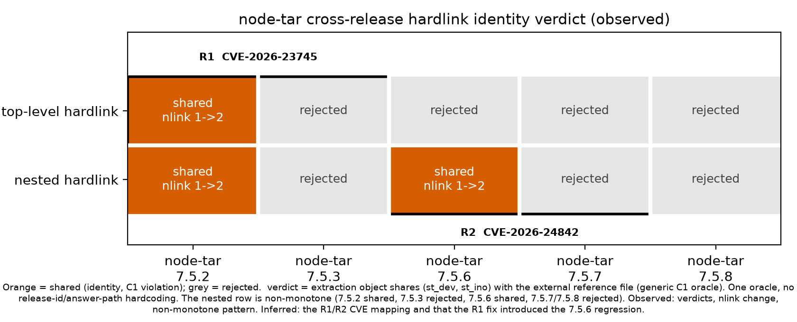
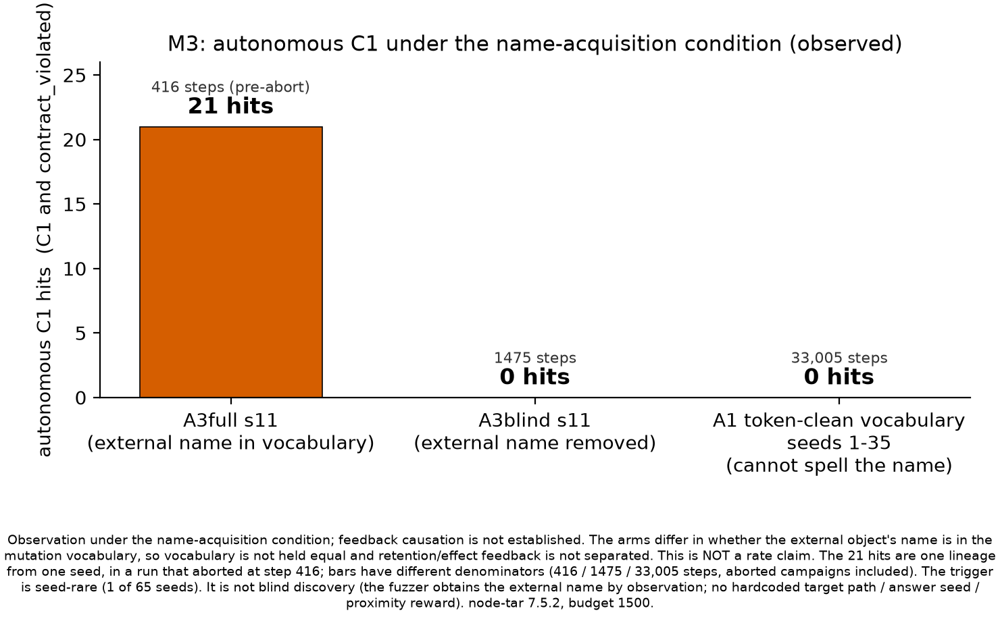

# 5. Results (드래프트 v1)

이 절의 모든 수치는 증거 사슬(raw → validated summary → finding)로 추적 가능하며, 능력 판정의
단일 기준은 Capability Ledger([`../../docs/STATUS.md`](../../docs/STATUS.md))다. 주장↔증거 매핑은
[`claims-evidence-status-v1.md`](claims-evidence-status-v1.md)를 본다. observed(실행 출력으로 확인)와
inferred(추론)를 소절마다 구분한다.

## 5.1 M1 — 루프가 실제 node-tar에서 돈다 (TESTED)

`make demo`(호스트, 실제 node-tar 7.5.22)는 입력 생성 → 실행 → entry별 중간 상태 관찰 →
C0/C1/C2 oracle → feedback → 다음 mutation 루프를 한 바퀴 20 step 돌린다. 반복 실행해도 같은
루프이고(SAME_LOOP), macOS/OrbStack과 WSL2 x86_64 두 플랫폼에서 동일 루프가 재현됐다(observed).

- 결과 JSON의 step마다 `trace`(entry별 중간 상태, observed/derived 구분), `oracle`(C0/C1/C2),
  `selection`(corpus 편입 여부 · operator 가중치 변화)이 남는다(observed).
- 정상 입력 20개에서 **위반 0건**이며, 이 소절은 취약점 발견·재발견을 주장하지 않는다.
- 중단 내성(끝난 step이 보존됨)과 producer 견고성(조용한 exit 0 → failed 프레임/lifecycle 기록)은
  별도로 TESTED다(Ledger 1–6행).

증거 수준은 **TESTED**(지정된 한계 안의 engineering 증거)이며 research effectiveness를 뜻하지 않는다.

## 5.2 M2 — 실제 경계위반 통제 재현 + 2-CVE 차분 (observed)

손으로 만든 결정론적 하드링크 fixture(외부 참조파일 대상, 추출 디렉터리를 벗어나는 동일 상대
경로)를 **5개 고정 node-tar 릴리스**(7.5.2 / 7.5.3 / 7.5.6 / 7.5.7 / 7.5.8)에 돌려, "추출된 객체가
외부 참조파일의 `(st_dev, st_ino)`를 공유하는가"라는 **generic C1 관찰**로 판정했다. 릴리스 id나
정답 경로를 판정 조건에 넣지 않았다. 전체 표는 [M2 cross-release 증거표](../tables/m2-cross-release-evidence.md),
raw는 [`../../experiments/repro/evidence/summary.json`](../../experiments/repro/evidence/summary.json),
검증 요약은 [cross-release-identity-repro-v1](../../experiments/summaries/cross-release-identity-repro-v1.md)다.

*그림 1 — 릴리스별 verdict(observed). 데이터 [표 M2](../tables/m2-cross-release-evidence.md),
생성 소스 [`../figures/render_m2_cross_release.py`](../figures/render_m2_cross_release.py).*

**Finding (observed).** 하나의 generic identity oracle(추출 객체↔외부 참조파일 inode 공유 = C1,
참조파일 전후 metadata 변화 = C2)이 서로 다른 **두 root-cause**를 포착한다.

- **R1 = CVE-2026-23745** (catalog N01): linkpath sanitation 누락. 최상위 하드링크가 7.5.2에서
  공유(nlink 1→2)되고 7.5.3에서 거부되는 전환으로 재현.
- **R2 = CVE-2026-24842** (catalog N02, GHSA-34x7-hfp2-rc4v): 검증 base ≠ 생성 base의 check/use
  mismatch 회귀이며, R1 수정이 도입한 것으로 **추론**한다(아래 inferred). 중첩 하드링크가 7.5.6에서 공유되고 7.5.7에서 거부되는
  전환으로 재현.

관찰된 공유 분포는 **비단조**(중첩: 7.5.2 공유 · 7.5.3 거부 · 7.5.6 공유 · 7.5.7/7.5.8 거부)로,
7.5.3에서 거부된 입력이 7.5.6에서 다시 공유되고 7.5.7에서 다시 거부됨을 보인다.

- **observed:** 5×2 verdict 표, nlink 전이, 거부 메시지, 비단조 분포.
- **inferred:** 특정 CVE↔fixture 대응과 "7.5.6 회귀가 R1 수정이 도입한 것"이라는 인과 서술.
  advisory 범위(24842 `<7.5.7`)와 이 **특정** fixture의 observed 거동은 다를 수 있어 **exact 하한은
  미검증**이다.
- **production-path 일치(M2.2):** 손 probe 판정 == production Observer+Oracle 판정 일치를 additive
  테스트로 고정했다([`../../tests/test_cross_release_oracle_agreement.py`](../../tests/test_cross_release_oracle_agreement.py),
  native closure는 [`../../tests/container_integration/check_cross_release_oracle_agreement.py`](../../tests/container_integration/check_cross_release_oracle_agreement.py)).

**정직 경계:** 이것은 **통제 재현**이지 **퍼저 자력 발견이 아니다**(자력 발견은 §5.3). fixture는
손으로 만든 generic 하드링크 엔트리이고, 하드링크·링크 상태 관찰·버전 차분 자체는 선행연구
(§3)가 다루므로 신규 기여로 표현하지 않는다.

## 5.3 M3 — 퍼저가 자력으로 위반을 찾는다: 이름 획득 조건의 관찰(피드백 인과는 미입증)

영향 릴리스 node-tar 7.5.2(budget 1500)에서 **외부 객체 이름을 mutation 어휘에 획득한 arm(A3full)에서
경계위반의 자율 트리거가 관찰됐다**. 전체 대조표는 [M3 어휘 제거 대조표](../tables/m3-blind-ablation.md),
그림 사양은 [m3-blind-ablation-figure-spec](../figures/m3-blind-ablation-figure-spec.md), 검증 요약은
[node-self-discovery-mechanism-v1](../../experiments/summaries/node-self-discovery-mechanism-v1.md)다
(Ledger M3 / PR #151, merge d44d903).

*그림 2 — 어휘 제거 대조(observed; 이름 획득 조건 대조이지 피드백 인과·rate 아님). 데이터 [표 M3](../tables/m3-blind-ablation.md),
생성 소스 [`../figures/render_m3_blind_ablation.py`](../figures/render_m3_blind_ablation.py).*

### 5.3.1 관찰된 수치 (observed, raw step 로그 재집계)

hit의 정의는 **step에서 `oracle.C1` AND `feedback.contract_violated`가 모두 참**이다.

| 셀 | seeds | 기록 step 수 | 자율 C1 hit |
| --- | --- | --- | --- |
| A3full s11 (state-aware) | 11 | 416 (abort 전) | **21** (모두 C1·C2·contract_violated 동시) |
| A3blind s11 (어휘 제거 대조) | 11 | 1475 | **0** |
| A1 random floor | 1–35 (35개) | 33,005 | **0** |
| A3full scale study | 1–35 (35개) | 41,494 | **s11만 21** (그 외 전 seed 0) |
| A3full 재현 | 36–65 (30개) | 34,585 | **0/30** |

**분모·lineage 주석(2026-11-03 감사 raw 재집계, observed).** 위 표의 분모는 abort된 campaign을 포함한다:
A1 random floor seed 35 = 완주 19/abort 16, A3full scale study seed 35 = 완주 24/abort 11, A3full 재현 30 =
완주 18/abort 12이며, A3blind 대조는 6셀 7,983 step이다. s11의 21 hit는 21개 distinct case_id이지만
**1 lineage**(독립 루트 0-based idx 263 + 자손 20, 부모 7)이고, 고유 C1 fingerprint는 2개
(`extract/archive/sentinel.txt/b/b`, `extract/dir/a.txt` ↔ `outside/sentinel.txt`) + C2 1개로 모두 링크 타깃
`../outside/sentinel.txt`다. 또한 `m3-repro` A3full-s60에는 C2=True·C1=False·contract_violated=True인 step
14개(rejected run, sentinel ctime 변화·nlink 불변)가 있으나 hit 정의(C1 ∧ contract_violated) 밖이라 표에 없다.

s11 run은 step 416에서 evidence-integrity 검사로 abort(returncode 1)하지만, 21건의 hit는 **abort
이전**에 기록된 step이다(producer abort-drain이 거부된 외부-하드링크 시도를 valid trace로 관찰).
따라서 process returncode 1을 "발견 없음"으로 읽지 않는다.

### 5.3.2 관찰된 조건 차이와 정직 경계

**관찰된 조건 차이(observed):** 자율 C1은 **BEFORE snapshot의 EXTERNAL 이름을 mutation 어휘에 넣은
A3full s11에서만** 관찰됐고(21), 그 이름을 뺀 A3blind s11은 1475 step에도 0, generic 어휘로 이름을 철자할 수
없는 A1(generic 어휘, effect retention)은 33,005 step에도 0이었다. 즉 **EXTERNAL 이름을 어휘에 넣은 A3full에서만 관찰됐고,
이름을 뺀 A3blind·철자 불가 A1에서는 미관찰**이다. (이 드래프트 v1은 이를 "feedback(identity 관찰)이 발견을
가능케 한다 — 없으면 도달 불가"라는 인과 확정으로 적었으나, 아래 2026-11-03 정정대로 그 해석은 철회한다.)

**2026-11-03 정정(해석; 위 수치·서술은 보존).** 위 어휘 제거 대조는 **피드백이 아니라 어휘**를 통제한 실험이다.
A3full은 BEFORE snapshot에서 관찰한 EXTERNAL 이름을 mutation 어휘에 넣고, A3blind는 그 이름을 빼며, A1은
generic 어휘 7토큰(`src/inodefence/mutator/m1.py`의 `COMPONENTS`, `m1_addressing.py` 주석)이라 대상 이름을
철자할 수 없다. 따라서 21/0/0이 보인 것은 **"외부 객체 이름을 어휘에 넣은 조건에서 자율 C1이 관찰됐고 그 조건 밖에서는 관찰되지 않았다"**(구조적 불가로 단정하지 않는다)이지,
(st_dev, st_ino) 기반 retention·스케줄링 피드백이 발견에 기여했다는 것이 아니다. 그 기여는 어휘를 맞춘 비교
(R/D/S, [research-questions v2](../../docs/research/design/research-questions.md) H-A)로 아직 분리되지 않았고,
어휘를 맞춘 기존 비교(§5.3.4 item-3 A/B/C/D, M4.8)는 C≡D·위반 0이다. §5.3 제목·§5.3.2·§5.3.3의 결론 문장은
이 기준으로 통일했다(s101·s118 역시 관찰 이름을 어휘에 넣은 A3full이다).

**정직 경계(엄수, inferred/열린 항목):**

- **현재 결론(통일 문장).** 기존 실험은 외부 객체 이름을 mutation 어휘에 획득한 조건에서 경계위반이 관찰되었음을 보여준다. 동일 어휘로 통제하지 않았으므로 inode/effect retention 피드백 자체의 인과적 기여는 아직 입증되지 않았다.
- **blind 발견이 아니다.** 기존 외부 객체에 하드링크하려면 그 이름이 필요하고 퍼저는 그것을
  **관찰**로 얻는다. oracle·feedback에 대상 경로·식별자·정답 seed·근접 보상을 넣지 않았고
  EXTERNAL 필터는 region 기준 target-agnostic이다. 다만 state-aware mutation 어휘 계열이
  `outside`/`sentinel.txt` 토큰을 포함할 수 있으므로, 어떤 rediscovery 프레이밍에서도 "blind 아님"을
  명시한다. *(구: "어휘·oracle에 … 하드코딩하지 않았고", 2026-11-06 범위 정정)*
- **seed-rare.** s11은 동일 seed에서 결정론적으로 재현(21건)되지만, budget 1500·65 seed 중 자율
  C1을 내는 seed는 s11 하나뿐이다(재현 0/30). 이 예산에서 다른 seed로 일반화되지 않는다.
- **rate 우위가 아니다.** 이 소절의 주장은 **이름 획득 조건에서의 관찰**이지 "상태-인지 feedback이
  무작위보다 빠르다/많이 찾는다"가 아니다(§5.3.3).

### 5.3.3 rate 우위 판정 — 사전등록 판정: CI 미분리(검정력 부족)

동일 budget·신규 disjoint seed 매칭 대조로 **rate 우위**(상태-인지 feedback이 무작위보다 더
빨리/많이 C1을 찾는가)를 사전등록 후 판정했다([powered verdict](../../experiments/summaries/m3-powered-matched-verdict-v1.md)).

- **설정(사전등록, 실행 전 고정):** A1 random floor(기존 셀 이름; generic 어휘, effect retention; 이름 철자 불가) vs A3full state-aware, node-tar 7.5.2 frozen
  overlay, **동일 budget 2000**, 기존 전부와 disjoint한 seed {100..119}(20개). hit = 한 step에서
  `oracle.C1 && feedback.contract_violated`(clean exact C1). rate 주장은 Wilson 95% CI 분리를
  요구한다(점추정 차이는 rate 아님, EN-008).
- **결과(observed):** A3full은 완주 10 campaign 중 **1 complete hit** — 신규 disjoint seed **s101**에서
  clean exact C1(1-based 실행 1720/2000) + s118이 abort 전 65건 관찰(observed-trigger, complete hit
  아님). A1은 완주 12 campaign 중 **0 complete hit**. 매칭 대조 Wilson 95% CI: A3full 1/10
  **[0.018, 0.404]** vs A1 0/12 **[0, 0.242]** → **겹침**(`complete_hit_wilson_intervals_separate=False`).
- **v2 pooled 판정(canonical, #200; observed):** 사전선언 연장 {120..129}를 풀링한 {100..129}(30 매칭 seed)가
  현재 canonical 수치다 — A1 0/19 Wilson **[0, 0.1682]**, A3full 1/17 **[0.0105, 0.2698]**, 여전히 겹침
  ([verdict v2](../../experiments/summaries/m3-powered-matched-verdict-v2.md)). 연장분은 양 arm 완주 7/abort 3에
  hit·observed-trigger 0으로 전부 null이었다. **미등록 연장 {130..149}**(launcher 2026-11-02 01:18 시작, LOG
  사전등록 없음)는 A1 20셀 완주 8/abort 12·29,180 step·hit 0, A3full 12셀(130–141) 완주 3/abort 9·13,057 step·
  hit 0(142–149 미실행, s138은 1872에서 중단)으로 관찰됐고 verdict에 **미포함**이다. 포함해도 {100..149}
  A1 0/27 [0, 0.1246]·A3full 1/20 [0.0089, 0.2361]로 방향은 불변이다. s101의 유일한 완주 hit는
  trace_termination=rejected·trace_completeness=invalid·feedback_eligible=False·observation_failures 4인 run의
  **post-state** C1+C2(하드링크 `/a/dir`→`../outside/sentinel.txt`가 뒤 entry 거부 전에 생성·잔존,
  unique_violation_fingerprints 0)다 — 여기서 "clean"은 hit 술어(`oracle.C1 && contract_violated`)를 뜻하며
  clean trace가 아니다.
- **판정:** 완주 clean-C1 rate 점추정은 identity feedback 쪽(0.059 vs 0.00)이나 **매칭 Wilson 구간이
  겹쳐 rate 우위는 CI로 분리되지 않는다** — ~0.06 효과에 대해 이 예산·seed 수로는 검정력이 부족하다.
  rate 우위는 여전히 **미입증**이며 이 논문의 주 주장이 아니다.
- **이름 획득 조건에서의 자율 트리거가 신규 seed(s101·s118)에서도 관찰됐다(인과 강화 아님).** §5.3.2의 자율
  트리거는 budget 1500·seed 1–65에서 s11 하나였으나, 이 powered 런은 **기존과 disjoint한 새 seed s101**(완주
  C1)과 s118(observed-trigger)에서 같은 조건(EXTERNAL 이름을 어휘에 넣은 A3full)의 자율 C1을 재현했다. 즉
  관찰은 단일 seed 아티팩트가 아니라 **여러 disjoint seed에서 반복**되지만, 동일 어휘 통제가 없으므로 피드백
  인과의 강화는 아니다. CI 분리된 rate 주장은 어휘 동등 R/D/S 비교(EXP-3)가 필요하다.

### 5.3.4 (보조·탐색적) item-3 단일경로 A/B/C/D 중간상태 거동

effect-path에서 A/B/C/D 4 arm(§4.4)의 **중간상태 boundary-attempt 거동**을 측정했다(AFFECTED
node-tar 7.5.2, budget 1000; de-censored PASS 2). **gradient(C/D) > random(A) > structure(B)**가
3개 짝 seed에서 일관되고, **identity-state(C) ≡ coverage(D)**가 4/4 짝 seed에서 operationally
identical(동일 case_id 시퀀스·operator weights·boundary-attempt step)이었다. terminal C1은 **0/21**
(Wilson 95% CI [0, 0.155]).

- 이것은 **search behavior**(탐색 거동)이지 **effectiveness 랭킹이 아니다**(EN-008). 중간상태 키 수를
  effectiveness 결론으로 옮기지 않는다.
- C≡D는 **범위 한정 negative**다: escape-hardlink 문법에서는 external LINK=hardlink escape라
  external-resolve rung이 boundary-attempt와 중복되어 C의 추가 rung이 scheduling을 바꾸지 못한다.
  이 타깃·문법의 중복이지 identity-state 일반 무의미가 아니다(다른 문법에선 갈릴 수 있음).

## 5.4 M4 — 일반성 (oracle/adapter 수준)

### 5.4.1 동일 generic oracle의 3-extractor 적용 (일부 TESTED)

**동일 generic C0/C1/C2 oracle(코드 불변)**이 adapter 수준에서 3개 독립 extractor에 target-agnostic
하게 적용됨을 통제 reference 차분(affected/fixed digest-pinned)과 container-integration 체크로 보였다.
target 로직은 adapter/worker/recipe에 격리되고 generic 모듈은 불변이다.

- **python-tarfile (JS 아님, stdlib):** C1 하드링크 fixture를 Python tarfile로 돌려 `fully_trusted`
  (영향) = 외부 sentinel inode 공유로 production oracle이 C1+C2 발화, `data`(PEP 706 완화) = 거부·
  위반 0([`../../tests/test_python_tarfile_generality.py`](../../tests/test_python_tarfile_generality.py) 4 passed).
- **oras-go (Go) · decompress (JS):** 동일 generic oracle로 affected/fixed 통제 reference 차분 +
  container-integration generality 체크 통과(#176 · #177).

이는 oracle의 **target-agnostic성 증거**이며 **node-tar 결과·fuzzer 자력 발견·effectiveness 주장이
아니다.**

### 5.4.2 2번째 extractor 자력발견 native run — right-censored 음성 (observed)

decompress를 effect 캠페인 퍼즈 타깃으로 연결하는 루프를 구현(sanctioned
`inodefence-boundary-attempt-v1` frame #179 + generic C0/C1/C2 oracle 불변)하고 native run을
실행했다(사전등록 ef585f7). decompress의 ordered per-op trace는 격리경계 내 infeasible로 확정돼
feasible set-based frame 채널을 쓴다(node-tar의 ordered per-op보다 좁음; #179 observed).

- **실행 설정(observed):** 실제 decompress 4.2.1 AFFECTED, production backend(컨트롤러 내 non-root
  Linux, 격리계약·완화 플래그 0), budget 200 × seed 11 × 2 arm(A3 state-aware + A1(generic 어휘, 관찰 이름 조합 없음; 양 arm 같은 피드백 루프, 기존 라벨 'A1 random')).
- **결과(observed):** **양 arm 0 C1/C2 (right-censored 음성).** 루프는 2번째 extractor에서 기능
  작동한다(실제 decompress frame 관찰, boundary-attempt 키 A3 11 / A1 8, rejected 141 vs 103,
  feedback 조향) 그러나 exact 경계위반에 미도달.
- **inferred:** exact 자력발견은 budget/seed-rare(node-tar M3와 정합 — budget 100=0, 자율 트리거는
  budget 1500+특정 seed). arm 차분(A3 11 > A1 8)은 1-seed라 검정력이 없다(EN-008, rate/effectiveness
  아님) → autoloop 7.1상 당시 **미판정**이었고, §5.4.3에서 사후 분석 기준으로 다룬다.

### 5.4.3 decompress powered 판정 — 사후 분석 기준 음성(사전등록 판정 아님)

M4.4의 검정력 없는 음성을 더 큰 사전고정 예산·복수 seed로 독립 반복해 판정했다. 맥(arm64)과
윈도우(x86_64) 두 아키텍처에서 각각 실행한 결과를 right-censored로 합산한
[통합 verdict](../../experiments/summaries/m4-5-decompress-selfdiscover-unified-v1.md)다.

- **설정(사전등록):** 실제 decompress 4.2.1 AFFECTED, production backend(격리계약·완화 플래그 0),
  A1(generic 어휘, 관찰 이름 조합 없음; 양 arm 같은 피드백 루프, 기존 라벨 'A1 random') vs A3 state-aware. 윈도우 seed {500..509}, 맥 seed {11,85,163,211,307,401}(교집합 ∅).
  **등록된 hit 정의는 `discovered_violation`(any step `contract_violated`, C0 포함)이다. C1/C2 by_contract
  분리와 pooled 0/28 합산은 결과가 들어온 뒤 도입된 사후 분석(post-hoc) 축으로, 사전등록에 없다**
  (근거: [통합 verdict](../../experiments/summaries/m4-5-decompress-selfdiscover-unified-v1.md) 「정의 변경 기록」).
- **결과(observed):** 양 arm **C1/C2 0/14**(Wilson 95% CI [0, 0.215]), 맥+윈도우 pooled
  **0/28 (Wilson 95% CI ≤ 0.121)**. 이는 **사후 분석(post-hoc by_contract) 기준 음성이며 사전등록 판정이 아니다**
  (등록 정의로 세면 완주 19 중 16이 C0 자력도달으로 hit; 수치·oracle 로직은 불변). C0(path-boundary)는
  **12/14** 자력도달하나 arm 우위는 없다(C0은 identity 관찰 불요). 교차-arch 바이트동일은 주장하지 않는다.
- **판정:** 2번째 extractor에서 자력발견 루프는 **기능 작동**하고 path-boundary(C0)를 자력도달하나,
  identity/effect 경계위반(C1/C2)은 이 예산에서 미도달이다(node-tar M3 seed-rare와 정합). 이는
  **generality(oracle/adapter)≠self-discovery(루프 작동)≠effectiveness(발견)**의 구분을 지킨 음성
  결과이며 effectiveness 주장이 아니다.

### 5.4.4 3번째 extractor (oras-go) 자력발견 native run — right-censored 음성 (observed)

oras-go(Go, compiled 3rd-party)를 effect 캠페인 퍼즈 타깃으로 연결해 native run을 실행했다
([M4.7 요약](../../experiments/summaries/m4-7-oras-go-selfdiscover-v1.md)). compiled 바이너리라
link call interpose가 불가해 post-extraction 상태 SET 채널에서 `inodefence-boundary-attempt-v1`
frame을 파생한다(decompress의 fs-wrap보다 좁다).

- **설정(사전등록):** 실제 oras-go v2.6.1 AFFECTED, production backend(격리 완화 0), budget 200 ×
  seed 11 × 2 arm(A3/A1).
- **결과(observed):** 양 arm **C0/C1/C2 0/1**(Wilson 95% CI [0, 0.793]) = right-censored 음성.
  compiled 채널이라 attempt-key가 양 arm 0이고 arm 우위도 없다. budget 200·1 seed라 **검정력이
  약한** 음성이다(과대주장 없음).
- **판정:** 3번째 독립 extractor에서도 자력발견 effectiveness는 음성이다. generality=oracle/adapter
  수준(§5.4.1)이며 self-discovery 루프는 작동하나 발견은 미도달.

## 5.5 Capability Ledger 요약

M1–M4의 능력과 증거 수준을 한눈에 보는 요약은 [Capability Ledger 요약표](../tables/capability-ledger-summary.md)에
두며, 단일 기준은 [`../../docs/STATUS.md`](../../docs/STATUS.md)다.

## 5.6 EXP-0 / EXP-3 결과 (EXP-0 완료 · EXP-3 실험 전 TBD)

이 소절은 §4.6 실험 설계(계획)의 실행 결과 자리다. EXP-0 등록 실행은 완료됐고 핵심 수치를 아래에 적는다. EXP-3 본실험은 실행
전이므로 EXP-3 표·그림은 **TBD**이며, 사전등록 잠금 뒤 생성기 출력으로 채운다.

**EXP-0 등록 실행 (registered run · 인프라 측정 · 가설 검정 아님).** 2026-11-05에 사전등록 v2.1로 등록한 실행이다. 대상은
node-tar 7.5.2, 설계는 seed 9001–9005 × {R, D, S-u}, budget 200, sentinel k=3(생성기 seed 고정 무작위 이름, 전 arm·seed 공통)이다(15셀,
3000 실행). H-A 검정도 효과 주장도 아니며, 이 숫자로 arm을 비교하지 않는다. 값의 기준과 재현 명령은 공식 리포트 [exp0-20261105-report](../../experiments/summaries/exp0-20261105-report.md)(#268)다.

- **완주.** 15/15, abort 0, invalid 셀 0. 셀 판정과 별개로 trace가 invalid인 step 11개와 failed step 10개가 있다(리포트 편차 2).
- **위반 hit.** C1/C2 전 arm 0(C0 관측도 0, arm마다 5/5 우측중도절단 @200). hit 0은 hazard 0이 아니다. 캠페인 단위 rule-of-three 참고 상한은 .6(n=5)이고 판정 입력이 아니다.
- **p95 full-step.** 기록값 1.549 s, 실시간 환산 1.419 s.[^exp0-clock]
- **처리량.** 호스트 집계 약 4760 exec/h(jobs 2, 실제 경과에서 직접 계산).[^exp0-clock]
- **편차.** 사전등록 대비 편차 11건은 리포트 §3에 공개했다. 측정 4(per-case 대 워커 풀 처리량 비교)는 미충족이다(편차 3).

> **주의(budget 2000 표기 구분):** 이 §5.6의 EXP-3(20 seed × budget 2000)은 **계획**이며 아직 미실행이다(규모는 D7, 재판정
> 대기(파일럿 후)).
> §5.3.3의 M3.3 powered(동일 budget 2000, seed {100..129})는 이미 **수행**된 결과로 매칭 Wilson CI가 미분리
> (검정력 부족)인 **음성**이다 — 둘은 다른 실험·다른 seed이며, §5.6의 자리를 §5.3.3 결과로 읽지 않는다.

- **표.** EXP-0 인프라·dense 신호 요약 — `analyze_exp0` report.json **item1~7 전부**(전부 분모 병기):
  item1 abort(사유 × arm) · item2 p95 full-step · item3 처리량(exec/h) · item4 per-case vs 워커풀 parity ·
  item5 첫 C0/C1/C2 · T_first(우측중도절단; abort 민감도 **3정책** `item5.sensitivity` — exclude · censor-at-budget, #243) ·
  item6 dense 신호 · item7 hazard proxy. **item2·item3·item4·item7은 '참고값' 라벨**(effectiveness·판정 입력 아님).
  arm×abort 독립성(꼭지 13 validity, 레인 3 optional)은 번호 없는 `arm_abort_independence` 키(#242)로 보고 —
  사전등록 **측정 item8 = raw SHA-256 체크섬 목록**과 번호 충돌을 피한다(체크섬은 report.json 밖 manifest).
  생성 경로: `scripts/analyze_exp0.py` → `report.json` →
  `paper/figures/render_exp0_survival.py` → `paper/tables/exp0-summary.md`. — **EXP-0 값의 기준은 위 공식 리포트다. EXP-3 표는
  TBD.**
- **그림.** arm별 결합 T_first(C1 ∨ C2) Kaplan–Meier 생존곡선(중도절단 tick). 생성 경로:
  `scripts/analyze_exp0.py` → `report.json` → `paper/figures/render_exp0_survival.py` → `exp0-survival.png`.
  — **EXP-0은 전 arm 사건 0(공식 리포트 측정 5)이다. EXP-3 그림은 TBD.**

**EXP-3 결과는 타깃 역할(`role`)별로 분리 보고한다** *(이 문단은 #239 초안 기준이다. holdout의 실험 배정은 D1, 7.5.6/7.5.7 캠페인 여부는 D3이며 재판정 대기(파일럿 후))*(#239·#246 용어 동일, 역할 간 풀링 없음): `train`(node-tar
7.5.2) = 1차 **탐색**(R/D/S-u 생존 비교) · `fix-verification`(7.5.6/7.5.7) = 등록 역할 `role=fix-verification` ·
`hypothesis=H-A` · `exposure=pre-exposed`의 **기노출 수정 검증 쌍**(M2 cross-release 통제 재현
[cross-release-identity-repro-v1](../../experiments/summaries/cross-release-identity-repro-v1.md)으로 이미 실행됨;
확증 아님) · `holdout`(sweep 밖) = **확증(confirmatory)**. 그 쌍의 근거는 고정 손 fixture 관찰(observed)뿐이다 —
**7.5.6은 nested 하드링크 identity 공유(affected, R2)**, 7.5.7은 고정 fixture 2종(toplevel·nested) 모두 거부.
따라서 7.5.6에 hit 0을 기대하지 않으며, 캠페인 조건의 hit 수는 두 타깃 모두 사전 예측하지 않는다(7.5.7의 '거부'는
고정 fixture 2종 범위의 관찰일 뿐 퍼징 캠페인 hit 0의 근거가 아니다). 각 역할의 결과는 섞지 않고 타깃별 표로
제시한다.

**판정 절차(사전등록 규칙의 기계 적용).** 판정은 EXP-0이 아니라 **EXP-3 결과**에 11/18 사전등록된
GO/NO-GO 규칙과 §4.6.4 판정 시나리오 ①–⑧(research-questions v2)을 **기계적으로** 적용해 결정한다.
규칙·지표·분모는 결과를 본 뒤 바꾸지 않는다. EXP-0의 hit 수는 검정력 x 산정에 쓰지 않으며, zero-hit은
NO-GO 사유가 아니다(사전등록 v2 (a)·(d)). *(규칙과 일정은 D7·D11·D12, 재판정 대기(파일럿 후))*

**EXP-0 seed 사전 노출 공개 (결과 아님 — 도구 검증).** EXP-0 사전등록 seed 중 9001–9004는 동결 전 비등록 실행에 이미
노출됐다. 이 호스트 raw 기준으로 seed 9001은 10런(G1 smoke 3, G1 completion 3, parity 확인 `s3wp` 3, 타이밍 대조 1)이고
9002–9004는 G1 smoke 각 3런이다. v2.1 사전 노출 절은 seed 9001의 4런만 공개해 6런이 빠졌고, 노출 원장은 7런을 기록해
`s3wp` 3런이 빠졌다(공식 리포트 편차 9). 이 실행들의 출력은 **결과가 아니며 논문 표·결론에 쓰지 않는다**.
이 중 G1 smoke는 통합 브랜치 `4b072a5`(image `sha256:22c8734f…`, node-tar 7.5.2), seed 9001–9004 × budget 50에서
**12/12 완주(abort 0, arm 간 어휘 동등 true)**했고, 그중 **D arm s9002의 exec 42에서 generic oracle C2 이벤트
1건**(u_viol 1; hardlink `a.txt` → `../outside/sentinel.txt` 뒤 regular `a.txt`)이 관찰됐다 — 출처 PR #223
(`claude/s3-exp0-launcher`) LOG + 호스트 `~/inodefence-evidence/g1-20261104/smoke/summaries/index.json`
(sha256 `26235b44…`, [raw-manifest-win-20261104-1421](../../experiments/summaries/raw-manifest-win-20261104-1421.sha256) 71행). 이는 사전등록 판정이 아니라 도구 검증 관측이므로
**해석하지 않는다**. smoke는 sentinel 설정과 budget이 등록 실행과 달라 등록 결과와 비교하지 않는다. 사전 노출된 seed로 얻은 EXP-0/EXP-3 결과의 독립성 해석상 한계는 §6.7에 둔다.

[^exp0-clock]: evidence: `experiments/summaries/exp0-20261105-report.md` 편차 1. 기록값은 monotonic clock 기준이고, EXP-0 당시 이 호스트의 monotonic clock은 실시간보다 1.091배 빠르게 갔다(합산 1.0914, 셀별 1.0855~1.0964; EXP-0 전용 배율). 다른 실행에서는 이 배율이 1.00~1.10으로 변했다([파일럿 결과 메모](../../experiments/summaries/exp3-hazard-pilot-v1-result.md) §5). p95 환산값 1.419 s는 셀 안에서 배율이 일정하다고 가정한다. 셀 안 변동은 측정하지 않았고, EXP-0 셀은 짧고 셀별 범위가 좁아 영향은 작을 것으로 본다(추론). 환산값은 실시간 기준이며 실시간 시계의 장기 편차는 검증 중이다. 호스트 집계 처리량은 배율 환산이 아니라 실제 경과에서 직접 계산했다(셀 구간 4763, 해시 고정 타임스탬프 4758 exec/h). T_first와 hazard proxy는 실행 수로 세므로 시계와 무관하다.
