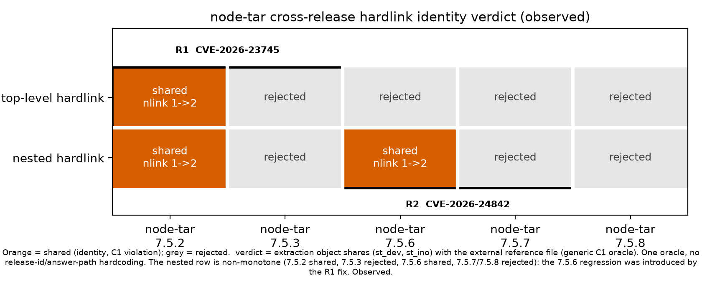
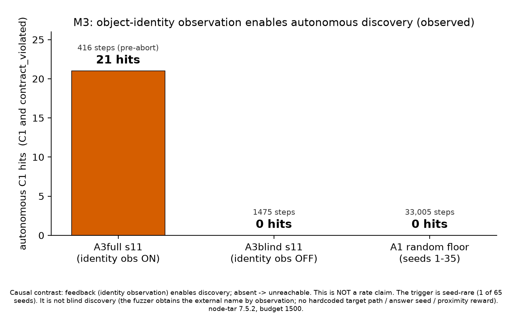

# 5. Results (드래프트 v1)

이 절의 모든 수치는 증거 사슬(raw → validated summary → finding)로 추적 가능하며, 능력 판정의
단일 기준은 Capability Ledger([`../../docs/STATUS.md`](../../docs/STATUS.md))다. 주장↔증거 매핑은
[`claims-evidence-status-v1.md`](claims-evidence-status-v1.md)를 본다. observed(실행 출력으로 확인)와
inferred(추론)를 소절마다 구분한다.

## 5.1 M1 — 루프가 실제 node-tar에서 돈다 (TESTED)

`make demo`(호스트, 실제 node-tar 7.5.22)는 입력 생성 → 실행 → entry별 중간 상태 관찰 →
C0/C1/C2 oracle → feedback → 다음 mutation 루프를 한 바퀴 20 step 돌린다. 반복 실행해도 같은
루프이고(SAME_LOOP), macOS/OrbStack과 WSL2 x86_64 두 플랫폼에서 동일 루프가 재현됐다(observed).

- 결과 JSON의 step마다 `trace`(entry별 중간 상태, observed/derived 구분), `oracle`(C0/C1/C2),
  `selection`(corpus 편입 여부 · operator 가중치 변화)이 남는다(observed).
- 정상 입력 20개에서 **위반 0건**이며, 이 소절은 취약점 발견·재발견을 주장하지 않는다.
- 중단 내성(끝난 step이 보존됨)과 producer 견고성(조용한 exit 0 → failed 프레임/lifecycle 기록)은
  별도로 TESTED다(Ledger 1–6행).

증거 수준은 **TESTED**(지정된 한계 안의 engineering 증거)이며 research effectiveness를 뜻하지 않는다.

## 5.2 M2 — 실제 경계위반 통제 재현 + 2-CVE 차분 (observed)

손으로 만든 결정론적 하드링크 fixture(외부 참조파일 대상, 추출 디렉터리를 벗어나는 동일 상대
경로)를 **5개 고정 node-tar 릴리스**(7.5.2 / 7.5.3 / 7.5.6 / 7.5.7 / 7.5.8)에 돌려, "추출된 객체가
외부 참조파일의 `(st_dev, st_ino)`를 공유하는가"라는 **generic C1 관찰**로 판정했다. 릴리스 id나
정답 경로를 판정 조건에 넣지 않았다. 전체 표는 [M2 cross-release 증거표](../tables/m2-cross-release-evidence.md),
raw는 [`../../experiments/repro/evidence/summary.json`](../../experiments/repro/evidence/summary.json),
검증 요약은 [cross-release-identity-repro-v1](../../experiments/summaries/cross-release-identity-repro-v1.md)다.

*그림 1 — 릴리스별 verdict(observed). 데이터 [표 M2](../tables/m2-cross-release-evidence.md),
생성 소스 [`../figures/render_m2_cross_release.py`](../figures/render_m2_cross_release.py).*

**Finding (observed).** 하나의 generic identity oracle(추출 객체↔외부 참조파일 inode 공유 = C1,
참조파일 전후 metadata 변화 = C2)이 서로 다른 **두 root-cause**를 포착한다.

- **R1 = CVE-2026-23745** (catalog N01): linkpath sanitation 누락. 최상위 하드링크가 7.5.2에서
  공유(nlink 1→2)되고 7.5.3에서 거부되는 전환으로 재현.
- **R2 = CVE-2026-24842** (catalog N02, GHSA-34x7-hfp2-rc4v): 검증 base ≠ 생성 base의 check/use
  mismatch 회귀로, **R1 수정이 도입**했다. 중첩 하드링크가 7.5.6에서 공유되고 7.5.7에서 거부되는
  전환으로 재현.

관찰된 공유 분포는 **비단조**(중첩: 7.5.2 공유 · 7.5.3 거부 · 7.5.6 공유 · 7.5.7/7.5.8 거부)로,
7.5.3이 닫은 경로를 7.5.6이 되돌렸고 7.5.7이 다시 닫았음을 보인다.

- **observed:** 5×2 verdict 표, nlink 전이, 거부 메시지, 비단조 분포.
- **inferred:** 특정 CVE↔fixture 대응과 "7.5.6 회귀가 R1 수정이 도입한 것"이라는 인과 서술.
  advisory 범위(24842 `<7.5.7`)와 이 **특정** fixture의 observed 거동은 다를 수 있어 **exact 하한은
  미검증**이다.
- **production-path 일치(M2.2):** 손 probe 판정 == production Observer+Oracle 판정 일치를 additive
  테스트로 고정했다([`../../tests/test_cross_release_oracle_agreement.py`](../../tests/test_cross_release_oracle_agreement.py),
  native closure는 [`../../tests/container_integration/check_cross_release_oracle_agreement.py`](../../tests/container_integration/check_cross_release_oracle_agreement.py)).

**정직 경계:** 이것은 **통제 재현**이지 **퍼저 자력 발견이 아니다**(자력 발견은 §5.3). fixture는
손으로 만든 generic 하드링크 엔트리이고, 하드링크·링크 상태 관찰·버전 차분 자체는 선행연구
(§3)가 다루므로 신규 기여로 표현하지 않는다.

## 5.3 M3 — 퍼저가 자력으로 위반을 찾는다: 메커니즘 인과 입증

영향 릴리스 node-tar 7.5.2(budget 1500)에서 **object-identity 관찰을 feedback으로 쓰는 state-aware
퍼징이 경계위반을 자율 트리거**한다. 전체 대조표는 [M3 blind-ablation 표](../tables/m3-blind-ablation.md),
그림 사양은 [m3-blind-ablation-figure-spec](../figures/m3-blind-ablation-figure-spec.md), 검증 요약은
[node-self-discovery-mechanism-v1](../../experiments/summaries/node-self-discovery-mechanism-v1.md)다
(Ledger M3 / PR #151, merge d44d903).

*그림 2 — blind-ablation 대조(observed; 인과이지 rate 아님). 데이터 [표 M3](../tables/m3-blind-ablation.md),
생성 소스 [`../figures/render_m3_blind_ablation.py`](../figures/render_m3_blind_ablation.py).*

### 5.3.1 관찰된 수치 (observed, raw step 로그 재집계)

hit의 정의는 **step에서 `oracle.C1` AND `feedback.contract_violated`가 모두 참**이다.

| 셀 | seeds | 기록 step 수 | 자율 C1 hit |
| --- | --- | --- | --- |
| A3full s11 (state-aware) | 11 | 416 (abort 전) | **21** (모두 C1·C2·contract_violated 동시) |
| A3blind s11 (identity-blind 대조) | 11 | 1475 | **0** |
| A1 random floor | 1–35 (35개) | 33,005 | **0** |
| A3full scale study | 1–35 (35개) | 41,494 | **s11만 21** (그 외 전 seed 0) |
| A3full 재현 | 36–65 (30개) | 34,585 | **0/30** |

s11 run은 step 416에서 evidence-integrity 검사로 abort(returncode 1)하지만, 21건의 hit는 **abort
이전**에 기록된 step이다(producer abort-drain이 거부된 외부-하드링크 시도를 valid trace로 관찰).
따라서 process returncode 1을 "발견 없음"으로 읽지 않는다.

### 5.3.2 인과 해석과 정직 경계

**인과(주 주장, observed):** 발견의 원인은 **object-identity 관찰**이다 — blind 대조(관찰 이름에서
EXTERNAL region 제외)의 A3blind s11은 1475 step에도 0, 무작위 바닥 A1은 33,005 step에도 0,
state-aware A3full s11만 21. 즉 **"feedback(identity 관찰)이 발견을 가능케 한다 — 없으면 도달
불가."** 이것은 가설이 명시한 feedback이 실제로 발견을 구동함을 blind 대조로 확정한 것이다.

**정직 경계(엄수, inferred/열린 항목):**

- **blind 발견이 아니다.** 기존 외부 객체에 하드링크하려면 그 이름이 필요하고 퍼저는 그것을
  **관찰**로 얻는다. 어휘·oracle에 대상 경로·식별자·정답 seed·근접 보상을 하드코딩하지 않았고
  EXTERNAL 필터는 region 기준 target-agnostic이다. 다만 state-aware mutation 어휘 계열이
  `outside`/`sentinel.txt` 토큰을 포함할 수 있으므로, 어떤 rediscovery 프레이밍에서도 "blind 아님"을
  명시한다.
- **seed-rare.** s11은 동일 seed에서 결정론적으로 재현(21건)되지만, budget 1500·65 seed 중 자율
  C1을 내는 seed는 s11 하나뿐이다(재현 0/30). 이 예산에서 다른 seed로 일반화되지 않는다.
- **rate 우위가 아니다.** 이 소절의 주장은 **인과**("feedback이 발견을 가능케 함")이지 "상태-인지
  feedback이 무작위보다 빠르다/많이 찾는다"가 아니다(§5.3.3).

### 5.3.3 rate 우위 판정 — PENDING

동일 budget·seed 매칭 대조로 **rate 우위**(상태-인지 feedback이 무작위보다 더 빨리/많이 C1을
찾는가)를 판정하는 작업이 진행 중이다.

- **지금까지 observed (인과 대조, rate 아님):** A1 random control은 budget 2000에서 clean exact C1
  **0/12 seed**(완주 7 seed 0/7, Wilson 95% CI [0, 0.354]; 5 seed는 fail-closed abort로 denominator
  제외, 각 abort 전 0 observed; 총 ~20,163 exec). effect-path A3full은 budget 1500에서 s11=21.
  이 둘은 **random floor=0 vs feedback s11=21의 인과 대조**일 뿐이며, **budget이 다르고(2000 vs
  1500) CI가 넓어 rate 판정이 아니다.**
- **PENDING — powered run 진행 중, 결과 후속 PR에서 채움.** 동일 budget(2000)에서 **powered matched
  A1 vs A3full** 독립 반복(네이티브 런)이 아직 끝나지 않았다. 들어갈 지표 자리: matched seed별
  executions-to-first-C1(right-censored), clean exact C1 hit 수/denominator, arm별 Wilson 95% CI,
  A3full vs A1 대조의 effect size. **네이티브 런이 끝나지 않았으므로 이 수치를 추측해 적지 않는다.**

### 5.3.4 (보조·탐색적) item-3 단일경로 A/B/C/D 중간상태 거동

effect-path에서 A/B/C/D 4 arm(§4.4)의 **중간상태 boundary-attempt 거동**을 측정했다(AFFECTED
node-tar 7.5.2, budget 1000; de-censored PASS 2). **gradient(C/D) > random(A) > structure(B)**가
3개 짝 seed에서 일관되고, **identity-state(C) ≡ coverage(D)**가 4/4 짝 seed에서 operationally
identical(동일 case_id 시퀀스·operator weights·boundary-attempt step)이었다. terminal C1은 **0/21**
(Wilson 95% CI [0, 0.155]).

- 이것은 **search behavior**(탐색 거동)이지 **effectiveness 랭킹이 아니다**(EN-008). 중간상태 키 수를
  effectiveness 결론으로 옮기지 않는다.
- C≡D는 **범위 한정 negative**다: escape-hardlink 문법에서는 external LINK=hardlink escape라
  external-resolve rung이 boundary-attempt와 중복되어 C의 추가 rung이 scheduling을 바꾸지 못한다.
  이 타깃·문법의 중복이지 identity-state 일반 무의미가 아니다(다른 문법에선 갈릴 수 있음).

## 5.4 M4 — 일반성 (oracle/adapter 수준)

### 5.4.1 동일 generic oracle의 3-extractor 적용 (일부 TESTED)

**동일 generic C0/C1/C2 oracle(코드 불변)**이 adapter 수준에서 3개 독립 extractor에 target-agnostic
하게 적용됨을 통제 reference 차분(affected/fixed digest-pinned)과 container-integration 체크로 보였다.
target 로직은 adapter/worker/recipe에 격리되고 generic 모듈은 불변이다.

- **python-tarfile (JS 아님, stdlib):** C1 하드링크 fixture를 Python tarfile로 돌려 `fully_trusted`
  (영향) = 외부 sentinel inode 공유로 production oracle이 C1+C2 발화, `data`(PEP 706 완화) = 거부·
  위반 0([`../../tests/test_python_tarfile_generality.py`](../../tests/test_python_tarfile_generality.py) 4 passed).
- **oras-go (Go) · decompress (JS):** 동일 generic oracle로 affected/fixed 통제 reference 차분 +
  container-integration generality 체크 통과(#176 · #177).

이는 oracle의 **target-agnostic성 증거**이며 **node-tar 결과·fuzzer 자력 발견·effectiveness 주장이
아니다.**

### 5.4.2 2번째 extractor 자력발견 native run — right-censored 음성 (observed)

decompress를 effect 캠페인 퍼즈 타깃으로 연결하는 루프를 구현(sanctioned
`inodefence-boundary-attempt-v1` frame #179 + generic C0/C1/C2 oracle 불변)하고 native run을
실행했다(사전등록 ef585f7). decompress의 ordered per-op trace는 격리경계 내 infeasible로 확정돼
feasible set-based frame 채널을 쓴다(node-tar의 ordered per-op보다 좁음; #179 observed).

- **실행 설정(observed):** 실제 decompress 4.2.1 AFFECTED, production backend(컨트롤러 내 non-root
  Linux, 격리계약·완화 플래그 0), budget 200 × seed 11 × 2 arm(A3 state-aware + A1 random).
- **결과(observed):** **양 arm 0 C1/C2 (right-censored 음성).** 루프는 2번째 extractor에서 기능
  작동한다(실제 decompress frame 관찰, boundary-attempt 키 A3 11 / A1 8, rejected 141 vs 103,
  feedback 조향) 그러나 exact 경계위반에 미도달.
- **inferred:** exact 자력발견은 budget/seed-rare(node-tar M3와 정합 — budget 100=0, 자율 트리거는
  budget 1500+특정 seed). arm 차분(A3 11 > A1 8)은 1-seed라 검정력이 없다(EN-008, rate/effectiveness
  아님) → autoloop 7.1상 **미판정**.

### 5.4.3 decompress powered 판정 — PENDING

- **PENDING — powered run 진행 중, 결과 후속 PR에서 채움.** M4.4가 검정력 없는 음성이므로, 더
  큰 사전고정 예산·복수 seed로 독립 반복해 양성/정직 음성을 검정력 있게 판정하는 run(M4.5)이
  진행 중이다. 들어갈 지표 자리: 사전등록 예산·seed, right-censored roll-up(Wilson 95% CI),
  A3 vs A1 대조, hit = generic C1/C2. **런이 끝나지 않았으므로 이 수치를 추측해 적지 않는다.**

## 5.5 Capability Ledger 요약

M1–M4의 능력과 증거 수준을 한눈에 보는 요약은 [Capability Ledger 요약표](../tables/capability-ledger-summary.md)에
두며, 단일 기준은 [`../../docs/STATUS.md`](../../docs/STATUS.md)다.
